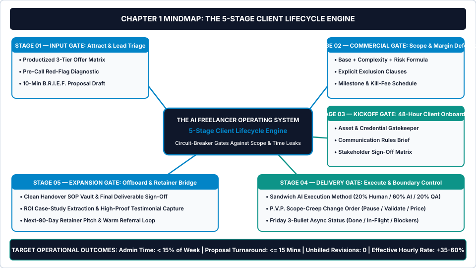
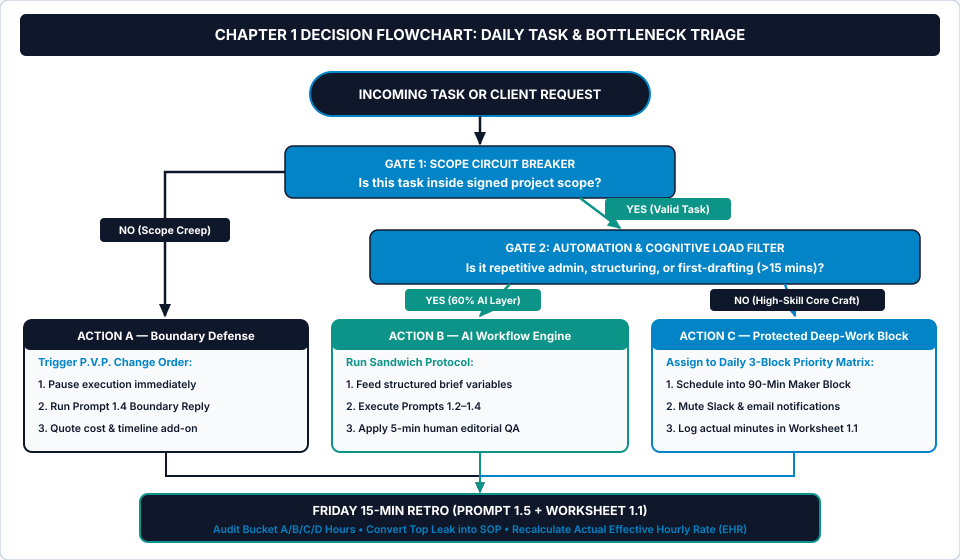

# Chapter 1: The Overwhelmed Freelancer’s Bottleneck (The 5-Stage Operating Model)

**How to Stop Trading Unbilled Nights and Weekends for Client Chaos, Plug the 40% Administrative Time Leak, and Install a Circuit-Breaker Operating System**

---

## 1. Learning Objectives

By the end of this chapter, you will be able to:

1. **Calculate your true Effective Hourly Rate (EHR)** by auditing all four weekly time buckets (`Bucket A: Core Billable Craft`, `Bucket B: Unbilled Client Friction`, `Bucket C: Sales & Proposal Overhead`, and `Bucket D: Internal Admin Debt`) using the *7-Day Time & Revenue Leak Audit*.
2. **Install the 5-Stage Client Lifecycle Engine** across your freelance business, replacing ad-hoc client reactions with five non-negotiable operational circuit-breaker gates (`Input Gate`, `Commercial Gate`, `Kickoff Gate`, `Delivery Gate`, and `Expansion Gate`).
3. **Deploy the Daily 3-Block Priority Architecture** (`90-Minute Maker Block`, `30-Minute AI Admin Sprint`, and `90-Minute Delivery & Pipeline Block`) alongside the *Daily Task & Bottleneck Triage Flowchart* to eliminate context switching.
4. **Execute five variable-driven AI workflow prompts (`Prompts 1.1–1.5`)** to audit weekly time leaks, extract repeatable standard operating procedures (SOPs) from messy project notes, structure daily deep-work blocks, defend scope boundaries in your inbox, and run a 15-minute Friday CEO retrospective.

---

## 2. The Real-World Friction Point

It is Thursday at 4:15 PM. You have been sitting at your desk since 8:30 AM, yet your primary billable deliverable for the day—a client homepage wireframe and conversion copy deck—remains only thirty percent complete.

Your browser holds twenty-seven open tabs. On your second monitor, Slack chimes with a "quick question" from a retainer client asking if you can resize four social banners and rewrite a landing page hero section before Friday morning. Neither task appears in your signed statement of work.

Meanwhile, two prospective leads who booked discovery calls earlier in the week are waiting in your inbox for custom proposals. A third client—whose project kicked off nine days ago—still has not sent their DNS credentials, brand typography files, or Stripe API keys, freezing your production calendar while they ask why the staging link is not live yet.

You do not have a skill problem. You have an operating system problem.

Most independent freelancers, consultants, virtual assistants, and boutique digital service providers enter self-employment because they excel at a core craft. Whether you build Webflow sites, design user interfaces, write direct-response copy, manage executive operations, or run paid acquisition campaigns, your technical output is high. Yet between Year 1 and Year 5—typically inside the `$2,000 to $8,000 per month` gross revenue band—growth hits an invisible ceiling.

Every new client adds exponential coordination overhead. Instead of earning more while working predictable hours, you work forty-five to fifty-five hours a week just to keep existing projects from slipping.

Consider the cold math of a typical Thursday in an unsystematized freelance practice. On paper, you quote clients a nominal rate of **`$65.00 per hour`** (or fixed-fee project packages calculated from a `$65.00/hour` baseline) targeting **`$4,000.00 per month`** (`$1,000.00 per week`) in gross revenue. You assume that earning `$1,000.00 per week` at `$65.00 per hour` requires roughly **15.4 hours** of focused client execution.

In reality, your calendar logs **45.0 total working hours** every week:

* **15.5 hours (`34.4%`):** Actual high-skill, billable client production (`Bucket A`).
* **11.5 hours (`25.6%`):** Unbilled revision rounds, informal Slack requests, chasing missing client passwords, and clarifying vague feedback (`Bucket B`).
* **10.0 hours (`22.2%`):** Writing custom proposals from scratch, holding unqualified discovery calls with budget-mismatched leads, and manually following up (`Bucket C`).
* **8.0 hours (`17.8%`):** Inbox sorting, manual invoice tracking, hunting for lost files across Google Drive, and rebuilding task lists (`Bucket D`).

Now apply the studio's foundational financial diagnostic formula:

$$\text{Actual Effective Hourly Rate (EHR)} = \frac{\text{Gross Weekly Revenue}}{\text{Total Real Working Hours (Buckets A + B + C + D)}}$$

When you divide **`$1,000.00`** in gross weekly revenue by **`45.0 real working hours`**, your `$65.00/hour` nominal rate collapses to an actual Effective Hourly Rate of **`$22.22 per hour`**.

Nearly **65.6% of your working week (`29.5 hours`)** produces zero direct billable return. You are subsidizing client disorganization and administrative friction with your own unpaid evenings and weekends. Raising your nominal rate on paper will not fix this leak if thirty hours of every week remain unguarded.

---

## 3. Why Standard Approaches Fail

When independent operators feel the squeeze of a `$22.22/hour` Effective Hourly Rate, they usually reach for one of three conventional fixes. All three fail because they add maintenance overhead without installing commercial or operational boundaries.

### 3.1 Failure Mode 1: The Bloated Template Trap
A frustrated freelancer buys an aesthetic, twenty-database Notion workspace or spends an entire weekend configuring a complex project management suite with color-coded tags, habit trackers, and multi-layered rollups. Within fourteen days, the workspace is abandoned.

Why? Because complex templates confuse *data entry* with *operational control*. When a system requires forty-five minutes of daily administrative upkeep just to keep task cards updated, the solo operator skips the updates the moment a client deadline tightens. An operating system for a one-person business must be minimalist. If a tracker cannot be updated in under three minutes a day, it becomes shelfware.

### 3.2 Failure Mode 2: The "Prompt Dump" Fallacy
Over the past two years, thousands of digital sellers have flooded the market with generic PDF lists titled *"500 ChatGPT Prompts for Freelancers."* A practitioner opens the file and finds one-sentence prompts such as: *"Write a professional proposal for a web design client."*

Running a one-line prompt produces generic, robotic corporate prose that immediately signals low status to a sophisticated buyer. Editing that synthetic output takes longer than writing the email from scratch. Real operational AI requires **structured variable slots**, **explicit commercial guardrails**, **contract clause alignment**, and a **human quality-assurance checklist**. Five battle-tested, variable-driven workflow prompts per stage outperform five hundred one-line novelties every day.

### 3.3 Failure Mode 3: Treating Symptoms as Isolated Events
Most freelance advice treats operational pain points as disconnected problems. You read one article about time blocking, another about raising prices, and a third about writing firmer emails.

In an active freelance business, however, downstream delivery chaos is almost always caused by an upstream gate failure:

* **Late-night revision marathons in Week 4** are not a design problem; they are caused by missing exclusion clauses at the **Commercial Gate (Stage 2)** and unstructured feedback collection at the **Delivery Gate (Stage 4)**.
* **Project timeline stalls in Week 2** are not a scheduling problem; they are caused by starting work before the **Kickoff Gate (Stage 3)** verified 100% of client assets and credentials.
* **Feast-or-famine income gaps in Month 3** are not a marketing mystery; they happen because projects end abruptly without an **Expansion Gate (Stage 5)** retainer pitch.

To reclaim twenty hours a week and double your Effective Hourly Rate, you cannot patch isolated leaks. You must install a sequential, five-stage circuit-breaker architecture across your entire client lifecycle.

---

## 4. Core Framework: The 5-Stage Client Lifecycle Engine

*The AI Freelancer Operating System* replaces reactive inbox management with **The 5-Stage Client Lifecycle Engine**. Instead of allowing leads and clients to pull you into unstructured conversations, every engagement must pass through five sequential operational gates.

Think of each stage as an electrical circuit breaker. If a lead or client fails to satisfy the entry criteria of a gate, work pauses automatically until the condition is met. You never advance a project to the next stage on verbal promises or goodwill alone.

### Visual Architecture: System Mindmap



As illustrated in [chapter-01-mindmap.svg](../../04-VISUAL-ASSETS/Mindmaps/chapter-01-mindmap.svg), the **5-Stage Client Lifecycle Engine** governs every client interaction from initial inquiry to post-project retainer expansion:

1. **Stage 01 — Input Gate (`Attract & Lead Triage`):** Eliminates custom discovery calls with unqualified prospects. You package your expertise into a **Productized 3-Tier Offer Matrix** (Chapter 2), score incoming inquiries through a **Pre-Call Red-Flag Diagnostic**, and generate a tailored three-option commercial proposal in under fifteen minutes using the **B.R.I.E.F. Proposal Protocol** (Chapter 3).
2. **Stage 02 — Commercial Gate (`Scope & Margin Defense`):** Eliminates underpricing and vague deliverables. Every project price is calculated using the **Base + Complexity + Risk Buffer (`B.C.R.`) Formula** (Chapter 4), backed by explicit out-of-scope exclusion clauses, revision caps, milestone payment triggers, and a contractual pause/kill fee.
3. **Stage 03 — Kickoff Gate (`48-Hour Client Onboarding`):** Eliminates the two-week asset stall. The production clock does not start when the contract is signed; it starts only after the **48-Hour Automated Kickoff Sequence** (Chapter 5) verifies that deposit funds have cleared, all brand/technical credentials are uploaded, and the **Communication Rules Brief** is signed.
4. **Stage 04 — Delivery Gate (`Execute & Boundary Control`):** Protects deep work and blocks unbilled scope creep. Core deliverables are produced using the **Sandwich AI Execution Protocol (`20% Human Brief ➔ 60% AI Heavy Lifting ➔ 20% Editorial QA`)** (Chapter 6). Out-of-scope requests trigger the **P.V.P. Change Order Protocol (`Pause ➔ Validate ➔ Price`)** (Chapter 7), while weekly **3-Bullet Async Status Updates** (Chapter 8) prevent revision loops.
5. **Stage 05 — Expansion Gate (`Offboard & Retainer Bridge`):** Eliminates the feast-or-famine revenue rollercoaster. Every completed project concludes with a structured **Handover SOP Vault**, a quantitative **ROI Case-Study & Testimonial Extraction**, and a **Next-90-Day Retainer Bridge Pitch** (Chapter 9), audited every Friday during the **20-Minute CEO Operating Cadence** (Chapter 10).

### Table 1.1: The 5-Stage Client Lifecycle Engine — Gate Specifications & Circuit-Breaker Rules

| Lifecycle Stage & Gate Name | Primary Operational Bottleneck Solved | Core System Framework Installed | Mandatory Circuit-Breaker Rule (When to Pause) | Target KPI Benchmark |
| :--- | :--- | :--- | :--- | :--- |
| **Stage 01: Input Gate**<br>*(Chapters 2 & 3)* | Unqualified discovery calls & 3-hour custom proposals | *3-Tier Productized Offer Matrix* + *B.R.I.E.F. Proposal Engine* | **Never book a live call** before lead completes 4-question intake & budget floor check. | Proposal drafting time **`<= 15 mins`**; Lead-to-close rate **`>= 35%`** |
| **Stage 02: Commercial Gate**<br>*(Chapter 4)* | Underpricing, scope ambiguity & 100% back-loaded payments | *Base + Complexity + Risk (`B.C.R.`) Pricing Formula* | **Never lock calendar dates** without signed scope exclusions & cleared upfront deposit (`50%`). | Gross project margin **`>= 70%`**; Upfront cash collected **`>= 50%`** |
| **Stage 03: Kickoff Gate**<br>*(Chapter 5)* | 14-day delays waiting on client logins, files & stakeholders | *48-Hour Automated Kickoff & Asset Gatekeeper Sequence* | **Never start delivery clock** until 100% of required credentials & files pass intake check. | Onboarding setup time **`<= 20 mins`**; Kickoff readiness **`<= 48 hrs`** |
| **Stage 04: Delivery Gate**<br>*(Chapters 6, 7 & 8)* | Unbilled Slack favors, endless revisions & context switching | *Sandwich AI Execution (20/60/20)* + *P.V.P. Change Order Protocol* | **Pause immediately** on any out-of-scope request; issue priced P.V.P. Change Order before executing. | Unbilled revision hours **`0.0 hrs/wk`**; Admin overhead **`< 15%`** |
| **Stage 05: Expansion Gate**<br>*(Chapters 9 & 10)* | Abrupt project endings & monthly revenue starts at `$0` | *Offboard-to-Retainer Bridge* + *20-Min Friday CEO Cadence* | **Never hand over final source files** before final milestone clears & 90-day retainer option is presented. | Repeat/Retainer revenue **`>= 40%`**; Effective Hourly Rate **`+35% to +60%`** |

---

## 5. Step-by-Step Implementation Protocol

Do not attempt to rebuild your entire freelance business in a single afternoon. Operational transformations stick when they are installed in a deterministic four-step sequence over seven business days.

### Step 1: Run the 7-Day Time & Revenue Leak Audit (Buckets A, B, C & D)
For the next seven days, stop guessing where your hours go. Log every thirty-minute working block into one of four strict operational buckets (recorded in **Worksheet 1.1** at the end of this chapter or inside the **Free Tier EHR Leak Calculator** in your Web Companion App):

* **Bucket A — Core Billable Craft (`Target: >= 65% of week`):** Direct, high-skill execution on signed, in-scope client deliverables (coding, designing, writing, consulting strategy, or system building).
* **Bucket B — Unbilled Client Friction (`Target: <= 5% of week`):** Unscoped revision rounds, answering ad-hoc client messages outside scheduled check-ins, hunting down missing client assets, and fixing errors caused by unclear briefs.
* **Bucket C — Sales & Proposal Overhead (`Target: <= 15% of week`):** Lead triage, discovery calls, proposal drafting, contract preparation, and pipeline follow-ups.
* **Bucket D — Internal Admin Debt (`Target: <= 15% of week`):** Invoicing, bookkeeping, organizing folders, updating task boards, and context-switching recovery.

At the end of Day 7, feed your raw time log into **Prompt 1.1** (*Weekly Time-Log & Unbilled Admin Leak Analyzer*). The prompt will calculate your baseline Effective Hourly Rate (`EHR`), quantify your exact monthly dollar leak, and rank the top three recurring bottlenecks draining your calendar.

### Step 2: Install the Daily 3-Block Priority Architecture
Context switching between deep creative craft and reactive inbox administration destroys cognitive output. Research on programmer and creator schedules demonstrates that a single fifteen-minute Slack interruption inside a ninety-minute production window destroys up to forty-five minutes of deep focus.

To protect your `Bucket A` capacity, restructure every Monday-through-Friday workday around three fixed operational blocks:

1. **Block 1 — The 90-Minute Morning Maker Block (`Zero Inbox / Zero Slack`):**
   * Executed during your peak cognitive hours before opening email, Slack, WhatsApp, or project management notifications.
   * Dedicated strictly to your single highest-value `Bucket A` client deliverable.
   * Phone is in another room; communication tabs are closed.
2. **Block 2 — The 30-Minute Midday AI Admin & Triage Sprint (`Batch Communication`):**
   * Executed only after Block 1 is complete.
   * Open your inbox and client channels once. Run incoming requests through the **Daily Task & Bottleneck Triage Flowchart** below.
   * Use **Prompt 1.4** (*Client Inbox Triage & Boundary-First Reply Generator*) to batch-process replies, issue scope-creep change orders, and clear administrative tasks in thirty focused minutes.
3. **Block 3 — The 90-Minute Afternoon Delivery & Pipeline Block (`Execution + Growth`):**
   * Dedicated to secondary client deliverables (`60 minutes`, accelerated via the **Sandwich AI Execution Protocol**) and pipeline actions (`30 minutes` for sending B.R.I.E.F. proposals or following up on open leads).

Even if the rest of your afternoon encounters unexpected errands or meetings, completing these three blocks (**3.5 focused hours per day**) guarantees **15 hours per week of pure Maker + Delivery output** while capping admin triage at **2.5 hours per week**.

### Step 3: Route Every Incoming Request Through the Triage Decision Tree
Whenever an email, Slack ping, or task lands on your desk during your midday triage sprint, never execute it reflexively. Route it through two binary gates first.

### Operational Decision Tree



Follow the exact routing logic depicted in [chapter-01-flowchart.svg](../../04-VISUAL-ASSETS/Flowcharts/chapter-01-flowchart.svg):

* **Gate 1 — The Scope Circuit Breaker:** *Is this task explicitly inside the signed project scope and within the remaining revision allowance?*
  * **If NO (`Scope Creep Detected`):** Route immediately to **Action A (Boundary Defense)**. Do not perform "just twenty minutes of free work." Pause execution, run **Prompt 1.4**, validate the client's underlying business goal, and reply with a polite **P.V.P. Change Order** quoting the exact fee and timeline add-on required to execute the request.
  * **If YES (`Valid In-Scope Task`):** Advance immediately to **Gate 2**.
* **Gate 2 — The Automation & Cognitive Load Filter:** *Is this task repetitive administration, meeting synthesis, SOP structuring, or first-draft scaffolding that takes more than 15 minutes?*
  * **If YES (`60% AI Layer`):** Route to **Action B (AI Workflow Engine)**. Do not stare at a blank cursor. Compile your 20% human context variables, execute the matching system prompt (**Prompts 1.2–1.4**), and spend five minutes applying human editorial quality assurance.
  * **If NO (`High-Skill Core Craft`):** Route to **Action C (Protected Deep-Work Block)**. Assign the task to tomorrow's **90-Minute Morning Maker Block** using **Prompt 1.3**, mute notifications during execution, and log actual completion minutes in **Worksheet 1.1**.

### Step 4: Execute the Friday 15-Minute CEO Retro
Every Friday at 3:00 PM, close client production and step into the role of Chief Executive Officer of your solo enterprise. Run **Prompt 1.5** (*Friday 15-Minute Bottleneck Retrospective Synthesizer*) alongside **Part D of Worksheet 1.1**.

During these fifteen minutes, you calculate your weekly Effective Hourly Rate, verify how many out-of-scope requests were converted into paid Change Orders, and select **one** recurring administrative friction point to convert into a permanent checklist using **Prompt 1.2**. Over twelve weeks, this single Friday habit builds twelve proprietary SOPs tailored to your exact service business.

---

## 6. Tested AI Workflow Prompts

Each prompt below is engineered as a complete, variable-driven operational instruction set. Copy the entire fenced code block into your preferred large language model (Claude, ChatGPT, or Gemini), replace the `[BRACKETED VARIABLES]` with your real operational numbers or notes, and verify the output against the mandatory **Verification Rule**.

---

### Prompt 1.1: Weekly Time-Log & Unbilled Admin Leak Analyzer

* **Operational Objective:** Transform raw, messy weekly calendar notes or time-tracking exports into a precise Bucket A/B/C/D classification, calculate true Effective Hourly Rate (`EHR`), quantify monthly revenue lost to unbilled friction, and isolate the top three lifecycle gate failures.
* **When to Run:** At the conclusion of your 7-Day Time & Revenue Leak Audit (and subsequently every Friday during your 15-minute CEO Retro).

```text
SYSTEM ROLE:
You are a Senior Freelance Operations Analyst and Margin Auditor. Your job is to audit a solo service provider's raw weekly time log, classify every hour into four strict operational buckets, calculate their true Effective Hourly Rate (EHR), and pinpoint exact commercial and workflow leaks. Do not offer generic motivational advice. Use strict financial arithmetic and direct practitioner language.

INPUT VARIABLES:
- Freelancer Service Niche: [E.G., UX/UI DESIGN & WEBFLOW DEVELOPMENT]
- Nominal Target Hourly Rate (USD): $[E.G., 65.00]
- Gross Revenue Earned / Billed This Week (USD): $[E.G., 1000.00]
- Raw Weekly Time Log & Task Notes (Hours + Description):
[PASTE YOUR RAW 7-DAY CALENDAR NOTES, TOGGL EXPORT, OR ROUGH HOUR LIST HERE — E.G.:
Mon: 3.5h client wireframe design, 1.5h Slack back-and-forth on unapproved copy changes, 2h writing custom proposal for Lead X, 1h email sorting.
Tue: 4h building Webflow components, 2h chasing Client Y for missing DNS/brand logins, 1.5h unbilled revision round 4...]

OPERATIONAL INSTRUCTIONS:
1. Categorize every logged activity into one of four strict buckets:
   - Bucket A (Core Billable Craft): Direct execution on signed, in-scope client deliverables.
   - Bucket B (Unbilled Client Friction): Scope creep, unpriced revisions, chasing missing assets, and ad-hoc Slack/email hand-holding.
   - Bucket C (Sales & Proposal Overhead): Unqualified calls, custom proposal writing, and lead follow-ups.
   - Bucket D (Internal Admin Debt): Invoicing, file hunting, tool maintenance, and context switching.
2. Compute the following exact financial metrics:
   - Total Real Working Hours = (Bucket A + Bucket B + Bucket C + Bucket D)
   - Billable Utilization Ratio (%) = (Bucket A Hours ÷ Total Real Working Hours) × 100
   - Actual Effective Hourly Rate (EHR) = Gross Weekly Revenue ÷ Total Real Working Hours
   - Hourly Rate Erosion ($) = Nominal Target Hourly Rate - Actual EHR
   - Monthly Unbilled Friction Cost ($) = (Bucket B Hours + Excess Bucket C/D Hours above 20% of week) × Nominal Target Hourly Rate × 4.33 weeks
3. Produce a clean Markdown Audit Table displaying Hours, % of Week, Target Benchmark %, and Status (PASS / LEAK ALERT) for Buckets A, B, C, and D.
4. Identify the Top 3 Time & Margin Leaks from the log and map each leak to the exact gate in the 5-Stage Client Lifecycle Engine (Stage 1 Input, Stage 2 Commercial, Stage 3 Kickoff, Stage 4 Delivery, or Stage 5 Expansion) that failed.
5. Prescribe one concrete 48-hour circuit-breaker action for each of the 3 leaks.
```

* **Verification Rule:** Confirm that the sum of Bucket A + B + C + D hours in the generated Markdown table exactly matches your total logged hours, and verify that `Actual EHR = Gross Weekly Revenue ÷ Total Real Working Hours` is calculated to two decimal places before recording the result in **Worksheet 1.1**.

---

### Prompt 1.2: Service Delivery SOP Extractor (Messy Notes to Checklist)

* **Operational Objective:** Convert rough voice notes, post-project scratchpads, or ad-hoc task sequences into a standardized, repeatable Standard Operating Procedure (SOP) with clear pre-flight gates, AI acceleration slots, and quality-assurance sign-off criteria.
* **When to Run:** Immediately after completing a repetitive client task or during your Friday Retro when converting your #1 weekly time leak into a standardized workflow.

```text
SYSTEM ROLE:
You are a Lead Process Engineer for a high-margin solo service business. Convert the user's unstructured project notes or rough task description into a compact, zero-fluff Standard Operating Procedure (SOP) designed to execute in under 30 minutes with zero missed quality checks.

INPUT VARIABLES:
- Workflow / Deliverable Name: [E.G., NEW CLIENT WEBFLOW STAGING & SEO PRE-LAUNCH CHECK]
- Lifecycle Stage (Stage 1 to 5): [E.G., STAGE 4 — DELIVERY GATE]
- Target Execution Time Limit (Minutes): [E.G., 25 MINUTES]
- Raw Unstructured Notes / Steps Taken Last Time:
[PASTE ROUGH BULLETS, VOICE TRANSCRIPT, OR MESSY STEPS HERE]
- Historical Mistakes or Client Friction to Prevent:
[E.G., FORGOT TO SET OPENGRAPH IMAGE; CLIENT COMPLAINED FORM NOTIFICATIONS WENT TO SPAM]

OPERATIONAL INSTRUCTIONS:
Structure the output as a single-page Markdown SOP containing these exact five sections:
1. SOP Header Block: Workflow ID, Lifecycle Stage Gate, Target Time Cap, and Trigger Condition (what must happen before this SOP starts).
2. Pre-Flight Asset Gate (3–5 Checkboxes): Required client files, credentials, or approvals that must be 100% present before starting the timer. Include the exact rule: "If any item is unchecked, STOP and trigger Kickoff/Asset Hold."
3. The 20/60/20 Execution Sequence:
   - Phase A (20% Human Setup — X mins): Context preparation and constraint locking.
   - Phase B (60% Automated / AI / Template Execution — X mins): Numbered step-by-step actions using existing templates or AI prompts.
   - Phase C (20% Human QA & Edge-Case Verification — X mins): Specific checks targeting the [Historical Mistakes] variable.
4. Client Communication Artifact: A 3-sentence copy-paste status snippet confirming completion to the client.
5. Definition of Done (DoD): Binary pass/fail criteria required to close the task.
```

* **Verification Rule:** Ensure the time allocations across Phase A + Phase B + Phase C equal your `[Target Execution Time Limit]`, and verify that every item listed in `[Historical Mistakes or Client Friction to Prevent]` appears as an explicit `[ ]` checkbox inside Phase C.

---

### Prompt 1.3: Daily 3-Block Priority & Cognitive Triage Architect

* **Operational Objective:** Convert an overwhelming backlog of open client tasks, pending proposals, and inbox errands into a calm, ruthless **Daily 3-Block Schedule** (`90-Min Maker Block`, `30-Min AI Admin Sprint`, `90-Min Delivery & Pipeline Block`) while deferring or eliminating low-return busywork.
* **When to Run:** Every evening at 4:45 PM (to lock tomorrow's schedule) or at 8:15 AM before opening email or Slack.

```text
SYSTEM ROLE:
You are an Executive Operations Chief of Staff enforcing the Daily 3-Block Priority Architecture for an independent practitioner. Your mandate is to protect the user's Effective Hourly Rate (EHR) by routing high-margin billable craft into protected Maker Blocks and compressing administrative triage into a strict 30-minute sprint.

INPUT VARIABLES:
- Date & Day of Week: [E.G., TUESDAY, OCTOBER 22]
- Total Available Working Hours Today: [E.G., 6.5 HOURS]
- Active Signed Client Deadlines & Revenue Value:
[E.G., CLIENT A ($3,200 PROJECT): HOMEPAGE PROTOTYPE DUE THURSDAY; CLIENT B ($1,800 RETAINER): MONTHLY ANALYTICS DECK DUE FRIDAY]
- Brain-Dump of All Open Tasks, Pings, and Errands:
[PASTE EVERYTHING ON YOUR MIND — E.G., FINISH CLIENT A WIREFRAME, REPLY TO CLIENT C ABOUT EXTRA LANDING PAGE REQUEST, SEND PROPOSAL TO LEAD D, UPDATE INVOICE SPREADSHEET, FIX BROKEN LINK ON OWN PORTFOLIO...]

OPERATIONAL INSTRUCTIONS:
1. Triage Gate Audit: Evaluate every item in the brain-dump against the Chapter 1 Decision Flowchart:
   - Flag any out-of-scope client request for Action A (P.V.P. Change Order).
   - Flag any repetitive drafting/admin task (>15 mins) for Action B (AI Workflow Engine).
   - Flag core billable craft tied to near-term signed revenue for Action C (Protected Maker Block).
2. Build the Locked Daily 3-Block Schedule:
   - BLOCK 1: 90-Minute Morning Maker Block (08:30–10:00) — Assign the SINGLE highest-return Bucket A deliverable. Specify the exact sub-milestone that constitutes "Done" at the 90-minute mark.
   - BLOCK 2: 30-Minute Midday AI Admin & Triage Sprint (11:30–12:00) — Batch all inbox replies, scope-creep boundary emails, and quick logistical tasks into strict 5-to-10-minute micro-slots.
   - BLOCK 3: 90-Minute Afternoon Delivery & Pipeline Block (13:30–15:00) — Split into 60 minutes of secondary Bucket A delivery and 30 minutes of Bucket C revenue pipeline (proposals/follow-ups).
3. Overflow & Deferral Quarantine: List tasks from the brain-dump that MUST NOT be touched until Blocks 1, 2, and 3 are 100% complete, explaining why touching them early erodes EHR.
```

* **Verification Rule:** Confirm that Block 1 contains **only one** client project (zero multi-tasking) and that no internal administrative or portfolio-tweaking tasks appear ahead of signed client delivery or active proposal follow-ups.

---

### Prompt 1.4: Client Inbox Triage & Boundary-First Reply Generator

* **Operational Objective:** Transform stressful, vague, or scope-creeping client messages (Slack, email, or WhatsApp) into calm, high-status, boundary-preserving responses that protect your schedule and convert extra work into paid Change Orders without triggering client defensiveness.
* **When to Run:** Inside your **30-Minute Midday AI Admin Sprint** whenever a client requests unquoted deliverables, extra revision rounds, rush turnarounds, or unscheduled calls.

```text
SYSTEM ROLE:
You are a Principal Commercial Negotiator and Client Success Director. Write a warm, collaborative, yet commercially firm reply to a client request that crosses scope, timeline, or communication boundaries. Follow the P.V.P. Protocol (Pause -> Validate -> Price/Option). Never sound apologetic, defensive, or combative. Frame boundaries as a mechanism that protects the client's primary launch deadline and quality standards.

INPUT VARIABLES:
- Client Name & Project Title: [E.G., SARAH JENKINS — SAAS ONBOARDING REDESIGN]
- Signed Contract Scope Summary & Revision Allowance: [E.G., 5 CORE APP SCREENS + 2 REVISION ROUNDS; CURRENTLY AT REVISION ROUND 2]
- Incoming Client Message (Paste Exact Text):
[E.G., "Hey! Can we also design 3 mobile settings modals and rewrite the email notification copy before Friday's review? Shouldn't take long!"]
- Estimated Hours & Add-On Price for the Extra Request: [E.G., 5 HOURS / $375 ADD-ON FEE + 3 BUSINESS DAYS]
- Desired Boundary Outcome: [CHOOSE: QUOTE PAID CHANGE ORDER / SWAP EXISTING DELIVERABLE / DEFER TO PHASE 2 RETAINER]

OPERATIONAL INSTRUCTIONS:
Generate two ready-to-send response versions (Version A: Concise Slack/Teams Message under 95 words; Version B: Structured Formal Email under 160 words). Both versions must execute these four steps:
1. Validate & Align: Acknowledge the request warmly and affirm why it is a smart addition to their broader product/business goal.
2. Protect the Core Milestone: Confirm that current in-scope deliverables ([Signed Contract Scope Summary]) are on track for the agreed deadline.
3. Present Binary Commercial Options (The P.V.P. Pivot): Clearly note that the new items sit outside the current milestone scope, and offer two frictionless choices:
   - Option 1 (Fast-Track Add-On): Approve a quick Change Order for $[Add-On Price] with delivery on [New Date] so core launch stays on schedule.
   - Option 2 (Zero-Cost Backlog / Scope Swap): Hold the new items in the Phase 2 post-launch backlog (or swap out an unstarted equivalent item from the current sprint) at zero extra fee.
4. One-Line Decision Prompt: Close with a simple question ("Which option works best for your timeline—Option 1 or Option 2?") so the client must choose a bounded path before work begins.
```

* **Verification Rule:** Check that the generated message contains **zero** passive apologies (delete words like *"Unfortunately"* or *"Sorry to be difficult"*) and explicitly includes both the dollar figure (`$[Add-On Price]`) and the two binary options (`Option 1` vs. `Option 2`).

---

### Prompt 1.5: Friday 15-Minute Bottleneck Retrospective Synthesizer

* **Operational Objective:** Synthesize your weekly hours, revenue billed, scope-creep interceptions, and operational friction into an executive Friday CEO Scorecard and lock in one concrete system upgrade for the coming week.
* **When to Run:** Every Friday at 3:00 PM during Step 4 of your weekly operating cadence.

```text
SYSTEM ROLE:
You are an Executive Advisor conducting a 15-Minute Friday CEO Review for an independent service business. Analyze the user's weekly performance numbers, compare them against their baseline benchmarks, and issue a decisive 3-point operational directive for next Monday.

INPUT VARIABLES:
- Week Ending Date: [E.G., FRIDAY, OCTOBER 25]
- Gross Revenue Billed + Change Orders Captured This Week (USD): $[E.G., 1450.00]
- Total Hours Worked Across Buckets (A / B / C / D):
  - Bucket A (Core Billable Craft): [E.G., 26.0] hrs
  - Bucket B (Unbilled Client Friction): [E.G., 3.5] hrs
  - Bucket C (Sales & Proposals): [E.G., 4.5] hrs
  - Bucket D (Internal Admin): [E.G., 4.0] hrs
- Number of Out-of-Scope Requests Received vs. Converted to Paid Change Orders: [E.G., 3 RECEIVED / 2 CONVERTED FOR $450 / 1 SLIPPED THROUGH]
- Single Biggest Operational Headache This Week:
[E.G., SPENT 2.5 HOURS ON TUESDAY MANUALLY FORMATTING A PROPOSAL THAT SHOULD HAVE TAKEN 15 MINUTES]

OPERATIONAL INSTRUCTIONS:
1. Executive KPI Scorecard Table: Output a Markdown table calculating:
   - Total Weekly Hours (Target: <= 40.0 hrs)
   - Actual Effective Hourly Rate (EHR = Gross Revenue ÷ Total Hours)
   - Billable Craft Ratio (Bucket A ÷ Total Hours; Target: >= 65%)
   - Unbilled Friction Ratio (Bucket B ÷ Total Hours; Target: <= 5%)
   - Boundary Conversion Rate (Converted Change Orders ÷ Out-of-Scope Requests)
2. Root-Cause Diagnosis: Analyze the [Single Biggest Operational Headache] and the one slipped boundary request. Identify which of the 5 Lifecycle Gates weakened and why.
3. Next Week's Single System Upgrade: Prescribe ONE specific 20-minute structural fix (e.g., a specific clause, template, or AI prompt trigger) to install before Monday 9:00 AM so this exact headache cannot repeat.
4. Monday Morning Maker Lock: Write the exact calendar block title and first action for Monday's 90-Minute Maker Block.
```

* **Verification Rule:** Confirm that the prescribed "Single System Upgrade" is a concrete asset or rule that can be implemented in under twenty minutes (reject vague directives like *"communicate better with clients"*).

---

## 7. Real-World Implementation Case Study

To see how the **5-Stage Client Lifecycle Engine** and the **Daily 3-Block Priority Architecture** perform under real commercial pressure, examine the 30-day operational turnaround of **Marcus V.**, an independent UX/UI designer and Webflow developer based in Austin, Texas.

### 7.1 Baseline Situation (Day 0 — The Overwhelmed Generalist)
With three years of independent experience, Marcus had strong technical skills and steady demand from B2B SaaS startups. His nominal billing rate was `$75.00 per hour`, which he used to estimate fixed-fee website builds between `$2,500` and `$4,000`.

Despite having four active clients and grossing **`$5,200.00 per month`** (`$1,300.00 per week`), Marcus was exhausted and considering returning to full-time agency employment. When he ran the **7-Day Time & Revenue Leak Audit (Worksheet 1.1)** in Week 1, the numbers exposed why:

* **Total Weekly Working Hours:** `48.5 hours/week` (`194.0 hours/month`), including four hours every Sunday evening catching up on client emails.
* **Bucket A (Core Billable Craft):** `23.5 hours/week` (`48.5%` of his week).
* **Bucket B (Unbilled Client Friction):** `11.5 hours/week` (`23.7%` of his week), including **`8.0 hours/week` of pure unbilled scope creep**—building extra CMS collection templates, resizing blog graphics, and troubleshooting third-party marketing scripts that clients casually dropped into Slack.
* **Bucket C (Sales & Proposal Overhead):** `7.5 hours/week` (`15.5%` of his week), spent writing custom twelve-page Notion proposals from scratch that took three hours each.
* **Bucket D (Internal Admin Debt):** `6.0 hours/week` (`12.4%` of his week), spent context switching between Slack pings and fragmented to-do lists.
* **Baseline Effective Hourly Rate (EHR):**
  $$\text{Baseline EHR} = \frac{\$5,200.00}{194.0\text{ hours}} = \$26.80\text{ per hour}$$

Marcus was quoting `$75.00/hour` in his head while earning **`$26.80/hour`** in reality—losing **`$48.20 per hour`** to unguarded lifecycle gates.

### 7.2 The 30-Day System Installation (Weeks 1 to 4)
Marcus did not find new clients or learn a new software framework during his 30-day sprint. Instead, he installed four specific components from Chapter 1:

1. **Week 1 (Daily 3-Block Schedule & Notification Quarantine):** Marcus logged out of Slack and Gmail between 8:30 AM and 10:00 AM every weekday, dedicating **Block 1 (90-Min Maker Block)** strictly to Webflow build milestones. He batched all client replies into **Block 2 (11:30 AM–12:00 PM)** using **Prompt 1.3** and **Prompt 1.4**.
2. **Week 2 (Gate 1 Scope Circuit Breaker & Prompt 1.4):** During Week 2, two active clients sent five separate Slack messages requesting unquoted additions (an interactive pricing toggle, two extra team bio pages, and custom HubSpot form styling). Instead of building them for free at 9:00 PM, Marcus routed all five requests through **Gate 1 of the Triage Flowchart** and sent **Prompt 1.4** boundary replies offering binary options (`Option 1: Fast-Track Change Order` vs. `Option 2: Phase 2 Backlog`).
   * **Result:** Two requests were voluntarily dropped by the clients as non-essential once a price tag was attached, and three were approved as paid Change Orders totaling **`+$900.00`** in additional high-margin revenue (`$350` + `$300` + `$250`).
3. **Week 3 (SOP Extraction via Prompt 1.2):** Using **Prompt 1.2**, Marcus turned his two biggest recurring time sinks—*Client Asset Intake* and *Pre-Launch Webflow QA*—into standardized 20-minute checklists, eliminating three hours of weekly rework.
4. **Week 4 (Productized Proposal Standardization & Friday Retro):** By standardizing his intake gate and running the **Friday 15-Minute CEO Retro (Prompt 1.5)**, Marcus reduced proposal preparation from `180 minutes` per lead to `15 minutes` and captured an additional `$450.00` in billable capacity previously lost to admin debt.

### 7.3 Verified 30-Day Results (Before vs. After Audit)

By Day 30, Marcus worked **10.5 fewer hours per week** while increasing monthly gross revenue by **`+$1,350.00/month`** (`$900.00` from captured Change Orders + `$450.00` from faster milestone completion).

### Table 1.2: Marcus V. (UX/UI & Webflow Practice) — 30-Day Operational Turnaround

| Operational & Financial Metric | Baseline (Day 0 Audit) | Post-System (Day 30 Audit) | Net Operational Variance |
| :--- | :---: | :---: | :---: |
| **Total Weekly Working Hours** | `48.5 hrs/wk` (`194.0 hrs/mo`) | **`38.0 hrs/wk` (`152.0 hrs/mo`)** | **`-10.5 hrs/wk` (`-42.0 hrs/mo` saved)** |
| **Bucket A: Core Billable Craft** | `23.5 hrs/wk` (`48.5%`) | **`29.5 hrs/wk` (`77.6%`)** | **`+6.0 hrs/wk` deep craft capacity** |
| **Bucket B: Unbilled Scope Creep** | `8.0 hrs/wk` (`11.5 hrs` total friction) | **`0.5 hrs/wk` (`1.5 hrs` total friction)** | **`-93.8%` unbilled scope creep** |
| **Bucket C + D: Sales & Admin Overhead** | `13.5 hrs/wk` (`27.9%`) | **`7.0 hrs/wk` (`18.4%`)** | **`-6.5 hrs/wk` admin overhead** |
| **Paid Change Orders Captured** | `$0.00 / month` | **`+$900.00 / month`** (`3 approved`) | **`+$900.00 / mo` pure margin recovery** |
| **Gross Monthly Revenue** | `$5,200.00 / month` | **`$6,550.00 / month`** | **`+$1,350.00 / month` (`+26.0%`)** |
| **Actual Effective Hourly Rate (EHR)** | **`$26.80 / hour`** | **`$43.09 / hour`** | **`+$16.29 / hour` (`+60.8%` EHR increase)** |

Notice the compounding effect in Table 1.2: a **26.0% increase in gross monthly revenue** combined with a **21.6% reduction in total working hours** produced a **60.8% surge in Effective Hourly Rate (`$26.80/hr ➔ $43.09/hr`)** in thirty days—before Marcus even raised his base package prices in Chapter 4.

---

## 8. Common Operational Pitfalls & Fixes

When transitioning from reactive freelancing to the **5-Stage Client Lifecycle Engine**, practitioners predictably encounter four friction points during their first fourteen days. Use Table 1.3 to diagnose and correct each failure immediately.

### Table 1.3: Chapter 1 Implementation Diagnostics — Common Pitfalls & Immediate System Fixes

| Common Implementation Pitfall | Symptom in Your Workweek | Root-Cause Gate Failure | Immediate Operational Fix |
| :--- | :--- | :--- | :--- |
| **1. Estimating Time Logs from Memory on Friday Afternoon** | Your Friday audit claims you spent 35 hours on billable craft, yet your EHR still feels low and projects are behind. | Retrospective bias hides 10–15 minutes of micro-switching and Slack checking every hour. | Log time in real 30-minute increments using **Worksheet 1.1** for 7 consecutive days; count any interrupted block under 20 minutes as `Bucket B` or `Bucket D`. |
| **2. Checking Email/Slack Before Block 1 (The "Quick Peek" Trap)** | You open Slack at 8:15 AM "just to check for emergencies" and lose your entire 90-Minute Maker Block to a client's minor feedback thread. | Violation of **Step 2 (Daily 3-Block Priority Architecture)** before cognitive craft begins. | Set devices to Focus Mode until 10:00 AM; schedule auto-responder or Slack status: *"In Deep Production Block 8:30–10:30 AM — Triage at 11:30 AM."* |
| **3. Sending Apologetic or Emotional Boundary Replies** | You write a three-paragraph defensive email explaining why you are too busy to do an extra task for free, irritating the client. | Attempting to write boundary emails manually while emotionally fatigued instead of using **Gate 1 + Prompt 1.4**. | Never reply to scope creep in real time. Wait until your 11:30 AM Triage Sprint, run **Prompt 1.4**, and present calm binary options (`Option 1: Paid Add-On` vs. `Option 2: Phase 2 Backlog`). |
| **4. Copy-Pasting AI Output Without the 20% Human QA Pass** | Your SOPs or client emails sound overly formal or include generic bullet points that do not match your actual project agreements. | Skipping the final 20% human editorial verification rule inside the **Sandwich Protocol**. | Fill every `[BRACKETED VARIABLE]` with concrete contract numbers before running the prompt, then spend 3 minutes trimming synthetic phrasing before sending. |

---

## 9. Chapter Action Worksheet: The 7-Day Time & Revenue Leak Audit

Complete **Part A** and **Part B** below directly inside this manual (or open the expanded, five-part fillable edition in `05-WORKBOOKS/worksheet-01.md` / Module 1 of `freelancer-os-app.html`). Do not proceed to Chapter 2 until you have locked your baseline Effective Hourly Rate (`Line F`) and identified your lowest-scoring lifecycle gate.

### Part A: Baseline Effective Hourly Rate (EHR) Calculator Table

Record your trailing 7-day (or trailing 4-week average divided by 4) working hours and gross revenue across Lines A through H:

| Line ID | Audit Metric Description | Calculation Rule / Formula | Example (Marcus V.) | Your Baseline Figure |
| :---: | :--- | :--- | :---: | :---: |
| **Line A** | **Gross Weekly Revenue Billed (USD)** | `Monthly Gross Revenue ÷ 4.0 Weeks` | `$1,300.00` | `$____________` |
| **Line B** | **Nominal Target Hourly Rate (USD)** | `Your quoted hourly or target baseline rate` | `$75.00 / hr` | `$________ / hr` |
| **Line C1** | **Bucket A Hours (Core Billable Craft)** | `Direct execution on signed in-scope work` | `23.5 hrs` | `________ hrs` |
| **Line C2** | **Bucket B Hours (Unbilled Client Friction)** | `Scope creep, unbilled revisions, asset chasing` | `11.5 hrs` | `________ hrs` |
| **Line C3** | **Bucket C Hours (Sales & Proposal Overhead)** | `Discovery calls, custom proposals, follow-ups` | `7.5 hrs` | `________ hrs` |
| **Line C4** | **Bucket D Hours (Internal Admin Debt)** | `Inbox sorting, invoicing, file hunting` | `6.0 hrs` | `________ hrs` |
| **Line D** | **Total Real Working Hours per Week** | `Line C1 + Line C2 + Line C3 + Line C4` | `48.5 hrs` | `________ hrs` |
| **Line E** | **Billable Craft Utilization Ratio (%)** | `(Line C1 ÷ Line D) × 100` *(Target: `>= 65%`)* | `48.5%` | `________ %` |
| **Line F** | **Actual Effective Hourly Rate (EHR)** | **`Line A ÷ Line D`** | **`$26.80 / hr`** | **`$________ / hr`** |
| **Line G** | **Hourly Rate Erosion Gap (USD/hr)** | `Line B - Line F` | `-$48.20 / hr` | `-$________ / hr` |
| **Line H** | **Monthly Unbilled Client Friction Loss** | `Line C2 × Line B × 4.0 Weeks` | `$3,450.00 / mo` | `$________ / mo` |

---

### Part B: The 5-Stage Lifecycle Bottleneck Scorecard

Rate your current freelance operation on each of the five lifecycle gates from **`1` (Complete Chaos / No Gate)** to **`5` (Automated & Enforced Gate)**:

| Lifecycle Stage Gate | Diagnostic Audit Statement | Score (`1` to `5`) | Priority Fix Chapter |
| :--- | :--- | :---: | :--- |
| **Gate 01: Input Gate** | I offer 3 standardized productized tiers and draft custom proposals in `<= 15 minutes` only for pre-qualified leads. | `[ 1 / 2 / 3 / 4 / 5 ]` | **Chapters 2 & 3** |
| **Gate 02: Commercial Gate** | I price every project with a Complexity + Risk buffer (`B.C.R.`) and include explicit written exclusion & revision clauses. | `[ 1 / 2 / 3 / 4 / 5 ]` | **Chapter 4** |
| **Gate 03: Kickoff Gate** | I never start project delivery until 100% of deposit funds, brand assets, and credentials pass a 48-hour intake gate. | `[ 1 / 2 / 3 / 4 / 5 ]` | **Chapter 5** |
| **Gate 04: Delivery Gate** | I protect a daily 90-Minute Maker Block and convert 100% of out-of-scope requests into paid P.V.P. Change Orders. | `[ 1 / 2 / 3 / 4 / 5 ]` | **Chapters 6, 7 & 8** |
| **Gate 05: Expansion Gate** | I offboard every client with an SOP vault, extract an ROI case study, and pitch a 90-day retainer before closing. | `[ 1 / 2 / 3 / 4 / 5 ]` | **Chapters 9 & 10** |
| **TOTAL SYSTEM SCORE** | **Sum of Gates 01 through 05** *(Max Score: `25` • Critical Leak Threshold: `< 15`)* | **`_____ / 25`** | **Lowest Gate: `______`** |

---

## 10. Executive Summary & Implementation Checklist

### Core Chapter Takeaways
* **Nominal Rates Are Vanity; Effective Hourly Rate (`EHR`) Is Reality:** Quoting `$65–$75/hour` means nothing if 35% to 40% of your working week leaks into unpaid scope creep (`Bucket B`), 3-hour custom proposals (`Bucket C`), and inbox context switching (`Bucket D`). Always measure `Actual EHR = Gross Revenue ÷ Total Real Working Hours`.
* **Gates Beat Willpower:** You cannot fix administrative overwhelm by typing faster or installing complex project management boards. You fix overwhelm by installing five sequential circuit-breaker gates (**The 5-Stage Client Lifecycle Engine**) that pause execution whenever scope, payment, or asset criteria are missing.
* **Protect the Maker Block First:** By locking a notification-free **90-Minute Morning Maker Block** before opening your inbox and compressing client replies into a **30-Minute Midday AI Admin Sprint**, you reclaim 15+ hours of high-margin production capacity every week.
* **Variable-Driven AI Workflows Outperform Generic Prompt Lists:** Using **Prompts 1.1–1.5** inside structured triage gates turns messy notes into SOPs and converts uncomfortable scope-creep requests into calm, binary Change Order options in under five minutes.

### Chapter 1 Implementation Checklist
Complete these five operational actions before advancing to Chapter 2:

* [ ] **Action 1:** Calculate your baseline **Actual Effective Hourly Rate (`Line F`)** and **Monthly Unbilled Client Friction Loss (`Line H`)** in Worksheet 1.1 (or inside the Web Companion App's *EHR Leak Calculator*) and run **Prompt 1.1** on your trailing 7-day calendar.
* [ ] **Action 2:** Score all five gates in **Part B (The 5-Stage Lifecycle Bottleneck Scorecard)** and circle your single lowest-scoring gate.
* [ ] **Action 3:** Block **08:30–10:00 AM (`Block 1: 90-Min Maker Block`)** and **11:30 AM–12:00 PM (`Block 2: 30-Min AI Admin Sprint`)** on your calendar for the next five business days.
* [ ] **Action 4:** Print or pin `chapter-01-flowchart.svg` (*Daily Task & Bottleneck Triage*) next to your monitor and route your very next out-of-scope client request through **Gate 1 + Prompt 1.4**.
* [ ] **Action 5:** Schedule a recurring **15-Minute Friday CEO Retro** every Friday at 3:00 PM with **Prompt 1.5** and **Prompt 1.2** saved in your bookmark bar.

---

## 11. Sources & Operational References

1. **Graham, Paul (2009).** *Maker's Schedule, Manager's Schedule.* Y Combinator Essays. Foundational operational analysis demonstrating why creative and technical practitioners require uninterrupted half-day or 90-minute Maker Blocks insulated from speculative meetings and asynchronous interruptions.
2. **Newport, Cal (2016).** *Deep Work: Rules for Focused Success in a Distracted World.* Grand Central Publishing. Empirical cognitive attention research establishing the attention-residue penalty incurred during rapid inbox and Slack context switching.
3. **Enns, Blair (2010).** *The Win Without Pitching Manifesto.* 2Bobs Publishing. Commercial diagnostic framework for replacing unpaid speculative proposals and custom scope creep with bounded, high-status advisory gates.
4. **Digital Knowledge Product Studio Market Audit (2026).** *Independent Service Provider Time & Margin Leak Benchmark (`01-MARKET-RESEARCH/sources.md`).* Longitudinal synthesis of solo practitioner utilization ratios, scope-creep erosion patterns, and minimalist 5-database Notion operating structures across US, UK, Canadian, and Australian freelance markets.
5. **Amazon KDP & Cross-Border Publishing Standards (2026).** *Kindle Direct Publishing Print Trim (`6.0" x 9.0"`), External Companion Link Compliance (`GQ6JQ7FM6C72HE4X`), and AI-Assisted Editorial Governance Guidelines (`G200672390`).*
