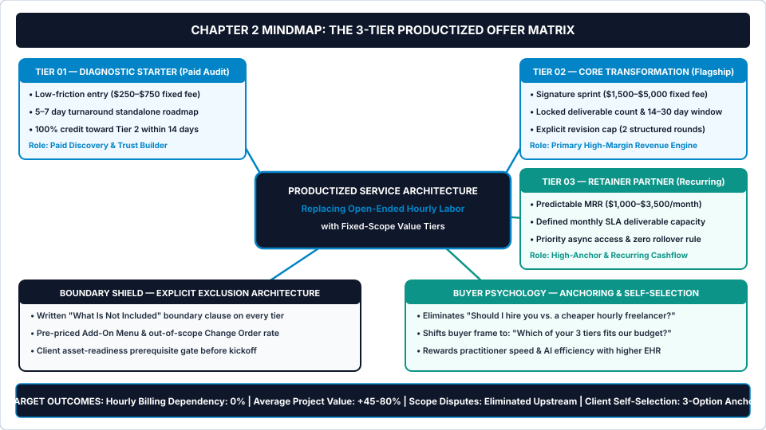
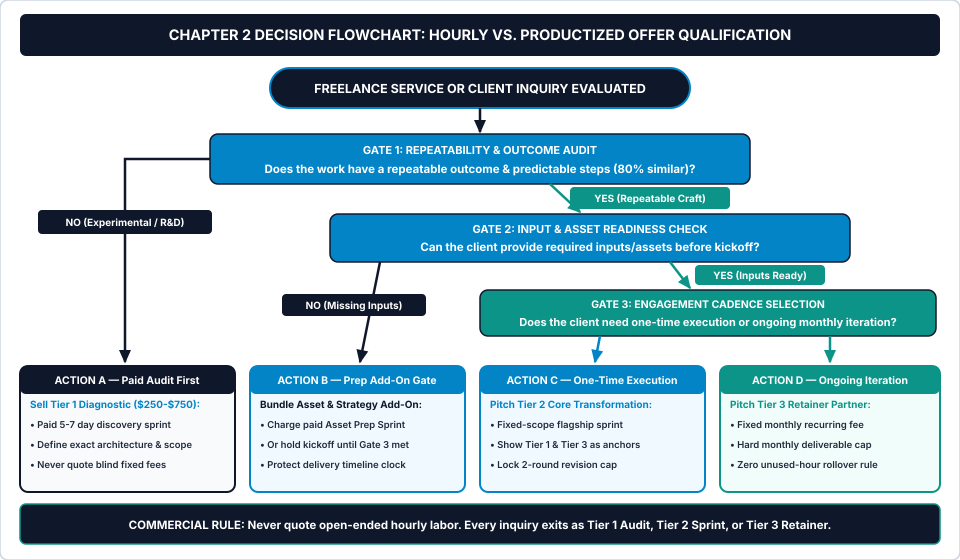

# Chapter 2: Positioning & Productized Service Packaging

**How to Escape the Hourly Billing Trap, Eliminate Scope Ambiguity, and Build a 3-Tier Productized Offer Matrix**

---

## 1. Learning Objectives

By the end of this chapter, you will be able to:

1. **Audit your historical client projects** to isolate the single repeatable, high-margin commercial problem that buyers gladly pay fixed fees to solve.
2. **Architect a 3-Tier Productized Offer Matrix** consisting of a low-friction *Tier 1 Diagnostic Starter* (`$250–$750`), a flagship *Tier 2 Core Transformation Sprint* (`$1,500–$5,000`), and a recurring *Tier 3 Retainer Partner Engine* (`$1,000–$3,500/month`).
3. **Construct an Explicit Exclusion Shield** (`What Is Not Included` clauses, pre-priced add-on menus, and asset-readiness prerequisites) that stops scope disputes before a contract is ever signed.
4. **Execute five variable-driven AI workflow prompts (`Prompts 2.1–2.5`)** to mine past project ROI patterns, structure three-tier packages, draft contractual exclusion boundaries, write a one-page service tear-sheet, and stress-test your commercial positioning statement.

---

## 2. The Real-World Friction Point

It is Tuesday at 10:15 AM. You just finished a discovery call with a promising B2B software founder who needs their customer onboarding emails and activation landing page rebuilt.

Seven minutes into the call, the founder asks the question that traps eighty percent of independent freelancers: *"So, what is your hourly rate, and roughly how many hours do you think this will take?"*

Because you do not have a productized offer menu sitting in front of you, you hesitate. You quote `$65.00 per hour` and estimate the project will take *"somewhere between twenty and twenty-five hours—so roughly $1,300 to $1,625."*

Look at the four commercial disasters you just triggered in thirty seconds:

1. **You Capped Your Upside and Penalized Your Own Speed:** Because you spent three years mastering your craft—and because you now use AI workflows to accelerate first-draft production—you can deliver a high-converting onboarding sequence in twelve focused hours instead of twenty-five. Under hourly billing, working twice as fast cuts your paycheck in half (`12 hours × $65/hr = $780`). Hourly billing punishes mastery.
2. **You Invited Line-Item Micromanagement:** The moment you sell hours instead of a bounded outcome, the buyer shifts from evaluating *business results* to policing your *timesheet*. Two weeks later, the client questions why research took four hours or why a revision took ninety minutes.
3. **You Created Zero Scope Boundaries:** When a buyer purchases "twenty-five hours of copywriting and design," they assume they have purchased twenty-five hours of open-ended access to your brain. When they ask you to rewrite their pricing FAQ and format three sales slides in Week 2, you have no structural basis to decline because you sold raw labor, not a locked deliverable package.
4. **You Forced a Binary Price Comparison:** If the only number the buyer hears from you is `$65.00 per hour`, their brain immediately compares your `$65.00/hour` against another freelancer on Upwork or LinkedIn quoting `$40.00 per hour`. You have positioned yourself as a commodity labor input.

Now examine the math of the **Efficiency Penalty Formula**:

$$\text{Hourly Revenue Penalty} = (\text{Baseline Manual Hours} - \text{Systematized AI-Assisted Hours}) \times \text{Nominal Hourly Rate}$$

If a project historically took `30 hours` at `$65.00/hour` (`$1,950.00`), and installing the AI workflows in this manual cuts your execution time to `14 hours`, hourly billing costs you **`$1,040.00 in lost revenue`** on that single project (`16 saved hours × $65.00/hr`). Fixed-scope productized packaging lets you charge **`$2,400.00`** for the outcome while delivering it in `14 hours`—lifting your actual Effective Hourly Rate from `$65.00/hour` to **`$171.43/hour`**.

---

## 3. Why Standard Approaches Fail

When solo operators try to move away from hourly billing, they typically follow generic marketing advice that backfires under real client conditions.

### 3.1 Failure Mode 1: The "Custom Quote for Every Inquiry" Trap
Many freelancers drop hourly billing only to replace it with custom fixed-price quoting. Every time a lead shows up, the freelancer invents a bespoke scope from scratch: one client buys a website plus a logo plus four blog posts; the next client buys a landing page plus CRM integration plus ad management.

Bespoke fixed pricing destroys your **Effective Hourly Rate (`EHR`)** because you can never standardize your delivery SOPs. Every project is a brand-new research and estimation problem. Worse, when you invent a custom scope on the fly, you inevitably forget to exclude edge cases—leaving the door wide open for `Bucket B` unbilled revisions.

### 3.2 Failure Mode 2: Single-Option "Take It or Leave It" Pricing
When a prospect asks for a quote and you send a single price—say, `$2,800`—you force the buyer's brain into a binary decision: *Yes (`$2,800`) or No (`$0`)*.

Behavioral pricing research consistently demonstrates that when a buyer sees only one price without context anchors, they anchor downward against their own internal budget guess. If they only have `$1,800` available this month, or if they are nervous about hiring a new freelancer for the first time, they walk away—or they ask you for a thirty percent discount. Presenting a **3-Tier Productized Offer Matrix** shifts the buyer's cognitive question from *"Should I hire this freelancer?"* to *"Which of these three packages fits our current stage?"*

### 3.3 Failure Mode 3: Vague "I Do Everything" Positioning
Inspect the LinkedIn headline or portfolio hero section of ten struggling freelancers and nine will read like a skills laundry list: *"Full-Stack Developer, UI/UX Designer & AI Automation Consultant Helping Brands Grow."*

Generalist skill lists force the client to do the heavy architectural thinking. A busy founder does not wake up wanting "fourteen hours of React development" or "some B2B copywriting." They wake up with a bleeding commercial bottleneck: *"Our trial users sign up and never activate,"* or *"Our Shopify mobile checkout drops 74% of carts."* When your positioning names a specific commercial problem and pairs it with a fixed-scope package, price resistance drops immediately.

---

## 4. Core Framework: The 3-Tier Productized Offer Matrix

To lock **Stage 01 (The Input Gate)** of the *5-Stage Client Lifecycle Engine*, you must replace open-ended hourly estimates with **The 3-Tier Productized Offer Matrix** fortified by **The Explicit Exclusion Shield**.

Productizing a service does not mean turning your craft into a rigid, low-ticket commodity. It means packaging eighty percent of your repeatable delivery into three structured commercial vehicles with locked deliverables, fixed timelines, explicit revision caps, and transparent price anchors.

### Visual Architecture: System Mindmap



As shown in [chapter-02-mindmap.svg](../../04-VISUAL-ASSETS/Mindmaps/chapter-02-mindmap.svg), the **3-Tier Productized Offer Matrix** structures your commercial menu across three distinct risk and investment levels:

1. **Tier 01 — The Diagnostic Starter (`Paid Discovery / Audit Sprint` • `$250–$750`):**
   * **Commercial Purpose:** Eliminates unpaid "pick your brain" consultations and removes risk for skeptical or budget-cautious leads. Instead of guessing how to fix a complex or messy client setup for free, you sell a standalone 5-to-7-day diagnostic audit.
   * **Core Mechanism:** Includes a concrete diagnostic scorecard, a prioritized action roadmap, and a 30-minute walkthrough call.
   * **The Conversion Bridge Rule:** Offer a **100% Fee Credit** toward Tier 2 if the client upgrades to the Core Transformation package within 14 calendar days of audit delivery.
2. **Tier 02 — The Core Transformation (`Flagship Fixed-Scope Sprint` • `$1,500–$5,000`):**
   * **Commercial Purpose:** Your primary profit engine, engineered so 65% to 75% of qualified buyers self-select this middle option.
   * **Core Mechanism:** Solves one high-value business problem end-to-end within a locked 14-to-30-day window. Every deliverable is enumerated by exact count (e.g., *5 core pages, 1 style guide, 2 rounds of consolidated revisions*).
3. **Tier 03 — The Retainer Partner (`Recurring Optimization & Advisory Engine` • `$1,000–$3,500/month`):**
   * **Commercial Purpose:** Serves two simultaneous functions: first, it acts as a high price anchor (`$10,000–$18,000` annualized value) that makes your `$2,500` Tier 2 package look immediately reasonable; second, it captures ongoing monthly recurring revenue (`MRR`) from clients who want continuous iteration.
   * **Core Mechanism:** Never sell "20 hours per month." Sell a fixed monthly deliverable SLA (e.g., *4 conversion experiments, 2 landing page builds, and 1 monthly executive analytics brief*) with a strict **Zero Rollover Rule** so unused monthly capacity never piles up into future scope debt.
4. **The Boundary Shield — Explicit Exclusion Architecture:**
   * Every package in your matrix is accompanied by a written **"What Is Not Included"** block and a pre-priced **Add-On Menu**. When a client sees on Day 1 that *"Custom 3D illustrations ($450 add-on)"* or *"Additional revision rounds ($250/round)"* are explicitly listed outside the base package, they never try to sneak them in for free during Week 3.

### Table 2.1: The 3-Tier Productized Offer Matrix — Structural & Financial Blueprint

| Package Dimension | Tier 1: Diagnostic Starter<br>*(Paid Discovery / Audit)* | Tier 2: Core Transformation<br>*(Flagship Fixed-Scope Sprint)* | Tier 3: Retainer Partner<br>*(Recurring Monthly Engine)* |
| :--- | :--- | :--- | :--- |
| **Buyer Psychological State** | *"We know something is broken, or we want to test working together with low risk."* | *"We have a clear bottleneck and want a proven specialist to build the solution now."* | *"We want ongoing monthly execution, priority turnaround, and strategic advisory."* |
| **Target Price Band (USD)** | **`$250 – $750`** *(100% upfront)* | **`$1,500 – $5,000`** *(50% deposit / 50% milestone)* | **`$1,000 – $3,500 / month`** *(Auto-billed Day 1 of month)* |
| **Delivery Window / Cadence** | `5 to 7 business days` | `14 to 30 calendar days` | `Monthly recurring cycle (3-month minimum commitment)` |
| **Deliverable Specification** | 1 Diagnostic Audit Report + 1 Prioritized Fix Roadmap + 30-Min Review Call | Exact locked deliverable list (e.g., 5 pages / 6 emails / 1 system build) + Handover SOP | Fixed monthly deliverable cap (e.g., 4 sprints/mo) + Async Friday Status Briefs |
| **Revision & Boundary Cap** | `0 revisions` (Diagnostic artifact only; 100% credit toward Tier 2 within 14 days) | **`2 consolidated revision rounds`** within 5 business days of delivery | **`1 revision pass per monthly item`**; strict **Zero Rollover** of unused capacity |
| **Target Real Hours & EHR** | `3–5 real hours` (`$80–$150/hr` EHR) | `15–30 real hours` (`$100–$165/hr` EHR) | `10–20 real hours/mo` (`$100–$175/hr` EHR) |

---

## 5. Step-by-Step Implementation Protocol

Execute these four steps in sequence to transition from ad-hoc hourly quoting to a locked **3-Tier Productized Offer Matrix** in under ninety minutes.

### Step 1: Audit Your Last 5 Projects to Isolate Your "80% Repeatable Core"
Open your invoice history and project folders from the past six to twelve months. Select your five most recent client engagements and evaluate each across two axes:

1. **Net Effective Hourly Rate (`EHR`):** Which projects finished on time, required minimal hand-holding, and left you with the highest actual pay per real working hour?
2. **Buyer Urgency & ROI Clarity:** Which projects solved a painful revenue, conversion, or operational bottleneck where the client approved the quote quickly?

Feed those five historical project summaries into **Prompt 2.1** (*Past Project Outcome & ROI Pattern Miner*). The prompt will strip away low-margin outliers and isolate the single **80% Repeatable Core Problem** that should anchor your **Tier 2 Core Transformation** package.

### Step 2: Engineer Your 3 Tiers Using the `1 : 4 : 3/mo` Pricing Ratio
Once your flagship **Tier 2 Core Transformation** scope is defined, price and bound your three tiers using a battle-tested commercial ratio:

* **Anchor Tier 2 First (`1.0x Flagship Fee`, e.g., `$2,400`):** Define the exact deliverables that solve the core problem in 14 to 21 days with a strict two-round revision cap.
* **Carve Out Tier 1 at `15%–25% of Tier 2` (`e.g., $450`):** Extract the first twenty percent of your Tier 2 process—the audit, architecture blueprint, wireframe, or strategy brief—and package it as a standalone 5-day **Diagnostic Starter**. Include the rule: *"100% of your $450 Tier 1 fee is credited toward Tier 2 if you upgrade within 14 days."*
* **Structure Tier 3 at `65%–85% of Tier 2 per Month` (`e.g., $1,800/month`):** Package ongoing optimization, monthly content/feature releases, or fractional management into a recurring **Retainer Partner** tier. Over a standard three-month minimum term (`$5,400`), Tier 3 serves as a `$5,400` high anchor that makes your `$2,400` Tier 2 sprint feel like an immediate bargain.

Run **Prompt 2.2** (*3-Tier Productized Package Architect*) to generate the exact package names, deliverable bullet points, timelines, and commercial terms for all three tiers.

### Step 3: Attach the Explicit Exclusion Shield & Pre-Priced Add-On Menu
Never publish or send a package description without listing what sits *outside* the container. Scope creep thrives in silence.

For every tier, run **Prompt 2.3** (*Exclusion List & "What Is Not Included" Clause Builder*) to attach two mandatory boundary blocks directly underneath your deliverables:

1. **The 5-Bullet "What Is Not Included" Shield:** Explicitly exclude adjacent tasks that clients frequently assume are free (e.g., *copywriting on a design package, custom photography, third-party paid plugin licenses, live training sessions beyond 30 minutes, or more than 2 consolidated revision rounds*).
2. **The Pre-Priced Add-On Menu:** List four to five common extra requests with fixed unit prices right on the tear-sheet (e.g., *Additional Landing Page: `+$350` • Rush 72-Hour Turnaround: `+30%` • Extra Revision Round: `+$250`*). Pre-pricing add-ons transforms scope creep from a tense argument into a frictionless shopping-cart upgrade.

### Step 4: Route Every Incoming Inquiry Through the Qualification Flowchart
When a prospect contacts you asking for custom work or an hourly quote, never revert to custom estimating. Route their request through the **Hourly vs. Productized Offer Qualification Flowchart** below.

### Operational Decision Tree



Follow the exact routing gates in [chapter-02-flowchart.svg](../../04-VISUAL-ASSETS/Flowcharts/chapter-02-flowchart.svg):

* **Gate 1 — Repeatability & Outcome Audit:** *Does the requested work have a repeatable outcome and predictable execution steps (`>= 80%` similar to your core craft)?*
  * **If NO (`Highly Experimental / Undefined R&D`):** Route to **Action A**. Never quote a fixed implementation price on an undefined problem. Pitch your **Tier 1 Diagnostic Starter (`$250–$750`)** as a paid 5-to-7-day discovery sprint to map the architecture before quoting Phase 2.
  * **If YES (`Repeatable Core Craft`):** Advance to **Gate 2**.
* **Gate 2 — Input & Asset Readiness Check:** *Does the client already have the required brand inputs, copy/data assets, and technical credentials ready before kickoff?*
  * **If NO (`Missing Prerequisites`):** Route to **Action B**. Either bundle a paid **"Asset & Strategy Prep Add-On"** from your Add-On Menu or hold the kickoff date until the Pre-Flight Gate is satisfied.
  * **If YES (`Inputs Ready`):** Advance to **Gate 3**.
* **Gate 3 — Engagement Cadence Selection:** *Does the client require a one-time transformation build or ongoing monthly iteration?*
  * **If One-Time Execution:** Route to **Action C** and pitch your **Tier 2 Core Transformation Package** (displaying Tier 1 and Tier 3 alongside it on your **One-Page Service Tear-Sheet** generated by **Prompt 2.4**).
  * **If Ongoing Iteration:** Route to **Action D** and pitch your **Tier 3 Monthly Retainer Partner** with a hard monthly deliverable cap and zero-rollover clause.

---

## 6. Tested AI Workflow Prompts

Use the five prompts below to build your complete productized service architecture in under one hour. Copy each prompt block, insert your details into the `[BRACKETED VARIABLES]`, and verify the output against the **Verification Rule**.

---

### Prompt 2.1: Past Project Outcome & ROI Pattern Miner

* **Operational Objective:** Analyze 3 to 5 historical client engagements to identify which project type generated the highest Effective Hourly Rate (`EHR`), the lowest client friction, and the strongest measurable business ROI—isolating the exact foundation for your productized offer.
* **When to Run:** During Step 1 when deciding which service to productize first.

```text
SYSTEM ROLE:
You are a Senior Commercial Positioning Strategist for independent service businesses. Analyze the user's past client projects to uncover the highest-margin, most repeatable service pattern. Ignore vanity preferences and focus strictly on Effective Hourly Rate (EHR), delivery speed, repeatable steps, and buyer urgency.

INPUT VARIABLES:
- My Core Discipline / Craft: [E.G., B2B SAAS CONTENT, EMAIL MARKETING & LIFECYCLE COPYWRITING]
- Target Monthly Revenue Goal (USD): $[E.G., 6500.00]
- Summary of 3 to 5 Past Client Projects (Include Fee Charged, Real Hours Spent, Deliverable, and Client Friction Level):
[PASTE 3-5 PAST PROJECTS HERE — E.G.:
Project 1: $1,800 fee, 22 real hours, wrote 6-email trial onboarding sequence + 1 activation guide for SaaS startup. Smooth approval, client reported +18% paid conversions.
Project 2: $1,100 fee (at $55/hr), 28 real hours, wrote 8 ad-hoc SEO blog posts for an agency. Endless edits, 4 stakeholders arguing over tone.
Project 3: $2,200 fee, 24 real hours, audited Klaviyo/Customer.io flows and rewrote 5 churn-prevention emails. Fast sign-off, very high client satisfaction...]

OPERATIONAL INSTRUCTIONS:
1. Project Profitability & Friction Matrix: Build a Markdown comparison table scoring each past project on:
   - Actual Effective Hourly Rate (Fee ÷ Real Hours)
   - Process Repeatability Score (1–10: how easily 80% of steps can be templated)
   - Buyer ROI Proximity (1–10: how directly the deliverable impacts client revenue or time saved)
   - Scope-Creep Immunity (1–10: how clear the finish line was)
2. Winner Isolation: Select the #1 highest-scoring project pattern and explain in 3 bullet points why it outperforms the others as a productized flagship offer.
3. Low-Margin Prune Directive: Identify which historical service type the user must immediately stop offering on an hourly/ad-hoc basis and why it is dragging down their EHR.
4. Core Transformation Blueprint: Draft a 1-sentence commercial problem statement and a 4-bullet locked deliverable summary for the winning flagship offer.
```

* **Verification Rule:** Confirm that the selected winning offer has the highest calculated `Actual EHR` in the comparison table and solves a problem tied directly to client revenue, conversions, or measurable operational speed.

---

### Prompt 2.2: 3-Tier Productized Package Architect

* **Operational Objective:** Transform your winning service concept into a complete **3-Tier Productized Offer Matrix** (`Tier 1: Diagnostic Starter`, `Tier 2: Core Transformation`, `Tier 3: Retainer Partner`) with commercial package names, locked deliverable counts, turnaround windows, revision caps, and psychological price anchors.
* **When to Run:** Immediately after completing Prompt 2.1 to lock your three commercial packages.

```text
SYSTEM ROLE:
You are a Principal Productized Service Architect. Design a 3-Tier Productized Offer Matrix that eliminates hourly billing, anchors buyer perception around a high-margin middle tier, and locks every deliverable behind clear numerical limits.

INPUT VARIABLES:
- Target Client Profile: [E.G., SEED TO SERIES-A B2B SAAS FOUNDERS & HEADS OF GROWTH]
- Core Problem Solved: [E.G., FREE TRIAL SIGNUPS DROPPING OFF BEFORE ACTIVATING OR UPGRADING TO PAID PLANS]
- Target Tier 2 Flagship Price (USD): $[E.G., 2400.00]
- Maximum Hours I Want to Spend Delivering Tier 2: [E.G., 18 REAL HOURS]
- Core Deliverables I Can Execute Repeatably: [E.G., LIFECYCLE AUDIT, USER ACTIVATION MAP, 6-EMAIL ONBOARDING SEQUENCE, IN-APP TOOLTIP COPY, MONTHLY SPLIT-TEST OPTIMIZATION]

OPERATIONAL INSTRUCTIONS:
Generate a complete 3-Tier Productized Offer Matrix containing:
1. Tier 1 — The Diagnostic Starter (Priced at 15%–25% of Tier 2):
   - Commercial Package Name (outcome-driven, never "Basic Package")
   - Fixed Price ($ USD) & Payment Term (100% upfront)
   - Turnaround Window (5–7 business days)
   - 3–4 Locked Deliverables (diagnostic + roadmap only, zero full implementation)
   - The 14-Day Upgrade Bridge Rule (100% fee credit toward Tier 2 if upgraded within 14 days)
2. Tier 2 — The Core Transformation [MOST POPULAR FLAGSHIP] (Priced at Target Tier 2 Price):
   - Commercial Package Name
   - Fixed Price ($ USD) & Payment Term (50% deposit / 50% upon Milestone 2 delivery)
   - Turnaround Window (14–30 calendar days)
   - 5 Locked Deliverables with exact numerical caps (e.g., exact number of pages, flows, emails, or components)
   - Revision Cap (2 consolidated rounds within 5 business days)
3. Tier 3 — The Retainer Partner (Priced at 65%–85% of Tier 2 per month, 3-month minimum):
   - Commercial Package Name
   - Monthly Fee ($ USD/mo) + 3-Month Total Anchor Value
   - Monthly Deliverable SLA Cap (fixed output units per month, NEVER hours per month)
   - Zero-Rollover & Priority Async Access Clause
4. Side-by-Side Markdown Comparison Matrix: Output a clean 4-column table comparing Tier 1, Tier 2, and Tier 3 across Price, Timeline, Deliverables, Revision Cap, and Expected Effective Hourly Rate (EHR).
```

* **Verification Rule:** Verify that **zero** tier descriptions mention an hourly rate or a bucket of hours (e.g., reject *"15 hours of support per month"* in Tier 3 and ensure it specifies concrete output units instead).

---

### Prompt 2.3: Exclusion List & "What Is Not Included" Clause Builder

* **Operational Objective:** Build an ironclad **Explicit Exclusion Shield** and **Pre-Priced Add-On Menu** for your productized packages so clients know exactly where your scope ends before they sign.
* **When to Run:** During Step 3 before publishing your One-Page Service Tear-Sheet or sending any proposal.

```text
SYSTEM ROLE:
You are a Commercial Contract Specialist and Scope-Creep Defense Architect for digital service providers. Your goal is to anticipate every adjacent request, hidden dependency, and revision loophole a client might assume is included in a fixed-price package, and convert them into explicit exclusions and pre-priced add-ons.

INPUT VARIABLES:
- Service Niche & Flagship Tier 2 Package Summary:
[E.G., WEBFLOW LANDING PAGE & CONVERSION ARCHITECTURE SPRINT — $2,800 FIXED FEE FOR 5 CORE PAGES, RESPONSIVE BUILD, AND BASIC CMS SETUP]
- Common Extra Requests Clients Have Tried to Sneak In Previously:
[E.G., WRITING ALL THE PAGE COPY FROM SCRATCH, CUSTOM 3D ILLUSTRATIONS, MULTILINGUAL TRANSLATION SETUP, INTEGRATING COMPLEX CUSTOM ZAPier/MAKE WEBHOOKS, ENDLESS STAKEHOLDER CALLS]

OPERATIONAL INSTRUCTIONS:
Produce three copy-paste-ready boundary modules for the service tear-sheet and agreement:
1. Module A — The 6-Point "What Is Explicitly Excluded" Shield:
   Write 6 crisp, non-defensive bullet points stating exactly what sits outside the base package price (covering adjacent crafts, third-party software/font licensing fees, custom assets, extra meetings, and post-handover edits).
2. Module B — The Pre-Priced Add-On Menu (Markdown Table):
   Create a 6-row Add-On Menu Table with columns: [Add-On Code | Optional Upgrade Item | Exact Unit Scope | Fixed Add-On Price (USD) | Added Timeline]. Price each item to yield at least $100+/hr EHR.
3. Module C — The Client Prerequisite & Revision Expiry Clause:
   Write a 4-sentence commercial clause locking in:
   - What happens if client assets/copy are delayed past 48 hours of kickoff (Timeline Pause Rule),
   - What constitutes a "Consolidated Revision Round" (all feedback from all stakeholders submitted in a single batch), and
   - The exact fee ($[X]) triggered if a 3rd revision round is requested.
```

* **Verification Rule:** Confirm that every item in `[Common Extra Requests Clients Have Tried to Sneak In Previously]` is explicitly addressed in **Module A** and assigned a profitable fixed dollar price in **Module B**.

---

### Prompt 2.4: One-Page Service Tear-Sheet Copywriter

* **Operational Objective:** Generate a clean, high-status **One-Page Service Tear-Sheet** (formatted for PDF export or a single Notion page) that you can send to inbound leads *before* booking a discovery call—pre-anchoring them on your 3-tier prices and filtering out low-budget browsers automatically.
* **When to Run:** Once your 3 tiers (Prompt 2.2) and Exclusion Shield (Prompt 2.3) are finalized.

```text
SYSTEM ROLE:
You are an Executive B2B Direct-Response Copywriter. Write a crisp, one-page commercial Service Tear-Sheet that positions an independent specialist as a high-trust operational partner. Use zero synthetic hype words. Write in short, authoritative sentences focused on client bottlenecks, predictable timelines, and transparent fixed pricing.

INPUT VARIABLES:
- Practitioner / Studio Name: [E.G., ELENA ROSTOVA — B2B SAAS LIFECYCLE STUDIO]
- Target Buyer & Core Bottleneck Solved: [E.G., HELPING SEED & SERIES-A SAAS TEAMS TURN DORMANT FREE TRIAL USERS INTO PAYING ANNUAL SUBSCRIBERS]
- 3-Tier Package Details (Paste Output from Prompt 2.2):
[PASTE TIER 1, TIER 2, AND TIER 3 NAMES, PRICES, AND DELIVERABLES]
- Top Exclusions & Add-On Menu (Paste Summary from Prompt 2.3):
[PASTE TOP EXCLUSIONS AND 3-4 ADD-ON ITEMS]
- Proof / Past Result Snippet: [E.G., LIFTED TRIAL-TO-PAID CONVERSION BY +22% TO +38% ACROSS 14 SAAS CLIENTS IN 2025-2026]

OPERATIONAL INSTRUCTIONS:
Format the output as a complete, ready-to-publish 1-Page Markdown Tear-Sheet with these exact six sections:
1. Authority Header: Studio Name, Outcome Headline, and 2-sentence "Who This Is Built For" filter.
2. The Cost of Waiting (The Friction Diagnostic): 3 short bullets contrasting the old broken approach vs. your systematized sprint.
3. The 3-Tier Engagement Matrix: Clean visual breakdown of Tier 1 (Diagnostic), Tier 2 (Core Transformation — badged as "Most Selected"), and Tier 3 (Retainer Partner), including exact timelines and payment terms.
4. How the Sprint Works (The 4-Gate Timeline): Day 1 Kickoff Gate -> Day 7 Architecture -> Day 14 Build -> Day 21 Handover & SOP Vault.
5. Scope Boundaries, Exclusions & Optional Add-Ons: Transparent summary of what is excluded and the pre-priced upgrade menu.
6. Next-Step Pre-Call CTA: Direct instruction to complete the 4-Question Intake Check to lock a 15-minute diagnostic slot.
```

* **Verification Rule:** Read the completed tear-sheet top-to-bottom and confirm a cold prospect can immediately see your **exact dollar prices**, **exact turnaround days**, and **exact revision limits** in under 60 seconds of skimming.

---

### Prompt 2.5: Niche Value Proposition & Positioning Stress-Tester

* **Operational Objective:** Audit and rewrite a generic freelancer bio, LinkedIn headline, or website hero statement into a razor-sharp **Commercial Positioning Statement** that passes the *Buyer Specificity, Outcome Clarity, and Price-Defense Stress Test*.
* **When to Run:** Whenever updating your website hero section, LinkedIn profile, or cold/warm outreach introduction.

```text
SYSTEM ROLE:
You are a Ruthless B2B Positioning Critic and Commercial Messaging Director. Critique the user's current freelance bio or positioning statement, expose why it attracts price-sensitive commodity buyers, and engineer three high-margin positioning alternatives tied to their 3-Tier Productized Offer Matrix.

INPUT VARIABLES:
- My Current Bio / Headline / Positioning Statement:
[E.G., "I am a freelance full-stack developer and UI designer with 4 years of experience helping startups and small businesses build modern websites and apps."]
- My Best-Fit Buyer Role & Industry: [E.G., FOUNDERS & VP MARKETING AT B2B FINTECH AND SAAS COMPANIES]
- The Expensive Problem I Solve Best: [E.G., SLOW, LOW-CONVERTING MARKETING SITES THAT TAKE ENGINEERING TEAMS WEEKS TO UPDATE]
- My Flagship Tier 2 Package & Timeline: [E.G., 21-DAY CONVERSION WEBFLOW MIGRATION & COMPONENT SYSTEM FOR $3,500]

OPERATIONAL INSTRUCTIONS:
1. Commodity Audit (Score 0–100): Score the user's current statement across four criteria (Buyer Specificity, Quantified Problem Urgency, Mechanism Uniqueness, and Hourly-Commodity Immunity). Explain brutally why the current phrasing invites lowball budgets.
2. The Positioning Formula Reconstruction: Apply the studio formula:
   "We help [Specific Buyer Segment] eliminate [High-Cost Bottleneck] and achieve [Measurable Business Outcome] in [Locked Timeframe] using our [Named Productized System]—without [Primary Buyer Fear/Friction]."
3. Three Calibrated Positioning Assets:
   - Asset A (1-Line LinkedIn / Portfolio Hero Headline — max 18 words)
   - Asset B (3-Sentence Warm Introduction / Email Bio — max 55 words)
   - Asset C (The Discovery Call Opening Frame — exact 25-second spoken script answering "Tell me what you do")
```

* **Verification Rule:** Ensure that none of the three generated positioning assets contain the word *"freelance"* or *"freelancer"* as a commodity label—frame your operation as a specialized practice, studio, or system architect.

---

## 7. Real-World Implementation Case Study

To see how replacing hourly labor with the **3-Tier Productized Offer Matrix** transforms both monthly income and weekly workload, examine the 45-day restructuring of **Elena R.**, a B2B SaaS content and email strategist based in Toronto, Canada (billing in USD to North American software clients).

### 7.1 Baseline Situation (Day 0 — The `$55/Hour` Content Hamster Wheel)
Elena had two and a half years of independent experience writing blog posts, newsletters, and onboarding emails for seed-stage SaaS companies. She quoted clients **`$55.00 USD per hour`** (or per-article rates derived from `$55/hour`).

In an average month, Elena billed **75 billable hours**, generating **`$4,125.00 USD per month`** in gross revenue. However, her actual weekly time audit (`Worksheet 1.1`) showed she was working **`44.0 real hours per week` (`176.0 hours per month`)**:

* Every client ordered a different mix of random tasks ("Can you write two blog posts this week, edit our founder's LinkedIn post, and draft a webinar invite?").
* Because she sold raw writing hours, clients treated her like an on-call staff writer—pulling her into three weekly editorial Slack channels and requesting four to five rounds of subjective line edits on every draft.
* When dividing her **`$4,125.00`** gross monthly revenue by **`176.0 real working hours`**, Elena's actual Effective Hourly Rate was only **`$23.44 per hour`**.

### 7.2 The 45-Day Productized Transition
Using Chapter 2's protocol, Elena ran **Prompt 2.1** across her past eight clients. The audit revealed a glaring pattern: her ad-hoc blog writing had the lowest EHR (`$19.50/hr`) and highest revision friction, whereas two past projects where she built **Trial-to-Paid User Onboarding Email Sequences** had zero scope disputes and directly lifted client activation revenue.

Elena immediately retired her `$55/hour` generalist rate card and used **Prompts 2.2, 2.3, and 2.4** to launch a single **One-Page Service Tear-Sheet** featuring three locked tiers:

1. **Tier 1 — The 7-Day Trial Activation & Drop-Off Audit (`$450 USD Fixed`):** Full teardown of the client's existing signup-to-upgrade funnel, friction scorecard, and 6-email architecture map (100% credited toward Tier 2 within 14 days).
2. **Tier 2 — The 14-Day SaaS Onboarding Sequence Sprint (`$2,400 USD Fixed`):** Strategy, conversion copy, and ESP trigger setup guidelines for 6 core activation emails + 3 trial-expiry nudge emails, capped at 2 consolidated revision rounds.
3. **Tier 3 — The Monthly Lifecycle & Retention Engine (`$1,800 USD/Month`):** Fixed monthly SLA delivering 2 lifecycle A/B test variations, 2 product-release campaigns, and 1 monthly conversion diagnostic brief (zero hour tracking, zero rollover).

She also attached **Prompt 2.3's Explicit Exclusion Shield**, clearly stating that blog articles, social media posts, custom HTML coding, and third-party CRM migrations were excluded from the base sprint (with a pre-priced Add-On Menu offering extra emails at `+$300 each`).

### 7.3 Verified 45-Day Results (Before vs. After Audit)

Within forty-five days of sending her new One-Page Tear-Sheet to inbound leads and legacy clients, Elena's monthly revenue composition shifted completely:

* She sold **one Tier 1 Audit (`$450`)**, **one Tier 2 Onboarding Sprint (`$2,400`)**, **two Tier 3 Monthly Retainer Engines (`2 × $1,800 = $3,600`)**, and **one pre-priced Add-On email (`+$300`)**—totaling **`$6,750.00 USD/month`**.
* Because all deliverables followed the exact same repeatable 6-email SOP checklist, her total weekly working hours dropped from `44.0 hours/week` to **`33.0 hours/week` (`132.0 hours/month`)**.

### Table 2.2: Elena R. (B2B SaaS Lifecycle Strategist) — Hourly vs. Productized Turnaround

| Commercial & Operational Metric | Baseline (Day 0 Hourly Model) | Post-System (Day 45 Productized Matrix) | Net Operational Variance |
| :--- | :---: | :---: | :---: |
| **Pricing & Packaging Model** | `$55.00/hr` ad-hoc writing & custom tasks | **3-Tier Matrix (`$450` / `$2,400` / `$1,800/mo`)** | **100% elimination of hourly billing** |
| **Average New Project Value** | `$825.00` (`15 billed hours` average) | **`$2,400.00` (Tier 2) / `$5,400.00` (3-Mo Tier 3)** | **`+190.9%` average engagement value** |
| **Total Weekly Working Hours** | `44.0 hrs/wk` (`176.0 hrs/mo`) | **`33.0 hrs/wk` (`132.0 hrs/mo`)** | **`-11.0 hrs/wk` (`-25.0%` workload reduction)** |
| **Unbilled Revision Rounds per Project** | `4 to 5 subjective rounds` | **`<= 2 consolidated rounds` (contract-capped)** | **`-60%` revision overhead** |
| **Gross Monthly Revenue (USD)** | `$4,125.00 / month` | **`$6,750.00 / month`** | **`+$2,625.00 / mo` (`+63.6%` revenue lift)** |
| **Actual Effective Hourly Rate (EHR)** | **`$23.44 / hour`** | **`$51.14 / hour`** | **`+$27.70 / hr` (`+118.2%` EHR surge)** |

---

## 8. Common Operational Pitfalls & Fixes

Use Table 2.3 to avoid the four most common traps freelancers encounter when launching their first **3-Tier Productized Offer Matrix**.

### Table 2.3: Chapter 2 Implementation Diagnostics — Common Pitfalls & Immediate System Fixes

| Common Packaging Pitfall | Symptom in Sales Conversations | Root-Cause Architectural Flaw | Immediate Operational Fix |
| :--- | :--- | :--- | :--- |
| **1. Stuffing Too Many Deliverables into Tier 1 (`Diagnostic Starter`)** | Clients buy your `$450` Tier 1 package, feel overwhelmed by a 30-page PDF, and never upgrade to Tier 2. | Treating Tier 1 as miniature execution instead of a diagnostic roadmap. | Restrict Tier 1 strictly to **Diagnosis + Architecture Blueprint** (`3–5 hours` max work) and attach the **14-Day 100% Credit Bridge** toward Tier 2. |
| **2. Selling "Hours per Month" Inside Tier 3 (`Retainer Partner`)** | Retainer clients obsess over your timesheet, or demand that 8 unused hours from May roll over into June for a massive launch. | Carrying hourly labor framing into your recurring tier. | Define Tier 3 strictly by **Fixed Monthly Output Units** (e.g., *2 sprints or 4 assets/month*) and insert the mandatory **Zero Rollover Clause**. |
| **3. Customizing Tier 2 Deliverables on the Fly During Discovery Calls** | A prospect asks to swap two emails for a custom video script on the call, and you say yes without repricing. | Failing to use the **Explicit Exclusion Shield** and **Pre-Priced Add-On Menu**. | Keep Tier 2 locked. Say: *"Our Core Sprint is locked so we can guarantee the 14-day timeline, but we can add Item X from our Add-On Menu for `+$350`."* |
| **4. Naming Packages "Bronze, Silver, Gold" or "Basic, Standard, Pro"** | Buyers pick the cheapest tier because "Basic" sounds like the exact same service at a lower price. | Commodity tier naming fails to communicate distinct commercial stages. | Name each tier by its **Operational Role**: *Diagnostic Audit* (Tier 1), *Core Transformation Sprint* (Tier 2), and *Ongoing Growth Partner* (Tier 3). |

---

## 9. Chapter Action Worksheet: The Productized Offer & Scope Boundary Blueprint

Complete **Part A** and **Part B** below (or inside the standalone fillable edition in `05-WORKBOOKS/worksheet-02.md`) to lock your 3-Tier Productized Offer Matrix before moving to Chapter 3.

### Part A: The 3-Tier Productized Offer Design Canvas

Fill in the exact commercial specifications for your three productized tiers (generated via **Prompt 2.2**):

| Specification Row | Tier 1: Diagnostic Starter<br>*(15%–25% of Tier 2)* | Tier 2: Core Transformation<br>*(1.0x Flagship Offer)* | Tier 3: Retainer Partner<br>*(65%–85% of Tier 2 / Mo)* |
| :--- | :--- | :--- | :--- |
| **1. Commercial Package Name** | `________________________` | `________________________` | `________________________` |
| **2. Fixed Price (USD) & Terms** | `$________` *(100% Upfront)* | `$________` *(50% / 50%)* | `$________ / mo` *(3-Mo Min)* |
| **3. Locked Turnaround Window** | `____ Business Days` | `____ Calendar Days` | `Monthly Recurring SLA` |
| **4. Deliverable #1 (Exact Cap)** | `________________________` | `________________________` | `________________________` |
| **5. Deliverable #2 (Exact Cap)** | `________________________` | `________________________` | `________________________` |
| **6. Deliverable #3 (Exact Cap)** | `________________________` | `________________________` | `________________________` |
| **7. Revision Allowance Cap** | `0 Rounds (14-Day Credit)` | `2 Consolidated Rounds` | `1 Pass / Deliverable` |
| **8. Max Real Hours Budgeted** | `____ hrs` | `____ hrs` | `____ hrs / mo` |
| **9. Target Package EHR (`#2 ÷ #8`)** | **`$________ / hr`** | **`$________ / hr`** | **`$________ / hr`** |

---

### Part B: Explicit Exclusion Shield & Pre-Priced Add-On Menu

Document the top five out-of-scope items that are **explicitly excluded** from your base tiers and assign each a profitable fixed Add-On price (`>= $100/hr` target EHR):

| Exclusion / Add-On ID | Explicitly Excluded Request ("What Is Not Included") | Pre-Priced Upgrade Unit Scope | Fixed Add-On Price (USD) | Added Timeline |
| :---: | :--- | :--- | :---: | :---: |
| **EX-01** | `________________________________________` | `___________________________` | `+$__________` | `+____ Days` |
| **EX-02** | `________________________________________` | `___________________________` | `+$__________` | `+____ Days` |
| **EX-03** | `________________________________________` | `___________________________` | `+$__________` | `+____ Days` |
| **EX-04** | `________________________________________` | `___________________________` | `+$__________` | `+____ Days` |
| **EX-05** | `Extra Revision Round Beyond 2-Round Cap` | `1 Consolidated Revision Pass` | `+$__________` | `+3 Bus. Days` |

---

## 10. Executive Summary & Implementation Checklist

### Core Chapter Takeaways
* **Hourly Billing Punishes Competence and AI Speed:** Every hour you shave off production using SOPs and AI workflows reduces your income if you charge by the hour. Fixed-scope productized tiers capture 100% of your efficiency gains as higher Effective Hourly Rate (`EHR`).
* **Three Tiers Beat One Price:** Presenting a **Tier 1 Diagnostic Starter**, a **Tier 2 Core Transformation Sprint**, and a **Tier 3 Retainer Partner** shifts buyer psychology from comparing your hourly rate against cheaper competitors to selecting which tier of your ecosystem fits their budget.
* **The Explicit Exclusion Shield Eliminates Upstream Scope Creep:** Listing five to six explicit *"What Is Not Included"* items alongside a **Pre-Priced Add-On Menu** on your service tear-sheet stops clients from assuming extra work is free and turns scope requests into instant upsells.
* **Never Quote Blind Fixed Prices on Undefined R&D:** Route every inquiry through `chapter-02-flowchart.svg`. If a project lacks repeatable parameters, sell the paid **Tier 1 Diagnostic Starter** first.

### Chapter 2 Implementation Checklist
Complete these five actions before advancing to Chapter 3:

* [ ] **Action 1:** Run **Prompt 2.1** on your last 3 to 5 client projects to isolate your highest-EHR, 80%-repeatable core service problem.
* [ ] **Action 2:** Run **Prompt 2.2** and complete **Part A of Worksheet 2** to lock names, prices, deliverables, and revision caps for Tiers 1, 2, and 3.
* [ ] **Action 3:** Run **Prompt 2.3** and complete **Part B of Worksheet 2** to establish your 6-point *"What Is Not Included"* clause and Pre-Priced Add-On Menu.
* [ ] **Action 4:** Run **Prompt 2.4** to generate your **One-Page Service Tear-Sheet** and save it as a clean PDF or public Notion link ready to send before discovery calls.
* [ ] **Action 5:** Run **Prompt 2.5** to replace any generalist "freelancer for hire" language on your LinkedIn headline and portfolio hero with an outcome-driven commercial positioning statement.

---

## 11. Sources & Operational References

1. **Enns, Blair (2018).** *Pricing Creativity: A Guide to Profit Beyond the Billable Hour.* 2Bobs Publishing. Foundational commercial reference on why hourly billing misaligns practitioner efficiency and how three-option value anchoring increases average engagement size.
2. **Ariely, Dan (2008).** *Predictably Irrational: The Hidden Forces That Shape Our Decisions.* HarperCollins. Empirical behavioral economics research demonstrating the asymmetric dominance (decoy/anchor) effect in three-tier pricing matrices.
3. **Digital Knowledge Product Studio Market Audit (2026).** *Productized Service Packaging & Scope Boundary Benchmarks (`01-MARKET-RESEARCH/sources.md`).* Comparative analysis of solo service provider utilization rates before and after replacing custom hourly estimates with bounded 3-tier tear-sheets.
4. **Graham, Paul (2009) & Newport, Cal (2016).** *Deep Work & Standardized Execution Protocols.* Operational justification for restricting service offerings to an 80%-repeatable core so delivery can be executed inside uninterrupted 90-Minute Maker Blocks.
