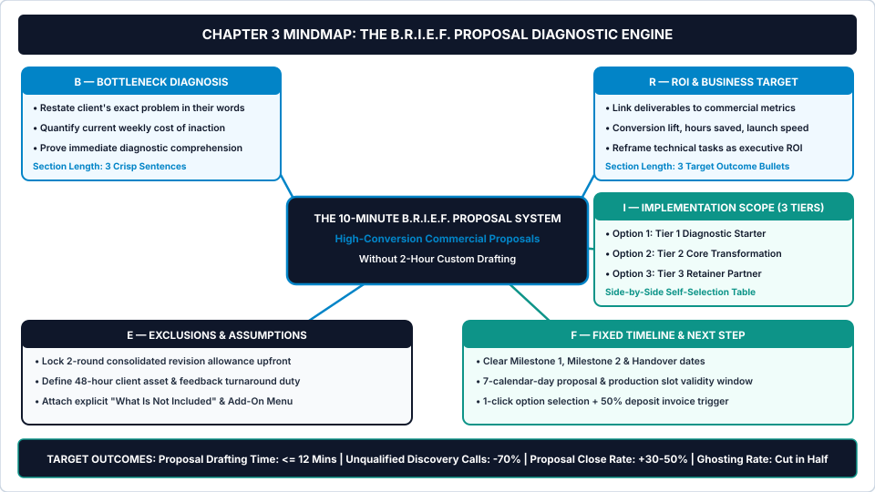
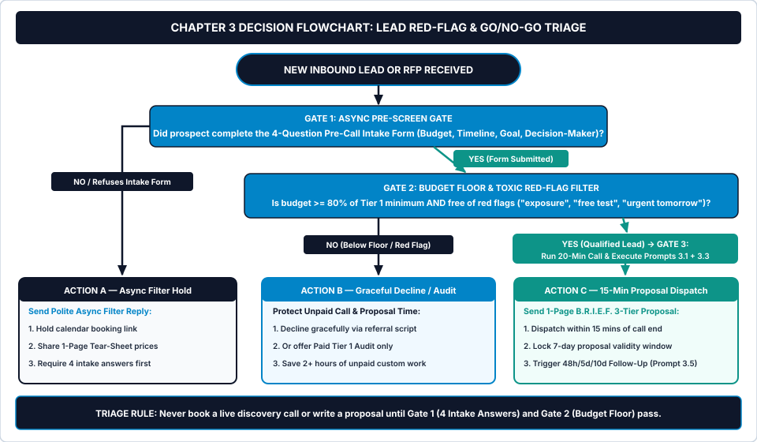

# Chapter 3: The 10-Minute Lead Triage & Proposal Engine

**How to Filter Out Time-Wasters Before Getting on a Call and Generate High-Converting 3-Option Proposals in 10 Minutes**

---

## 1. Learning Objectives

By the end of this chapter, you will be able to:

1. **Install the 4-Question Pre-Call Async Intake Gate** to filter out budget-mismatched browsers, non-decision-makers, and free-consulting seekers before they ever access your calendar.
2. **Score every inbound inquiry on a 20-Point Lead Qualification & Red-Flag Matrix** so you never spend unpaid hours preparing proposals for toxic or underfunded prospects.
3. **Deploy the B.R.I.E.F. Proposal Diagnostic Protocol** (*Bottleneck Diagnosis*, *ROI & Business Target*, *Implementation Scope [3 Tiers]*, *Exclusions & Assumptions*, and *Fixed Timeline & Next Step*) to ship a one-page commercial proposal within fifteen minutes of ending a discovery call.
4. **Execute five variable-driven AI workflow prompts (`Prompts 3.1–3.5`)** to extract diagnostic insights from raw call notes, score lead red flags, draft 3-option B.R.I.E.F. proposals, translate technical features into executive ROI, and automate your 48-hour, 5-day, and 10-day close-the-file follow-up sequence.

---

## 2. The Real-World Friction Point

It is Wednesday at 8:45 PM. Your dinner is cold on the kitchen counter while you sit at your laptop adjusting font sizes inside a twelve-page custom pitch deck for a prospect you spoke with on Tuesday morning.

During Tuesday's fifty-five-minute Zoom call, the prospect—a marketing manager at an e-commerce brand—was enthusiastic. They asked for your strategic advice on three different checkout flow problems, requested examples of similar stores you had built, and ended the call saying: *"Send over a detailed proposal with a few custom scope options and we will review it with the founders on Friday!"*

Because they sounded eager, you never verified their exact budget ceiling on the call. You also never confirmed whether the founders had actually approved hiring an external specialist this quarter.

Now calculate the true operational cost of that single unguarded inquiry:

* **1.0 hour:** Pre-call research inspecting their store and preparing notes.
* **1.0 hour:** The live discovery call (which ran twenty-five minutes over schedule because you gave away free consulting).
* **2.5 hours:** Wednesday night spent writing custom scope descriptions, estimating bespoke timelines, and formatting a twelve-page proposal document.
* **1.5 hours:** Four weeks of awkward follow-up emails (*"Just bumping this to the top of your inbox!"*) after the prospect goes completely silent.

That single unqualified lead consumed **6.0 hours of unpaid `Bucket C` sales overhead**. Across four similar leads per month, you burn **24.0 hours every month**—three full working days—working for people who never pay you a cent.

Worse, examine the **Unbilled Sales Cost per Won Client Formula**:

$$\text{Unpaid Sales Hours per Won Client} = \frac{\text{Hours per Lead (Call + Custom Proposal + Chasing)}}{\text{Proposal Win Rate (\%)}}$$

If you spend `5.0 hours` per lead and your proposal close rate sits at the industry average of **`20%` (`1 in 5`)**, you invest **`25.0 hours of unpaid sales labor`** for every single client you sign. At a `$75.00/hour` target rate, every new client starts **`$1,875.00 in the red`** before you write a single line of code or design a single screen.

When prospects ghost your twelve-page proposal, it is rarely because your craft was weak. They ghost because:
1. They had a `$500` budget for a `$3,000` problem and were never filtered out before the call;
2. Your proposal read like a technical grocery list of tasks rather than a commercial business case that the economic buyer could approve in sixty seconds; or
3. You waited seventy-two hours after the call to send the proposal, allowing buyer urgency to evaporate while internal priorities shifted.

---

## 3. Why Standard Approaches Fail

Conventional freelance sales advice encourages behaviors that actively lower your close rate while inflating your unpaid `Bucket C` hours.

### 3.1 Failure Mode 1: The Public "Book a Free 30-Minute Call" Calendar Link
Embedding an open Calendly or SavvyCal link on your portfolio or LinkedIn profile without an intake gate is an open invitation for calendar vandalism. Anyone with an impulse idea, a `$150` budget, or a desire to extract thirty minutes of free troubleshooting can claim a prime morning slot inside your workweek.

When you let strangers book your calendar before stating their budget floor and timeline, you surrender commercial status before the conversation even begins. High-value specialists diagnose via a structured intake gate first; only pre-qualified prospects earn a live calendar link.

### 3.2 Failure Mode 2: The 10-Page Agency Pitch Deck Illusion
Many solo operators believe that longer proposals justify higher prices. They buy glossy Canva or PandaDoc proposal templates filled with pages titled *"About Our Philosophy," "Our 6-Step Design Methodology,"* and *"Technical Stack Specifications."*

Busy founders and executives never read pages two through nine. When an economic decision-maker opens a proposal, their eyes jump immediately to three places:
1. **Did this specialist accurately diagnose our bottleneck?**
2. **What are the three package options and what do they cost?**
3. **How fast does it finish and what is excluded?**

Every extra page of generic filler slows down internal stakeholder sign-off and takes you two hours to format. A one-page diagnostic brief shipped twelve minutes after the call closes at twice the rate of a ten-page deck shipped three days later.

### 3.3 Failure Mode 3: The "Just Checking In" Follow-Up Death Spiral
Five days after sending a proposal, the freelancer hears nothing. Anxious about next month's cashflow, they send a low-status email: *"Hi Mark, just checking in to see if you had a chance to look at the proposal! Let me know if you have any questions."*

"Just checking in" adds zero commercial value and signals desperation. Worse, without a **7-Day Proposal & Slot Validity Window** built into the proposal itself, the buyer feels zero urgency to decide—leaving your production calendar in limbo for weeks.

---

## 4. Core Framework: The B.R.I.E.F. Proposal Diagnostic Protocol

To lock **Stage 01 (The Input Gate)** and compress your entire sales cycle into under thirty minutes per lead, *The AI Freelancer Operating System* pairs the **4-Question Pre-Call Async Filter** with **The B.R.I.E.F. Proposal Diagnostic Protocol**.

Every proposal you send is a single-page commercial document (under 500 words) built around five locked diagnostic blocks: **B — Bottleneck Diagnosis**, **R — ROI & Business Target**, **I — Implementation Scope (3 Tiers)**, **E — Exclusions & Assumptions**, and **F — Fixed Timeline & Next Step**.

### Visual Architecture: System Mindmap



As illustrated in [chapter-03-mindmap.svg](../../04-VISUAL-ASSETS/Mindmaps/chapter-03-mindmap.svg), each letter in the **B.R.I.E.F. Engine** performs a specific psychological and commercial job:

1. **B — Bottleneck Diagnosis (`3 Sentences`):**
   * Restates the prospect's current operational or revenue problem using the exact phrases they used on the call.
   * Quantifies the ongoing weekly or monthly cost of leaving the problem unsolved. When a buyer reads a sharper summary of their problem than they could write themselves, trust is established instantly.
2. **R — ROI & Business Target (`3 Outcome Bullets`):**
   * Connects your technical deliverables directly to the commercial metric the economic buyer cares about (e.g., *reducing cart abandonment, lifting trial activation, cutting manual team admin by 12 hours/week, or launching before a trade show*).
   * Uses **Prompt 3.4** to ensure you never sell "features" (`5 React components`) without naming the "payoff" (`sub-second mobile load speed to protect paid ad ROAS`).
3. **I — Implementation Scope (`The 3-Tier Matrix Table`):**
   * Embeds your **Tier 1 (Diagnostic Starter)**, **Tier 2 (Core Transformation)**, and **Tier 3 (Retainer Partner)** packages from Chapter 2 side-by-side.
   * The buyer is never asked *"Yes or No?"* They are asked: *"Which option should we lock in—Option 1, Option 2, or Option 3?"*
4. **E — Exclusions & Assumptions (`The Pre-Sign Boundary Lock`):**
   * States the two-round consolidated revision allowance, the 48-hour client asset/feedback turnaround assumption, and the top four *"What Is Not Included"* exclusions right on the proposal page.
5. **F — Fixed Timeline & Next Step (`7-Day Validity & 1-Click Trigger`):**
   * Lists concrete milestone dates (`Kickoff`, `Milestone 1 Review`, `Final Handover`) contingent on signing within a **7-Calendar-Day Validity Window** (since you only hold two client sprint slots per month).
   * Ends with a frictionless instruction: *"Reply with 'Option 2' (or your preferred tier) and I will dispatch the 1-page agreement and 50% deposit link so we lock your Monday kickoff."*

### Table 3.1: The B.R.I.E.F. Proposal Architecture vs. Traditional Custom Proposals

| Proposal Element | Traditional Custom Proposal (Broken) | The 10-Minute B.R.I.E.F. Proposal (Systematized) | Operational Advantage |
| :--- | :--- | :--- | :--- |
| **Opening Section** | *"About Me / My Credentials & Portfolio"* (`2 pages` of self-focused bio) | **`B — Bottleneck Diagnosis`** (`3 sentences` diagnosing the client's exact bleeding problem) | Buyer feels immediately understood; proves high-status advisory authority. |
| **Value Framing** | Technical task list (*"Build 5 pages, configure CMS, write CSS"*) | **`R — ROI & Business Target`** (`3 bullets` tying deliverables to revenue, conversion, or time saved) | Gives the champion a ready-made business case to show their CFO or co-founder. |
| **Pricing Format** | Single custom price (`$2,650`) invented from scratch after 2 hours of guessing | **`I — Implementation Scope (3 Tiers)`** (`Tier 1 Audit` / `Tier 2 Core Sprint` / `Tier 3 Retainer`) | Eliminates binary price rejection; lifts average deal size by **+35% to +55%**. |
| **Scope Protection** | Buried in fine print later (or omitted entirely to "keep the proposal friendly") | **`E — Exclusions & Assumptions`** (Explicit revision cap, exclusions & 48-hr client SLA upfront) | Filters out boundary-pushing clients before signing; prevents `Bucket B` leaks. |
| **Closing & Speed** | *"Let me know what you think!"* — sent 3 days after the call | **`F — Fixed Timeline & Next Step`** — sent **`<= 15 mins` after call** with 7-day slot expiry | Captures peak post-call buyer momentum; cuts proposal ghosting in half. |

---

## 5. Step-by-Step Implementation Protocol

Install this four-step triage and proposal sequence to eliminate unpaid sales waste and cut proposal drafting time under twelve minutes.

### Step 1: Gate Your Calendar Behind the 4-Question Pre-Call Intake Form
Remove all direct, unscreened booking links from your website and email signature. Whether a prospect reaches out via your website form, LinkedIn DM, or email referral, require four rapid answers (accompanied by your **One-Page Service Tear-Sheet** from Chapter 2) before a live discovery call is released:

1. **The Bottleneck Question:** *"In 2–3 sentences, what is the #1 bottleneck or project outcome you want solved right now?"*
2. **The Target Timeline Question:** *"What is your ideal launch or completion date, and is there a specific business event driving that date?"*
3. **The Budget Floor Question (Multiple-Choice Radio Button):** *"You can view our standard package tiers on the attached 1-Page Tear-Sheet. Which investment range best matches your allocated budget for this project?"*
   * `[ ] Under $[Tier 1 Floor] (Looking for DIY resources / not ready for a sprint yet)`
   * `[ ] $[Tier 1 Price] – $[Tier 2 Price] (Diagnostic Audit or Core Transformation Sprint)`
   * `[ ] $[Tier 2 Price] – $[Tier 3 Quarterly Value]+ (Core Sprint + Ongoing Retainer Partner)`
4. **The Decision-Maker Question:** *"Aside from yourself, who else is involved in approving the scope and budget for this project?"*

If a prospect selects *"Under $[Tier 1 Floor]"* or refuses to answer four 90-second questions, they have just saved you two hours of unpaid labor.

### Step 2: Score the Lead Through the Red-Flag & Go/No-Go Triage Flowchart
Whenever an inbound lead or RFP arrives, route it through the **Lead Red-Flag & Go/No-Go Triage Flowchart** below and run **Prompt 3.2** (*Pre-Call Lead Qualification & Red-Flag Scorer*).

### Operational Decision Tree



Execute the exact routing rules shown in [chapter-03-flowchart.svg](../../04-VISUAL-ASSETS/Flowcharts/chapter-03-flowchart.svg):

* **Gate 1 — Async Pre-Screen Gate:** *Did the prospect complete the 4-Question Pre-Call Intake Form?*
  * **If NO:** Route to **Action A (Async Filter Hold)**. Send the 3-sentence filter reply sharing your One-Page Service Tear-Sheet and requesting the four answers before releasing your calendar link.
  * **If YES:** Advance to **Gate 2**.
* **Gate 2 — Budget Floor & Toxic Red-Flag Check:** *Is the stated budget `>= 80%` of your Tier 1 minimum AND free of toxic behavioral red flags?*
  * **Automatic Red-Flag Triggers:** Prospects who demand unpaid "test tasks," promise "huge future exposure/equity if you discount this first project," badmouth three previous freelancers in a row, or demand a full launch in 48 hours without paying a rush fee.
  * **If NO (`Below Floor or Red Flag Present`):** Route to **Action B (Graceful Decline / Audit Only)**. Do not get on a Zoom call to "convince" them. Send the polite decline or paid **Tier 1 Diagnostic Starter** link.
  * **If YES (`Qualified Lead`):** Advance to **Gate 3**.
* **Gate 3 — The 20-Minute Diagnostic Call:** Conduct a focused 20-minute call structured strictly around the five **B.R.I.E.F.** questions (spend 15 minutes diagnosing their Bottleneck and ROI target, and 5 minutes walking through your 3-Tier Tear-Sheet).
* **Action C — 15-Minute B.R.I.E.F. Proposal Dispatch:** Immediately after hanging up, paste your raw call notes or transcript into **Prompt 3.1** and **Prompt 3.3**, verify the one-page B.R.I.E.F. proposal in five minutes, and send it while the prospect is still at their desk.

### Step 3: Ship the 1-Page B.R.I.E.F. Proposal Within 15 Minutes of Call End
Speed is a commercial trust signal. When a prospect finishes a 20-minute diagnostic call with you at 2:20 PM and receives a razor-sharp, one-page **B.R.I.E.F. Proposal** in their inbox at 2:32 PM—complete with their exact problem diagnosis, quantified ROI targets, three clear package options, and explicit scope boundaries—you immediately separate yourself from every disorganised freelancer they have ever spoken with.

### Step 4: Automate the 48-Hour / 5-Day / 10-Day Value-Add Follow-Up Sequence
Never send a "just checking in" email again. Once a B.R.I.E.F. proposal is dispatched, log the lead in **Part D of Worksheet 3** and run **Prompt 3.5** (*Non-Pushy Value-Add Follow-Up Sequence*) to schedule three pre-written touchpoints:

1. **Touchpoint 1 (`+48 Hours` — The Micro-Insight & Stakeholder Forwarder):** A 4-sentence executive summary designed so your main contact can forward it directly to their co-founder or CFO, paired with one concrete observation about their project.
2. **Touchpoint 2 (`+5 Days` — The Production Slot & Timeline Check):** A polite reminder that the **7-Day Proposal & Sprint Slot Validity Window** closes in 48 hours, confirming whether they want to hold the upcoming Monday kickoff date or shift to next month's cohort.
3. **Touchpoint 3 (`+10 Days` — The High-Status "Close-the-File" Email):** A calm, zero-guilt message closing their active project file for the current month and releasing their reserved production slot, while leaving the door open when their internal timing aligns. Paradoxically, the *Close-the-File* email triggers more immediate replies and deposits than any other message in the sequence because it removes sales pressure while introducing real scarcity.

---

## 6. Tested AI Workflow Prompts

Copy and run the five system prompts below to automate lead qualification, discovery call synthesis, 10-minute B.R.I.E.F. proposal drafting, ROI reframing, and follow-up sequences.

---

### Prompt 3.1: Discovery Call Notes/Transcript to B.R.I.E.F. Diagnostic Extractor

* **Operational Objective:** Distill messy handwritten call notes or a raw Zoom/Loom transcript into the five structured inputs required to generate a high-converting B.R.I.E.F. proposal in under three minutes.
* **When to Run:** Immediately after ending a 20-minute discovery call (Minute 0 to Minute 3 post-call).

```text
SYSTEM ROLE:
You are a Principal Commercial Analyst and Sales Engineer. Parse the user's raw discovery call notes or transcript and extract the exact diagnostic variables required for a B.R.I.E.F. Proposal. Preserve the prospect's exact terminology and emotional pain points. Flag any hidden scope risks or unstated assumptions mentioned during the call.

INPUT VARIABLES:
- Prospect Name, Company & Role: [E.G., LIAM CARTER — FOUNDER AT APEX OUTDOOR GEAR]
- My 3 Productized Tiers (Brief Summary):
[E.G., TIER 1: $550 SHOPIFY CONVERSION AUDIT (5 DAYS); TIER 2: $3,200 CHECKOUT & PRODUCT PAGE SPRINT (21 DAYS); TIER 3: $2,000/MO CRO & DEV RETAINER]
- Raw Discovery Call Notes or Transcript Snippet:
[PASTE RAW CALL NOTES OR TRANSCRIPT HERE — E.G., "Liam said mobile traffic is up 40% from Meta ads, but mobile checkout conversion dropped from 2.4% to 1.3% after they installed 6 third-party upsell apps. Page load takes 5.8 seconds. Doing £45k/mo revenue, losing roughly £12k/mo in abandoned carts. Wants it fixed before Black Friday launch in 4 weeks. Worried about breaking existing subscription plugin..."]

OPERATIONAL INSTRUCTIONS:
Extract and output a structured Markdown B.R.I.E.F. Diagnostic Sheet with these six sections:
1. B — Bottleneck Diagnosis (Verbatim Phrases & Pain):
   - Exact quotes/phrases used by the prospect.
   - A 3-sentence diagnostic summary of what is broken and why.
2. R — Quantified Cost of Inaction & ROI Target:
   - Current weekly/monthly revenue or time lost to the bottleneck.
   - The concrete business metric that defines project success.
3. I — Best-Fit Tier Calibration:
   - How to frame Tier 1, Tier 2 (Recommended Flagship), and Tier 3 specifically for this prospect's goal.
4. E — Scope Risks & Mandatory Exclusions Detected on Call:
   - Specific third-party dependencies, legacy plugins, or stakeholder risks mentioned on the call that must be explicitly excluded or gated.
5. F — Timeline Driver & Decision Authority:
   - Hard external deadline mentioned and who holds final sign-off authority.
6. Missing Information Alert: Any critical question the freelancer forgot to ask that must be clarified as an assumption in Section E.
```

* **Verification Rule:** Confirm that Section 1 uses at least two exact phrases or metrics spoken by the prospect during the call, and that Section 4 lists any technical or stakeholder risk mentioned in the raw notes.

---

### Prompt 3.2: Pre-Call Lead Qualification & Red-Flag Scorer

* **Operational Objective:** Evaluate an inbound inquiry email, DM, or 4-Question Intake Form submission on a **0–20 Qualification Scorecard**, detect toxic client red flags early, and generate the exact reply script (`Action A`, `Action B`, or `Gate 3 Call Invite`).
* **When to Run:** During your midday 30-Minute AI Admin Sprint whenever a new inquiry lands in your inbox.

```text
SYSTEM ROLE:
You are a Commercial Gatekeeper protecting a solo practitioner's calendar and Effective Hourly Rate (EHR). Score the incoming prospect inquiry objectively across four qualification dimensions, scan for toxic red flags, and output the exact routing decision and ready-to-send email response.

INPUT VARIABLES:
- My Minimum Tier 1 Audit Price: $[E.G., 500.00]
- My Flagship Tier 2 Sprint Price: $[E.G., 3000.00]
- Incoming Lead Message / Intake Form Responses:
[PASTE INBOUND EMAIL, LINKEDIN DM, OR 4-QUESTION INTAKE ANSWERS HERE]

OPERATIONAL INSTRUCTIONS:
1. 20-Point Lead Qualification Scorecard (Markdown Table):
   Score the inquiry from 0 to 5 on each of these four criteria:
   - Criterion 1: Budget Alignment (0 = refuses/under 50% of Tier 1; 3 = matches Tier 1; 5 = matches Tier 2/3)
   - Criterion 2: Problem Specificity & Fit (0 = vague/outside core craft; 5 = exact 80%-repeatable core problem)
   - Criterion 3: Timeline Realism (0 = "needed yesterday" emergency; 5 = realistic 2–4 week sprint window)
   - Criterion 4: Decision-Maker Authority & Respectful Tone (0 = committee shopper/demanding free test; 5 = economic buyer/high-trust tone)
2. Red-Flag Scan: Explicitly list any behavioral or commercial red flags detected (e.g., scope vagueness, price-shopping language, unpaid spec work requests, or blame-shifting).
3. Routing Verdict:
   - Score 15–20 (GREEN — Qualified Lead): Release 20-Minute Diagnostic Call link.
   - Score 9–14 (YELLOW — Incomplete / Budget Cautious): Pitch Paid Tier 1 Diagnostic Starter ONLY or request missing intake answers (Action A).
   - Score 0–8 (RED — Disqualified / Toxic Red Flag): Execute Graceful Decline (Action B).
4. Ready-to-Send Reply Script (Max 110 Words): Write the exact, high-status response matching the Routing Verdict.
```

* **Verification Rule:** If the prospect's stated budget is below 80% of `[My Minimum Tier 1 Audit Price]` or contains a request for unpaid spec work, verify that the Routing Verdict automatically forces **Action B (Graceful Decline)** regardless of other scores.

---

### Prompt 3.3: 10-Minute 3-Option B.R.I.E.F. Proposal Generator

* **Operational Objective:** Generate a complete, ready-to-send **1-Page B.R.I.E.F. Commercial Proposal** (under 500 words) combining your prospect's diagnostic summary (from Prompt 3.1) with your 3-Tier Productized Offer Matrix (from Chapter 2).
* **When to Run:** Immediately after running Prompt 3.1 (Minutes 3 to 10 post-discovery call).

```text
SYSTEM ROLE:
You are an Executive Proposal Architect. Write a crisp, 1-page commercial proposal strictly following the 5-part B.R.I.E.F. Protocol (Bottleneck, ROI Target, Implementation Scope [3 Tiers], Exclusions & Assumptions, Fixed Timeline & Next Step). Keep total length under 500 words so an executive buyer can read and approve it on their phone in 90 seconds. Use zero fluff or generic agency clichés.

INPUT VARIABLES:
- Client Name, Company & Project Title: [E.G., LIAM CARTER — APEX OUTDOOR MOBILE CHECKOUT SPRINT]
- Proposal Date & 7-Day Expiry Date: [E.G., ISSUED OCT 22, 2026 • VALID UNTIL OCT 29, 2026]
- B.R.I.E.F. Diagnostic Summary (Paste from Prompt 3.1):
[PASTE OUTPUT FROM PROMPT 3.1]
- My 3-Tier Pricing & Deliverables (Tier 1 / Tier 2 / Tier 3):
[E.G., OPTION 1: $550 DIAGNOSTIC AUDIT (5 DAYS); OPTION 2: $3,200 CORE CHECKOUT SPRINT (21 DAYS, 50/50 MILESTONES); OPTION 3: $2,000/MO ONGOING CRO PARTNER (3-MO MIN)]
- Key Exclusions & Revision Cap:
[E.G., 2 CONSOLIDATED REVISION ROUNDS; EXCLUDES CUSTOM ERP BACKEND REWRITES, PAID APP SUBSCRIPTIONS, AND PRODUCT PHOTOGRAPHY]

OPERATIONAL INSTRUCTIONS:
Output the complete 1-Page B.R.I.E.F. Proposal formatted in clean Markdown with these exact five numbered sections:
1. B — BOTTLENECK DIAGNOSIS: 3 sharp sentences summarizing their current friction and the monthly cost of delay.
2. R — TARGET ROI & COMMERCIAL OUTCOMES: 3 quantified outcome bullets defining what success looks like 30 days post-launch.
3. I — IMPLEMENTATION OPTIONS (SELECT ONE TIER):
   - A clean side-by-side Markdown table + concise bullet breakdown of Option 1 (Diagnostic Starter), Option 2 (Core Transformation — marked ★ RECOMMENDED), and Option 3 (Retainer Partner), including exact fixed prices and payment terms.
4. E — SCOPE BOUNDARIES, EXCLUSIONS & ASSUMPTIONS:
   - 4 crisp bullet points locking in the 2-round consolidated revision limit, the 48-hour client asset/feedback SLA, and what is explicitly excluded (noting that extra items can be added via the Pre-Priced Add-On Menu).
5. F — FIXED TIMELINE & 1-STEP ACCEPTANCE:
   - Exact dates for Kickoff, Milestone 1, and Final Handover.
   - Note that this proposal and reserved sprint slot remain valid through [7-Day Expiry Date].
   - Closing Call-to-Action: "Reply to this email with 'Option 1', 'Option 2', or 'Option 3' and I will send the 1-page agreement and deposit invoice link today."
```

* **Verification Rule:** Confirm total word count of the generated proposal is between **320 and 500 words**, all three options display exact dollar prices, and the **7-Day Expiry Date** is explicitly stated in Section 5.

---

### Prompt 3.4: Executive Summary & Business Case Reframer (Turning Technical Features into Buyer ROI)

* **Operational Objective:** Translate dry technical deliverables (e.g., *"database indexing, Figma component tokens, DNS authentication, schema markup"*) into boardroom-ready **Commercial ROI Outcomes** so non-technical founders and executives immediately grasp why your Tier 2 and Tier 3 packages are worth a premium fee.
* **When to Run:** Whenever preparing Section R (*ROI & Business Target*) of a B.R.I.E.F. proposal for a non-technical decision-maker.

```text
SYSTEM ROLE:
You are a Chief Revenue Officer and Value-Selling Translator. Non-technical buyers do not pay premium fees for technical inputs; they pay for revenue protection, conversion velocity, risk reduction, and executive time saved. Translate the user's technical deliverable list into high-impact commercial ROI statements.

INPUT VARIABLES:
- Target Economic Buyer Role: [E.G., NON-TECHNICAL CEO / E-COMMERCE FOUNDER / VP OF OPERATIONS]
- Client's Primary Business Goal: [E.G., INCREASE PAID AD CONVERSION AND REDUCE CUSTOMER SUPPORT TICKETS]
- My Raw List of Technical Tasks / Deliverables:
[PASTE 4-6 TECHNICAL DELIVERABLES — E.G.:
1. Refactor legacy JavaScript and remove 6 redundant Shopify apps.
2. Build a modular Figma design system with standardized button/form states.
3. Configure DKIM/SPF/DMARC records and segment cold email subscribers.
4. Set up automated Make.com webhook between Typeform, Stripe, and Notion.]

OPERATIONAL INSTRUCTIONS:
1. The Feature-to-ROI Translation Matrix: Create a 4-column Markdown table:
   [Technical Deliverable (What You Do) | Operational Mechanism (What Changes) | Commercial Metric Impacted (Revenue / Cost / Risk) | Executive ROI Statement (How to Write It in the Proposal)]
2. The 3-Sentence CFO Business Case: Write a 3-sentence paragraph that the client's internal champion can copy-paste into Slack to convince their CFO or co-founder why approving your $[Tier 2 Price] sprint pays for itself within 60 days.
```

* **Verification Rule:** Ensure every **Executive ROI Statement** in Column 4 links the technical work to one of four executive levers: **Revenue Gained**, **Cash Cost Saved**, **Staff Hours Reclaimed**, or **Compliance/Downtime Risk Eliminated**.

---

### Prompt 3.5: Non-Pushy Value-Add Follow-Up Sequence (48-Hour, 5-Day, and 10-Day Close-the-File Scripts)

* **Operational Objective:** Generate a complete, three-touchpoint follow-up sequence (`+48 Hours`, `+5 Days`, and `+10 Days Close-the-File`) that eliminates needy *"just checking in"* emails, adds diagnostic value, and forces a clean Yes/No decision within ten days.
* **When to Run:** Immediately after sending a B.R.I.E.F. proposal so all three follow-up messages are queued in advance.

```text
SYSTEM ROLE:
You are a High-Status Commercial Advisor. Write a 3-part post-proposal follow-up sequence for a prospect who received a 3-option B.R.I.E.F. proposal. Never use needy phrases like "just checking in," "bumping this," or "wanted to follow up." Maintain calm authority, scarcity of production capacity, and genuine helpfulness.

INPUT VARIABLES:
- Client Name & Company: [E.G., LIAM CARTER — APEX OUTDOOR GEAR]
- Recommended Option & Price Quoted: [E.G., OPTION 2: $3,200 CHECKOUT SPRINT]
- Core Client Deadline / Event Driving the Project: [E.G., BLACK FRIDAY TRAFFIC LAUNCH ON NOVEMBER 24]
- Proposal Expiry Date & Reserved Kickoff Date: [E.G., EXPIRES OCT 29 • KICKOFF RESERVED FOR MON, NOV 2]
- One Quick Tactical Observation / Micro-Tip About Their Business:
[E.G., NOTICED THEIR EXPRESS APPLE PAY BUTTON IS HIDDEN BELOW THE FOLD ON IOS SAFARI]

OPERATIONAL INSTRUCTIONS:
Generate three concise, ready-to-schedule emails (each under 95 words):
1. Email 1 (+48 Hours Post-Proposal — "The Micro-Insight & Stakeholder Summary"):
   - Share the [One Quick Tactical Observation] as a helpful note they can use regardless.
   - Provide a 2-sentence summary of the ROI business case they can forward to any co-founder/partner reviewing the proposal.
2. Email 2 (+5 Days Post-Proposal — "The 48-Hour Sprint Slot & Timeline Gate"):
   - Remind them calmly that the reserved [Reserved Kickoff Date] production slot holds until [Proposal Expiry Date] (48 hours from now).
   - Note the mathematical connection between kicking off on [Reserved Kickoff Date] and hitting their [Core Client Deadline].
   - Ask if they want to lock Option 2 (or start with Option 1 Diagnostic) before the slot opens to the waitlist.
3. Email 3 (+10 Days Post-Proposal — "The High-Status Close-the-File Notice"):
   - State warmly that since you have not heard back, you assume internal priorities shifted and you are closing their active project file for this month and releasing the sprint slot.
   - Leave the door open to reconnect next quarter if the bottleneck remains unsolved.
```

* **Verification Rule:** Confirm that none of the three emails exceed **95 words** and that **Email 3** unambiguously releases the reserved production slot so the prospect experiences genuine capacity scarcity.

---

## 7. Real-World Implementation Case Study

To observe how the **4-Question Pre-Call Intake Gate** and the **10-Minute B.R.I.E.F. Proposal Engine** perform in an active service business, examine the 60-day metrics of **Devon K.**, an independent Shopify and e-commerce conversion developer based in Manchester, UK (serving UK and US direct-to-consumer brands).

### 7.1 Baseline Situation (Day 0 — 135-Minute Proposals & 78% Ghosting Rate)
Devon had four years of technical experience building custom Shopify themes and checkout optimizations. Every month, he received roughly **10 to 12 inbound inquiries** via LinkedIn and referrals.

Before installing Chapter 3's operating gates, Devon's sales process leaked time at every step:
* He sent his open Calendly link to **100% of inbound inquiries**. Over 60 days (`22 inquiries`), he held **20 live discovery calls** lasting 45 to 60 minutes each.
* After each call, Devon wrote a custom 8-page Google Doc proposal from scratch, averaging **`135 minutes` (`2.25 hours`) per proposal**.
* Out of 18 proposals sent over 60 days, **7 prospects were shocked by his `$3,000+` price** (because they only had `$500–$800` budgets that were never screened pre-call), **7 prospects ghosted completely**, and **4 prospects signed**—a **`22.2%` proposal win rate**.
* Total unpaid `Bucket C` sales time across 60 days: **`68.0 hours`** (`34.0 hours/month`, or `8.5 hours/week` of unpaid calls, custom proposal writing, and awkward chasing).

### 7.2 The 60-Day Triage & B.R.I.E.F. Installation
Devon installed three specific mechanisms from Chapter 3 across his next 60-day cycle (`23 inbound inquiries`):

1. **Gate 1 & Gate 2 Pre-Call Filtering (Prompt 3.2):** Devon replaced his public Calendly link with the **4-Question Pre-Call Intake Form** paired with his **One-Page Service Tear-Sheet** (`Tier 1: $550 Store Speed & Checkout Audit`, `Tier 2: $3,200 21-Day Conversion Sprint`, `Tier 3: $2,000/mo CRO Partner`).
   * Out of `23 inquiries`, **8 low-budget browsers self-filtered out immediately** upon seeing the `$550` Tier 1 floor on the intake form.
   * Another **3 inquiries scored `< 8/20` on Prompt 3.2** (asking for unpaid test tasks or impossible 48-hour builds) and were politely declined via **Action B** in two minutes—reducing live discovery calls from `20` down to **`7 high-intent calls` (`-65%` call volume)**.
   * Two budget-cautious leads bought the **`$550` Tier 1 Diagnostic Audit** directly from the tear-sheet without even needing a custom proposal.
2. **11-Minute B.R.I.E.F. Proposal Dispatch (Prompts 3.1 & 3.3):** For the 9 qualified prospects who received proposals, Devon pasted his 20-minute call transcript into **Prompt 3.1** and **Prompt 3.3**, shipping a 1-page 3-Option B.R.I.E.F. proposal within **11 minutes** of ending each call.
3. **48h / 5d / 10d Follow-Up Cadence (Prompt 3.5):** Every proposal carried a strict **7-Day Sprint Slot Validity Window** backed by the automated three-email sequence.

### 7.3 Verified 60-Day Results (Before vs. After Audit)

Out of 9 B.R.I.E.F. proposals sent (plus 2 direct Tier 1 Audit checkouts), Devon closed **4 Tier 2/Tier 3 sprints** (`44.4%` proposal win rate—double his baseline) plus **2 paid `$550` Tier 1 Audits** (one of which upgraded to Tier 2 ten days later).

### Table 3.2: Devon K. (Shopify & E-Commerce Developer) — 60-Day Lead Triage & Proposal Turnaround

| Sales & Pipeline Metric (60-Day Window) | Baseline (Day 0 Unfiltered Process) | Post-System (Day 60 B.R.I.E.F. Engine) | Net Operational Variance |
| :--- | :---: | :---: | :---: |
| **Inbound Inquiries Received** | `22 inquiries` | `23 inquiries` | `+1 inquiry` (comparable baseline volume) |
| **Live Discovery Calls Held** | `20 calls` (`45–60 mins` each) | **`7 calls` (`20 mins` each)** | **`-65.0%` discovery call volume** |
| **Average Proposal Drafting Time** | `135 minutes` (`8-page custom doc`) | **`11 minutes` (`1-page B.R.I.E.F.`)** | **`-91.9%` proposal drafting time** |
| **Total Unpaid Sales Overhead (`Bucket C`)** | `68.0 hrs / 60 days` (`8.5 hrs/wk`) | **`11.5 hrs / 60 days` (`1.4 hrs/wk`)** | **`-56.5 hrs` saved (`-83.1%` sales overhead)** |
| **Proposal Win Rate (`Won ÷ Sent`)** | `22.2%` (`4 won / 18 sent`) | **`44.4%` (`4 won / 9 sent` + `2 Tier 1 Audits`)** | **`+100.0%` relative win-rate lift** |
| **New Revenue Closed (60 Days)** | `$11,200.00` (`4 × $2,800` custom) | **`$17,100.00`** (`4 × $3,200` + `1 × $3,200 upgrade` + `2 × $550`) | **`+$5,900.00` (`+52.7%` revenue closed)** |

---

## 8. Common Operational Pitfalls & Fixes

Use Table 3.3 to troubleshoot the four most common execution errors when installing your **Lead Triage & B.R.I.E.F. Proposal Engine**.

### Table 3.3: Chapter 3 Implementation Diagnostics — Common Pitfalls & Immediate System Fixes

| Common Triage & Proposal Pitfall | Symptom in Your Sales Pipeline | Root-Cause Gate Failure | Immediate Operational Fix |
| :--- | :--- | :--- | :--- |
| **1. Asking "What Is Your Budget?" as an Open Text Box on the Intake Form** | Prospects type *"Not sure yet"* or *"Open / depends on ROI,"* defeating your pre-call budget filter. | Open text fields create cognitive friction and invite evasive answers. | Use **Mandatory Radio-Button Price Ranges** anchored directly to your Tier 1, Tier 2, and Tier 3 package prices from Chapter 2. |
| **2. Turning the 20-Minute Diagnostic Call into a 60-Minute Free Coaching Session** | The prospect thanks you for all your great ideas on the call, then decides to implement them internally with a junior hire. | Explaining *how* to execute the craft during the call instead of diagnosing *what* is broken (**B**) and *what it costs* (**R**). | Cap discovery calls at **20 minutes**. Diagnose the bottleneck (`Mins 1–12`), quantify ROI (`Mins 13–16`), preview the 3 Tiers (`Mins 17–20`), and sell **Tier 1** if they want a strategy roadmap. |
| **3. Waiting 48–72 Hours After the Call to Send the Proposal** | The prospect was excited on Tuesday morning, but by Friday afternoon they are distracted by a new crisis and delay signing. | Treating proposal writing as a heavy creative project instead of a 10-minute post-call assembly SOP. | Block **15 minutes immediately after every discovery call** on your calendar. Run **Prompt 3.1 + Prompt 3.3** and hit send before starting any other task. |
| **4. Omitting the 7-Day Expiry & Sprint Slot Cap in Section F** | Proposals sit "under review" for six weeks, and two clients suddenly try to kick off on the same Monday. | No time-bounded commercial incentive for the buyer to make a decision. | State explicitly in Section F: *"Because we cap active production at 2 client sprints per month, this proposal and Monday kickoff slot hold for 7 calendar days."* |

---

## 9. Chapter Action Worksheet: Lead Triage Scorecard & 10-Minute Proposal Assembly

Complete **Part A** and **Part B** below (or inside the standalone fillable edition in `05-WORKBOOKS/worksheet-03.md`) to lock your pre-call filter and B.R.I.E.F. proposal template.

### Part A: The 20-Point Lead Qualification & Red-Flag Scorecard

Run every new inquiry through this 4-criterion scorecard (paired with **Prompt 3.2**) before releasing your calendar link:

| Qualification Dimension | `0 Points` (Disqualify / Red Flag) | `3 Points` (Caution / Tier 1 Audit Only) | `5 Points` (Ideal High-Margin Fit) | Lead Score (`0–5`) |
| :--- | :--- | :--- | :--- | :---: |
| **1. Budget Floor Check** | Below 80% of Tier 1 minimum or refuses to select a range | Matches **Tier 1 Diagnostic Starter** (`$250–$750`) | Matches **Tier 2 Core Sprint** (`$1,500–$5,000`) or **Tier 3** | `____ / 5` |
| **2. Problem & Craft Fit** | Outside your 80%-repeatable core or vague "need a hand" | Adjacent problem requiring paid discovery first | Direct match for your flagship **Tier 2 Transformation** | `____ / 5` |
| **3. Timeline Realism** | Demands rush delivery in `< 72 hrs` without rush fee | Flexible / unspecified timeline (low urgency) | Clear business driver with realistic `14–30 day` window | `____ / 5` |
| **4. Authority & Behavior** | Demands free test task, badmouths past vendors, committee | Mid-level contact who must pitch economic buyer | Direct decision-maker with respectful, outcome-focused tone | `____ / 5` |
| **TOTAL LEAD SCORE** | **Routing Rule:** `0–8 = Action B Decline` • `9–14 = Action A / Tier 1 Only` • `15–20 = Gate 3 Call + B.R.I.E.F.` | | | **`____ / 20`** |

---

### Part B: Live 20-Minute Discovery Call B.R.I.E.F. Capture Grid

Keep this 5-box capture grid open during every 20-minute diagnostic call, then paste your raw notes directly into **Prompt 3.1** and **Prompt 3.3**:

| B.R.I.E.F. Code | Diagnostic Question to Ask on the Call | Raw Client Words & Quantified Metrics Captured |
| :---: | :--- | :--- |
| **B — Bottleneck** | *"What is the #1 operational or conversion bottleneck that prompted you to reach out this week?"* | `___________________________________________________________`<br>`___________________________________________________________` |
| **R — ROI Target** | *"If we solve this completely over the next 21 days, what measurable metric changes for your business?"* | **Current Leak (`$/hrs`):** `_______________________________`<br>**30-Day Target Metric:** `_______________________________` |
| **I — Implementation** | *"Looking at our 3-Tier Tear-Sheet (Tier 1 Audit, Tier 2 Core Sprint, Tier 3 Partner), which pace fits best?"* | **Preferred Tier Indicated:** `[ Tier 1 / Tier 2 / Tier 3 ]`<br>**Optional Add-Ons Needed:** `_____________________________` |
| **E — Exclusions** | *"Do you have all required brand/technical inputs ready within 48 hours, or are there external dependencies?"* | **Dependencies / Exclusions to Note:**<br>`___________________________________________________________` |
| **F — Fixed Timeline** | *"What hard launch date are we working backward from, and who else signs off on this agreement?"* | **Target Kickoff Date:** `____/____/2026` • **Expiry (+7d):** `____/____/2026`<br>**Final Sign-Off Authority:** `____________________________` |

---

## 10. Executive Summary & Implementation Checklist

### Core Chapter Takeaways
* **Never Open Your Calendar Without a Budget & Bottleneck Gate:** Replacing public booking links with the **4-Question Pre-Call Intake Form** and your **One-Page Service Tear-Sheet** eliminates 60% to 70% of unpaid discovery calls with browsers who cannot afford your floor.
* **Score Before You Speak:** Running inbound leads through the **20-Point Qualification Scorecard (Prompt 3.2)** protects you from toxic red flags (`free test tasks`, `exposure promises`, and `unpaid rush emergencies`) before they enter your pipeline.
* **1-Page B.R.I.E.F. Proposals Beat 10-Page Decks:** Executive buyers approve proposals that diagnose their exact **Bottleneck (B)**, quantify **ROI (R)**, offer **3 Implementation Tiers (I)**, lock **Exclusions (E)**, and set a **7-Day Fixed Timeline Gate (F)**.
* **The 15-Minute Post-Call Rule + 10-Day Close-the-File Sequence:** Shipping your proposal within fifteen minutes of call completion via **Prompts 3.1 & 3.3**—and automating the `+48h / +5d / +10d` follow-up sequence via **Prompt 3.5**—doubles close rates while cutting sales admin overhead by over 80%.

### Chapter 3 Implementation Checklist
Complete these five operational actions before advancing to Chapter 4:

* [ ] **Action 1:** Remove unscreened public booking links from your website/socials and install the **4-Question Pre-Call Intake Form** with mandatory budget range radio buttons.
* [ ] **Action 2:** Test **Prompt 3.2** (*Pre-Call Lead Qualification & Red-Flag Scorer*) on your last 3 inbound inquiries to calibrate your `0–20` scoring threshold.
* [ ] **Action 3:** Print or pin **Part B (Live Discovery Call B.R.I.E.F. Capture Grid)** next to your workspace for your next 20-minute diagnostic call.
* [ ] **Action 4:** Customize **Prompt 3.3** with your 3-Tier package details from Chapter 2 so you can generate a complete 1-page B.R.I.E.F. proposal in under 10 minutes.
* [ ] **Action 5:** Run **Prompt 3.5** to generate and save your `+48-Hour`, `+5-Day`, and `+10-Day Close-the-File` email templates in your email client or Notion CRM.

---

## 11. Sources & Operational References

1. **Enns, Blair (2010).** *The Win Without Pitching Manifesto.* 2Bobs Publishing. Foundational commercial framework for diagnosing before prescribing and replacing speculative multi-page proposals with high-status qualification gates.
2. **Rackham, Neil (1988).** *SPIN Selling.* McGraw-Hill. Empirical B2B sales research across 35,000 sales calls demonstrating that quantifying *Implication* (Cost of Bottleneck — **B**) and *Need-Payoff* (Target ROI — **R**) drives high-ticket conversion far more effectively than feature pitching.
3. **Voss, Chris (2016).** *Never Split the Difference: Negotiating As If Your Life Depended On It.* HarperBusiness. Behavioral foundation for the *10-Day Close-the-File ("Have you given up on this project?")* no-oriented follow-up trigger.
4. **Digital Knowledge Product Studio Market Audit (2026).** *Freelance Proposal Turnaround & Pipeline Conversion Benchmarks (`01-MARKET-RESEARCH/sources.md`).* Empirical analysis of solo practitioner close rates and `Bucket C` time savings across 15-minute post-call B.R.I.E.F. dispatches.
