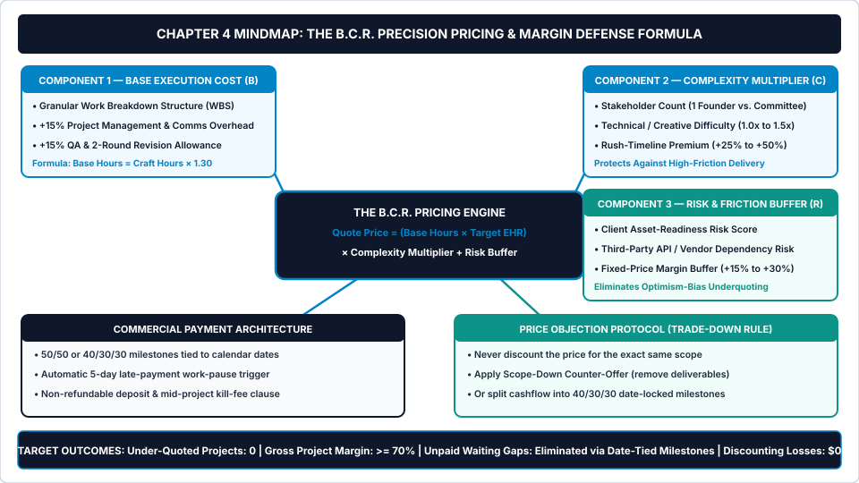
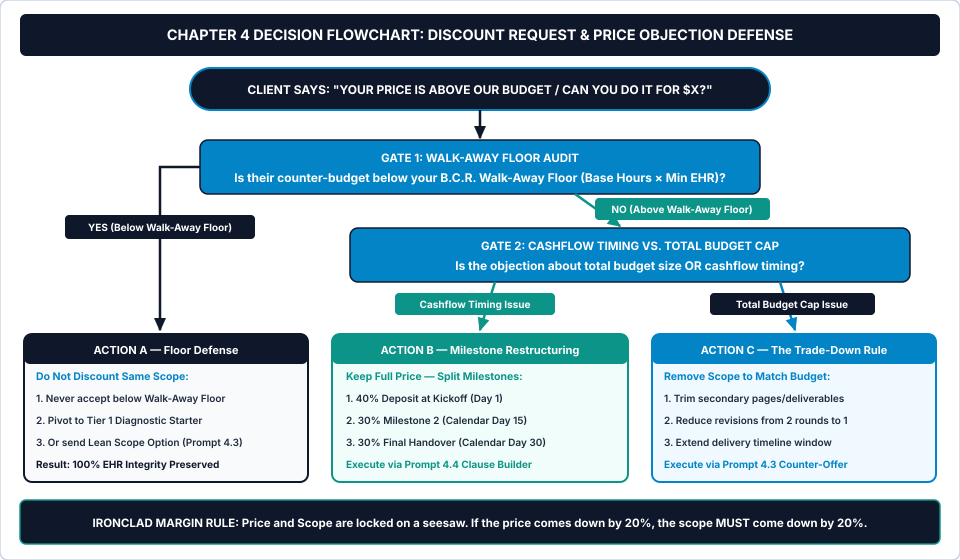

# Chapter 4: Precision Pricing, Estimation & Margin Defense

**How to Stop Guessing Project Prices, Calculate Your True Risk Buffer, and Handle Budget Objections Without Discounting Your Rate**

---

## 1. Learning Objectives

By the end of this chapter, you will be able to:

1. **Eliminate estimation optimism bias** by breaking every package or project into a granular Work Breakdown Structure (`WBS`) that explicitly accounts for `+15% Project Management & Communication Overhead` and `+15% Quality Assurance & Revision Allowance`.
2. **Calculate profitable fixed-scope prices using the B.C.R. Precision Pricing Formula** (`Quote Price = [Base Execution Hours × Target EHR] × Complexity Multiplier + Risk Buffer`), locking in your non-negotiable **Walk-Away Floor**.
3. **Replace approval-dependent payment traps with Calendar-Locked Milestone Billing** (`50/50` or `40/30/30` tied to fixed calendar dates, automatic 5-day late-payment pause triggers, and mid-project kill fees).
4. **Execute the Trade-Down Objection Protocol and five tested AI workflow prompts (`Prompts 4.1–4.5`)** to counter discount requests without cutting your Effective Hourly Rate and raise legacy client rates by 15% to 25% with zero churn.

---

## 2. The Real-World Friction Point

It is Friday at 5:30 PM. You just delivered the final files for a fixed-price brand identity and packaging sprint that you quoted at **`$2,000.00`**.

Three weeks ago, when you calculated that `$2,000.00` price in your head, the math looked effortless. You told yourself: *"Designing the primary logo lockup, three packaging dielines, and a brand style guide will take me twenty hours of pure design work. At `$100.00 per hour`, `$2,000.00` is a great payday."*

You fell victim to the **Planning Fallacy**—the well-documented cognitive bias where skilled practitioners estimate projects based on a best-case, zero-friction fantasy in which the client sends perfect files on Day 1, single-handedly approves the first draft in ten minutes, and never changes their mind.

When you inspect your actual time log at the end of Week 3, here is what really happened inside that `$2,000.00` project:

* **20.0 hours:** The core Illustrator and Figma design craft you originally estimated.
* **4.5 hours:** Uncounted project management, kickoff calls, Slack updates, and explaining print bleed specs to the client's overseas packaging printer (`+22.5%` hidden PM overhead).
* **6.5 hours:** Two full rounds of revision consolidation after the client's co-founder and head of retail joined the review thread in Week 2 with contradictory opinions (`+32.5%` hidden stakeholder and revision overhead).
* **5.0 hours:** Reformatting dieline files after the client switched packaging vendors mid-sprint (`+25.0%` unbuffered dependency risk).

Instead of `20.0 hours`, the project consumed **`36.0 real working hours`**—an **80% estimation overrun**. Your anticipated `$100.00/hour` payday quietly collapsed to **`$55.56/hour`**.

Even worse, consider what happens when a prospect pushes back on your initial quote before signing. Suppose you properly estimated a project at **`$2,800.00`**, and the prospect replies: *"We really want to work with you, but our budget is capped at `$2,100.00`. Can you meet us at `$2,100.00`?"*

Afraid of losing the deal, you say yes—and you leave the scope 100% unchanged.

Look at the brutal math of a **25% Unscoped Panic Discount**:

$$\text{Effective Hourly Rate After Discount} = \frac{\text{Original Quote} \times (1 - \text{Discount \%})}{\text{Total Real Project Hours}}$$

Giving a `25%` discount (`-$700.00`) does not reduce your workload by a single minute. It comes **100% out of your net margin**—slashing your Effective Hourly Rate by a full quarter while teaching the client from Day 1 that your prices are arbitrary and negotiable.

To add final insult to injury, your contract stated: *"50% deposit upon signing, 50% upon final client approval."* Because the client's internal marketing team went on vacation before reviewing the final proof, your final `$1,050.00` invoice sits unpaid for forty-five extra days—turning you into an interest-free bank for your client's internal delays.

---

## 3. Why Standard Approaches Fail

When freelancers try to fix pricing errors and cashflow stalls, they normally rely on three broken industry habits.

### 3.1 Failure Mode 1: "Gut-Feel" Estimation (Counting Only Pure Craft Hours)
When a developer, designer, copywriter, or consultant estimates a project, their brain naturally visualizes only the *hands-on-keyboard creation time* (`Bucket A`). They completely omit the **30% mandatory operational tax** required to run a professional engagement:
* **15% Project Management & Communication (`PM Tax`):** Onboarding setup, status updates, Loom walkthrough videos, file organization, and stakeholder alignment.
* **15% Quality Assurance & Revision Cycles (`QA Tax`):** Edge-case testing, proofreading, consolidating round-one and round-two feedback, and final handover packaging.

Any fixed-price quote that prices only raw craft hours is mathematically guaranteed to underprice the engagement by at least thirty percent before the project even begins.

### 3.2 Failure Mode 2: Ignoring Stakeholder & Dependency Multipliers
Delivering a five-page website for a solo founder who makes instant decisions in twenty-four hours is a fundamentally different operational workload than delivering the exact same five-page website for a company where a VP of Marketing, a Head of Legal, and two co-founders all have veto power.

Standard flat pricing charges both clients the exact same fee. Without a **Complexity Multiplier (`C`)** and a **Risk & Friction Buffer (`R`)**, high-maintenance committee clients devour your profit margin while your easiest solo-founder clients subsidize them.

### 3.3 Failure Mode 3: Tying Final Milestone Payments to "Client Approval"
Writing *"50% due upon final approval or launch"* in your agreement is one of the most dangerous mistakes in independent consulting. You do not control when a client launches their product, finishes their internal legal review, or replies to your email.

If you tie your payment trigger to a subjective event controlled entirely by the buyer, any internal client stall freezes your income. Professional commercial agreements tie milestones to **deliverable submission + a fixed calendar date window** (with an automatic *Deemed Approved* clause after five business days of client silence).

---

## 4. Core Framework: The Base + Complexity + Risk Buffer (B.C.R.) Formula

To lock **Stage 02 (The Commercial Gate)** of the *5-Stage Client Lifecycle Engine*, every productized package tier and custom add-on in your studio must be priced through **The B.C.R. Precision Pricing Formula**, defended by **The Trade-Down Objection Protocol**, and collected via **Calendar-Locked Milestone Billing**.

*(Note: Tier 3 bundle owners can also run this exact calculation interactively inside **Module 2: B.C.R. Scope & 3-Tier Proposal Pricing Calculator** in `freelancer-os-app.html`.)*

### Visual Architecture: System Mindmap



As depicted in [chapter-04-mindmap.svg](../../04-VISUAL-ASSETS/Mindmaps/chapter-04-mindmap.svg), the **B.C.R. Pricing Engine** computes your true commercial quote through three mathematical layers:

### 4.1 The Master B.C.R. Pricing Equations

1. **Step 1 — Calculate Total Base Execution Hours (`H_base`):**
   $$\text{Base Hours } (H_{\text{base}}) = \text{Core Craft Hours } (H_{\text{craft}}) \times 1.30 \quad (\text{includes } +15\%\text{ PM} + 15\%\text{ QA/Revisions})$$

2. **Step 2 — Calculate Base Execution Cost (`B`) & Walk-Away Floor (`F_walk`):**
   $$\text{Base Cost } (B) = H_{\text{base}} \times \text{Target Effective Hourly Rate } (\text{EHR}_{\text{target}})$$
   $$\text{Walk-Away Floor } (F_{\text{walk}}) = H_{\text{base}} \times \text{Minimum Acceptable EHR } (\text{EHR}_{\text{min}})$$

3. **Step 3 — Apply the Complexity Multiplier (`C`) and Risk Buffer (`R%`):**
   $$\text{Final B.C.R. Quote Price} = (B \times C) \times (1 + R\%)$$

Let's walk through a concrete numerical example:
* Suppose your **Core Craft Hours (`H_craft`)** for a sprint equal **`20.0 hours`**.
* Multiplying by `1.30` (`+15% PM` + `+15% QA`) yields **`26.0 Base Execution Hours (`H_base`)`**.
* At your **`$90.00/hour` Target EHR**, your **Base Execution Cost (`B`)** is **`$2,340.00`** (and at a `$70.00/hour` minimum EHR, your hard **Walk-Away Floor** is **`$1,820.00`**).
* Now suppose the client has three stakeholders reviewing work (`Complexity Multiplier C = 1.15x`) and relies on an external developer team for API credentials (`Risk Buffer R = +15%` or `0.15`):
  $$\text{Final B.C.R. Quote} = (\$2,340.00 \times 1.15) \times 1.15 = \$2,691.00 \times 1.15 = \$3,094.65 \rightarrow \mathbf{\$3,100.00\text{ Quoted Fee}}$$

Notice the difference: "Gut-feel" pricing quoted `$1,800–$2,000` (`20 hrs × $90–$100`). **B.C.R. Precision Pricing** quotes **`$3,100.00`**, building in **`$1,100.00` of structural protection** so that even if three stakeholders debate revisions and an API delay adds four hours, you still hit your `$90.00+/hour` Target EHR.

### Table 4.1: The B.C.R. Multiplier & Risk Buffer Calibration Matrix

| Pricing Variable | Low Friction (`1.00x` / `+0%`) | Moderate Friction (`1.15x–1.25x` / `+15%`) | High Friction (`1.35x–1.50x` / `+30%`) |
| :--- | :--- | :--- | :--- |
| **C1: Stakeholder Count** | **1 Single Decision-Maker** (Founder/Owner approves directly) | **2–3 Stakeholders** (Marketing Lead + Co-Founder review) | **4+ Committee / Board** (Multiple departments with veto power) |
| **C2: Technical / Creative Difficulty** | Standard 80%-repeatable sprint using existing templates | Custom integrations, complex migration, or new niche research | High-stakes custom architecture or strict compliance rules |
| **C3: Turnaround Velocity** | Standard `14–30 day` sprint window | Compressed `7–10 day` priority window (`+25%` rush) | Emergency `< 5 business day` turnaround (`+50%` rush) |
| **R1: Client Asset Readiness** | 100% of copy, data & logins ready in folder today | Partial assets ready; minor guidance required at kickoff | Disorganized historical files or slow internal client team |
| **R2: 3rd-Party Dependencies** | Zero external dependencies; you control 100% of tools | Depends on 1 external app, printer, or client IT admin | Depends on external agency, legacy ERP, or app-store review |

---

## 5. Step-by-Step Implementation Protocol

Install these four commercial rules to eliminate underquoting, protect cashflow timing, and handle every budget objection with calm mathematical authority.

### Step 1: Run Every Scope Through the WBS & B.C.R. Estimator Before Quoting
Never quote a number on a live call unless it is one of your pre-calculated, locked 3-Tier packages from Chapter 2. Whenever a project involves custom parameters, multi-stakeholder dynamics, or expedited timelines, run **Prompt 4.1** (*Work Breakdown Structure & Hidden-Hour Estimator*) and **Prompt 4.2** (*B.C.R. Calculator Prompt*) to lock three numbers before generating your proposal:
1. **Your Walk-Away Floor (`F_walk`):** The absolute lowest dollar figure below which you will decline the full scope.
2. **Your Target Tier 2 Quote (`B.C.R. Price`):** Your fully buffered commercial price.
3. **Your High-Anchor Tier 3 / Priority Price (`1.4x–1.8x`):** Your expedited or comprehensive advisory option.

### Step 2: Enforce the "Trade-Down Rule" on Every Price Objection
Eventually, a qualified buyer will look at your `$3,100` Tier 2 quote and ask: *"We have `$2,400` approved for this sprint—can you do it for `$2,400`?"*

**The Ironclad Margin Rule:** *Price and Scope are locked on opposite ends of a mechanical seesaw. If the price comes down by 20%, the scope MUST come down by at least 20%.*

Never say *"Okay, I'll do the `$3,100` package for `$2,400`."* If you cut your price without cutting deliverables, you admit that your original `$3,100` price was padded—and you destroy your Effective Hourly Rate.

Instead, route every discount request or budget objection through the **Discount Request & Price Objection Defense Flowchart** below.

### Operational Decision Tree



Follow the exact commercial gates depicted in [chapter-04-flowchart.svg](../../04-VISUAL-ASSETS/Flowcharts/chapter-04-flowchart.svg):

* **Gate 1 — The Walk-Away Floor Audit:** *Is the client's counter-budget below your B.C.R. Walk-Away Floor (`Base Hours × Minimum EHR`) for the full scope?*
  * **If YES (`Below Floor`):** Route to **Action A (Floor Defense)**. Never accept the full project below your Walk-Away Floor. Offer two high-status alternatives via **Prompt 4.3**:
    1. Start with your **Tier 1 Diagnostic Starter (`$450–$750`)** so they get immediate architectural clarity within their current budget; or
    2. Present a **Lean Scope Option** that removes 30% to 40% of the labor hours to fit their lower budget while keeping your Effective Hourly Rate at 100%.
  * **If NO (`Above Walk-Away Floor`):** Advance to **Gate 2**.
* **Gate 2 — Cashflow Timing vs. Total Budget Cap Diagnosis:** Ask a single clarifying question: *"To make sure I structure the right option for you, is the `$2,400` limit a hard total budget cap for the quarter, or is it primarily a monthly cashflow timing preference?"*
  * **If Cashflow Timing Issue:** Route to **Action B (Milestone Restructuring)**. Keep the full **`$3,100` B.C.R. Price** and split payment into three **Calendar-Locked Milestones** (`40% Kickoff [$1,240]`, `30% Day 15 [$930]`, `30% Day 30 [$930]`) using **Prompt 4.4**.
  * **If Total Budget Cap:** Route to **Action C (The Trade-Down Rule)**. Run **Prompt 4.3** (*Scope-Down Counter-Offer Generator*) to strip out secondary deliverables (e.g., *drop from 5 pages to 3 core pages, reduce revisions from 2 rounds to 1 consolidated round, and shift handover from 14 days to 21 days*) so the `$2,400` fee requires 25% fewer hours. Often, the moment a buyer sees which deliverables they will lose to save `$700`, they magically find the extra `$700` and approve your full `$3,100` Tier 2 quote anyway!

### Step 3: Lock In Calendar-Tied Milestones, Pause Triggers & Kill Fees
Eliminate unpaid waiting gaps forever by replacing subjective *"upon final approval"* payment clauses with three commercial protections generated by **Prompt 4.4**:

1. **Date-Locked Milestone Triggers:** Define every payment after the upfront deposit as: *"Milestone 2 (`50%`) is due upon delivery of the Milestone 2 staging link OR on Calendar Day 14 post-kickoff, whichever occurs first, provided any delay past Day 14 is caused by missing client inputs or delayed client feedback."*
2. **The 5-Day Deemed-Approval & Late-Pause Rule:** If a deliverable sits in the client's inbox for **5 business days** without consolidated feedback, the milestone is automatically deemed approved for billing purposes. If any invoice remains unpaid **5 calendar days** past its due date, all work and staging access pause automatically until the balance clears.
3. **The Non-Refundable Deposit & 50% Kill-Fee Clause:** State clearly that the initial `50%` kickoff deposit reserves dedicated studio capacity and is non-refundable. If a client cancels or indefinitely pauses a project after work has begun, a kill fee equal to work completed (minimum `50%` of total contract value) is due immediately before any work-in-progress files are released.

### Step 4: Execute the Annual Legacy Client Rate-Increase Protocol
Many freelancers trap 50% of their weekly capacity servicing loyal clients they signed two years ago at `$40/hour` or `$1,000/month`. Once your **3-Tier Productized Offer Matrix** and **B.C.R. Pricing** are installed for new leads, use **Prompt 4.5** (*Legacy Client Rate-Increase Notification & Grandfathering Bridge Architect*) to bring legacy accounts up to at least 85% of your new target EHR with a 30-day transition notice.

---

## 6. Tested AI Workflow Prompts

Copy and execute the five prompts below to automate WBS hidden-hour estimation, B.C.R. risk scoring, scope-down counter-offers, milestone protection clauses, and legacy rate increases.

---

### Prompt 4.1: Work Breakdown Structure (WBS) & Hidden-Hour Estimator

* **Operational Objective:** Deconstruct a project or productized package into micro-tasks, uncover hidden project management and revision hours that optimism bias ignores, and compute true **Base Execution Hours (`H_base`)**.
* **When to Run:** Whenever pricing a new productized tier or evaluating a custom project scope before running the B.C.R. calculator.

```text
SYSTEM ROLE:
You are a Senior Technical Project Estimator and Operations Auditor. Freelancers chronically underestimate project hours by 35% to 50% because they only count best-case creative/technical hours. Break the user's proposed project scope into a granular Work Breakdown Structure (WBS) and expose every hidden administrative, communication, testing, and revision hour.

INPUT VARIABLES:
- Service Niche & Project Deliverable Summary:
[E.G., FULL BRAND IDENTITY & 3 SKU PACKAGING DIELINE SPRINT FOR A CONSUMER BEVERAGE LAUNCH]
- Freelancer's Naive "Gut-Feel" Hour Estimate: [E.G., 20 HOURS]
- Number of Included Revision Rounds: [E.G., 2 CONSOLIDATED ROUNDS]
- Client Technical / Operational Context:
[E.G., 2 CO-FOUNDERS REVIEWING WORK; FILES MUST BE PREPARED FOR AN EXTERNAL COMMERCIAL OFFSET PRINTER]

OPERATIONAL INSTRUCTIONS:
1. Granular WBS Table: Output a Markdown table breaking the project into 5 operational phases:
   - Phase 1: Onboarding, Asset Audit & Strategy Setup
   - Phase 2: Core Architecture / First-Draft Production (Bucket A Craft)
   - Phase 3: Client Presentation, Async Walkthrough & Stakeholder Comms (+15% PM Floor)
   - Phase 4: Revision Round 1 & Round 2 Execution + Edge-Case QA (+15% QA Floor)
   - Phase 5: Final Pre-Flight Verification, Printer/Dev Handover & Offboarding SOP
   For each sub-task, list: [Best-Case Hours | Realistic Hours | Worst-Case Friction Hours | Weighted Expected Hours = (Best + 4×Realistic + Worst) ÷ 6].
2. Optimism Bias Diagnostic: Compare the sum of [Weighted Expected Hours] (`H_base`) against the user's [Naive Gut-Feel Hour Estimate] and state the exact percentage of hidden hours they almost gave away for free.
3. Bottleneck Task Alert: Highlight the single sub-task most likely to overrun if not bounded by an explicit assumption clause.
```

* **Verification Rule:** Confirm that Phases 3, 4, and 5 combined represent **at least 25% to 35%** of total `Weighted Expected Hours` (`H_base`), preventing raw craft optimism bias.

---

### Prompt 4.2: Project Complexity & Client Dependency Risk Scorer (B.C.R. Calculator Prompt)

* **Operational Objective:** Compute your exact **Walk-Away Floor (`F_walk`)**, **B.C.R. Target Quote Price**, and **3-Tier Anchor Prices** by applying calibrated Complexity (`C`) and Risk (`R%`) multipliers to your Base Execution Hours (`H_base`).
* **When to Run:** Immediately after Prompt 4.1 to lock the exact dollar figures for your proposal.

```text
SYSTEM ROLE:
You are an Executive Commercial Pricing Actuary enforcing the B.C.R. Precision Pricing Formula:
Quote Price = (Base Hours × Target EHR) × Complexity Multiplier (C) × (1 + Risk Buffer R%).
Calculate exact, mathematically verified project quotes and protect the user's profit margin against stakeholder and dependency friction.

INPUT VARIABLES:
- Weighted Base Execution Hours (`H_base` from Prompt 4.1): [E.G., 28.0 HOURS]
- My Target Effective Hourly Rate (`EHR_target` in USD): $[E.G., 95.00]
- My Minimum Acceptable Walk-Away Rate (`EHR_min` in USD): $[E.G., 70.00]
- Project Complexity & Risk Factors:
  - Stakeholder Count & Approval Structure: [E.G., 3 STAKEHOLDERS — CEO, MARKETING MANAGER, AND EXTERNAL RETAIL ADVISOR]
  - Technical / Creative Difficulty: [E.G., MODERATE-HIGH — REQUIRES METALLIC FOIL STAMPING SPECS AND BARCODE COMPLIANCE]
  - Turnaround Timeline Requested: [E.G., 14 DAYS — SLIGHTLY COMPRESSED FOR TRADE SHOW]
  - Client Asset Readiness & 3rd-Party Dependencies: [E.G., FINAL INGREDIENT COPY STILL PENDING LEGAL REVIEW; EXTERNAL PRINTER IN CHINA]

OPERATIONAL INSTRUCTIONS:
1. B.C.R. Multiplier Scoring Table:
   - Assign and justify the Complexity Multiplier `C` (`1.00x` to `1.50x`) across Stakeholders, Difficulty, and Timeline Velocity.
   - Assign and justify the Risk & Friction Buffer `R%` (`+0%` to `+30%`) across Asset Readiness and 3rd-Party Dependencies.
2. Exact B.C.R. Financial Calculation Block:
   - Base Execution Cost (`B = H_base × EHR_target`) = $____
   - Hard Walk-Away Floor (`F_walk = H_base × EHR_min`) = $____
   - Complexity-Adjusted Price (`B × C`) = $____
   - Final B.C.R. Target Quote (`[B × C] × [1 + R%]`, rounded to nearest $50) = $____
   - Projected Effective Hourly Rate if Zero Risk Hours Trigger (`Final Quote ÷ H_base`) = $____/hr
   - Protected Effective Hourly Rate if +25% Worst-Case Overrun Occurs (`Final Quote ÷ [H_base × 1.25]`) = $____/hr
3. 3-Option Proposal Price Calibration:
   - Option 1 (Tier 1 Diagnostic / Spec Blueprint — 20% of B.C.R. Quote): $____
   - Option 2 (Tier 2 Core B.C.R. Sprint — 1.0x Flagship Quote): $____
   - Option 3 (Tier 3 Priority + Post-Launch Retainer Anchor — 1.5x Quote): $____
```

* **Verification Rule:** Check that the **Protected Effective Hourly Rate under a +25% Worst-Case Overrun** remains strictly above your `[Minimum Acceptable Walk-Away Rate (EHR_min)]`.

---

### Prompt 4.3: Scope-Down Counter-Offer Generator (Protecting Your Rate When a Client Asks for a Discount)

* **Operational Objective:** Generate a calm, collaborative, zero-discount counter-offer using **The Trade-Down Rule** (`Action C`) or **Milestone Split** (`Action B`) whenever a prospect says your quote is above their budget.
* **When to Run:** Whenever a prospect asks for a discount or counters with a lower budget figure after receiving your proposal.

```text
SYSTEM ROLE:
You are a Master Commercial Negotiator enforcing the Ironclad Margin Rule: "Never discount the price for the exact same scope. If the price comes down by X%, the workload and deliverables must come down by at least X%." Write a warm, high-status counter-offer that honors the client's budget constraint by trading down scope or restructuring milestone timing—never by cutting the freelancer's Effective Hourly Rate.

INPUT VARIABLES:
- Client Name & Project Title: [E.G., MARCUS TAN — VERDE BEVERAGE BRAND & PACKAGING SPRINT]
- My Original B.C.R. Quote & Included Deliverables:
[E.G., $3,100 FOR PRIMARY BRAND IDENTITY, 3 SKU CAN DIELINES, PRINT-READY FOIL SPECS, 20-PAGE BRAND BOOK, AND 2 REVISION ROUNDS IN 14 DAYS]
- Client's Counter-Budget or Discount Request:
[E.G., "We love your work, but our packaging design budget is strictly capped at $2,200. Can you do it for $2,200?"]
- My Hard Walk-Away Floor for Full Scope (`F_walk`): $[E.G., 2500.00]
- Secondary Deliverables I Can Remove to Cut ~30% of My Hours:
[E.G., DROP FROM 3 SKU DIELINES TO 1 MASTER SKU DIELINE (THEY CAN ADAPT THE OTHER 2 LATER), REPLACE 20-PAGE BRAND BOOK WITH A 1-PAGE STYLE SHEET, AND CAP REVISIONS AT 1 CONSOLIDATED ROUND]

OPERATIONAL INSTRUCTIONS:
Generate a ready-to-send email response (under 165 words) that executes these four steps:
1. Warm Alignment: Validate their excitement to work together and respect their $2,200 budget discipline without sounding defensive.
2. Transparent Anchor Explanation: Briefly note that the $3,100 quote reflects the exact engineering/design hours required to deliver all [Original Deliverables] at launch quality.
3. Three Zero-Discount Paths Forward:
   - Path A (The Lean Scope Trade-Down at $2,200): Deliver the core foundation within their exact $2,200 budget by adjusting scope to [Secondary Deliverables Removed], keeping Phase 2 items on hold for next month.
   - Path B (The Full $3,100 Scope with 40/30/30 Date-Locked Milestones): Keep all original deliverables at $3,100, but split cashflow into $1,240 at Kickoff, $930 at Day 15, and $930 at Day 30.
   - Path C (The Tier 1 Diagnostic Starter at $[Tier 1 Price]): Start with the 5-day Architecture & Spec Blueprint today, with 100% credited when their full budget clears.
4. Simple Closing Question: "Which path works best for your launch goals—Path A (Lean $2,200 Sprint) or Path B (Full $3,100 Scope across 3 milestones)?"
```

* **Verification Rule:** Confirm that **Path A** explicitly removes concrete deliverables and/or revision rounds proportional to the price reduction, and **Path B** preserves 100% of your original `$[Original B.C.R. Quote]` price.

---

### Prompt 4.4: Date-Locked Payment Milestone, Pause-Trigger & Kill-Fee Clause Builder

* **Operational Objective:** Draft clear, plain-English commercial contract clauses that tie milestone payments to calendar dates (eliminating the *"waiting on client approval"* cashflow trap), enforce automatic work pauses on late invoices, and protect you with a 50% kill fee.
* **When to Run:** When assembling your 1-page service agreement or updating your standard commercial terms.

```text
SYSTEM ROLE:
You are a Commercial Operations & Contract Drafting Specialist for independent digital service studios. Draft crisp, plain-English payment, milestone, pause-trigger, and kill-fee clauses that protect the freelancer's cashflow from internal client delays. Include a standard note reminding the user to review final contract language with local legal counsel if required.

INPUT VARIABLES:
- Total Project Fee (USD): $[E.G., 3100.00]
- Chosen Milestone Structure: [CHOOSE: 50/50 SPLIT OR 40/30/30 SPLIT]
- Total Sprint Duration (Calendar Days): [E.G., 21 CALENDAR DAYS]
- Late Payment Grace Period (Days): [E.G., 5 CALENDAR DAYS]
- Extra Revision Round Fee (USD): $[E.G., 275.00]

OPERATIONAL INSTRUCTIONS:
Output five numbered, copy-paste-ready commercial agreement clauses in clean Markdown:
1. Clause 1 — Calendar-Locked Milestone Schedule:
   - Specify exact dollar amounts and percentages.
   - Include the crucial dual-trigger rule: "Milestone payments are triggered upon deliverable submission OR on the scheduled Calendar Day (Day [X]), whichever comes first, provided any delay in reaching the milestone is caused by client asset delays, stakeholder unavailability, or postponed feedback."
2. Clause 2 — The 5-Business-Day "Deemed Approved" Feedback Rule:
   - State that client feedback for each revision round must be submitted as a single consolidated list within 5 business days of deliverable presentation; silence beyond 5 business days constitutes formal milestone acceptance.
3. Clause 3 — Automatic Late-Payment Work Pause & Timeline Extension:
   - State that invoices unpaid past [Late Payment Grace Period] trigger an automatic pause on all production, calls, and staging links, with each day of payment delay extending final delivery dates by 2 business days.
4. Clause 4 — Capacity Reservation Deposit & Mid-Project Kill Fee:
   - State that the initial deposit is non-refundable as a capacity reservation fee, and if the client cancels or pauses the project for more than 14 days after kickoff, a kill fee equal to work completed (minimum 50% of total contract value) is immediately due.
5. Clause 5 — Intellectual Property & Source-File Transfer Gate:
   - State that full copyright/license assignment and editable source files transfer to the client exclusively upon 100% clearance of all milestone and add-on invoices.
```

* **Verification Rule:** Verify that **Clause 1** explicitly contains the *"upon deliverable submission OR on Calendar Day [X], whichever comes first"* language so client review delays can never block your invoice schedule.

---

### Prompt 4.5: Legacy Client Rate-Increase Notification & Grandfathering Bridge Architect

* **Operational Objective:** Upgrade low-margin legacy hourly or retainer clients to your new **B.C.R. Target EHR** and **Productized Tier Structure** using a high-trust 30-day notice and loyalty bridge that maximizes retention while pruning unprofitable accounts.
* **When to Run:** Once your new productized tiers are live and you are ready to calibrate existing client accounts.

```text
SYSTEM ROLE:
You are an Executive Account Director and Pricing Strategist. Write a respectful, confident, zero-apology rate-increase and package-transition memo for an existing long-term freelance client. Frame the transition around upgraded service architecture, dedicated capacity guarantees, and a loyalty "Grandfathering Bridge" discount off your new public studio rates.

INPUT VARIABLES:
- Legacy Client Name & Current Relationship Duration: [E.G., DAVID CHEN — 14 MONTHS WORKING TOGETHER]
- Current Legacy Pricing & Arrangement: [E.G., $1,200/MONTH FOR AD-HOC DESIGN & WEB UPDATES (~28 HOURS/MO = $42.85/HR EHR)]
- New Public Tier 3 Retainer Rate for New Clients: $[E.G., 2000.00]/MONTH
- Proposed Loyalty / Grandfathered Rate for This Client: $[E.G., 1550.00]/MONTH (+29% LIFT) FOR A LOCKED 3-DELIVERABLE MONTHLY SLA (~16 HOURS/MO = $96.87/HR EHR)
- Effective Date of New Rate (30-Day Notice): [E.G., NOVEMBER 1, 2026]
- Tangible Value / Speed Wins Delivered Over Past Year:
[E.G., LAUNCHED 18 LANDING PAGES, REDESIGNED CORE PRODUCT DECK, AND CUT PAGE LOAD TIMES BY 45%]

OPERATIONAL INSTRUCTIONS:
Generate a complete Legacy Rate Upgrade Package containing:
1. The 4-Part Rate Transition Email (Max 175 Words):
   - Appreciation & Proof Recap: Highlight the concrete wins delivered together ([Tangible Value Delivered]).
   - Studio Architecture Upgrade Notice: Explain calmly that as of [Effective Date], the studio has retired open ad-hoc billing and moved all accounts to bounded Productized Retainer Tiers (publicly priced at $[New Public Rate]/mo).
   - The Loyalty Grandfathering Bridge: Offer to lock their account in at a preferred legacy partner rate of $[Proposed Loyalty Rate]/mo for the next 6 months, including priority async turnaround and a clear monthly deliverable SLA.
   - Binary Transition Options: Option A (Lock the $[Proposed Loyalty Rate]/mo Grandfathered Retainer SLA starting [Effective Date]) or Option B (Transition to on-demand Tier 2 fixed sprints as needed).
2. Objection Handling Mini-Script: A 3-sentence reply if the client asks to stay at the old $[Current Legacy Pricing] rate (politely holding the rate while offering a smaller monthly deliverable cap that protects your $95+/hr EHR).
```

* **Verification Rule:** Confirm the email contains **zero** personal cost-of-living excuses (never blame inflation, rent, or taxes; justify the rate strictly through commercial value delivered and studio capacity structure).

---

## 7. Real-World Implementation Case Study

To see how **B.C.R. Precision Pricing**, **The Trade-Down Objection Protocol**, and **Calendar-Locked Milestones** transform project profitability, examine the 60-day financial turnaround of **Priya M.**, an independent brand identity and packaging designer based in Sydney, Australia (working with Australian and US consumer packaged goods [CPG] founders; all figures normalized to USD equivalent).

### 7.1 Baseline Situation (Day 0 — Optimism Bias & The 25% "Friendship Discount")
With three and a half years of freelance experience, Priya produced retail-ready packaging designs. However, her financial audit exposed three severe margin leaks at **Stage 02 (The Commercial Gate)**:

1. **Chronic Underestimation:** Priya quoted fixed-fee brand and packaging projects at **`$1,850.00 USD`** based on an optimistic guess of `20 design hours`. In reality, printer dieline revisions, multi-founder debates, and Pantone/foil spec coordination pushed her average project to **`37.0 real hours`** (`$50.00/hr` gross before admin, and **`$34.25/hr` actual EHR** once unpaid sales/admin hours were included).
2. **Panic Discounting:** Whenever a founder hesitated at `$2,200`, Priya immediately offered a `15% to 25%` discount (`-$350 to -$500`) without removing a single SKU or revision round.
3. **Approval-Stalled Final Invoices:** Because her contracts billed `50% upfront / 50% upon final print sign-off`, she had **`$4,200.00` in completed project balances stalled for 40+ days** while clients waited on packaging manufacturers.

### 7.2 The 60-Day B.C.R. & Margin Defense Installation
Priya applied Chapter 4's four-step protocol across all new quotes and her three legacy monthly design clients:

1. **WBS + B.C.R. Recalibration (Prompts 4.1 & 4.2):** Running **Prompt 4.1** revealed her true **Base Execution Hours (`H_base`)** for a 3-SKU packaging sprint was **`27.5 hours`** (including `+15% PM` and `+15% Printer Pre-Flight QA`). Applying a `1.15x` multi-founder Complexity Multiplier and a `+15%` packaging dependency Risk Buffer at her `$90.00/hr` Target EHR lifted her flagship **Tier 2 Sprint Price from `$1,850` to `$3,100.00 USD`** (with a hard Walk-Away Floor of `$2,200`).
2. **Enforcing the Trade-Down Rule (Prompt 4.3):** Over 60 days, four qualified founders received her `$3,100` B.R.I.E.F. proposal. Two signed at the full **`$3,100`** immediately. The other two asked if she could match a **`$2,300` budget**.
   * Instead of giving an `$800` discount, Priya sent **Prompt 4.3's Trade-Down Counter-Offer**: **Path A (`$2,300` Lean Sprint: 1 Master SKU + 1 Revision Round)** vs. **Path B (`$3,100` Full 3-SKU Sprint split across `40/30/30` Calendar-Locked Milestones)**.
   * **Result:** One client chose **Path B (`$3,100` across 3 milestones)** so they would not lose the extra two SKUs, and one client chose **Path A (`$2,300` Lean Sprint)**, which Priya delivered in just `18.5 hours` (`$124.32/hr` project EHR!). Zero dollars were lost to unscoped discounting.
3. **Calendar-Locked Milestones & Legacy Rate Lift (Prompts 4.4 & 4.5):** Priya updated her agreement with **Prompt 4.4's Date-Locked Milestone Clause** (`Day 1 / Day 14 / Day 24`) and sent **Prompt 4.5's Grandfathering Memo** to her three legacy retainer clients—lifting each from `$1,000/mo` to **`$1,200/mo` (`+20%`)** with a hard monthly deliverable cap and **zero client churn**.

### 7.3 Verified 60-Day Results (Before vs. After Audit)

### Table 4.2: Priya M. (Brand & Packaging Studio) — 60-Day B.C.R. Pricing & Margin Defense Turnaround

| Financial & Commercial Metric | Baseline (Day 0 Gut-Feel Pricing) | Post-System (Day 60 B.C.R. Engine) | Net Commercial Variance |
| :--- | :---: | :---: | :---: |
| **Average Project Fee Quoted & Won** | `$1,850.00 USD` | **`$2,900.00 USD`** (`3 × $3,100` + `1 × $2,300 Lean`) | **`+$1,050.00 / project` (`+56.8%` lift)** |
| **Margin Lost to Unscoped Discounts** | `-$425.00 / project` (`~20%` panic cuts) | **`$0.00`** (`100%` enforced via Trade-Down Rule) | **`100%` elimination of discount erosion** |
| **Legacy Retainer Revenue (3 Clients)** | `$3,000.00 / mo` (`3 × $1,000`) | **`$3,600.00 / mo`** (`3 × $1,200` • `0` churn) | **`+$600.00 / mo` (`+20.0%` recurring lift)** |
| **Average Days to Collect Final Milestone** | `44 days` (tied to printer/client approval) | **`21 days` (tied to Calendar Day 21 clause)** | **`-23 days` faster cash collection** |
| **Gross Monthly Studio Revenue** | `$4,850.00 / month` | **`$7,950.00 / month`** | **`+$3,100.00 / mo` (`+63.9%` revenue growth)** |
| **Actual Effective Hourly Rate (EHR)** | **`$34.25 / hour`** (`35.4 hrs/wk`) | **`$62.11 / hour`** (`32.0 hrs/wk`) | **`+$27.86 / hr` (`+81.3%` EHR increase)** |

---

## 8. Common Operational Pitfalls & Fixes

Use Table 4.3 to prevent the four most common pricing and negotiation breakdowns at **Stage 02 (The Commercial Gate)**.

### Table 4.3: Chapter 4 Implementation Diagnostics — Common Pitfalls & Immediate System Fixes

| Common Pricing & Margin Pitfall | Symptom in Your Bank Account | Root-Cause Commercial Failure | Immediate Operational Fix |
| :--- | :--- | :--- | :--- |
| **1. Quoting Custom Prices Live on Discovery Calls** | You blurt out `$1,800` on Zoom to sound accommodating, then realize two hours later the scope requires 35 hours of work. | Estimating under live social pressure without running the **WBS + B.C.R. Formula**. | Quote **only** your pre-calculated 3-Tier Tear-Sheet prices live. For any custom scope, say: *"I'll run the exact WBS parameters right after our call and send your 3-option B.R.I.E.F. quote within 15 minutes."* |
| **2. Giving a "One-Time 20% Discount" for Future Promise** | A startup promises *"five more projects next quarter if you cut this first one by 25%."* There are never five more projects—only low-margin expectations. | Violating the **Ironclad Margin Rule** (`Price and Scope are locked on a seesaw`). | Never discount upfront on future promises. Instead, offer a **Retroactive Volume Rebate**: *"Full B.C.R. price (`$3,100`) on Sprint 1, and if you book Sprint 2 within 30 days of completion, we credit `$400` toward Sprint 2."* |
| **3. Starting Work Before the 50% Deposit Clears the Bank** | A client signs the PDF contract on Friday and says *"Accounting is wiring the deposit Monday—can you start this weekend?"* You work 10 hours, and the wire stalls for 3 weeks. | Treating a signature as a Kickoff Gate pass instead of cleared funds. | Enforce **Clause 4 (Prompt 4.4)**: The production calendar and 48-Hour Kickoff Sequence activate exclusively when the deposit payment shows **Cleared / Paid** in Stripe/Payoneer/Bank. |
| **4. Writing Long, Apologetic Essays When Raising Legacy Rates** | You send a 600-word emotional email explaining your software costs and rent, inviting the client to debate your personal budget. | Confusing commercial repricing with a personal salary plea. | Use **Prompt 4.5**: Keep the memo under 175 words, anchor on measurable wins delivered over the past year, present the new public rate alongside their **Loyalty Grandfathered Rate**, and give 30 days' notice. |

---

## 9. Chapter Action Worksheet: The B.C.R. Pricing & Margin Defense Calculator

Complete **Part A** and **Part B** below (or inside the standalone fillable edition in `05-WORKBOOKS/worksheet-04.md` / Module 2 of `freelancer-os-app.html`) to lock your B.C.R. numbers and Trade-Down menu.

### Part A: The B.C.R. Precision Pricing & Walk-Away Floor Worksheet

Run your flagship **Tier 2 Core Transformation Sprint** (or your next active project quote) through Lines 1 through 10:

| Line # | B.C.R. Calculation Component | Formula / Multiplier Rule | Example (Priya M.) | Your Calculated Figure |
| :---: | :--- | :--- | :---: | :---: |
| **Line 1** | **Core Craft Hours (`H_craft`)** | `Hands-on production hours from WBS (Prompt 4.1)` | `21.15 hrs` | `__________ hrs` |
| **Line 2** | **PM & Revision Overhead (`+30%`)** | `Line 1 × 0.30 (+15% PM + 15% QA/Revisions)` | `+6.35 hrs` | `+_________ hrs` |
| **Line 3** | **Total Base Execution Hours (`H_base`)** | **`Line 1 + Line 2` (`H_craft × 1.30`)** | **`27.50 hrs`** | **`__________ hrs`** |
| **Line 4** | **Target Effective Hourly Rate (`EHR_target`)** | `Your target high-margin hourly rate` | `$90.00 / hr` | `$________ / hr` |
| **Line 5** | **Minimum Walk-Away Rate (`EHR_min`)** | `Lowest acceptable rate (never < 75% of Line 4)` | `$80.00 / hr` | `$________ / hr` |
| **Line 6** | **Hard Walk-Away Floor (`F_walk`)** | **`Line 3 × Line 5` *(Never accept full scope below this)* ** | **`$2,200.00`** | **`$____________`** |
| **Line 7** | **Base Execution Cost (`B`)** | `Line 3 × Line 4` | `$2,475.00` | `$____________` |
| **Line 8** | **Complexity Multiplier (`C`)** | `1.00x (Low) • 1.15x–1.25x (Med) • 1.35x–1.50x (High)` | `1.12x` | `________ x` |
| **Line 9** | **Risk & Friction Buffer (`1 + R%`)** | `1.00 (+0%) • 1.15 (+15% Med) • 1.30 (+30% High)` | `1.12 (+12%)` | `1.______ (+___%)` |
| **Line 10** | **Final B.C.R. Target Quote Price** | **`(Line 7 × Line 8) × Line 9` *(Rounded to $50)* ** | **`$3,100.00`** | **`$____________`** |

---

### Part B: Pre-Built Scope-Down Counter-Offer Menu (The Trade-Down Rule)

Prepare three pre-defined scope reductions (via **Prompt 4.3**) so that if a prospect's budget sits 15% to 30% below **Line 10**, you can offer a **Lean Scope Option** in two minutes without cutting your Effective Hourly Rate:

| Trade-Down Lever | Full Flagship Tier 2 Specification (`100% Price`) | Lean Scope Trade-Down Specification (`75%–80% Price`) | Hours Saved (`-Hrs`) | Dollar Reduction Offered (`-$`) |
| :--- | :--- | :--- | :---: | :---: |
| **1. Core Deliverable Volume** | `________________________________________` | `________________________________________` | `-____ hrs` | `-$________` |
| **2. Revision Round Cap** | `2 Consolidated Revision Rounds` | `1 Single Consolidated Revision Pass` | `-____ hrs` | `-$________` |
| **3. Handover / Secondary Assets** | `________________________________________` | `________________________________________` | `-____ hrs` | `-$________` |
| **4. Turnaround Speed** | `Standard 14–21 Day Priority Sprint` | `Flexible 28–30 Day Standard Window` | ` Flex Slot` | `-$________` |
| **LEAN OPTION TOTAL** | **Full B.C.R. Price:** `$____________` | **Lean Trade-Down Price:** `$____________` | **`-____ hrs`** | **EHR Preserved: `100%`** |

---

## 10. Executive Summary & Implementation Checklist

### Core Chapter Takeaways
* **Never Price Raw Craft Hours Alone:** Every project carries a mandatory **30% operational tax** (`+15% Project Management/Communication` + `+15% QA/Revisions`). Always compute `Base Execution Hours = Core Craft Hours × 1.30` using a granular WBS (**Prompt 4.1**).
* **Price Complexity (`C`) and Risk (`R`) Upfront:** Committee approvals, rushed timelines, messy client files, and third-party dependencies are predictable margin killers. Applying the **B.C.R. Formula (`[B × C] × [1 + R%]`)** via **Prompt 4.2** guarantees you hit your Target EHR even when friction occurs.
* **Enforce the Ironclad Trade-Down Rule:** Never discount your price for the exact same scope. When a buyer cites a lower budget, route them through `chapter-04-flowchart.svg`: either keep the full price across **40/30/30 Calendar-Locked Milestones (Action B)** or remove 20% to 30% of deliverables via a **Lean Scope Counter-Offer (Action C / Prompt 4.3)**.
* **Tie Milestones to the Calendar, Never to Subjective Approval:** Inserting **Prompt 4.4's Date-Locked Milestone, 5-Day Deemed-Approval, and 50% Kill-Fee Clauses** eliminates the 45-day unpaid waiting gap permanently.

### Chapter 4 Implementation Checklist
Complete these five actions to lock **Part I (System Foundation, Positioning & Commercial Intake)** before advancing to Chapter 5:

* [ ] **Action 1:** Run **Prompt 4.1** and **Prompt 4.2** on your flagship Tier 2 package and complete **Part A of Worksheet 4** to lock your **Hard Walk-Away Floor (`Line 6`)** and **Final B.C.R. Target Quote (`Line 10`)**.
* [ ] **Action 2:** Complete **Part B of Worksheet 4** and save your **Prompt 4.3 Scope-Down Counter-Offer** script so you never panic-discount on a call or email again.
* [ ] **Action 3:** Run **Prompt 4.4** and update your service agreement template with the **Calendar-Locked Milestone Clause**, **5-Day Deemed-Approval Rule**, and **50% Kill-Fee Protection**.
* [ ] **Action 4:** Audit all active legacy clients; for any client below 80% of your `Target EHR`, run **Prompt 4.5** and schedule a 30-day **Grandfathered Rate Transition Notice**.
* [ ] **Action 5:** Verify that all **Stage 01 (Input Gate)** and **Stage 02 (Commercial Gate)** assets are complete—you are now ready to enter **Part II: Onboarding, AI-Assisted Execution & Boundary Control (Chapter 5)**.

---

## 11. Sources & Operational References

1. **Kahneman, Daniel & Tversky, Amos (1979).** *Intuitive Prediction: Biases and Corrective Procedures.* TIMS Studies in Management Science. Foundational cognitive psychology research defining the **Planning Fallacy** and optimism bias in professional project estimation.
2. **Project Management Institute (PMI).** *Practice Standard for Work Breakdown Structures (WBS) & Three-Point PERT Estimation (`[Optimistic + 4×Most Likely + Pessimistic] ÷ 6`).* Industry-standard mathematical methodology used in **Prompt 4.1** to calculate weighted base hours.
3. **Enns, Blair (2018) & Weiss, Alan (2009).** *Value-Based Fees & Commercial Scope Negotiation.* Foundational consulting rules for the **Trade-Down Objection Protocol** and decoupling payment milestones from subjective buyer launch delays.
4. **Digital Knowledge Product Studio Market Audit (2026).** *Solo Practitioner Estimation Overruns, Discount Erosion & Milestone Cashflow Benchmarks (`01-MARKET-RESEARCH/sources.md`).* Empirical grounding for the `+15% PM / +15% QA` overhead multiplier and 5-day deemed-approval clauses.
