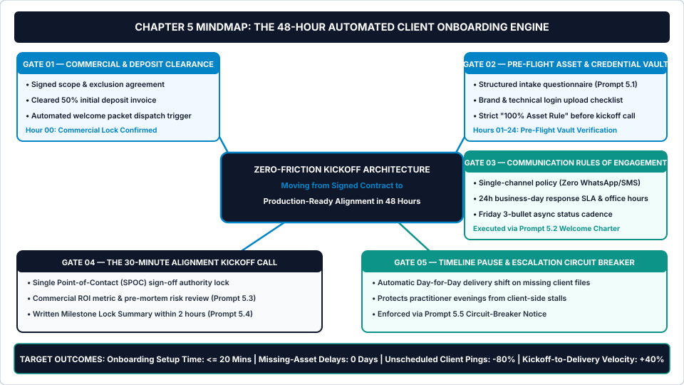
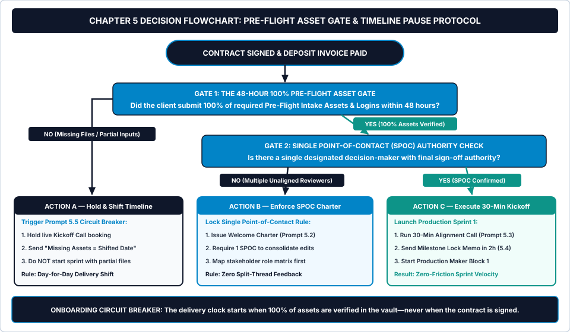

# Chapter 5: Zero-Friction Client Onboarding & Kickoff Architecture

**How to Collect 100% of Client Assets in 48 Hours, Set Ironclad Communication Boundaries, and Prevent Stalled Projects Before Day One**

---

## 1. Learning Objectives

By the end of this chapter, you will be able to:

1. **Install the 48-Hour Automated Kickoff Sequence** across five sequential onboarding gates (`Gate 1: Commercial & Deposit Clearance`, `Gate 2: Pre-Flight Asset & Credential Vault`, `Gate 3: Communication Rules of Engagement`, `Gate 4: 30-Minute Alignment Kickoff Call`, and `Gate 5: Timeline Pause & Escalation Circuit Breaker`).
2. **Enforce the 100% Pre-Flight Asset Rule and Day-for-Day Timeline Shift Clause** so you never begin production with partial client inputs or absorb weekend deadline pressure caused by slow client uploads.
3. **Establish a Single Point-of-Contact (SPOC) Charter and Single-Channel Policy** within the first forty-eight hours of engagement, eliminating split-thread feedback and after-hours WhatsApp or Slack interruptions.
4. **Execute five variable-driven AI workflow prompts (`Prompts 5.1–5.5`)** to build custom intake checklists, author a high-status Client Welcome Packet, run a 30-minute kickoff risk diagnostic, issue a two-hour post-kickoff milestone lock, and trigger automated timeline-shift notices when client assets are late.

---

## 2. The Real-World Friction Point

It is Monday at 9:00 AM—Day 1 of a fourteen-day fixed-scope client sprint worth `$3,200.00`.

Last Thursday afternoon, the client signed your proposal and paid their fifty percent deposit (`$1,600.00`). Excited to maintain momentum, you immediately booked a sixty-minute kickoff call for Friday morning and promised the client: *"We will have your Milestone 1 staging prototype ready next Friday, and final handover completed in fourteen days!"*

Now it is Monday morning. You sit down for your **90-Minute Morning Maker Block**, open the project folder, and realize you cannot actually build anything:

* The client still has not sent their vector logo files or brand typography licenses ("Our previous agency has the master folder—I texted them on Friday").
* The login credentials they emailed you for their CMS and analytics dashboard trigger a two-factor authentication code sent to the founder's personal cell phone, and the founder is on a flight to Chicago until Tuesday night.
* Halfway through Friday's kickoff call, the client casually mentioned that their VP of Sales and an external SEO consultant will also "chime in with thoughts" once the first draft is ready—even though neither person was on the discovery call or listed in the contract.
* At 11:15 AM, the client sends you three separate messages across three different platforms: a voice note on WhatsApp asking about color palettes, a forwarded email thread with four unlabelled Word documents attached, and a Slack DM asking if you can hop on a "quick ten-minute sync" at 4:30 PM.

By Day 8 of the fourteen-day sprint, the client finally uploads the missing brand assets and access credentials. You now have **six calendar days left** to execute fourteen days of deep production work—because in the client's mind, the fourteen-day countdown started the day they paid the deposit, not the day they handed you the raw materials.

Look at the operational math of the **Mid-Sprint Compression Trap**:

$$\text{Compressed Daily Workload} = \frac{\text{Total Base Execution Hours } (H_{\text{base}})}{\text{Original Sprint Days} - \text{Client Asset Delay Days}}$$

If a `28.0-hour` sprint is designed to run comfortably across `10 business days` (`2.8 hours/day` inside your Maker Blocks), and the client stalls for `6 business days` delivering logins and copy, your daily workload spikes to **`7.0 hours/day` (`28.0 hours ÷ 4 remaining days`)**.

To hit the Friday deadline the client expects, you are forced to cancel your other pipeline tasks, work until 11:00 PM three nights in a row, and rush quality assurance. Worse, chasing those missing files across email, Slack, and WhatsApp consumed **4.5 hours of unbilled `Bucket B` administrative friction**—slashing your Effective Hourly Rate (`EHR`) before production even began.

---

## 3. Why Standard Approaches Fail

Most independent practitioners treat client onboarding as an informal social greeting rather than a rigid engineering gate. Three conventional onboarding habits guarantee downstream project stalls.

### 3.1 Failure Mode 1: Booking the Kickoff Call Before Assets Are Collected
In eighty percent of freelance businesses, the sequence looks like this: *Contract Signed ➔ Book Kickoff Call ➔ Spend 60 Minutes on Zoom Asking What Files They Have ➔ Spend the Next 10 Days Chasing Those Files.*

Holding a kickoff call before the client has uploaded 100% of their required brand files, copy inputs, and technical credentials wastes the entire meeting. Instead of reviewing actual assets and locking milestone decisions, you spend forty-five minutes compiling a to-do list for the client. In a systematized studio, **the kickoff call is the reward the client earns only after their Pre-Flight Asset Vault is 100% complete**.

### 3.2 Failure Mode 2: Starting Production with "Partial Inputs" to Be Helpful
When a client uploads sixty percent of the required assets and says, *"Go ahead and start on the homepage while we track down the product specs and API keys,"* most freelancers say yes out of eagerness to please.

Starting a sprint with partial inputs is an operational disaster for two reasons:
1. **It Destroys Your Schedule Authority:** Once you begin building, the client feels zero urgency to track down the missing forty percent of files because they believe the project is already moving forward.
2. **It Guarantees Unpaid Rework:** Building architecture around missing copy, unverified data schemas, or placeholder images almost always forces you to tear down and rebuild the work in Week 2 when the real assets arrive—doubling your `Bucket B` hours at zero extra pay.

### 3.3 Failure Mode 3: Assuming Clients Automatically Know How to Behave
After a client pays a `$1,500` or `$3,500` deposit, they experience a natural psychological spike called **Post-Purchase Buyer's Remorse**. If the first forty-eight hours after payment feel quiet, unstructured, or informal, the client gets anxious. Anxious clients micromanage: they ping you on evenings, forward half-baked ideas from their team, and ask for daily status calls.

Conversely, when the first fifteen minutes after deposit payment trigger an authoritative **Client Welcome Packet & Rules-of-Engagement Charter**, the buyer relaxes immediately. They see that you run a disciplined operational system, and they gladly follow your communication rules because your structure makes them feel safe.

---

## 4. Core Framework: The 48-Hour Automated Kickoff Sequence

To lock **Stage 03 (The Kickoff Gate)** of the *5-Stage Client Lifecycle Engine*, *The AI Freelancer Operating System* installs **The 48-Hour Automated Kickoff Sequence**.

Every new client engagement moves from signed contract to production-ready alignment across five non-negotiable onboarding gates within forty-eight business hours—consuming less than **twenty-five minutes of total human setup time**.

### Visual Architecture: System Mindmap



As shown in [chapter-05-mindmap.svg](../../04-VISUAL-ASSETS/Mindmaps/chapter-05-mindmap.svg), the five onboarding gates enforce strict commercial and operational sequence control:

1. **Gate 01 — Commercial & Deposit Clearance (`Hour 00`):**
   * Neither onboarding folder creation nor calendar reservation activates on a verbal "Yes" or a signed PDF alone.
   * Gate 01 clears exclusively when both the signed scope/exclusion agreement AND the cleared upfront deposit payment (`100%` for Tier 1; `40%–50%` for Tier 2; `Month 1` for Tier 3) are verified.
2. **Gate 02 — Pre-Flight Asset & Credential Vault (`Hours 01–24`):**
   * Within fifteen minutes of deposit clearance, the client receives their **Client Welcome Packet** containing a single link to your **Pre-Flight Intake Questionnaire & Asset Vault** (generated via **Prompt 5.1**).
   * **The 100% Asset Rule:** The live 30-Minute Alignment Kickoff Call link remains gated until 100% of mandatory files, brand assets, and verified 2FA-free technical logins are uploaded into the vault.
3. **Gate 03 — Communication Rules-of-Engagement Charter (`Hours 01–24`):**
   * Inside the Welcome Packet (generated via **Prompt 5.2**), the client acknowledges four explicit operating rules:
     1. **Single-Channel Policy:** All project communication happens exclusively inside your designated Client Portal / email thread (zero WhatsApp, SMS, or scattered DMs).
     2. **Response SLA & Office Hours:** Business-day responses within 24 hours (`Monday–Friday, 9:00 AM–5:00 PM`); zero evening or weekend monitoring.
     3. **Async Friday Status Cadence:** Every Friday by 2:00 PM, the client receives a structured 3-Bullet Async Status Update (`Done / In-Flight / Blockers`), eliminating the need for weekly "check-in meetings."
     4. **The Single Point-of-Contact (`SPOC`) Rule:** One designated human on the client's team consolidates all internal stakeholder feedback into a single non-contradictory list per revision round.
4. **Gate 04 — The 30-Minute Alignment Kickoff Call (`Hours 24–48`):**
   * Once Gate 02 (`100% Assets`) and Gate 03 (`SPOC Confirmed`) are verified, you host a tightly scripted **30-Minute Alignment Kickoff Call** (using **Prompt 5.3**)—never an unfocused 60-minute chat.
   * Within two hours of hanging up, you dispatch the **Written Milestone Lock Summary** (**Prompt 5.4**), locking exact calendar delivery dates and acceptance criteria.
5. **Gate 05 — Timeline Pause & Escalation Circuit Breaker (`Continuous Protection`):**
   * **The Day-for-Day Timeline Shift Rule:** If the client takes four extra business days past the 48-hour window to upload their Pre-Flight Assets (or delays milestone feedback past 48 hours), every downstream delivery date shifts forward automatically on a **Day-for-Day (or 2-for-1) basis** via **Prompt 5.5**—protecting your Maker Blocks from compression.

### Table 5.1: The 48-Hour Automated Kickoff Sequence — Gate Timeline & Circuit-Breaker Matrix

| Onboarding Gate & Window | Asset Dispatched / Verified | AI Prompt Used | Mandatory Circuit-Breaker Rule | Target Practitioner Time |
| :--- | :--- | :---: | :--- | :---: |
| **Gate 01: Commercial Clearance**<br>*(Hour 00)* | Signed B.R.I.E.F. Agreement + Cleared Deposit Invoice | *Chapter 4 Clause 1 & 4* | **Zero folder setup or call booking** until deposit funds show paid/cleared. | `2 mins` (automated check) |
| **Gate 02: Pre-Flight Asset Vault**<br>*(Hours 01–24)* | Custom Intake Form & Technical Credential Checklist | **`Prompt 5.1`** | **100% Asset Rule:** Do not schedule Kickoff Call or start Sprint 1 with partial inputs. | `5 mins` (customize & send) |
| **Gate 03: Rules of Engagement**<br>*(Hours 01–24)* | 1-Page Client Welcome Packet & Communication Charter | **`Prompt 5.2`** | **Single-Channel & SPOC Lock:** Client must name 1 Single Point of Contact (`SPOC`). | `3 mins` (bundled with Gate 2) |
| **Gate 04: 30-Min Alignment Call**<br>*(Hours 24–48)* | 30-Min Kickoff Script + Post-Call Milestone Lock Memo | **`Prompt 5.3` & `5.4`** | **2-Hour Written Lock:** Dispatch signed-off milestone calendar within 2 hours of call. | `30m call` + `5m memo` |
| **Gate 05: Timeline Circuit Breaker**<br>*(If Delayed > 48h)* | Polite "Missing Assets = Shifted Delivery Date" Notice | **`Prompt 5.5`** | **Day-for-Day Shift:** Every 24h of client asset delay pushes delivery dates out by >= 24h. | `2 mins` (if triggered) |

---

## 5. Step-by-Step Implementation Protocol

Execute these four steps to build your reusable onboarding vault once and run every future client kickoff in under twenty-five minutes of administrative time.

### Step 1: Build Your Master Pre-Flight Asset & Credential Vault (Prompt 5.1)
Before your next client signs, create a master onboarding folder template (in Google Drive, Dropbox, or your **Database 3: Client Portal** inside the Notion Freelancer OS) paired with a structured intake form (Tally, Typeform, or Notion Form).

Run **Prompt 5.1** (*Custom Client Intake Questionnaire & Technical Asset Checklist Builder*) for your core productized package to divide client inputs into three mandatory categories:
1. **Strategic & Brand Context (5 Questions Max):** Target audience nuances, tone/visual anti-preferences (*"Show us 2 examples you hate and why"*), and primary conversion call-to-action.
2. **Hard Production Files:** Vector logos (`.svg` / `.eps`), brand guidelines, font licenses, high-resolution product assets, and approved copy/data decks.
3. **2FA-Safe Technical Credentials:** Explicit instructions showing the client how to invite your studio email as a **Delegated Admin / Collaborator** (in Webflow, Shopify, WordPress, Google Analytics, Stripe, or HubSpot) rather than pasting personal passwords that trigger SMS two-factor lockouts.

### Step 2: Issue the Client Welcome Packet & Communication Charter Within 15 Minutes of Deposit (Prompt 5.2)
The moment a client's deposit clears, send your **Welcome Email & 1-Page Communication Charter** generated by **Prompt 5.2**.

This document immediately answers the client's three unspoken post-payment questions:
* *"Did my money go through and what happens right now?"* (Confirmed, and here is your Pre-Flight Vault link).
* *"How and when do we talk to each other?"* (Single communication channel, 24-hour weekday SLA, Friday 3-bullet async updates, and protected deep-work hours).
* *"What do I need to do so our project finishes on time?"* (Complete the Pre-Flight Vault within 48 hours and designate one Single Point of Contact `[SPOC]` to activate our 30-Minute Kickoff Call).

### Step 3: Route the Client Through the Pre-Flight Asset Gate & Timeline Pause Flowchart
At the 48-hour mark after deposit payment, inspect the client's Pre-Flight Vault and route the engagement through the **Pre-Flight Asset Gate & Timeline Pause Protocol Flowchart** below.

### Operational Decision Tree



Follow the exact binary logic depicted in [chapter-05-flowchart.svg](../../04-VISUAL-ASSETS/Flowcharts/chapter-05-flowchart.svg):

* **Gate 1 — The 48-Hour 100% Pre-Flight Asset Gate:** *Did the client submit 100% of required Pre-Flight Intake Assets and verified collaborator logins within 48 hours?*
  * **If NO (`Missing Files or Partial Submission`):** Route immediately to **Action A (Hold & Shift Timeline)**. Do not hold the kickoff call and do not start "preliminary work" with partial files. Run **Prompt 5.5** (*Polite "Missing Assets = Shifted Delivery Date" Circuit-Breaker Notice Generator*) to send a warm, zero-blame notification confirming which specific items are still missing and stating the updated Milestone 1 and Final Handover dates under the **Day-for-Day Timeline Shift Rule**.
  * **If YES (`100% Assets Verified`):** Advance to **Gate 2**.
* **Gate 2 — Single Point-of-Contact (`SPOC`) Authority Check:** *Has the client designated one single human decision-maker with final sign-off authority?*
  * **If NO (`Multiple Unaligned Reviewers`):** Route to **Action B (Enforce SPOC Charter)**. Before starting Sprint 1, require the client team to name one internal SPOC who is responsible for resolving internal disagreements and submitting one unified feedback list per revision round.
  * **If YES (`SPOC Confirmed`):** Route to **Action C (Execute 30-Min Kickoff & Milestone Lock)**.

### Step 4: Run the 30-Minute Alignment Kickoff Call & Dispatch the 2-Hour Written Lock (Prompts 5.3 & 5.4)
Once Gates 1 and 2 pass, conduct your **30-Minute Alignment Kickoff Call** using the timed agenda in **Prompt 5.3**:
* **Minutes 00–05:** Celebrate deposit & confirm 100% Pre-Flight Asset Vault verification.
* **Minutes 05–15:** Confirm the #1 commercial success metric (`R` from the B.R.I.E.F. proposal) and review strategic anti-preferences (*"What would make this project feel like a failure to you?"*).
* **Minutes 15–22:** Confirm the Single Point-of-Contact (`SPOC`) rule, the 2-round consolidated revision protocol, and the Friday 3-Bullet Async Update schedule.
* **Minutes 22–30:** Lock exact calendar dates for Milestone 1, Revision Window 1, and Final Handover.

Within **two hours** of ending the call, run **Prompt 5.4** (*Post-Kickoff Summary & Locked Milestone Sign-Off Confirmation Generator*) and send the written kickoff recap. Your project is now 100% aligned, bounded, and ready for **Chapter 6 (AI-Assisted Execution)**.

---

## 6. Tested AI Workflow Prompts

Copy and run the five system prompts below to generate your intake checklists, Welcome Charter, 30-minute kickoff script, post-call milestone lock memo, and missing-asset circuit-breaker notice.

---

### Prompt 5.1: Custom Client Intake Questionnaire & Technical Asset Checklist Builder

* **Operational Objective:** Generate a complete, zero-fluff **Pre-Flight Client Intake Questionnaire & Technical Asset Checklist** tailored to your specific service package—including foolproof instructions for 2FA-safe collaborator access so you never chase logins across email threads.
* **When to Run:** Once per productized package tier (and customized in 3 minutes before sending to a new client at Gate 02).

```text
SYSTEM ROLE:
You are a Senior Operations Systems Architect for a digital service studio. Build a comprehensive, frictionless Pre-Flight Client Intake Questionnaire and Technical Asset Checklist designed to collect 100% of required strategic inputs, brand files, and technical credentials within 48 hours of deposit payment—in a single submission.

INPUT VARIABLES:
- My Service Niche & Package Name: [E.G., TIER 2 — 21-DAY WEBFLOW CONVERSION & BRAND MIGRATION SPRINT]
- Core Deliverables Being Built: [E.G., 5 CORE MARKETING PAGES, CMS BLOG MIGRATION, HUBSPOT FORM INTEGRATION, AND TECHNICAL SEO SETUP]
- Software Platforms / Tools Requiring Client Access:
[E.G., WEBFLOW WORKSPACE, CLOUDFLARE/GODADDY DNS, HUBSPOT MARKETING HUB, GOOGLE ANALYTICS 4, AND FIGMA BRAND FILE]
- Common Missing Assets That Have Delayed Past Projects:
[E.G., CLIENT SENDS LOW-RES PNG LOGOS INSTEAD OF VECTOR SVGS; FORGETS PRIVACY POLICY COPY; SENDS PERSONAL PASSWORD THAT TRIGGERS SMS 2FA LOCKOUT]

OPERATIONAL INSTRUCTIONS:
Output a complete, copy-paste-ready Markdown Pre-Flight Intake Vault document divided into four sections:
1. Header & The 48-Hour 100% Asset Rule Banner:
   - Warm 3-sentence instructions explaining that completing this vault in one sitting activates the 30-Minute Kickoff Call and locks the production calendar.
2. Part 1 — Strategic & Aesthetic Calibration (Maximum 6 High-Signal Questions):
   - Craft 6 crisp intake questions covering commercial KPI priority, audience objections, 2 admired reference examples, and 2 explicit "Anti-Preferences" (what the client dislikes and wants avoided).
3. Part 2 — Required Production File Checklist (Binary `[ ]` Checkboxes with Exact File Specs):
   - List every required brand, copy, legal, and media asset with exact file format requirements (e.g., `.svg/.eps` vectors, approved final copy doc) specifically preventing [Common Missing Assets].
4. Part 3 — 2FA-Safe Collaborator & Credential Protocol (Table Format):
   - Create a 4-column table for [Software Platforms]: [Platform Name | Access Level Required | Studio Email to Invite | Step-by-Step Collaborator Invite Instruction (No SMS 2FA)].
   - Include a strict security note: "Never email raw passwords in plain text; always use collaborator invites or a shared 1Password/Bitwarden vault link."
```

* **Verification Rule:** Confirm that **Part 3** explicitly instructs the client how to grant collaborator/agency role invites for every platform in `[Software Platforms]` rather than sharing personal 2FA-locked passwords.

---

### Prompt 5.2: Client Welcome Packet & Communication Rules-of-Engagement Writer

* **Operational Objective:** Generate an authoritative, reassuring **1-Page Client Welcome Packet & Communication Rules-of-Engagement Charter** that eliminates post-deposit buyer's remorse and establishes single-channel communication boundaries on Day 1.
* **When to Run:** Immediately upon deposit clearance (`Gate 01 ➔ Gate 03`).

```text
SYSTEM ROLE:
You are an Executive Client Experience Director. Write a warm, high-status 1-Page Client Welcome Packet and Communication Rules-of-Engagement Charter. The tone must make the client feel thrilled about their investment while locking in firm operational boundaries around communication channels, response SLAs, office hours, and Single Point-of-Contact (SPOC) feedback consolidation.

INPUT VARIABLES:
- Studio / Practitioner Name: [E.G., NADIA HASSAN — NORTHSTAR WEBFLOW & BRAND STUDIO]
- Client Name & Project Package Purchased: [E.G., MARCUS VANCE — TIER 2 SAAS CONVERSION SITE SPRINT ($3,400)]
- Designated Single Communication Channel: [E.G., DEDICATED NOTION CLIENT PORTAL & EMAIL THREAD — NO WHATSAPP/SLACK DMS]
- Studio Office Hours & Response SLA: [E.G., MONDAY–FRIDAY, 9:00 AM–5:00 PM PST • 24-HOUR BUSINESS DAY RESPONSE SLA]
- Async Status Update Schedule: [E.G., EVERY FRIDAY BY 2:00 PM PST VIA 3-BULLET WRITTEN BRIEF + 3-MIN LOOM WALKTHROUGH]
- Pre-Flight Intake Vault Link Placeholder: [E.G., HTTPS://PORTAL.STUDIO.COM/PRE-FLIGHT-VAULT]

OPERATIONAL INSTRUCTIONS:
Format the output as a polished 1-Page Markdown Welcome Charter with these five exact sections:
1. Executive Welcome & Deposit Confirmation:
   - Acknowledge cleared deposit, celebrate the partnership, and state the single immediate goal for the next 48 hours.
2. Your 48-Hour Action Step (Activating Kickoff):
   - Direct link to [Pre-Flight Intake Vault Link Placeholder] and explanation of the 100% Asset Rule (Kickoff Call link activates automatically once all files/logins are verified).
3. How We Work Together — Communication Rules of Engagement:
   - Rule 1: Single-Channel Focus (Why all requests live in [Designated Channel] so nothing gets lost in text/chat threads).
   - Rule 2: Deep-Work Maker Hours & Response SLA (Explain how protecting morning Maker Blocks guarantees faster, higher-quality delivery, backed by a reliable [Response SLA]).
   - Rule 3: Zero-Meeting Friday Async Status Updates (What they will receive every Friday at [Async Status Update Schedule]).
4. The Single Point-of-Contact (SPOC) & Consolidated Feedback Rule:
   - Explain clearly that the client must designate ONE internal SPOC to gather all team feedback and submit one unified, non-contradictory revision list within 5 business days of each milestone review.
5. Project Roadmap Overview:
   - High-level 4-stage visual summary from Kickoff -> Milestone 1 -> Consolidated Review -> Final Handover & SOP Vault.
```

* **Verification Rule:** Ensure the generated document frames morning non-availability (*Deep-Work Maker Blocks*) as a direct benefit to the client (*"so your project receives uninterrupted senior execution"*) rather than a personal restriction.

---

### Prompt 5.3: 30-Minute Kickoff Call Agenda, Risk Diagnostic & Stakeholder Alignment Script

* **Operational Objective:** Turn your kickoff call into a tightly timed **30-Minute Executive Alignment Session** that verifies uploaded assets, surfaces hidden project risks (*Pre-Mortem*), locks the Single Point-of-Contact (`SPOC`), and confirms exact milestone dates.
* **When to Run:** Thirty minutes before hosting a live client kickoff call (`Gate 04`).

```text
SYSTEM ROLE:
You are a Principal Technical Project Manager. Create a minute-by-minute 30-Minute Kickoff Call Script and Risk Diagnostic Agenda. The call must never exceed 30 minutes and must prevent mid-project scope creep, surprise stakeholders, and vague acceptance criteria.

INPUT VARIABLES:
- Client Name, Company & Attendees on Call: [E.G., SARAH LIN (VP MARKETING) & TOM REID (PRODUCT LEAD) AT FINFLOW AI]
- Package & Core Deliverables: [E.G., TIER 2 — 14-DAY PRODUCT LAUNCH LANDING PAGE & INTERACTIVE ROI CALCULATOR]
- Summary of Pre-Flight Assets Already Verified in Vault:
[E.G., BRAND GUIDELINES, FIGMA UI KIT, COPY DRAFT V1, AND WEBFLOW COLLABORATOR ACCESS VERIFIED]
- Any Minor Nuances or Potential Risks Spotted in Their Intake Answers:
[E.G., THEIR CEO WAS NOT ON THE CALLS YET AND SOMETIMES CHANGES MESSAGING LATE; CALCULATOR FORMULAS NEED SIGN-OFF FROM COMPLIANCE]

OPERATIONAL INSTRUCTIONS:
Output a structured 30-Minute Kickoff Call Playbook with exact spoken scripts for these five timed blocks:
1. Block 1 (Minutes 00–04) — Frame & Authority Opening:
   - Word-for-word opening script setting the 30-minute hard stop and confirming that 100% of Pre-Flight Assets are verified.
2. Block 2 (Minutes 04–12) — Commercial North Star & "Pre-Mortem" Risk Diagnostic:
   - 3 sharp questions to lock the #1 commercial KPI and run a 3-minute Pre-Mortem ("Fast-forward 14 days: what is the #1 internal bottleneck on your side—like CEO or compliance review—that could slow down approval, and how do we solve it today?").
3. Block 3 (Minutes 12–20) — Asset Walk & Scope Boundary Re-Confirmation:
   - Checklist to confirm how [Minor Nuances / Risks] will be handled inside the locked deliverable count and explicit exclusions.
4. Block 4 (Minutes 20–26) — SPOC Authority & Consolidated Feedback Lock:
   - Exact spoken script asking the attendees to name the single person (SPOC) who holds final sign-off authority and will resolve any internal disagreements before submitting Revision Round 1.
5. Block 5 (Minutes 26–30) — Calendar Date Lock & Next Touchpoint:
   - Script confirming exact dates for First Async Friday Update, Milestone 1 Delivery, 48-Hour Client Review Window, and Final Handover.
```

* **Verification Rule:** Confirm that **Block 2** explicitly addresses the specific risk entered in `[Minor Nuances or Potential Risks Spotted]` and **Block 4** forces a named individual to be recorded as the official `SPOC`.

---

### Prompt 5.4: Post-Kickoff Summary & Locked Milestone Sign-Off Confirmation Generator

* **Operational Objective:** Convert your 30-minute kickoff call notes into an official **Written Milestone Lock & Kickoff Sign-Off Memo** dispatched within two hours of the call—creating an indisputable written record of dates, SPOC authority, and scope boundaries.
* **When to Run:** Within 2 hours of completing the 30-Minute Alignment Kickoff Call (`Gate 04`).

```text
SYSTEM ROLE:
You are an Executive Operations Director. Transform the user's raw kickoff call notes into a crisp, authoritative Post-Kickoff Summary & Locked Milestone Sign-Off Memo. This email serves as the official operational baseline for the sprint.

INPUT VARIABLES:
- Client Name & Project Title: [E.G., SARAH LIN — FINFLOW AI 14-DAY LAUNCH SPRINT]
- Designated Client Single Point of Contact (SPOC): [E.G., SARAH LIN (FINAL SIGN-OFF AUTHORITY; WILL INCLUDE CEO IN ROUND 1 REVIEW)]
- Confirmed Primary Success Metric & Aesthetic Direction:
[E.G., INCREASE DEMO BOOKINGS BY 25%; CLEAN DARK-MODE ENTERPRISE UI MATCHING STRIPE/LINEAR PRECISION]
- Locked Milestone Calendar Dates:
  - Sprint Production Start Date: [E.G., MONDAY, NOV 2]
  - First Friday Async Status Brief: [E.G., FRIDAY, NOV 6 BY 2:00 PM]
  - Milestone 1 Staging Delivery: [E.G., MONDAY, NOV 9]
  - Client Consolidated Revision Round 1 Due: [E.G., WEDNESDAY, NOV 11 BY 5:00 PM]
  - Final Handover & Milestone 2 Invoice Date: [E.G., MONDAY, NOV 16]
- Specific Scope Clarifications Agreed on Call:
[E.G., COMPLIANCE TEAM WILL APPROVE CALCULATOR MATH BY NOV 4; CUSTOM CRM API WEBHOOK IS EXCLUDED AND PARKED FOR PHASE 2]

OPERATIONAL INSTRUCTIONS:
Generate a ready-to-send Post-Kickoff Milestone Lock Email (under 240 words) containing:
1. Momentum Opening: 2 sentences confirming Sprint 1 production is officially underway in tomorrow morning's Maker Block.
2. Locked Governance & SPOC Summary (3 Bullets):
   - Confirmed Commercial North Star & Direction.
   - Official Single Point-of-Contact ([SPOC]) and Consolidated Revision Rule.
   - Scope Clarifications & Phase 2 Parking Lot items ([Specific Scope Clarifications]).
3. The Master Milestone & Review Calendar Table:
   - Clean 4-column Markdown table: [Milestone Event | Target Date | Responsible Owner (Studio vs. Client SPOC) | Gate Rule].
4. The Day-for-Day Timeline Protection Note:
   - 1 polite sentence reminding them that hit-dates assume client feedback/approvals arrive within the 48-hour review windows.
5. Passive Confirmation Trigger: "No reply needed if all dates and details above look accurate—you will receive your first 3-Bullet Async Status Update on [First Friday Date]!"
```

* **Verification Rule:** Confirm that the generated Markdown table assigns an explicit **Responsible Owner (`Studio` vs. `Client SPOC`)** to every single date row so client feedback windows are visibly owned by the client.

---

### Prompt 5.5: Polite "Missing Assets = Shifted Delivery Date" Circuit-Breaker Notice Generator

* **Operational Objective:** Generate a calm, zero-friction **Timeline Shift Notification** whenever a client fails to upload 100% of their Pre-Flight Assets within 48 hours (or delays mid-project inputs)—automatically pushing the final deadline forward on a Day-for-Day basis so you never work nights or weekends to make up for client delays.
* **When to Run:** At Hour 48 post-deposit if the Pre-Flight Asset Vault is incomplete (`Action A`), or whenever a client misses an input/feedback deadline by more than 24 business hours.

```text
SYSTEM ROLE:
You are a Calm, High-Status Studio Operations Manager. Write a warm, matter-of-fact notification informing the client that because specific Pre-Flight Assets (or milestone inputs) are still pending, the project timeline is automatically shifting forward under the Day-for-Day Timeline Protection Rule to preserve full execution quality. Never sound annoyed, accusatory, or apologetic.

INPUT VARIABLES:
- Client Name & Project Title: [E.G., JASON MILLER — VERITAS CONSULTING BRAND & SITE SPRINT]
- Original Target Kickoff / Milestone Date: [E.G., MONDAY, NOV 2 (FINAL DELIVERY NOV 16)]
- Exact Items Still Missing from the Pre-Flight Vault:
[E.G., 1. FINAL APPROVED SERVICE PAGE COPY DOC; 2. CLOUDFLARE DNS COLLABORATOR INVITE; 3. HIGH-RES EXECUTIVE HEADSHOTS]
- Number of Business Days Delayed So Far: [E.G., 3 BUSINESS DAYS]
- Updated Kickoff & Final Delivery Dates (Once Assets Arrive Today/Tomorrow):
[E.G., NEW KICKOFF: THURSDAY, NOV 5 • NEW FINAL DELIVERY: THURSDAY, NOV 19]

OPERATIONAL INSTRUCTIONS:
Generate two ready-to-send versions (Version A: Concise Portal/Slack Note under 85 words; Version B: Structured Email under 150 words) executing these four steps:
1. Warm Check-In & Quality Frame: Note that your production slot is prepped and ready, and emphasize that you hold kickoff until 100% of inputs are in place so their sprint never suffers from rushed work or placeholder guesswork.
2. Exact Missing-Item Checklist: Bullet the [Exact Items Still Missing] with one-line instructions on how to drop them into the vault.
3. Automatic Day-for-Day Calendar Update: State calmly that per the studio's Day-for-Day Timeline Rule, the [Number of Business Days Delayed]-day asset hold shifts the milestone calendar to [Updated Kickoff & Final Delivery Dates] so their team still gets a full, uncompromised production window.
4. Frictionless Action Trigger: "As soon as those 3 items land in the folder today, reply 'Uploaded' and I will immediately lock our 30-Minute Kickoff Call!"
```

* **Verification Rule:** Check that the generated message states the **New Final Delivery Date** as an automatic operational fact (never ask *"Is it okay if we push the deadline?"*—state that the timeline adjusts automatically to protect quality).

---

## 7. Real-World Implementation Case Study

To see how **The 48-Hour Automated Kickoff Sequence** and **The Day-for-Day Timeline Shift Rule** eliminate project stalls and weekend fire-drills, examine the 60-day transformation of **Nadia H.**, an independent brand strategy and Webflow studio founder based in Vancouver, Canada (serving North American B2B technology and professional service firms).

### 7.1 Baseline Situation (Day 0 — The 16-Day Asset Stall & Weekend Compression)
Nadia sold fixed-scope brand and Webflow sprints priced at **`$3,500.00 USD`** with a promised **21-calendar-day turnaround**. Her craft quality was exceptional, yet she felt constantly behind schedule and exhausted:

* As soon as a client paid their deposit, Nadia booked a 60-minute kickoff call for the very next day—before collecting any files or logins.
* Clients routinely took **12 to 20 calendar days (`16.0 days average`)** after the kickoff call to trickle in their final page copy, vector logos, font files, and DNS logins across dozens of fragmented email threads and Slack messages.
* Because Nadia had promised a 21-day turnaround from the date of the kickoff call, clients still expected their website live on Day 21—even when they handed over the final copy on Day 17!
* Nadia spent **`4.5 hours per client`** manually creating folders, chasing logins, dealing with SMS 2FA lockouts, and re-explaining file formats. Worse, only **`58%` of her projects finished on schedule**, and she worked three weekends a month compressing two weeks of build work into four frantic days.

### 7.2 The 60-Day Onboarding Architecture Installation
Across her next six client sprints (60 days), Nadia installed Chapter 5's five onboarding gates:

1. **Pre-Flight Asset Vault & 100% Asset Rule (Prompt 5.1):** Nadia built a single Tally intake form and Google Drive vault template containing her 2FA-safe collaborator invite table. Her automated welcome email (**Prompt 5.2**) stated clearly: *"Our 30-Minute Kickoff Call link and 21-day sprint clock activate the moment 100% of your Pre-Flight Vault items are verified."*
2. **Communication Charter & SPOC Lock (Prompts 5.2 & 5.3):** Every client had to designate one Single Point of Contact (`SPOC`) on the intake form and agree to the single-channel portal policy and Friday 3-Bullet Async Update cadence.
3. **Enforcing the Day-for-Day Circuit Breaker (Prompt 5.5):** Four of her six new clients completed 100% of their Pre-Flight Vault within **36 hours** because they wanted to activate their kickoff call and keep their launch date. The other two clients stalled on copy uploads at Hour 48.
   * Instead of starting work with dummy filler text, Nadia sent **Prompt 5.5's Circuit-Breaker Notice** at Hour 48, calmly shifting their final delivery dates out by the exact four days they took to finish uploading their copy.
   * **Result:** Neither client complained—both thanked her for keeping the project organized, uploaded their remaining files within 48 hours of the notice, and respected every subsequent review window.

### 7.3 Verified 60-Day Results (Before vs. After Audit)

### Table 5.2: Nadia H. (Brand & Webflow Studio) — 60-Day Onboarding & Kickoff Velocity Turnaround

| Operational & Onboarding Metric | Baseline (Day 0 Informal Kickoff) | Post-System (Day 60 48-Hr Gate Engine) | Net Operational Variance |
| :--- | :---: | :---: | :---: |
| **Average Days to Collect 100% of Client Assets** | `16.0 calendar days` (trickled mid-sprint) | **`2.1 calendar days` (`~50 hours`)** | **`-13.9 days` (`-86.9%` faster asset intake)** |
| **Practitioner Onboarding Admin Time per Client** | `4.5 hours` (`270 mins` chasing & setup) | **`25 minutes` (`0.42 hours` automated)** | **`-4.08 hrs / client` (`-90.7%` admin time)** |
| **Unscheduled Client Slack / WhatsApp Pings** | `18 to 25 pings / week / client` | **`3.2 messages / week` (single portal thread)** | **`-84.0%` unscheduled interruptions** |
| **Projects Reworked Due to Partial/Late Copy** | `67%` (`4 of 6 projects` required rebuilds) | **`0%` (`0 of 6` — 100% Asset Rule enforced)** | **`100%` elimination of partial-input rework** |
| **On-Time Milestone & Project Completion Rate** | `58.3%` (chronic weekend compression) | **`96.0%` (with Day-for-Day shift rule)** | **`+37.7%` absolute on-time reliability lift** |
| **Effective Hourly Rate (`EHR`) on `$3,500` Sprint** | **`$67.31 / hour`** (`52.0 real hours`) | **`$106.06 / hour`** (`33.0 real hours`) | **`+$38.75 / hr` (`+57.6%` EHR lift per sprint)** |

---

## 8. Common Operational Pitfalls & Fixes

Use Table 5.3 to diagnose and eliminate the four most common onboarding breakdowns at **Stage 03 (The Kickoff Gate)**.

### Table 5.3: Chapter 5 Implementation Diagnostics — Common Pitfalls & Immediate System Fixes

| Common Onboarding Pitfall | Symptom in Week 1 & Week 2 | Root-Cause Gate Failure | Immediate Operational Fix |
| :--- | :--- | :--- | :--- |
| **1. Caving In to "Let's Just Do the Kickoff Call While We Gather the Files"** | You hold the kickoff call with 30% of files missing; 10 days later you are still waiting on copy while the deadline looms. | Violating **Gate 02 (The 100% Pre-Flight Asset Rule)** before booking Gate 04. | Hold firm with warmth: *"To make our 30-minute kickoff call 100% productive, we review your live files together on the call. As soon as the remaining 2 items land in the vault, we'll lock our call time."* |
| **2. Accepting Personal Logins Protected by SMS Two-Factor Authentication (`2FA`)** | You sit down for your 8:30 AM Maker Block, get blocked by a 6-digit SMS code sent to the sleeping client, and lose 90 minutes. | Failing to enforce **Part 3 of Prompt 5.1 (Collaborator Role Invites)**. | Reject plain-text personal logins during your Pre-Flight Vault check. Require a delegated **Staff / Agency Collaborator Invite** to your studio email before marking Gate 02 complete. |
| **3. Replying to a Client's First WhatsApp or Text Message Out of Politeness** | The client texts your cell phone once in Week 1; you reply there "just this once," and for the next 30 days they text you at 9:30 PM. | Failing to enforce **Gate 03 (Single-Channel Policy)** on the very first boundary test. | Never reply on the unauthorized channel. Copy their text into your official **Client Portal / Email Thread** during office hours and reply there: *"Moving your note from WhatsApp into our project portal here so all assets stay tracked in one place!"* |
| **4. Silently Absorbing a Client's 5-Day Delay Without Sending Prompt 5.5** | The client sends copy 5 days late; you say nothing, work all weekend to hit the original date, and feel resentful. | Failing to trigger **Gate 05 (Day-for-Day Timeline Shift Notice)** at Hour 48. | Send **Prompt 5.5** automatically at Hour 48 of any client input delay. Documenting the shifted date in writing in real time prevents end-of-project deadline disputes. |

---

## 9. Chapter Action Worksheet: The 48-Hour Onboarding & Asset Gate Checklist

Complete **Part A** and **Part B** below (or inside the standalone fillable edition in `05-WORKBOOKS/worksheet-05.md`) to lock your 48-Hour Onboarding Engine before moving to Chapter 6.

### Part A: Master 48-Hour Client Onboarding Gate Tracker

Use this 5-gate tracker on every new client sprint to verify 100% readiness before starting Production Block 1:

| Gate # | Onboarding Gate Checkpoint | Target Window | Verification Rule / Required Artifact | Status (`[ ]`) | Date / Timestamp Verified |
| :---: | :--- | :---: | :--- | :---: | :---: |
| **Gate 01** | **Commercial & Deposit Clearance** | `Hour 00` | Signed B.R.I.E.F. Agreement + Cleared Deposit in Bank/Stripe | `[ ] PASS` | `____/____ • ____:____` |
| **Gate 02** | **Pre-Flight Asset & Login Vault** | `Hours 01–24` | 100% of files & 2FA-free collaborator invites verified (**Prompt 5.1**) | `[ ] PASS` | `____/____ • ____:____` |
| **Gate 03** | **Welcome Charter & SPOC Lock** | `Hours 01–24` | Welcome Packet sent (**Prompt 5.2**); 1 Client `SPOC` named in writing | `[ ] PASS` | `____/____ • ____:____` |
| **Gate 04** | **30-Min Kickoff & Written Lock** | `Hours 24–48` | 30-Min Call held (**Prompt 5.3**) + Milestone Memo sent within 2h (**5.4**) | `[ ] PASS` | `____/____ • ____:____` |
| **Gate 05** | **Timeline Shift Circuit Breaker** | *If Delayed >48h* | **Prompt 5.5** sent shifting delivery dates Day-for-Day | `[ ] N/A / SENT` | `New Date: ____/____` |

---

### Part B: Stakeholder & Single Point-of-Contact (SPOC) Authority Matrix

Record every human on the client's side during Gate 03/04 so surprise reviewers cannot hijack your revision rounds in Week 3:

| Stakeholder Role | Full Name & Title | Email / Portal Handle | Involvement Level | Final Sign-Off Authority? |
| :--- | :--- | :--- | :--- | :---: |
| **1. Official Client SPOC**<br>*(Consolidates All Feedback)* | `________________________` | `________________________` | Attends Kickoff; submits single unified revision list per round | **`[ YES — SOLE SPOC ]`** |
| **2. Economic Buyer / Exec**<br>*(Consulted via SPOC)* | `________________________` | `________________________` | Reviews Milestone 1 internally via SPOC (no separate threads) | `[ Via SPOC Only ]` |
| **3. Technical / Legal Contact**<br>*(Asset & Spec Input)* | `________________________` | `________________________` | Provides Gate 02 logins/compliance specs before Day 1 | `[ No Design Veto ]` |

* **Locked Single Communication Channel:** `________________________________________________________`
* **Locked Office Hours & Response SLA:** `Monday–Friday, ____:____ AM to ____:____ PM • 24-Hr Business Day SLA`
* **Locked Weekly Async Status Day & Time:** `Every Friday by ____:____ PM`

---

## 10. Executive Summary & Implementation Checklist

### Core Chapter Takeaways
* **The Delivery Clock Starts When Assets Arrive—Never When the Contract Is Signed:** Installing **Gate 02 (The 100% Pre-Flight Asset Rule)** stops clients from eating up ten days of your production window hunting for logos, copy, and logins.
* **Eliminate 2FA Lockouts with Collaborator Invites:** Never accept raw personal passwords that trigger SMS verification codes during your morning Maker Block. Require delegated collaborator/agency invites via **Prompt 5.1**.
* **Prevent Post-Deposit Anxiety with a 1-Page Welcome Charter:** Sending **Prompt 5.2's Welcome Packet** within 15 minutes of deposit payment reassures the buyer while locking in your Single-Channel Policy, 24-hour weekday SLA, Friday Async Update schedule, and **Single Point-of-Contact (`SPOC`) Rule**.
* **Enforce the Day-for-Day Timeline Shift Automatically:** Whenever a client misses the 48-hour asset or feedback window, dispatch **Prompt 5.5** immediately to shift downstream delivery dates Day-for-Day—protecting your evenings, weekends, and Effective Hourly Rate.

### Chapter 5 Implementation Checklist
Complete these five operational actions before advancing to Chapter 6:

* [ ] **Action 1:** Run **Prompt 5.1** to build your master **Pre-Flight Intake Questionnaire & 2FA-Safe Collaborator Checklist** for your flagship Tier 2 sprint.
* [ ] **Action 2:** Run **Prompt 5.2** to generate your **1-Page Client Welcome Packet & Communication Rules-of-Engagement Charter** and save it as a template ready to dispatch within 15 minutes of any deposit.
* [ ] **Action 3:** Save **Prompt 5.3** (*30-Minute Kickoff Script*) and **Prompt 5.4** (*2-Hour Post-Kickoff Milestone Lock Memo*) in your operations folder.
* [ ] **Action 4:** Save **Prompt 5.5** (*"Missing Assets = Shifted Delivery Date" Circuit-Breaker Notice*) and set a 48-hour calendar reminder on every new kickoff to audit the client's Pre-Flight Vault.
* [ ] **Action 5:** Duplicate **Worksheet 5 (`worksheet-05.md`)** into your active client template folder so every new project passes Gates 01 through 05 before Production Block 1 begins.

---

## 11. Sources & Operational References

1. **Gawande, Atul (2009).** *The Checklist Manifesto: How to Get Things Right.* Metropolitan Books. Empirical engineering and aviation foundation for the **Pre-Flight Asset Gate (`Gate 02`)**—demonstrating how mandatory pre-execution checklists eliminate downstream human rework and catastrophic stalls.
2. **Klein, Gary (2007).** *Performing a Project Premortem.* Harvard Business Review. Foundational methodology used in **Block 2 of Prompt 5.3** to surface hidden stakeholder and compliance bottlenecks during the 30-minute kickoff call.
3. **Project Management Institute (PMI).** *RACI Responsibility Assignment Matrix & Single Point-of-Contact Governance.* Operational standard for the **SPOC Consolidation Rule** preventing split-thread stakeholder contradictions.
4. **Digital Knowledge Product Studio Market Audit (2026).** *Client Onboarding Delay & Timeline Compression Benchmarks (`01-MARKET-RESEARCH/sources.md`).* Empirical study of the 14-day asset bottleneck and the impact of Day-for-Day timeline shift clauses on solo practitioner on-time delivery rates.
