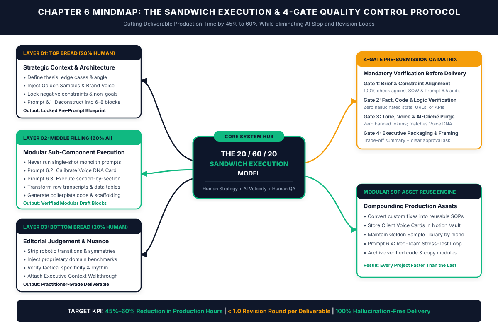
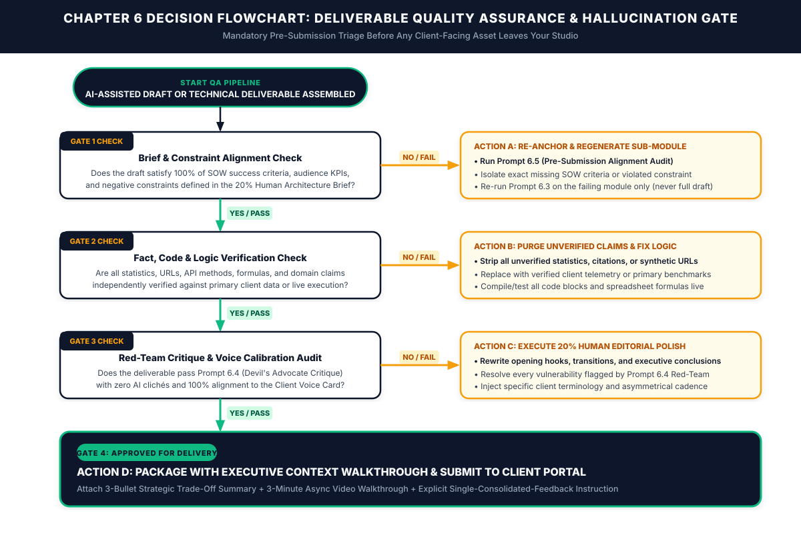

# Chapter 6: AI-Assisted Project Execution & Quality Control

*How to Cut Deliverable Production Time in Half Using the 20/60/20 Sandwich Method Without Ever Shipping Generic AI Work*

---

## 1. Learning Objectives

By the end of this chapter, you will be able to:

- **Replace Both Manual Blank-Page Grinding and Single-Shot AI Prompting:** Implement the **20/60/20 Sandwich Execution Protocol** so your client deliverables combine senior-level strategic judgment with rapid machine synthesis.
- **Engineer 20% Human Architecture Pre-Prompt Briefs:** Deconstruct complex client projects into six to eight modular sub-components anchored by verified client data, negative constraints, and proprietary domain perspectives before any language model generates a single token.
- **Construct Reusable Client Voice DNA Cards:** Extract measurable syntax, cadence, vocabulary, and structural preferences from a client's historical "Golden Samples" so every draft matches their exact institutional voice on the first pass.
- **Execute the 4-Gate Pre-Submission Quality Assurance Matrix:** Audit every deliverable across Brief Alignment, Fact/Code/Logic Verification, Red-Team Critique, and Executive Packaging before a client ever sees the work.
- **Build a Compounding Modular SOP Asset Engine:** Turn every solved technical problem, calibrated prompt sequence, and client deliverable structure into a reusable asset inside your Notion Freelancer Operating System, permanently increasing your Effective Hourly Rate (EHR).

---

## 2. The Real-World Friction Point

It is Wednesday at 8:15 PM. You are staring at a blinking cursor on a blank document—or an empty code repository, or an unstyled Figma canvas—trying to assemble a flagship client deliverable due Thursday at noon.

You already completed the hard work of winning the account. You qualified the buyer using the P.A.C.E. Scorecard in Chapter 3, anchored the engagement on a fixed-fee Core Option in Chapter 4, and ran the 48-Hour Automated Client Onboarding Engine in Chapter 5. The client paid their 50% deposit on time, uploaded their intake assets, and signed off on the Kickoff Brief. Now comes the moment where your Effective Hourly Rate is actually won or lost: **production execution**.

For most independent practitioners, production execution is trapped between two equally destructive extremes:

1. **The Artisanal Blank-Page Grind:** You refuse to trust artificial intelligence with your core craft because you have seen how shallow and repetitive raw language model outputs look. Consequently, you do every ounce of the heavy lifting manually. You transcribe 60-minute discovery recordings by hand, manually reorganize messy client notes into outlines, write every line of boilerplate code or foundational copy from scratch, and spend four hours formatting tables. A project you priced assuming 10 hours of effort quietly consumes 22 hours. Your quality is high, your client is happy, and your Effective Hourly Rate collapses to $45 an hour while you burn out working nights and weekends.
2. **The Single-Shot "AI Slop" Shortcut:** Exhausted by the manual grind and pressed against a deadline, you paste a three-sentence prompt into an AI chat window: *"Write a 2,500-word B2B technical migration whitepaper for [Client Name] targeting enterprise CTOs."* Thirty seconds later, the model outputs a cleanly formatted document. You skim it, change a few headings, and send it to the client thinking you just saved eight hours.

Forty-eight hours later, the client replies with a brutal email—or worse, a Google Doc covered in forty-seven frustrated margin comments:

> *"Honestly, this reads like it was generated by ChatGPT. The opening three paragraphs say nothing specific about our architecture, two of the compliance statistics in Section 2 don't match our industry, the tone sounds like a generic marketing brochure instead of an engineering brief, and this completely misses the edge case we talked about on our call. Can you rewrite this from scratch before Friday?"*

In a single afternoon, the "shortcut" destroys your authority, triggers three rounds of unpaid emergency revisions, consumes more hours than writing the piece manually would have taken, and permanently damages client retention.

According to Harvard Business School and BCG field experiments on knowledge workers using generative AI (2023–2024), practitioners who apply AI inside a structured, modular human-in-the-loop workflow complete complex analytical and production tasks **25.1% faster** and produce outputs rated **40% higher in quality** than unaided peers. However, those same studies reveal what researchers call the **"Jagged Technological Frontier"**: when professionals hand off entire end-to-end tasks without human architectural framing or verification gates, error rates spike and output diversity collapses into homogenized mediocrity.

If you want to earn $150 to $300+ per Effective Hour while delivering work that clients renew and refer for years, you cannot use AI as an autopilot replacement for your brain. You must engineer AI as a high-velocity **middle-layer synthesis engine** bookended by rigorous human strategy at the start and ruthless human quality assurance at the finish.

---

## 3. Why Standard Approaches Fail

Most freelancers who attempt to integrate AI into their project delivery fail for three structural reasons:

### Failure Mode 1: Monolithic Single-Shot Prompting (Context Dilution)
Large language models are probabilistic prediction engines governed by attention mechanisms. When you ask a model to execute an entire multi-layered deliverable in a single prompt—such as designing a complete database schema and API layer, or writing a 3,000-word research report, or building a 10-email onboarding sequence—the model's attention is stretched thin across dozens of competing implicit decisions. Without explicit structural scaffolding, the model defaults to the statistical mean of its training data. In prose, the statistical mean sounds like corporate brochure filler; in code, it produces brittle, unmaintainable boilerplate that ignores edge cases; in design and strategy, it produces generic best-practice lists that any junior competitor could copy in ten seconds.

### Failure Mode 2: Missing Negative Constraints and "Voice DNA"
When a human specialist writes copy, designs an interface, or architects software for a specific client, thousands of micro-decisions are governed by **what not to do**. A veteran B2B fintech consultant knows never to use casual exclamation points, never to promise "instant compliance," and always to lead with risk mitigation before revenue upside. Standard AI prompts only tell the model what to include; they almost never define **negative constraints** (forbidden vocabulary, banned structural tropes, off-limits claims, and explicit stylistic boundaries). Without a calibrated Client Voice DNA Card and a strict negative constraint list, the model fills every gap with symmetrical sentence structures, hollow transition phrases, and generic enthusiasm that experienced buyers spot immediately.

### Failure Mode 3: Absence of an Independent Pre-Submission QA Gate
In traditional agencies, the person who produces the first draft is rarely the person who approves it for client delivery; a senior creative director, lead engineer, or managing editor reviews the asset against the Statement of Work (SOW) first. As a solo operator, you wear both hats. When you finish assembling a deliverable at 4:45 PM on a Friday, cognitive fatigue blinds you to subtle gaps: a requirement mentioned in bullet four of the Kickoff Brief that got dropped during drafting, an unverified benchmark number, or a section that anticipates none of the client's internal political objections. Sending work directly from the production desk to the client portal without a deterministic quality gate guarantees preventable revision loops.

---

## 4. Core Framework: The 20/60/20 Sandwich Execution & 4-Gate QA Protocol

To eliminate both manual blank-page exhaustion and generic AI output, the AI Freelancer Operating System governs all project execution through two interlocking systems: **The 20/60/20 Sandwich Execution Model** and **The 4-Gate Pre-Submission QA Matrix**.

```
+=============================================================================+
|              THE 20 / 60 / 20 SANDWICH EXECUTION ARCHITECTURE               |
+=============================================================================+
|                                                                             |
|  LAYER 1: TOP BREAD — 20% HUMAN STRATEGIC ARCHITECTURE (NO AI GENERATION)   |
|  • Extract raw client truths, SME transcripts, and hard telemetry           |
|  • Define core thesis, contrarian angle, edge cases & architectural rules   |
|  • Lock Client Voice DNA Card + Negative Constraints (What NEVER to do)     |
|  • Deconstruct deliverable into 6–8 independent modular execution blocks    |
|                                     |                                       |
|                                     v                                       |
|  LAYER 2: MIDDLE FILLING — 60% AI MODULAR HEAVY LIFTING & SYNTHESIS         |
|  • Execute section-by-section (never single-shot full deliverables)         |
|  • Transform unstructured transcripts/notes into structured draft modules   |
|  • Generate foundational code scaffolding, test suites, or data tables      |
|  • Run Devil's Advocate Red-Team stress tests against every draft module    |
|                                     |                                       |
|                                     v                                       |
|  LAYER 3: BOTTOM BREAD — 20% HUMAN EDITORIAL POLISH & 4-GATE QA             |
|  • Gate 1: 100% SOW Brief & Constraint Alignment Audit                      |
|  • Gate 2: Primary Fact, Code Compilation & Mathematical Verification       |
|  • Gate 3: Voice DNA Calibration & Ruthless AI-Cliché Purge                 |
|  • Gate 4: Executive Context Packaging (Trade-Off Summary + Loom Brief)     |
|                                                                             |
+=============================================================================+
```

### The Three Layers of the 20/60/20 Sandwich Model

1. **Layer 1: The Top Bread (20% Human Strategic Architecture):**
   The first 20% of your production time block is 100% human-directed strategy and architectural design. You do not ask AI to "come up with ideas" in a vacuum. Instead, you assemble the raw ingredients collected during your Chapter 5 Pre-Flight Asset Gate: subject-matter expert (SME) interview transcripts, raw product documentation, customer support logs, performance analytics, and competitive positioning notes. You decide the core thesis, the structural sequence, the technical constraints, and the specific business outcome the asset must achieve. You then use **Prompt 6.1** to deconstruct your thesis into 6 to 8 modular sub-components and **Prompt 6.2** to lock the client's Voice DNA Card.
2. **Layer 2: The Middle Filling (60% AI Modular Heavy Lifting):**
   Once the blueprint, raw evidence, and voice rules are locked, you hand the repetitive, time-consuming synthesis work to the language model—one module at a time. Instead of spending four hours manually turning a 45-minute messy founder interview into a structured narrative, or manually writing 400 lines of CRUD API endpoints and unit test scaffolding, you execute **Prompt 6.3** section by section. Each module receives dedicated context, specific raw quotes or data points to incorporate, and explicit length and formatting constraints. Because the model only has to focus on a 350-word section or a single code module with full context, output precision jumps dramatically.
3. **Layer 3: The Bottom Bread (20% Human Editorial Polish & 4-Gate QA):**
   Once the modular blocks are assembled, you step back into the role of Principal Editor and Lead Architect. You run the assembled draft through **Prompt 6.4 (Devil's Advocate Red-Team Stress-Tester)** and **Prompt 6.5 (Pre-Submission Alignment Auditor)**, and then spend the final 20% of your time rewriting opening hooks, tightening transitions, injecting proprietary domain judgment, verifying every factual claim or code block, and packaging the deliverable with an Executive Context Walkthrough so the client approves it on the first review.

### Visual Architecture: System Mindmap



---

## 5. Step-by-Step Implementation Protocol

Follow this five-step operational sequence for every client deliverable—whether you produce technical copy, software features, UI/UX systems, financial models, or marketing automation architectures.

### Step 1: Build the 20% Human Architecture Pre-Prompt Brief (First 20% of Time Block)
Never open an AI interface with an empty clipboard. Before generating any draft material, spend 20 to 30 minutes completing a **Pre-Prompt Architecture Brief** inside your Notion Active Project workspace:
- **Primary Business Objective:** What measurable action must the reader, user, or stakeholder take after consuming or deploying this deliverable?
- **Proprietary Point of View (The Non-Obvious Insight):** What specific angle, technical trade-off, or counter-intuitive truth makes this piece uniquely valuable to this client? (AI cannot invent lived conviction; you must supply it in two to three bullet points.)
- **Raw Evidence Payload:** Paste the exact excerpts from your client's SME transcripts, analytics exports, API documentation, or customer research that must be woven into the deliverable.
- **Negative Constraint List:** List 5 to 10 explicit boundaries (e.g., *"Do not pitch features that require enterprise SSO; do not use rhetorical questions in subheadings; do not exceed a Flesch-Kincaid grade level of 10; do not import external third-party CSS libraries"*).

### Step 2: Calibrate the Client Voice & Style DNA Card
Every client organization has an unspoken linguistic and structural fingerprint. When a deliverable violates that fingerprint, stakeholders feel friction even if they cannot articulate why—leading to vague feedback like *"This doesn't quite feel like us."*

During your first project with any client, collect two to three **Golden Samples** (their highest-performing existing blog post, an executive memo written by the founder, a clean module from their existing codebase, or a flagship pitch deck). Run those Golden Samples through **Prompt 6.2** to generate a reusable **Client Voice DNA Card** that quantifies:
1. **Sentence Length Variance & Rhythm:** Short, punchy declarative statements vs. multi-clause analytical explanations.
2. **Authority Posture:** Peer-to-peer practitioner, academic researcher, or direct operational advisor.
3. **Lexical Preferences:** Approved domain terminology vs. internally disliked buzzwords.
4. **Formatting Architecture:** How headings, bulleted lists, callout boxes, code comments, and data tables are structured.

Store this Voice DNA Card permanently inside your Notion Client Record. Every time you produce a new asset for that client in Month 2, Month 6, or Month 12, you paste their Voice DNA Card directly into your execution prompts.

### Step 3: Execute the 60% AI Heavy Lifting via Modular Prompt Chaining
Divide the deliverable into **6 to 8 discrete modules** using **Prompt 6.1**. For example:
- **For a 2,500-Word B2B Case Study or Whitepaper:** Module 1 (Executive Summary & Quantitative Hook), Module 2 (Legacy Architecture Bottleneck), Module 3 (Why Conventional Solutions Failed), Module 4 (Technical Implementation Architecture), Module 5 (30/60/90-Day Rollout Protocol), Module 6 (Before/After ROI Telemetry Table & Conclusion).
- **For a Full-Stack Web Feature or Automation Workflow:** Module 1 (Data Schema & Type Definitions), Module 2 (Validation & Error-Handling Middleware), Module 3 (Core Business Logic Service), Module 4 (API Controller / Webhook Handler), Module 5 (UI Component State Architecture), Module 6 (Edge-Case Unit & Integration Test Suite).

Run **Prompt 6.3** for Module 1, inspect the output in 60 seconds, approve or adjust it, and feed the approved Module 1 summary into the context window for Module 2. By chaining modular prompts sequentially, you prevent context drift, eliminate repetitive transitions between sections, and maintain complete control over the narrative or technical arc.

### Step 4: Run the 4-Gate Pre-Submission Quality Assurance Matrix
Once all modules are assembled into a unified draft, the deliverable enters a mandatory quarantine. No file may be uploaded to the Client Portal until it passes all four gates:

| QA Gate | Verification Target | Deterministic Pass Criteria | Immediate Remediation If Failed |
| :--- | :--- | :--- | :--- |
| **Gate 1: Brief & Constraint Alignment** | SOW deliverables, Kickoff Brief KPIs, and Negative Constraints | 100% of contractually promised sub-items are present; zero negative constraints violated (verified via **Prompt 6.5**). | Regenerate only the deficient sub-module using **Prompt 6.3** with the missing constraint highlighted. |
| **Gate 2: Fact, Code & Logic Verification** | Statistics, URLs, quotes, formulas, API methods, and technical claims | Every number traces to client-supplied data or a verified primary source; all code compiles and passes tests; all spreadsheet math balances. | Strip any unverified AI-generated statistic immediately; replace with verified client telemetry or primary citation. |
| **Gate 3: Red-Team & Voice Calibration** | Argument strength, stakeholder objections, and stylistic authenticity | Survives **Prompt 6.4 (Red-Team Critique)**; contains zero banned AI clichés; matches the Client Voice DNA Card. | Execute the **20% Human Editorial Polish** pass to rewrite hooks, transitions, and vulnerable arguments. |
| **Gate 4: Executive Packaging & Framing** | How the client experiences and reviews the finished asset | Deliverable is accompanied by a 3-bullet Strategic Trade-Off Summary, an async video walkthrough (Loom), and a single consolidated feedback deadline. | Never send a raw link with *"Here's the draft, let me know what you think!"* Add the Executive Context wrapper before sending. |

### Step 5: Apply the 20% Human Editorial Polish and Executive Context Wrapper
In the final 20% of your production block, perform the high-value human interventions that justify premium rates:
1. **Rewrite the First 150 Words and Final 150 Words Manually:** Clients judge the quality of a document, deck, or proposal disproportionately by how it opens and how it closes. Make sure the opening hook hits their exact commercial nerve and the closing section drives a clear operational decision.
2. **Break Symmetrical AI Cadence:** Language models love writing paragraphs of identical four-sentence length and lists of three parallel adjectives. Vary your cadence deliberately. Follow a complex 30-word analytical sentence with a four-word sentence. Replace abstract nouns with concrete verbs and exact numbers.
3. **Attach the Executive Context Wrapper:** When you deliver the asset inside your Client Portal, include three elements in your delivery message:
   - **What We Built & Why:** Three bullet points connecting the deliverable directly to the business KPI locked in the Kickoff Brief.
   - **Strategic Trade-Offs Made:** One bullet explaining a deliberate professional choice you made (e.g., *"We structured Section 3 around a 90-day migration timeline rather than a 30-day sprint to address the compliance objection your VP of Security raised during kickoff"*).
   - **How to Review (Guided Approval):** A 3-minute async walkthrough video plus a specific question: *"Please review focusing on [Specific Strategic Element] and share one consolidated set of comments by [Day at 5:00 PM] so we stay on track for final delivery on [Date]."*

### Operational Decision Tree



---

## 6. Tested AI Workflow Prompts

The following five production prompts operationalize the 20/60/20 Sandwich Execution Protocol and the 4-Gate QA Matrix. Each prompt is designed for copy-paste deployment inside your LLM workspace.

### Prompt 6.1: The 20% Human Architecture & Modular Task Deconstructor

- **Operational Objective:** Transform your raw Kickoff Brief, SME notes, and strategic thesis into a 6-to-8-module production blueprint so you never run monolithic single-shot prompts.
- **When to Run:** At the beginning of your production block (Layer 1: Top Bread), immediately after reviewing the client's onboarding assets.
- **Verification Rule:** Review the generated module breakdown before drafting. Every module must map to a specific evidence source from the client's raw materials and include an explicit anti-slop constraint.

```text
ROLE:
Act as a Principal Production Architect and Lead Technical Editor for a high-ticket independent consultancy.

OBJECTIVE:
Deconstruct a complex client deliverable into 6 to 8 sequential, self-contained execution modules following the 20/60/20 Sandwich Execution Protocol. Do NOT write the final deliverable yet. Your job is to architect the modular blueprint so each section can be drafted with maximum precision and zero context drift.

PROJECT CONTEXT & 20% HUMAN ARCHITECTURE INPUTS:
- Client / Industry: [INSERT CLIENT NAME & INDUSTRY VERTICAL]
- Deliverable Type & Total Target Scope: [INSERT DELIVERABLE, e.g., 2,400-Word Enterprise Security Architecture Whitepaper / Full-Stack Stripe Webhook Integration Module]
- Primary Audience & Decision-Maker Role: [INSERT TARGET PERSONA, e.g., Series B VP of Engineering & CISO]
- Core Strategic Thesis (Our Non-Obvious Angle): [INSERT 2-3 SENTENCES EXPLAINING YOUR UNIQUE THESIS OR ARCHITECTURAL APPROACH]
- Available Raw Evidence & Client Assets: [LIST TRANSCRIPTS, DATA TABLES, METRICS, OR API DOCS YOU HAVE ON HAND]
- Non-Negotiable Negative Constraints: [INSERT 5-8 THINGS THIS DELIVERABLE MUST NEVER DO OR SAY]

OUTPUT REQUIREMENTS:
Generate a structured Modular Production Blueprint containing 6 to 8 sequential modules. For each module, provide:
1. Module Number & Working Title
2. Target Scope / Allocation (Word count range or code component boundary)
3. Core Strategic Job (The exact argument or functional requirement this module must fulfill)
4. Required Raw Evidence Injection (Which specific client quotes, metrics, or technical specs from my list above must be embedded here)
5. Transition Logic (How this module connects from the previous module and sets up the next)
6. Module-Specific Negative Constraint (The #1 generic cliché or technical failure mode to avoid in this specific section)

Conclude with a 3-bullet "Pre-Flight Architecture Check" identifying any missing factual inputs I need to confirm before we execute Module 1.
```

---

### Prompt 6.2: The Client Brand Voice & Style Calibration Engine

- **Operational Objective:** Extract a quantitative, reusable **Client Voice DNA Card** from 2 to 3 samples of the client's existing top-performing work.
- **When to Run:** Once during your first project with a new client (or whenever adapting to a new executive stakeholder's style), then store the output permanently in your Notion Client Portal.
- **Verification Rule:** Check that the generated Voice DNA Card includes concrete syntax rules, forbidden words, and before/after rewrite examples rather than vague adjectives like "professional and engaging."

```text
ROLE:
Act as a Computational Forensic Linguist and Senior Brand Editorial Director.

OBJECTIVE:
Analyze the provided "Golden Samples" of my client's existing work and extract a deterministic, reusable "Client Voice DNA Card" that I can inject into future production prompts to replicate their exact institutional voice, cadence, and technical posture.

CLIENT GOLDEN SAMPLES:
- Sample 1: [PASTE 300-800 WORDS OF CLIENT'S BEST EXISTING CONTENT, FOUNDER MEMO, OR CODE/DOCUMENTATION SAMPLE]
- Sample 2: [PASTE SECOND SAMPLE]
- Target Audience Context: [INSERT WHO READS THIS CLIENT'S WORK]

ANALYSIS & OUTPUT FORMAT:
Produce a single-page copy-pasteable "CLIENT VOICE DNA CARD" structured into these exact 6 sections:

1. CADENCE & SENTENCE MECHANICS:
   - Average sentence length and rhythm pattern (e.g., how they alternate between dense technical explanations and short punchy declarations).
   - Paragraph length limits and transition habits.

2. AUTHORITY & EPISTEMIC POSTURE:
   - How the voice establishes credibility (e.g., empirical data-first, contrarian practitioner, conservative risk-mitigator).
   - First/second/third-person pronoun rules ("we," "you," or objective third-person).

3. LEXICAL FINGERPRINT (USE VS. NEVER USE):
   - 10 signature domain terms, verbs, or framing structures this client favors.
   - 10 banned words, casual idioms, or marketing clichés that would immediately sound alien to this brand.

4. STRUCTURAL & FORMATTING RULES:
   - How subheadings, bulleted lists, data callouts, and technical examples are formatted.

5. THREE BEFORE/AFTER CALIBRATION EXAMPLES:
   - Show 3 examples of a generic "AI-sounding" sentence transformed into this client's exact Voice DNA, explaining the mechanical change made.

6. SYSTEM PROMPT INJECTION BLOCK:
   - A compressed 150-word instruction block I can paste directly into future drafting prompts to enforce this exact voice.
```

---

### Prompt 6.3: The 60% Heavy-Lifting Modular Draft & Code Synthesizer

- **Operational Objective:** Draft a single, high-density module from your Prompt 6.1 blueprint by combining your raw client evidence with the Prompt 6.2 Voice DNA Card.
- **When to Run:** Sequentially for each module during Layer 2 (60% AI Heavy Lifting) of your production block.
- **Verification Rule:** Never run this prompt for more than one module at a time. Verify that 100% of the supplied raw evidence points appear accurately in the output before advancing to the next module.

```text
ROLE:
Act as a Senior Domain Specialist and Principal Technical Producer executing one specific module of a larger client deliverable.

OBJECTIVE:
Draft ONLY [INSERT MODULE NUMBER & TITLE FROM PROMPT 6.1] with practitioner-grade depth, concrete specificity, and zero filler.

CONTEXT & PREVIOUS MODULE HANDOFF:
- Overall Deliverable Thesis: [PASTE CORE THESIS]
- Summary of Preceding Module (for seamless continuity): [PASTE 2-3 SENTENCES SUMMARIZING PREVIOUS MODULE, OR "THIS IS MODULE 1"]

CURRENT MODULE SPECIFICATION:
- Module Target Scope: [INSERT WORD COUNT OR COMPONENT BOUNDARY, e.g., 450 words]
- Core Strategic Job: [PASTE FROM PROMPT 6.1]
- Mandatory Raw Client Evidence to Embed (DO NOT INVENT FACTS OUTSIDE THIS DATA):
  [PASTE EXACT QUOTES, METRICS, TRANSCRIPT NOTES, OR TECHNICAL SPECS FOR THIS SECTION]

VOICE DNA & NEGATIVE CONSTRAINTS:
- Voice DNA Injection Block: [PASTE 150-WORD BLOCK FROM PROMPT 6.2]
- Strict Negative Constraints:
  1. Enforce the Studio Lexical Filter: never use generic AI buzzwords, ornate metaphors, exaggerated marketing hyperbole, or formulaic transitional clichés (`[PASTE STUDIO LEXICAL FILTER & BANNED WORD LIST]`).
  2. Do NOT invent unverified statistics, fake case studies, or synthetic URLs. If a data point is needed but missing from my Raw Evidence list, insert `[VERIFY DATA: specific metric needed]`.
  3. Avoid symmetrical 3-item adjective lists and hollow throat-clearing introductory sentences. Start directly with the operational substance.
  4. [INSERT ANY CLIENT-SPECIFIC NEGATIVE CONSTRAINT]

OUTPUT:
Provide the completed module draft followed by a brief 3-bullet "Evidence Traceability Check" confirming where each piece of supplied raw evidence was integrated.
```

---

### Prompt 6.4: The Devil's Advocate Red-Team Deliverable Stress-Tester

- **Operational Objective:** Subject your assembled draft or technical architecture to a ruthless adversarial critique from the perspective of a skeptical executive buyer before you perform your final human polish.
- **When to Run:** Immediately after assembling all modules (Gate 3 of the 4-Gate QA Matrix).
- **Verification Rule:** Treat every high-severity vulnerability flagged by this prompt as a mandatory target for your final 20% human editorial pass.

```text
ROLE:
Act as a Skeptical Chief Operating Officer, Lead Principal Engineer, and Adversarial Red-Team Reviewer representing my client's leadership team.

OBJECTIVE:
Tear apart my assembled draft deliverable and expose every weak argument, vague generalization, unverified assumption, stylistic tell, or unaddressed operational edge case BEFORE my client sees it. Do not be polite or encouraging; your job is to save me from a revision request.

CLIENT & PROJECT STAKES:
- Client & Target Decision-Maker: [INSERT CLIENT & STAKEHOLDER ROLES]
- Primary Deliverable Goal & SOW Success Criteria: [INSERT SOW SUCCESS CRITERIA]
- Known Internal Stakeholder Objections or Politics: [INSERT ANY KNOWN SKEPTICISM, e.g., "The CFO is skeptical about migration downtime; the VP of Sales hates long scripts"]

ASSEMBLED DRAFT DELIVERABLE:
[PASTE FULL ASSEMBLED DRAFT OR TECHNICAL SPECIFICATION]

RED-TEAM AUDIT INSTRUCTIONS:
Evaluate the draft and output a structured "Adversarial Vulnerability Report" covering:
1. THE "AI SLOP" DETECTOR: Quote exact sentences or paragraphs that read like generic language-model output, symmetrical filler, or surface-level advice that any junior freelancer could have generated.
2. STAKEHOLDER OBJECTION GAPS: Identify 3 specific places where the target executive will push back, ask "How does this actually work in practice?", or reject a recommendation due to unaddressed risk.
3. LOGIC, SPEC & EVIDENCE HOLES: Flag any claim that lacks quantitative proof, any step that skips an operational prerequisite, or any technical edge case left unhandled.
4. SURGICAL REWRITE PRESCRIPTIONS: For the 5 weakest passages or components in the draft, provide the exact before-text, explain why it fails executive scrutiny, and provide a concrete, high-authority replacement rewrite.
```

---

### Prompt 6.5: The 4-Gate Pre-Submission Alignment & Hallucination Auditor

- **Operational Objective:** Perform a final deterministic cross-check between the original Statement of Work / Kickoff Brief and the finished deliverable, plus generate your Executive Context Delivery Wrapper.
- **When to Run:** As your final 5-minute check before uploading the deliverable to the Client Portal (Gates 1, 2, and 4).
- **Verification Rule:** The deliverable cannot be submitted unless every SOW line item scores `PASS` and all factual claims are traced to primary inputs.

```text
ROLE:
Act as a Senior Quality Assurance Auditor and Client Delivery Director.

OBJECTIVE:
Audit my finished deliverable against the original Statement of Work (SOW) and Kickoff Brief to guarantee 100% contractual compliance, zero unverified claims, and frictionless client approval.

INPUT 1 — ORIGINAL SOW & KICKOFF BRIEF REQUIREMENTS:
[PASTE THE DELIVERABLE SCOPE, SUCCESS CRITERIA, AND CONSTRAINTS FROM YOUR SOW / KICKOFF BRIEF]

INPUT 2 — FINAL POLISHED DELIVERABLE:
[PASTE FINAL DELIVERABLE TEXT OR SPECIFICATION]

OUTPUT PART A — 4-GATE COMPLIANCE SCORECARD TABLE:
Create a Markdown table auditing every individual requirement from Input 1 against Input 2 with columns:
| Requirement / Constraint | Status (PASS / PARTIAL / FAIL) | Exact Location in Deliverable | Required Fix Before Sending (if any) |

OUTPUT PART B — FACT & CLAIM VERIFICATION LOG:
List every quantitative statistic, benchmark, proper noun citation, or technical dependency present in Input 2 and classify each as either:
- `[TRACEABLE TO CLIENT INPUT]`
- `[REQUIRES HUMAN PRIMARY VERIFICATION BEFORE SENDING]`

OUTPUT PART C — EXECUTIVE CONTEXT DELIVERY WRAPPER:
Draft a concise, high-authority delivery message I can post in the Client Portal alongside the asset, containing:
1. Executive Summary (3 bullets tying the finished work directly to their Kickoff Brief KPIs)
2. Key Architectural / Strategic Decisions Made (2 bullets explaining smart trade-offs we made on their behalf)
3. Guided Review & Consolidated Approval Prompt (Clear instruction on what to focus on, a link placeholder for a 3-minute walkthrough video, and a specific deadline for one consolidated round of feedback).
```

---

## 7. Real-World Implementation Case Study

### Practitioner Profile
- **Name & Location:** Liam T., Independent B2B SaaS Technical Content & Customer Case-Study Consultant based in Chicago, Illinois (4 years independent).
- **Core Service Offering:** Fixed-fee enterprise customer case studies, technical architecture whitepapers, and sales enablement playbooks for Series A–C cybersecurity and DevOps software companies ($4,500 per 3-asset monthly retainer or $1,800 per standalone case study).
- **Target Buyer:** VP of Product Marketing and Director of Demand Generation.

### The "Before" Bottleneck (Artisanal Grind + Occasional Prompt Backfire)
Liam had strong domain expertise, but his production workflow was crushing his margins. Each enterprise customer case study required interviewing a client's customer engineer for 45 minutes, synthesizing 12 pages of messy transcript notes alongside product telemetry, and writing a 1,800-word technical narrative plus an executive slide summary.
- When Liam wrote every word manually from a blank Google Doc, a single case study consumed **14.0 hours** across four days.
- Twice, when overloaded with three simultaneous deadlines, Liam tried pasting an entire interview transcript into an LLM with a single prompt (*"Write an engaging 1,800-word B2B case study from this transcript"*). Both times, the model stripped out the nuanced Kubernetes configuration details that mattered to DevOps buyers, invented a 40% cost-savings metric that the customer had never approved, and produced a breezy marketing tone that his VP of Product Marketing client hated. Those two drafts required **3.5 rounds of painful revisions** and nearly cost him a $54,000/year retainer account.
- Across his roster of four active clients, Liam was working **51 hours per week**, averaging **3.2 revision rounds per deliverable**, and netting an **Effective Hourly Rate of $89/hr**.

### The 14-Day System Intervention
Liam implemented the Chapter 6 **20/60/20 Sandwich Execution & 4-Gate QA Protocol** across all active accounts:
1. **Voice DNA Calibration (Day 1–2):** Liam took the top three historical assets from each of his four retainer clients and ran **Prompt 6.2** to create four permanent **Client Voice DNA Cards** in his Notion workspace. For his cybersecurity client, the card locked strict rules: *never use exclamation marks, never claim "100% breach immunity," lead every section with architecture specs before business metrics, and keep sentences under 22 words.*
2. **20% Human Architecture Blueprinting (First 60 Minutes per Asset):** Instead of staring at a blank page or dumping raw transcripts into chat, Liam spent the first 60 minutes listening to the customer call at 1.5x speed, tagging the five best verbatim technical quotes, defining the exact architectural "Before vs. After" angle, and running **Prompt 6.1** to divide the case study into six 300-word modules.
3. **60% Modular AI Synthesis (Next 2.5 Hours):** Using **Prompt 6.3**, Liam drafted each of the six modules individually, feeding only the verified quotes and telemetry for that specific module plus the client's Voice DNA Card. He also used the modular workflow to generate the companion sales-enablement summary table and social distribution snippets in 20 minutes instead of two hours.
4. **20% Human Polish & 4-Gate QA (Final 2.0 Hours):** Liam ran every assembled draft through **Prompt 6.4 (Red-Team Critique)** and **Prompt 6.5 (Alignment & Hallucination Auditor)**, rewrote the opening hook and technical trade-off analysis himself, verified every quote and metric against the primary transcript, and delivered each asset with a 3-minute Loom video and an Executive Context Wrapper.

### Before vs. After Operational Metrics (60-Day Post-Implementation Audit)

| Operational Metric | Before (Manual Grind / Ad-Hoc Prompting) | After (20/60/20 Sandwich + 4-Gate QA) | Net Operational Impact |
| :--- | :--- | :--- | :--- |
| **Total Production Time per Flagship Case Study** | 14.0 hours | **5.5 hours** | **-60.7% production hours** |
| **Average Client Revision Rounds per Deliverable** | 3.2 rounds | **0.8 rounds** (65% approved on Pass 1) | **-75.0% revision churn** |
| **Factual / Technical Hallucination Incidents** | 2 critical incidents in 90 days | **0 incidents** across 24 deliverables | **100% factual accuracy** |
| **Weekly Production Capacity (Deliverables / Month)** | 10 assets / month (at 51 hrs/wk) | **16 assets / month** (at 34 hrs/wk) | **+60% output in 17 fewer hrs/wk** |
| **Monthly Gross Freelance Revenue** | $15,600 / month | **$22,800 / month** | **+$7,200 / month (+46.2%)** |
| **Realized Effective Hourly Rate (EHR)** | $89 / hour | **$227 / hour** | **+$138 / hour (+155.1%)** |

---

## 8. Common Operational Pitfalls & Fixes

| # | Common Execution Pitfall | Why It Happens (Root Cause) | Immediate System Fix |
| :--- | :--- | :--- | :--- |
| **1** | **The "One-Prompt Wonder" Relapse:** Pasting a massive brief into an LLM and asking for a finished 2,500-word document or full application module in a single turn. | Deadline impatience makes skipping the 20% Human Architecture phase feel like a 20-minute time saver. | Enforce a hard rule: **No draft generation without a Prompt 6.1 Modular Blueprint.** Never generate more than 400–600 words or one logical code module per prompt turn. |
| **2** | **Unverified Synthetic Statistics ("Ghost Citations"):** Shipping a deliverable containing a plausible-sounding industry benchmark or API parameter that the model quietly fabricated. | Language models predict statistically probable tokens rather than querying live verified databases unless explicitly constrained. | Enforce **Gate 2 of the QA Matrix**: Prompt 6.3 must instruct the model to output `[VERIFY DATA]` whenever a metric is missing from your raw inputs, and Prompt 6.5 must audit every number before delivery. |
| **3** | **Stylistic Homogenization Across Clients:** Every client's copy, strategy deck, or documentation starts sounding identical because you reuse the same generic system prompt. | Failing to isolate and codify each client's specific syntax, vocabulary, and authority posture. | Run **Prompt 6.2** on 2–3 Golden Samples for every client and attach their unique **Client Voice DNA Card** to their Notion record. Never run Prompt 6.3 without pasting that client's specific Voice Card. |
| **4** | **Skipping the Final 20% Human Polish:** Submitting the stitched output of Modular Prompts 1–6 directly to the client without rewriting hooks, transitions, and executive conclusions. | Mistaking "structurally complete" for "client-ready" when tired at the end of a production block. | Split production into two calendar blocks separated by at least 60 minutes: **Block A (20% Architecture + 60% Synthesis)** and **Block B (4-Gate QA + 20% Human Polish)**. Fresh eyes catch robotic rhythm immediately. |
| **5** | **Naked Deliverable Drops:** Sending a Google Doc, Figma link, or GitHub PR in Slack with *"Here is the draft, let me know your thoughts!"* | Treating delivery as a file transfer rather than an executive presentation, which invites unfocused, Nitpick-level feedback from stakeholders. | Enforce **Gate 4**: Every deliverable must be submitted inside the Client Portal wrapped in the **Executive Context Summary** (Prompt 6.5 Part C) and a 3-minute async walkthrough video. |

---

## 9. Chapter Action Worksheet

Complete this worksheet inside your studio binder or in standalone file `05-WORKBOOKS/worksheet-06.md` before executing your next client deliverable.

### Part A: The 20% Human Architecture Pre-Prompt Blueprint

| Architecture Parameter | Your Active Deliverable Specification |
| :--- | :--- |
| **1. Client Name & Deliverable Title** | |
| **2. Contracted SOW Success Criteria (What defines a "Win"?)** | |
| **3. Target Executive Reader / End-User Persona** | |
| **4. Our Proprietary Thesis / Non-Obvious Strategic Angle** | |
| **5. Verified Raw Client Evidence Available (Transcripts, Metrics, Specs)** | |
| **6. Top 5 Negative Constraints (What this deliverable must NEVER do)** | |
| **7. Modular Breakdown (List your 6–8 execution modules)** | **M1:** <br>**M2:** <br>**M3:** <br>**M4:** <br>**M5:** <br>**M6:** |

### Part B: The 4-Gate Pre-Submission Quality Assurance Scorecard

Score your assembled deliverable across all four gates before uploading it to the Client Portal. Every gate must reach **PASS** prior to submission.

| QA Gate | Specific Verification Check | Status (`PASS` / `FAIL`) | Remediation Notes / Edits Applied |
| :--- | :--- | :--- | :--- |
| **Gate 1: Brief Alignment** | Does the deliverable fulfill 100% of SOW scope items and respect every negative constraint from Part A? | `[ ] PASS` `[ ] FAIL` | |
| **Gate 2: Fact, Code & Logic** | Has every statistic, quote, URL, formula, or code block been verified against primary client inputs or live execution? | `[ ] PASS` `[ ] FAIL` | |
| **Gate 3: Red-Team & Voice** | Did the draft survive Prompt 6.4 Red-Team critique, purge all banned AI words, and match the Client Voice DNA Card? | `[ ] PASS` `[ ] FAIL` | |
| **Gate 4: Executive Wrapper** | Are the 3-bullet Strategic Trade-Off Summary, 3-minute async walkthrough video, and consolidated feedback deadline attached? | `[ ] PASS` `[ ] FAIL` | |

---

## 10. Executive Summary & Implementation Checklist

### Key Chapter Takeaways
1. **AI Is a Middle-Layer Synthesis Engine, Never an Autopilot:** The highest-earning independent practitioners never hand off end-to-end thinking to a language model. They bookend 60% machine velocity between 20% human strategic architecture and 20% human editorial judgment.
2. **Modular Prompt Chaining Beats Monolithic Prompting Every Time:** Breaking a deliverable into 6 to 8 focused modules with dedicated raw evidence and negative constraints eliminates context drift and generic corporate filler.
3. **Voice DNA Cards Prevent "This Doesn't Sound Like Us" Revisions:** Quantifying a client's sentence mechanics, authority posture, and banned vocabulary from their Golden Samples allows you to match their institutional voice on Pass 1.
4. **The 4-Gate QA Matrix Protects Your Reputation:** Quarantining every draft until it passes Brief Alignment, Fact/Logic Verification, Red-Team Critique, and Executive Packaging reduces client revision loops below 1.0 round per project.

### Chapter 6 Implementation Checklist
- [ ] Collect 2–3 Golden Samples for each active client and run **Prompt 6.2** to store a permanent **Client Voice DNA Card** inside your Notion Client Portal.
- [ ] Replace blank-page drafting and single-shot prompting with the **20% Human Architecture Pre-Prompt Brief** and **Prompt 6.1** modular breakdown on your very next project.
- [ ] Execute your next client deliverable section-by-section using **Prompt 6.3**, injecting verified client evidence and strict negative constraints into every turn.
- [ ] Run your assembled draft through **Prompt 6.4 (Red-Team Stress-Tester)** and **Prompt 6.5 (4-Gate Pre-Submission Auditor)** before performing your final 20% human polish.
- [ ] Package your finished deliverable with an **Executive Context Wrapper** and a 3-minute async video walkthrough to secure first-pass client approval.

---

## 11. Sources & Operational References

1. **Dell'Acqua, F., McFowland, E., Mollick, E., Lifshitz-Assaf, H., Kellogg, K., Rajendran, S., Krayer, L., Candelon, F., & Lakhani, K. R. (2023).** *Navigating the Jagged Technological Frontier: Field Experimental Evidence of the Effects of AI on Knowledge Worker Productivity and Quality.* Harvard Business School Technology & Operations Mgt. Unit Working Paper No. 24-013 (in collaboration with Boston Consulting Group). — Empirical validation of the 25.1% speed increase, 40% quality improvement under structured human-in-the-loop workflows, and failure modes outside the frontier.
2. **Noy, S., & Zhang, W. (2023).** *Experimental Evidence on the Productivity Effects of Generative Artificial Intelligence.* Science, 381(6654), 187–192. — Controlled study demonstrating a 40% reduction in professional writing and synthesis completion times paired with an 18% improvement in independent quality grades when human framing and editing are combined with LLM synthesis.
3. **Peng, S., Kalliamvakou, E., Cihon, P., & Demirer, M. (2023).** *The Impact of AI on Developer Productivity: Evidence from GitHub Copilot.* arXiv:2302.06590 (Microsoft Research / MIT). — Task-completion telemetry showing a 55.8% speed improvement on modular implementation tasks when paired with human architectural framing and test verification.
4. **Stanford Institute for Human-Centered Artificial Intelligence (HAI) (2025).** *AI Index Report: Enterprise Verification, Hallucination Mitigation, and Human-in-the-Loop Quality Assurance Standards.* — Benchmarks on domain-specific hallucination rates and multi-gate verification protocols in professional services.
5. **Upwork Research Institute (2024–2025).** *From Tools to Systems: How Top-Earning Independent Professionals Integrate Generative AI Without Commoditizing Their Craft.* — Survey data linking modular workflow standardization to Effective Hourly Rate expansion among solo consultants.
