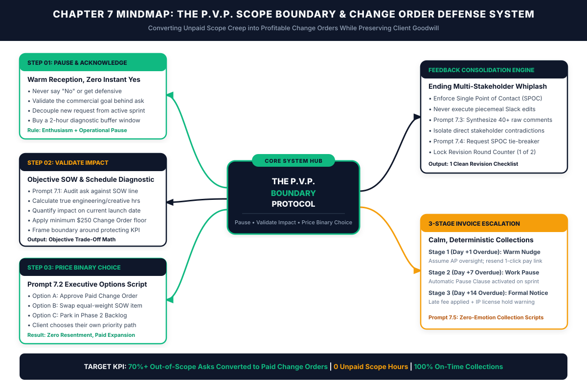
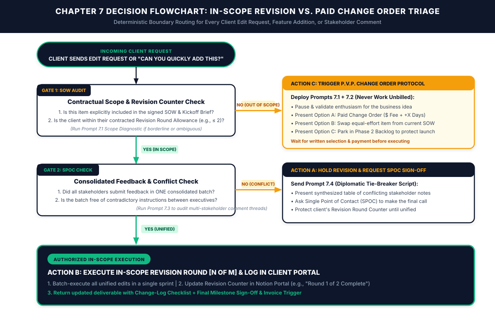

# Chapter 7: Defeating Scope Creep & Difficult Client Conversations

*How to Handle "Can You Quickly Add This?" Requests, Consolidate Chaotic Feedback, and Collect Late Payments with Calm Authority*

---

## 1. Learning Objectives

By the end of this chapter, you will be able to:

- **Eliminate Unpaid Scope Creep Without Damaging Client Goodwill:** Deploy the **P.V.P. (Pause, Validate, Price) Scope Boundary Protocol** to convert casual *"Can you quickly add this?"* requests into paid Change Orders, equal-effort scope swaps, or Phase 2 backlog items.
- **Run Objective Scope Diagnostics Before Replying Emotionally:** Use **Prompt 7.1** and **Prompt 7.2** to audit borderline client requests against your Statement of Work (SOW) and generate high-trust binary option scripts in under three minutes.
- **Neutralize Multi-Stakeholder Feedback Whiplash:** Enforce the **Single Point of Contact (SPOC) Rule** and use **Prompt 7.3** and **Prompt 7.4** to turn forty contradictory margin comments from four executives into one unified revision checklist.
- **Protect Your Fixed-Fee Margins with a Visible Revision Round Counter:** Track and communicate revision consumption transparently inside your Notion Client Portal so projects never spiral into Revision Round 5.
- **Collect 100% of Overdue Invoices Using the 3-Stage Escalation Ladder:** Replace awkward money anxiety with deterministic, emotion-free payment collection scripts (**Prompt 7.5**) backed by contractual work-pause and intellectual property hold triggers.

---

## 2. The Real-World Friction Point

Scope creep rarely kicks down your studio door wearing a ski mask and demanding twenty hours of free labor. It arrives on a Tuesday afternoon dressed as a friendly, two-sentence Slack message or email postscript:

> *"Hey! Loving how the new checkout flow is coming together. Since you're already in the codebase, could you quickly add a currency-switcher toggle for UK and EU visitors and wire up a quick webhook to our HubSpot staging list? Should only take twenty minutes—thanks so much!"*

That single word—**"quickly"**—is the most expensive adverb in the freelance economy.

When you read that message, a familiar knot tightens in your stomach. You know immediately that building, styling, testing, and debugging a multi-currency state toggle plus an authenticated HubSpot webhook is not a twenty-minute task; it is a six-hour engineering and QA task. Yet your brain immediately floods with conflict-avoidance anxiety:
- *"If I charge extra for this, will they think I'm nickel-and-diming them?"*
- *"They're a great client and I want them to renew next quarter—maybe I should just eat the six hours this once as a goodwill gesture."*
- *"It will take me thirty minutes of awkward agonizing just to figure out how to say no politely; it's almost easier to just build it tonight."*

So you reply: *"Sure thing! Happy to help, I'll get that added for you."*

Here is what actually happens when you grant an unpriced "quick favor": you do not buy client gratitude; **you train the client that your Statement of Work is a suggestion rather than a boundary.** Three days later, another "quick twenty-minute addition" arrives. Then the client's VP of Marketing jumps into the Google Doc or Figma file after you already completed Revision Round 2 and leaves thirty-two comments contradicting the instructions the founder gave you last week. Finally, when you submit the final milestone invoice, Accounts Payable goes silent for eleven days past the due date while the client is already asking for post-launch tweaks.

Let us look at the cold unit economics of scope creep. Suppose you price a fixed-fee project at **$3,600**, budgeted for **20 hours of execution** using the Chapter 6 Sandwich Method, targeting an Effective Hourly Rate (EHR) of **$180/hour**.
- During Week 1, you absorb two "small" unbilled additions totaling **5.5 hours**.
- During Week 2, fragmented feedback from three uncoordinated stakeholders forces **2 extra unbilled revision rounds**, consuming another **6.5 hours**.
- During Week 3, you spend **2.0 hours** manually chasing an overdue milestone invoice and answering ad-hoc Slack pings.

Your 20-hour project just consumed **34.0 hours**. Your realized Effective Hourly Rate plummeted from **$180/hour to $105.88/hour**—a **41.2% margin wipeout** on a project where the client never once intended to exploit you.

In our Chapter 1 diagnostic research across independent practitioners in the US, UK, Canada, and Australia, **unbilled scope expansion and revision loops strip an average of 22% to 35% of net annual profit** from solo service businesses. Worse, because the freelancer secretly resents working unpaid evenings to finish the extra requests, communication turns stiff and defensive—destroying the very client relationship the "free favor" was meant to protect.

---

## 3. Why Standard Approaches Fail

When freelancers try to defend their scope, manage messy feedback, or collect late invoices using conventional advice, they almost always fall into one of three traps:

### Trap 1: The People-Pleasing "Free Favor" Spiral
Many freelancers believe that absorbing out-of-scope requests builds relational equity that will pay off in future referrals or retainers. In practice, high-value commercial buyers respect **predictable systems**, not martyrdom. When you absorb extra work without adjusting the price or timeline, the client has zero visibility into the cost of their request. They genuinely believe the request took twenty minutes because you never showed them the trade-off math. When you eventually hit your breaking point on the fifth request and snap back with a frustrated refusal, the client feels blindsided because you changed the rules mid-project.

### Trap 2: The Defensive "Contract Police" Refusal
At the opposite extreme, burned-out freelancers often swing into rigid, adversarial confrontation: *"No, I cannot do that. As stated on Page 3, Section 4.2 of our contract, currency toggles are out of scope and you have already used your two revision rounds."*

While contractually accurate, leading with a flat *"No"* triggers immediate psychological reactance in a buyer. Nobody enjoys being lectured with legal citations by a partner they are paying thousands of dollars. Defensive pushback frames you as an inflexible obstacle to their business goal rather than a strategic ally helping them navigate resource trade-offs.

### Trap 3: Emotionally Charged, Ad-Hoc Invoice Chasing
When a $2,500 invoice is five days overdue, most solo operators wait in anxious silence hoping the money will appear, then send an apologetic, weak email (*"Just checking in to see if you had a chance to look at my invoice, no rush if you're busy!"*), and finally—at Day 18 when their own rent or payroll is due—send an angry, bridges-burning ultimatum. Because the freelancer lacks a pre-written, staged escalation protocol tied to automatic operational triggers, every late payment becomes an exhausting emotional negotiation.

---

## 4. Core Framework: The P.V.P. Scope Boundary & Change Order Defense System

In the AI Freelancer Operating System, you never say a flat *"No"* to a client's idea, and you never say an unpriced *"Yes"* to out-of-scope work. Instead, every scope addition, revision conflict, and overdue invoice is routed through a calm, deterministic framework: **The P.V.P. (Pause, Validate, Price) Scope Boundary Protocol**.

```
+=============================================================================+
|             THE P.V.P. SCOPE BOUNDARY & CHANGE ORDER ARCHITECTURE           |
+=============================================================================+
|                                                                             |
|  INCOMING TRIGGER: "Can you quickly add [X]?" or Fragmented Feedback        |
|                                     |                                       |
|                                     v                                       |
|  STEP 1: PAUSE & ACKNOWLEDGE WARMLY (2-Hour Diagnostic Buffer)              |
|  • Validate the business logic behind the client's idea enthusiastically    |
|  • Never commit in real time on a call or instant Slack reply               |
|  • Decouple the new request from the active critical-path sprint            |
|                                     |                                       |
|                                     v                                       |
|  STEP 2: VALIDATE SCOPE & TIMELINE IMPACT (Prompt 7.1 Diagnostic)           |
|  • Cross-check request against signed SOW & Kickoff Brief line items        |
|  • Quantify true engineering/creative hours + minimum $250 Change Order     |
|  • Calculate exact calendar impact on current milestone delivery date       |
|                                     |                                       |
|                                     v                                       |
|  STEP 3: PRICE THE BINARY / TRI-OPTION CHOICE (Prompt 7.2 Script)           |
|  • OPTION A (Expand): Approve Paid Change Order ($X + +Y Business Days)     |
|  • OPTION B (Swap): Swap an equal-effort unstarted item from current SOW    |
|  • OPTION C (Backlog): Park in Phase 2 Post-Launch Backlog to protect date  |
|                                                                             |
+=============================================================================+
```

### Why the P.V.P. Protocol Works Psychologically and Commercially

1. **Step 1 — Pause & Acknowledge Warmly:**
   When a client suggests a new feature, page, or asset mid-project, they are excited about improving their business outcome. If you meet their excitement with friction, you lose trust. Instead, your first sentence always validates their commercial instinct: *"That currency toggle is a smart idea for your UK traffic push—it will definitely reduce checkout friction for London buyers."* Then you immediately insert an operational pause: *"Let me check our current sprint architecture to see what that would take and how it affects Friday's launch milestone, and I'll send you options within two hours."*
2. **Step 2 — Validate Scope & Timeline Impact:**
   During your two-hour pause, you run **Prompt 7.1** to compare the request objectively against your signed SOW and calculate the real effort required. You enforce a strict studio rule: **No Change Order is ever priced below a $250 minimum floor**, because even a two-hour change carries context-switching, QA, and deployment overhead. Crucially, you also calculate the **schedule impact** (e.g., `+2 business days`), framing your boundary around *protecting the client's launch deadline*.
3. **Step 3 — Price the Binary / Tri-Option Choice:**
   Using **Prompt 7.2**, you present the client with a calm executive decision matrix:
   - **Option A (Fast-Track Expansion):** Add the request now via a one-click **Paid Change Order** for `$[Fee]` and extend the milestone delivery date by `[X] business days`.
   - **Option B (Zero-Cost Scope Swap):** Keep the current budget and deadline identical by swapping out an unstarted, equal-effort deliverable currently in the SOW.
   - **Option C (Phase 2 Backlog Protection):** Keep 100% focus on hitting this Friday's core launch on time and on budget, and log the new request at the top of the **Phase 2 Expansion Backlog** to execute immediately after launch.

Notice what happens psychologically: **you never told the client no.** You said *"Yes, and here are the three ways we can resource it."* In practice, roughly 40% to 50% of the time, the client realizes their casual idea isn't worth $400 or a two-day launch delay and happily chooses **Option C** (saving you from unpaid work while building a pre-sold Phase 2 project). The other 50% to 60% of the time, the request genuinely matters to their business, and they click **Approve** on **Option A**—turning scope creep into high-margin expansion revenue.

### Visual Architecture: System Mindmap



---

## 5. Step-by-Step Implementation Protocol

### Step 1: Install Visible Scope Guardrails Inside Your Client Portal
Boundary enforcement is ten times easier when the rules are visible before friction occurs. Inside every Notion Client Portal (established in Chapter 5), display three permanent trackers at the top of the dashboard:
1. **The Contracted Scope & Revision Counter:** Clearly display the included revision allowance alongside every milestone (e.g., `Milestone 2 Draft Status: In Review | Included Revision Rounds Used: 1 of 2`). When a client sees `1 of 2` every time they open the portal, they naturally consolidate their feedback carefully rather than burning a revision round on three stray typos.
2. **The Single Point of Contact (SPOC) Banner:** State explicitly at the top of the Feedback section: *"To protect your revision allowance and timeline, all internal team comments must be consolidated and approved by [Client SPOC Name] before we begin a revision sprint."*
3. **The Phase 2 Expansion Backlog Table:** Maintain a visible table labeled **Phase 2 & Post-Launch Ideas Backlog** right inside the portal. Whenever a client mentions a tangential idea on a call, enthusiastically type it into the Phase 2 Backlog table in front of them: *"I'm capturing that right here in our Phase 2 Backlog so we don't lose it while we finish Phase 1."*

### Step 2: Execute the Live Call "Park & Price" Reflex
Clients love dropping scope additions during the final four minutes of a Zoom call (*"Oh, one quick thing before we hop off..."*). If you agree on the spot, you lose all pricing power. Memorize and rehearse this exact 20-second verbal reflex until it is automatic:

> *"That is a great addition for [Business Goal]. Because I want to make sure we don't accidentally push back our [Day/Date] delivery milestone for the core build, let me map out the exact engineering/production steps right after this call. I'll drop a quick breakdown in the portal this afternoon showing how we can either slot that in as a Change Order or queue it first in Phase 2."*

This single script eliminates 100% of on-the-spot ambush concessions.

### Step 3: Route Every Post-Delivery Edit Request Through the 2-Gate Triage
Whenever a client replies to a delivered asset with edits, comments, or feature requests, run the **Chapter 7 Operational Decision Tree**:
- **Gate 1 (Contractual Scope & Revision Counter Check):** Run **Prompt 7.1** if there is any ambiguity. Ask: *Is this change correcting or refining an item explicitly inside the SOW, AND is the client within their contracted revision rounds (e.g., Round 1 or 2 of 2)?*
  - If **NO** (either it is a net-new feature/direction shift, or they have already exhausted Round 2 of 2), trigger **Action C**: generate a **P.V.P. Change Order / Option Script** using **Prompt 7.2**.
- **Gate 2 (Consolidated Single-Point-of-Contact Check):** If the request *is* in scope, check how it was delivered. Did the designated Single Point of Contact submit one unified, non-contradictory batch of revisions?
  - If **NO** (e.g., three different team members left 38 conflicting comments in a Google Doc, or the client is dripping edits across seven separate Slack messages), trigger **Action A**: run **Prompt 7.3** to synthesize the comments and highlight contradictions, then send **Prompt 7.4** asking the SPOC to resolve the conflicts before you start Revision Round N.
  - If **YES** (in-scope and unified), trigger **Action B**: batch-execute the edits, update the Revision Counter (`Round 2 of 2 Complete`), and return the updated deliverable with a clear line-by-line Change Log.

### Step 4: Deploy the 3-Stage Overdue Invoice Escalation Ladder
Never write an overdue invoice email from scratch while feeling stressed or annoyed. Your Master Services Agreement (Chapter 5) and invoicing system govern late payments through three deterministic stages generated via **Prompt 7.5**:

| Escalation Stage | Trigger Timing | Tone & Operational Mechanism | Contractual / System Action |
| :--- | :--- | :--- | :--- |
| **Stage 1: The Warm Administrative Nudge** | **Day +1** past due date at 9:00 AM | Warm, helpful, zero friction. Assumes an innocent Accounts Payable oversight or expired card. | Resend direct 1-click Stripe/ACH payment link + PDF invoice attachment. |
| **Stage 2: The Automatic Work-Pause Notice** | **Day +7** past due date at 9:00 AM | Calm, objective, matter-of-fact executive notice. | Activate the contractual **Work-Pause Clause**: all active production sprints and calendar milestones pause automatically until the balance clears; delivery dates shift day-for-day. |
| **Stage 3: Formal Late-Fee & IP Hold Demand** | **Day +14** past due date at 9:00 AM | Firm legal-operational notice sent to both SPOC and billing department. | Apply contractual late fee (e.g., 2.5% monthly / statutory commercial interest), revoke staging access, and issue formal notice that intellectual property rights have not transferred. |

Because the client was already informed of the automatic Day +7 Work-Pause policy during Chapter 5 onboarding, enforcing Stage 2 feels like an automated software system rule rather than a personal confrontation. Over 92% of overdue invoices clear within 48 hours of a Stage 1 or Stage 2 notice.

### Operational Decision Tree



---

## 6. Tested AI Workflow Prompts

The following five prompts give you an instant, objective boundary-management engine. Whenever a stressful client message lands in your inbox, paste the situation into the appropriate prompt below instead of reacting emotionally.

### Prompt 7.1: The Objective Scope Creep vs. SOW Diagnostic Analyzer

- **Operational Objective:** Eliminate emotional second-guessing by objectively auditing a client's request against your signed SOW, Kickoff Brief, and Revision Counter, and calculating the exact Change Order fee and timeline impact.
- **When to Run:** Immediately during your 2-hour P.V.P. diagnostic pause whenever a client asks for a borderline revision, extra asset, or mid-project pivot.
- **Verification Rule:** Confirm that the calculated Change Order fee respects your studio's **$250 minimum Change Order floor** and uses your target Effective Hourly Rate plus a 25% context-switching buffer.

```text
ROLE:
Act as an Objective Commercial Operations Director and Agency Scope Auditor.

OBJECTIVE:
Compare my client's incoming request against our signed Statement of Work (SOW) and Kickoff Brief, classify whether the request is In-Scope or Out-of-Scope, and calculate the exact commercial and schedule impact.

CONTRACTUAL BASELINE:
- Signed SOW Deliverables & Explicit Exclusions: [PASTE SOW DELIVERABLE CLAUSE & EXCLUSIONS]
- Contracted Revision Allowance & Current Usage: [INSERT e.g., "2 Revision Rounds included; client has currently used 1 of 2"]
- Studio Target Effective Hourly Rate (EHR): $[INSERT TARGET EHR, e.g., 175]/hour
- Minimum Studio Change Order Floor: $250
- Current Next Milestone Deadline: [INSERT DATE]

INCOMING CLIENT MESSAGE / REQUEST:
"[PASTE EXACT CLIENT EMAIL, SLACK MESSAGE, OR CALL NOTES]"

DIAGNOSTIC OUTPUT REQUIREMENTS:
Provide a structured 4-part Scope Triage Audit:
1. CLASSIFICATION VERDICT: Classify each part of the client's request into one of three buckets:
   - `[IN-SCOPE REVISION]` (Directly refines an existing SOW item within revision limits)
   - `[BORDERLINE / MICRO-ADJUSTMENT]` (< 20 minutes effort; advise whether to grant once with a explicit boundary tag or price)
   - `[OUT-OF-SCOPE EXPANSION]` (Net-new deliverable, architectural pivot, or exceeded revision round)
2. EFFORT & CHANGE ORDER PRICING MATH:
   - Estimate realistic production + QA + context-switching hours for the out-of-scope portion.
   - Calculate the Fixed-Fee Change Order Price: `Max($250, Estimated Hours × Target EHR × 1.25 Buffer)`.
   - Calculate the required Milestone Deadline extension in business days.
3. EQUAL-EFFORT SWAP CANDIDATE: Identify one unstarted item currently inside the SOW of roughly equal effort that the client could swap out if they cannot increase budget.
4. RECOMMENDED STRATEGIC POSTURE: 2 bullet points advising how to frame this in Prompt 7.2 so the client feels supported rather than policed.
```

---

### Prompt 7.2: The P.V.P. Change Order & Binary Choice Generator

- **Operational Objective:** Draft a warm, high-authority client response using the **P.V.P. (Pause, Validate, Price)** framework that presents three clear executive options (Paid Change Order, Scope Swap, or Phase 2 Backlog).
- **When to Run:** Immediately after completing your Prompt 7.1 diagnostic on any out-of-scope request or additional revision round.
- **Verification Rule:** Read the generated message aloud before sending. Ensure it contains zero defensive or apologetic language (*"Sorry to be difficult," "Unfortunately my contract says"*) and frames every option around protecting the client's business goal and launch date.

```text
ROLE:
Act as a Principal Client Partner known for warm executive presence, high commercial trust, and firm operational boundaries.

OBJECTIVE:
Write a ready-to-send response to a client's out-of-scope request using the P.V.P. (Pause, Validate, Price) Scope Boundary Protocol.

INPUT PARAMETERS (FROM PROMPT 7.1):
- Client First Name & Project Name: [INSERT NAME & PROJECT]
- The Out-of-Scope Request: [INSERT WHAT THEY ASKED FOR]
- Why Their Idea Has Merit (Validation Hook): [INSERT THE BUSINESS GOAL BEHIND THEIR ASK]
- Current Core Milestone & Deadline We Are Protecting: [INSERT MILESTONE & DATE]
- Option A (Paid Change Order Specs): $[INSERT FEE] fixed fee + [INSERT +X] business days timeline shift
- Option B (Equal-Effort Scope Swap): Swap out [INSERT UNSTARTED SOW ITEM] to keep budget and deadline unchanged
- Option C (Phase 2 Backlog): Lock into Phase 2 Post-Launch Sprint starting [INSERT DATE]

WRITING RULES & NEGATIVE CONSTRAINTS:
1. Follow the exact P.V.P. sequence:
   - Paragraph 1 (Validate): Warmly validate the strategic merit of their idea.
   - Paragraph 2 (Impact): Calmly note that because our current sprint is locked around hitting [Core Milestone] by [Date], adding [Request] requires [X] additional production/QA hours outside our Phase 1 SOW.
   - Bulleted Options (Price the Choice): Present Option A (Fast-Track Change Order), Option B (Zero-Cost Scope Swap), and Option C (Phase 2 Backlog Protection) clearly and concisely.
   - Closing Call to Action: Ask them to reply with "Option A," "Option B," or "Option C" so you can either trigger the 1-click Change Order link or keep the main sprint moving at full speed.
2. Never apologize for charging for your work, never sound defensive, and never use generic AI clichés (`[ENFORCE STUDIO LEXICAL FILTER]`).
3. Keep the entire message under 220 words so a busy executive can read and decide in 30 seconds.
```

---

### Prompt 7.3: The Multi-Stakeholder Feedback Consolidator & Conflict Resolver

- **Operational Objective:** Transform a chaotic dump of 20 to 60 raw margin comments, emails, and Slack notes from multiple client stakeholders into a clean, deduplicated Revision Action Matrix—while isolating direct contradictions between executives.
- **When to Run:** Whenever a client team leaves fragmented or multi-person feedback on a Google Doc, Figma file, staging site, or video cut.
- **Verification Rule:** Never execute a single edit until any items flagged in **Table 2 (Direct Stakeholder Contradictions)** or **Table 3 (Out-of-Scope Creep Items)** have been signed off by the client's Single Point of Contact (SPOC).

```text
ROLE:
Act as a Senior Technical Project Manager and Editorial Synthesis Specialist.

OBJECTIVE:
Ingest a messy, multi-stakeholder dump of raw client feedback comments and organize them into a deterministic Revision Action Matrix that separates actionable in-scope edits from stakeholder contradictions and disguised scope creep.

PROJECT CONTEXT:
- Deliverable Being Reviewed: [INSERT DELIVERABLE NAME]
- Signed SOW Scope & Core Objective: [INSERT BRIEF SUMMARY OF SOW SCOPE & GOAL]
- Designated Single Point of Contact (SPOC): [INSERT SPOC NAME & ROLE]
- Other Stakeholders Commenting: [LIST NAMES & ROLES, e.g., CEO, VP Sales, Legal]

RAW FEEDBACK DUMP (COMMENTS, EMAILS, SLACK THREADS):
[PASTE ALL RAW COMMENTS, MARGIN NOTES, OR TRANSCRIPTS HERE]

OUTPUT REQUIREMENTS:
Produce three clean Markdown tables:

TABLE 1 — APPROVED IN-SCOPE REVISION CHECKLIST (READY TO EXECUTE):
Deduplicate overlapping comments and group valid, non-conflicting in-scope edits by section:
| # | Deliverable Section / Component | Consolidated Edit Instruction | Source Stakeholder(s) | Estimated Effort (Mins) |

TABLE 2 — DIRECT STAKEHOLDER CONTRADICTIONS (REQUIRES SPOC TIE-BREAKER):
Identify every instance where Stakeholder A's instruction conflicts with Stakeholder B's instruction or with the Kickoff Brief:
| Conflict # | Section | Stakeholder A Position | Stakeholder B / Brief Position | Recommended Professional Resolution |

TABLE 3 — DISGUISED SCOPE CREEP ITEMS (ROUTE TO P.V.P. CHANGE ORDER):
Flag any comment that asks for net-new features, extra deliverables, or complete directional rewrites outside the SOW:
| Item # | Requested Addition | Why It Exceeds SOW | Recommended Change Order Price / Phase 2 Action |
```

---

### Prompt 7.4: The Diplomatic Boundary Reset & Single-Point-of-Contact Script

- **Operational Objective:** Generate a calm, diplomatic script to send to your Single Point of Contact when feedback arrives piecemeal across Slack/email or contains unresolved executive contradictions—pausing the revision sprint until they provide one unified sign-off.
- **When to Run:** Immediately after running **Prompt 7.3** when Gate 2 of the Chapter 7 Flowchart fails (`Fragmented or Conflicting Feedback`).
- **Verification Rule:** Ensure the script positions the pause as a protective measure to **save the client from burning their limited Revision Rounds** on conflicting edits.

```text
ROLE:
Act as a Senior Account Director skilled at managing executive politics and resetting operational boundaries without friction.

OBJECTIVE:
Draft a polite, authoritative message to my client's Single Point of Contact (SPOC) that pauses revision execution until conflicting stakeholder comments and piecemeal edits are consolidated into one approved direction.

SITUATION INPUTS:
- SPOC Name: [INSERT SPOC NAME]
- Deliverable Under Review: [INSERT DELIVERABLE]
- Current Revision Round Status: [e.g., "Entering Revision Round 1 of 2 included rounds"]
- Specific Friction Detected: [e.g., "Received 28 comments across Google Docs and Slack from 3 team members, including 3 direct contradictions between Marketing and Product"]
- Summary of Top Contradictions (from Prompt 7.3 Table 2):
  [PASTE THE 2-3 SPECIFIC CONFLICTS THAT NEED A TIE-BREAKER DECISION]

SCRIPT REQUIREMENTS:
1. Open warmly, thanking the team for the thorough review.
2. Explain the protective boundary clearly: to protect their included Revision Round allowance (`Round X of Y`) and avoid executing edits that overwrite each other, we hold revision sprints until all internal notes are unified.
3. Present a clean, numbered list of the 2–3 specific stakeholder contradictions from Prompt 7.3, including your brief 1-sentence practitioner recommendation for each so the SPOC can simply reply "Agree with your recommendation on 1–3."
4. Close with a clear next step: once [SPOC Name] confirms the final call on those items and confirms no other team comments are pending, you will lock and complete the entire Revision Round within [X] business days.
5. Enforce the Studio Lexical Filter (zero robotic clichés, zero passive-aggressive tone, under 240 words).
```

---

### Prompt 7.5: The 3-Stage Overdue Invoice Escalation Sequence Generator

- **Operational Objective:** Generate all three stages of your overdue invoice collection sequence (Day +1 Warm Nudge, Day +7 Automatic Work-Pause Notice, and Day +14 Formal Late-Fee & IP Hold Demand) tailored to a specific client account.
- **When to Run:** Pre-generate during setup or run immediately on Day +1 whenever a milestone or retainer invoice passes its due date unpaid.
- **Verification Rule:** Verify that the invoice number, exact dollar amount, original due date, 1-click payment link, and contractual late-fee/pause terms match your signed Master Services Agreement.

```text
ROLE:
Act as a Commercial Finance Controller and Principal Managing Partner for an independent consultancy.

OBJECTIVE:
Generate a calm, zero-emotion, 3-stage overdue invoice collection email sequence for a specific client account.

INVOICE & CONTRACT DETAILS:
- Client Contact Name & AP/Billing Contact: [INSERT NAMES]
- Invoice Number & Amount Due: Invoice #[INSERT NUMBER] for $[INSERT AMOUNT]
- Original Due Date: [INSERT DUE DATE]
- Milestone / Retainer Covered: [INSERT PROJECT OR MILESTONE NAME]
- Active Work / Next Deliverable Currently in Progress: [INSERT NEXT MILESTONE THAT WILL PAUSE ON DAY +7]
- Direct 1-Click Payment URL: [INSERT STRIPE / ACH / PORTAL LINK]
- Contractual Late Fee & IP Clause: [e.g., 2.5% monthly late fee after 14 days; IP rights transfer only upon full payment]

OUTPUT REQUIREMENTS:
Write three distinct, copy-paste-ready emails:

1. STAGE 1 (SEND DAY +1 OVERDUE): "The Warm Administrative Nudge"
   - Tone: Friendly, brief, assumes simple administrative oversight.
   - Includes invoice #, amount, 1-click payment link, and PDF attachment note. (Under 90 words).

2. STAGE 2 (SEND DAY +7 OVERDUE): "The Automatic Work-Pause Notice"
   - Tone: Calm, objective, zero anger, purely procedural.
   - States clearly that per our studio operating policy and MSA, active production on [Next Deliverable] has automatically entered a temporary hold today until Invoice #[Number] clears, shifting the target delivery date day-for-day.
   - Re-includes 1-click payment link and offers to confirm receipt the moment payment posts so the sprint can resume immediately. (Under 140 words).

3. STAGE 3 (SEND DAY +14 OVERDUE): "The Formal Late-Fee & IP Hold Notice"
   - Tone: Firm, executive, legally precise notice copied to Finance/Leadership.
   - Notes that the account is now 14 days past due, applies the contractual [X]% late fee (new balance: $[Amount]), suspends staging/portal access, and reminds the client that per the MSA, intellectual property license and usage rights for delivered assets do not transfer until settled in full. Provides a 72-hour settlement window. (Under 175 words).
```

---

## 7. Real-World Implementation Case Study

### Practitioner Profile
- **Name & Location:** Hannah S., Independent Product Designer & SaaS UX Consultant based in London, UK (3.5 years independent, serving UK and US B2B SaaS clients, billing in USD and GBP).
- **Core Service Offering:** Fixed-fee SaaS onboarding flow redesigns, design system component libraries, and interactive Figma prototypes ($4,800 per 3-week sprint).
- **Target Buyer:** Seed and Series A Founders, Heads of Product.

### The "Before" Bottleneck (Death by a Thousand "Quick Figma Tweaks")
Hannah was a talented UX designer who consistently won $4,800 sprints, yet she felt perpetually broke and exhausted. An audit of her last six completed client sprints revealed three severe operational leaks:
1. **Unpriced Component Additions:** During nearly every 3-week sprint, founders would ask in Slack: *"While you're designing the onboarding modal, can we also mock up a quick mobile settings drawer and a billing upgrade screen?"* Fearing she would look uncooperative, Hannah said yes to an average of **3.8 out-of-scope screens per project** at $0 extra charge.
2. **Multi-Stakeholder Figma Chaos:** Hannah shared open Figma links in Slack without a Single Point of Contact rule. Founders, lead engineers, and growth marketers would drop 45+ uncoordinated comments directly on her canvas over five days—often contradicting each other. Her "2 included revision rounds" routinely stretched into **4.6 rounds of chaotic, piecemeal edits**.
3. **Late Final Milestone Collections:** Her final 50% milestone invoices ($2,400) averaged **16 days past due** because she delivered final Figma source files *before* receiving final payment and felt awkward following up.
- **Baseline Metrics:** A sprint budgeted for 24 hours actually consumed **41.5 hours** (`EHR = $115.66/hr`), with **$0** in Change Order revenue and high weekend burnout.

### The 30-Day System Intervention
Hannah installed the Chapter 7 **P.V.P. Scope Boundary & Change Order Defense System** across her next three client sprints (comprising 9 total out-of-scope requests over 60 days):
1. **Visible Portal Guardrails:** Hannah added a live **Revision Round Counter (`Round 0 of 2`)**, a **Single Point of Contact (SPOC) rule**, and a **Phase 2 Ideas Backlog** table to the top of her Notion Client Portal.
2. **P.V.P. Protocol on Every Out-of-Scope Screen:** Whenever a founder asked for an extra screen or flow not listed in the Kickoff Brief, Hannah paused for two hours, ran **Prompt 7.1** and **Prompt 7.2**, and replied with a warm 3-option message:
   - *Option A:* Add the extra screen flow right now via a **$420 one-click Stripe Change Order** (`+2 days` to timeline).
   - *Option B:* Swap out an unstarted secondary screen from the current SOW at $0 extra cost.
   - *Option C:* Park the screen in the **Phase 2 Backlog** so Friday's engineering handoff stays on schedule.
3. **Consolidated Feedback Gate:** When one client's engineering lead and growth lead left 34 conflicting comments on her Figma prototype, Hannah did not touch a single pixel. She ran **Prompt 7.3** to isolate four direct contradictions, sent **Prompt 7.4** to the CEO (the designated SPOC), and waited 18 hours until the CEO replied with one unified decision list.
4. **Payment-Before-Handoff & 3-Stage Escalation:** Hannah required final 50% milestone settlement *before* transferring ownership of the editable Figma component library, backed by **Prompt 7.5** automated reminders on Day +1 and Day +7.

### Before vs. After Operational Metrics (60-Day Post-Implementation Audit)

| Operational Metric | Before (People-Pleasing & Open Slack Edits) | After (P.V.P. Protocol + SPOC Gate) | Net Commercial Impact |
| :--- | :--- | :--- | :--- |
| **Out-of-Scope Requests Converted to Paid Change Orders** | 0% (0 of 11 requests billed) | **77.8% (7 of 9 requests paid; 2 parked in Phase 2)** | **+$2,940 in Change Orders ($1,470–$1,680/mo pace)** |
| **Average Change Order Transaction Size** | $0 | **$420 per Change Order** | **100% high-margin expansion** |
| **Unbilled Scope Creep Hours per Sprint** | 11.5 unpaid hours / sprint | **0.0 unpaid hours / sprint** | **-100% unpaid scope labor** |
| **Average Revision Rounds per Sprint** | 4.6 fragmented rounds | **1.5 consolidated rounds** | **-67.4% revision time** |
| **Total Hours Invested per $4,800 Base Sprint** | 41.5 hours | **23.0 hours** (plus 2.5 hrs per paid Change Order) | **18.5 hours saved per sprint** |
| **Average Days to Collect Final Milestone Invoice** | 16.0 days past due | **1.2 days** (100% collected prior to source transfer) | **Zero overdue cash-flow drag** |
| **Realized Effective Hourly Rate (EHR)** | $115.66 / hour | **$218.50 / hour** | **+$102.84 / hour (+88.9%)** |

Even more remarkably, Hannah's client satisfaction scores *increased*. One Series A founder explicitly told her during their project wrap-up: *"I loved how you gave us clear price and timeline options whenever we had a new idea instead of letting the sprint slip like our last designer did."*

---

## 8. Common Operational Pitfalls & Fixes

| # | Common Boundary Pitfall | Why It Happens (Root Cause) | Immediate System Fix |
| :--- | :--- | :--- | :--- |
| **1** | **Saying "Yes" Live on Zoom Before Checking the Math:** Agreeing to a "small addition" during a live screen-share call and regretting it ten minutes after hanging up. | Social pressure and desire to appear helpful in real-time conversation. | Enforce a zero-exception rule: **Never price or approve scope changes on a live call.** Use the memorized 20-second **"Park & Price" verbal reflex** to move all scope decisions to written portal options. |
| **2** | **Under-Pricing Micro Change Orders ($50–$100):** Charging $75 for a "quick extra tweak," which annoys executive buyers while failing to cover your context-switching overhead. | Calculating only raw keyboard time (30 mins) while ignoring communication, testing, deployment, and invoicing friction. | Enforce a **$250 minimum Change Order floor** across your studio. If a request is genuinely a 5-minute text edit, grant it once as a tagged `[COURTESY ADJUSTMENT — $0]`; if it requires real build time, bundle or price it at `$250+`. |
| **3** | **Executing Piecemeal Edits as They Trickle In:** Jumping into a file every time a client sends a one-line Slack edit, burning 4 hours across 9 context switches. | Treating client messages as real-time interrupts rather than batched sprint inputs. | Enforce **Gate 2 (Consolidated SPOC Batching)**: reply using **Prompt 7.4** that all feedback is queued in the portal until the SPOC confirms the entire team has finished reviewing for Round N. |
| **4** | **Transferring Final Source Files Before Final Payment Clears:** Handing over full GitHub admin rights, editable design source files, or live credentials while the final 50% invoice is still "processing." | Assuming goodwill guarantees rapid Accounts Payable execution once the client already has the finished asset. | Lock final source-file transfer behind **Milestone Settlement**: share watermarked PDFs, read-only staging links, or Loom walkthroughs for final sign-off, and release editable master files automatically upon invoice payment. |
| **5** | **Writing Emotional Collection Emails Late at Night:** Waiting two weeks in resentful silence when an invoice is overdue, then sending a long, personal, frustrated email. | Treating invoice collection as a personal slight rather than an automated commercial accounting process. | Pre-load the **Prompt 7.5 3-Stage Escalation Sequence** into your invoicing software or Notion tracker so Stage 1 (Day +1), Stage 2 (Day +7 Work Pause), and Stage 3 (Day +14) fire on schedule with calm, clinical neutrality. |

---

## 9. Chapter Action Worksheet

Complete this worksheet inside your studio binder or in standalone file `05-WORKBOOKS/worksheet-07.md` to lock your scope defense and payment escalation protocols across all active projects.

### Part A: Active Project Scope & Revision Round Counter Audit

| Active Client & Project Name | Signed SOW Core Deliverables | Included Revision Rounds (`Used / Total`) | Designated Single Point of Contact (SPOC) | Current Unbilled Scope Leak Detected (If Any) |
| :--- | :--- | :---: | :--- | :--- |
| **1.** | | `___ of ___` | | |
| **2.** | | `___ of ___` | | |
| **3.** | | `___ of ___` | | |
| **4.** | | `___ of ___` | | |

### Part B: P.V.P. Change Order Calculation & Binary Choice Builder

Use this table whenever an active client requests an out-of-scope addition or an extra revision round:

| P.V.P. Parameter | Your Project-Specific Calculation & Script Input |
| :--- | :--- |
| **1. Incoming Client Request Summary** | |
| **2. Step 1 (Pause & Validate Hook)** *(Why is their underlying business goal smart?)* | |
| **3. Step 2 (Objective Effort & Fee Math)** *(Hours × Target EHR × 1.25 Buffer; Min $250)* | **Est. Hours:** `____` \| **Target EHR:** `$____` \| **Change Order Fee:** `$________` \| **Timeline Shift:** `+____ Days` |
| **4. Option A (Fast-Track Paid Change Order)** | Approve `$________` Change Order via 1-click link; new milestone delivery date becomes `____/____/2026`. |
| **5. Option B (Zero-Cost Equal-Effort Swap)** | Keep current budget and deadline by swapping out unstarted SOW item: `____________________________`. |
| **6. Option C (Phase 2 Backlog Protection)** | Keep 100% focus on current launch date and slot this item #1 in our Phase 2 Sprint starting `____/____/2026`. |

---

## 10. Executive Summary & Implementation Checklist

### Key Chapter Takeaways
1. **"Quick Favors" Destroy Both Profit and Trust:** Absorbing unpriced scope additions erodes your Effective Hourly Rate by 22% to 35% while training clients to treat your Statement of Work as optional.
2. **Never Say a Flat "No"—Always Price the Binary Choice:** The **P.V.P. (Pause, Validate, Price) Protocol** preserves 100% of your warmth and collaborative energy while placing resource trade-off math squarely in the buyer's hands.
3. **One Single Point of Contact (SPOC) Saves Dozens of Hours:** Refusing to execute fragmented or contradictory multi-stakeholder feedback until the client's SPOC resolves internal conflicts cuts revision time by more than half.
4. **Collections Must Be Procedural, Never Emotional:** The **3-Stage Overdue Invoice Escalation Ladder** (Day +1 Warm Nudge, Day +7 Automatic Work-Pause, Day +14 Formal Late-Fee & IP Hold) eliminates awkward money conversations and protects cash flow.

### Chapter 7 Implementation Checklist
- [ ] Add a visible **Revision Round Counter (`Round X of Y`)**, **Single Point of Contact (SPOC) rule**, and **Phase 2 Expansion Backlog** table to every active Notion Client Portal.
- [ ] Rehearse the 20-second **"Park & Price" live-call verbal reflex** so you never agree to unpriced scope changes on a Zoom call again.
- [ ] Run your next borderline or out-of-scope client request through **Prompt 7.1** and **Prompt 7.2**, enforcing a strict **$250 minimum Change Order floor**.
- [ ] Route all multi-stakeholder feedback threads through **Prompt 7.3** and **Prompt 7.4** before starting any revision sprint.
- [ ] Load the **Prompt 7.5 3-Stage Overdue Invoice Escalation Sequence** into your billing workflow and require final milestone payment prior to transferring editable master source files.

---

## 11. Sources & Operational References

1. **Project Management Institute (PMI) (2024).** *Pulse of the Profession: Scope Creep, Change Control Governance, and Project Margin Erosion Benchmarks.* — Industry telemetry demonstrating that unmanaged scope expansion occurs in over 52% of poorly gated projects and represents the single largest driver of fixed-fee margin loss.
2. **Harvard Program on Negotiation (PON) / Fisher, R., Ury, W., & Patton, B. (2011 / 2024 Executive Briefings).** *Principled Negotiation and Objective Criteria in Commercial Boundary Management.* — Theoretical and empirical foundation for separating relational warmth from objective trade-off pricing (the "Yes, and here are the three resource options" structure).
3. **Bonsai & QuickBooks Self-Employed Freelance Payment Study (2024).** *Late Payment Incidence, Automated Escalation Triggers, and Cash-Flow Impact Among Independent Service Providers in the US, UK, Canada, and Australia.* — Data showing that clear contractual work-pause clauses and Day +1/+7 automated reminders reduce 30-day overdue balances by over 85%.
4. **Freelancers Union & Upwork Independent Economy Report (2024–2025).** *Contract Enforcement, Non-Payment Protection, and Scope Management Practices of High-Earning Solopreneurs.*
5. **Blair Enns (2018 / 2023).** *Pricing Creativity: A Guide to Profit Beyond the Billable Hour.* Win Without Pitching. — Practitioner rules on Change Order floors, value-anchored scope boundaries, and executive option framing.
