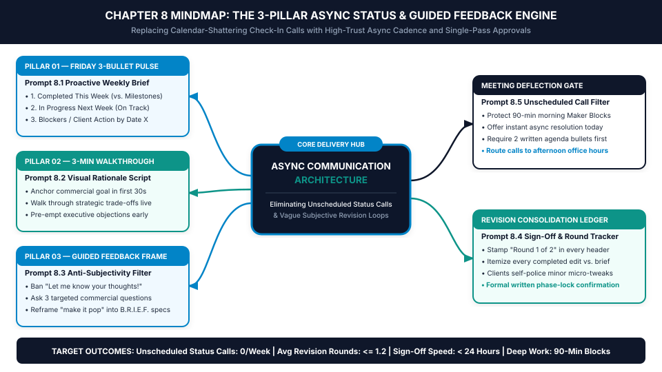
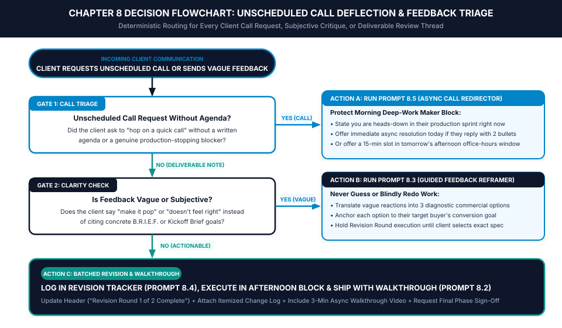

# Chapter 8: Async Client Updates & Revision Minimization

*How to Replace Calendar-Shattering Status Meetings with a 3-Pillar Async Cadence and Cut Client Revisions in Half*

---

## 1. Learning Objectives

By the end of this chapter, you will be able to:

- **Eliminate Ad-Hoc "Quick Check-In" Calls:** Install the **3-Pillar Async Status & Guided Feedback Engine** so clients feel completely informed without ever shattering your morning 90-minute deep-work blocks.
- **Automate the Friday 3-Bullet Status Pulse:** Use **Prompt 8.1** to convert messy weekly engineering, design, or writing notes into an executive-ready status memo in under four minutes per client.
- **Frame Every Deliverable with a 3-Minute Walkthrough Video:** Deploy **Prompt 8.2** to structure short screen-share walkthroughs that explain strategic trade-offs before a client reads a line of copy or clicks a prototype.
- **Stop Subjective "Make It Pop" Revision Loops:** Replace open-ended *"Let me know what you think!"* handoffs with the **Guided Feedback Frame** (**Prompt 8.3**) and visible **Revision Round Ledgers** (**Prompt 8.4**).
- **Deflect Unscheduled Call Requests with High Trust:** Route last-minute *"Can we hop on Zoom for 15 minutes?"* messages into instant asynchronous resolution or structured afternoon office hours using **Prompt 8.5**.

---

## 2. The Real-World Friction Point

Look at your calendar for next Tuesday. At first glance, it looks wide open: you only have two 20-minute client check-in calls scheduled—one at 10:00 AM and another at 1:30 PM. You tell yourself you have at least six hours of uninterrupted production time to finish a complex client build.

Then Tuesday actually arrives.

From 9:00 AM to 9:40 AM, you hesitate to start a deep coding, writing, or design sprint because you know you have to stop in twenty minutes for the 10:00 AM Zoom call. Instead, you clear minor inbox notifications. At 9:45 AM, you open the client's project folder to review what you did last week so you sound prepared on the call. At 10:00 AM, the client joins five minutes late, spends ten minutes chatting about their weekend and internal company politics, asks *"So, how are things coming along?"*, and then spends fifteen minutes brainstorming tangential ideas out loud. The "20-minute check-in" ends at 10:38 AM.

By the time you write down the call notes, grab coffee, and try to reload the complex mental state of your core deliverable, it is 11:05 AM. You finally get sixty minutes of focused momentum—until 12:10 PM, when a different client drops a Slack message: *"Hey, just looked at the staging link you sent yesterday. Something about the hero section doesn't quite feel right to our team. Can we hop on a quick 15-minute call this afternoon to talk through it?"*

That single "quick 15-minute check-in" phenomenon is the silent killer of solo practitioner capacity.

In cognitive psychology and computer science research—most notably Gloria Mark's longitudinal studies at the University of California, Irvine, and Paul Graham's seminal analysis of the **Maker's Schedule vs. Manager's Schedule**—a single 15-minute synchronous interruption does not cost 15 minutes. When you account for pre-meeting anticipation, context switching, attention residue, and the 23 minutes required to re-load deep working memory, **every unscheduled 15-minute status call destroys a 90-minute production block**. Across four active clients, just two check-in calls per client per week (8 calls total) quietly vaporize **12.0 hours of prime billable capacity every single week**.

Even worse is the second half of the communication leak: **the naked deliverable handoff**.

When you finish a milestone draft on Wednesday afternoon, paste the Google Doc, Figma prototype, or staging URL into an email, and write, *"Here is Draft 1—let me know what you think!"*, you are committing operational malpractice.

Why? Because clients are not trained creative directors, lead software architects, or conversion editors. When you hand a busy executive a raw deliverable with zero strategic framing and ask an open-ended question like *"What do you think?"*, you force them into the role of an amateur critic. Feeling obligated to add value, they scrutinize surface aesthetics cleanly detached from commercial outcomes: *"Can we make this headline punchier?"*, *"I don't love this shade of blue,"* or *"What if we moved the pricing table above the fold?"*

Without a structured walkthrough and a guided feedback frame, a deliverable that met 100% of the Statement of Work spirals into three rounds of subjective, taste-based revisions—burning another eight hours of unbilled effort and tanking your Effective Hourly Rate.

---

## 3. Why Standard Approaches Fail

Most freelancers know that status meetings and endless revision rounds hurt their productivity, yet their attempts to fix the problem fail for three predictable reasons:

### Failure Mode 1: Going Radio Silent to Protect Deep Work
When overwhelmed freelancers try to protect their calendar by simply ignoring Slack and email for three days while they work heads-down, they trigger **Client Visibility Panic**. From the client's perspective, they just wired a $2,500 deposit, and now the freelancer has vanished into a black box. Why do clients ask for "quick 15-minute check-in calls"? Almost never because they enjoy meetings. They ask for calls because **silence feels like risk**. If you do not push proactive, structured status signals on a predictable schedule, the client will pull status from you via unscheduled Zoom requests and anxious Slack pings.

### Failure Mode 2: Sending "Wall-of-Text" Technical Updates
Attempting to avoid meetings by emailing a 900-word technical diary of every minor CSS tweak, API parameter, or paragraph edit you made during the week backfires immediately. Busy founders and marketing directors do not have time to decode dense technical logs on their phones between meetings. When an update is hard to scan, the client skips reading it and replies: *"Thanks! Let's hop on a quick 10-minute call tomorrow so you can give me the high-level summary."*

### Failure Mode 3: Passive Deliverable Drops ("Let Me Know Your Thoughts")
Sending a link without a synchronous or asynchronous walkthrough forces the client to evaluate your work in a vacuum. When a client reads a headline or views a wireframe without hearing *why* you structured it that way to solve their buyer's primary objection, they judge it by personal preference rather than commercial function. Open-ended prompts invite open-ended, unguided critique.

---

## 4. Core Framework: The 3-Pillar Async Status & Guided Feedback System

To eliminate unscheduled status calls while cutting revision rounds below 1.2 per deliverable, the AI Freelancer Operating System replaces ad-hoc communication with **The 3-Pillar Async Status & Guided Feedback Engine**.

```
+=============================================================================+
|          THE 3-PILLAR ASYNC STATUS & GUIDED FEEDBACK ARCHITECTURE           |
+=============================================================================+
|                                                                             |
|  PILLAR 1: THE FRIDAY 3-BULLET STATUS PULSE (Proactive Visibility)          |
|  • Sent every Friday by 2:00 PM local time across all active accounts       |
|  • 1. Completed This Week (Mapped directly to signed SOW milestones)        |
|  • 2. In Progress Next Week (Confirming target delivery dates are green)    |
|  • 3. Blockers / Client Action Needed (With explicit deadline & owner)      |
|                                     |                                       |
|                                     v                                       |
|  PILLAR 2: THE 3-MINUTE WALKTHROUGH PROTOCOL (Pre-Emptive Framing)          |
|  • No deliverable link is ever sent naked without a 180-second walkthrough  |
|  • 0:00–0:30 — Re-anchor on the signed B.R.I.E.F. commercial KPI            |
|  • 0:30–2:15 — Walk through top 3 strategic decisions & trade-offs made     |
|  • 2:15–3:00 — State what NOT to worry about yet + exact review instructions|
|                                     |                                       |
|                                     v                                       |
|  PILLAR 3: THE GUIDED FEEDBACK FRAME & REVISION LEDGER (Bounded Review)     |
|  • Replace "What do you think?" with 3 specific commercial audit questions  |
|  • Stamp "Revision Round 1 of 2" visibly in the portal & delivery header    |
|  • Deflect ad-hoc call requests via the 2-Bullet Async Triage Gate          |
|                                                                             |
+=============================================================================+
```

### How the Three Pillars Lock Together

1. **Pillar 1 — The Friday 3-Bullet Status Pulse (Eliminates "How Are Things Going?" Calls):**
   Every Friday afternoon between 1:00 PM and 2:00 PM, you send a standardized, 60-second-read update inside each active client's portal (generated via **Prompt 8.1**). It contains exactly three bold headers: **1. Completed This Week**, **2. In Progress Next Week**, and **3. Blockers / Action Needed from You**. Because the client receives this crisp executive pulse like clockwork every Friday before they close their laptop for the weekend, their anxiety drops to zero. They never need to ping you on Tuesday morning to ask if the project is on track.
2. **Pillar 2 — The 3-Minute Walkthrough Protocol (Eliminates Misinterpretation Revisions):**
   Whenever you deliver a milestone asset, you record a tightly scripted **3-Minute Async Video Walkthrough** (using Loom, Tella, or CleanShot X, scripted via **Prompt 8.2**). In three minutes, you show your screen, remind the client of the exact revenue or conversion metric agreed upon in the Kickoff Brief, point out the two or three deliberate architectural choices you made to serve their target buyer, and explicitly flag anything that is still in staging (e.g., *"Ignore the mobile footer spacing for now; we lock responsive breakpoints in Milestone 2"*). When executives hear your calm, senior rationale while seeing the work for the first time, 70% of knee-jerk subjective objections evaporate before they ever type a comment.
3. **Pillar 3 — The Guided Feedback Frame & Revision Ledger (Eliminates "Make It Pop" Loops):**
   Beneath your 3-minute walkthrough video, you paste your **Guided Feedback Frame** (**Prompt 8.3**). Instead of asking *"Let me know your thoughts!"*, you ask three binary or criteria-anchored questions tied directly to the project brief, alongside a visible stamp of their **Revision Round Counter** (`Included Revision Round 1 of 2`). If a client still replies with vague, subjective feedback (*"Can we make this section feel more dynamic?"*), you never guess and blindly redesign; you run **Prompt 8.3** to translate their vague adjective into three concrete commercial options and ask them to pick one before you touch the asset.

### Visual Architecture: System Mindmap



---

## 5. Step-by-Step Implementation Protocol

### Step 1: Install the Friday 2:00 PM Status Pulse Ritual
Block a recurring 25-minute calendar slot every Friday from 1:30 PM to 1:55 PM labeled **Client Status Pulse Dispatch**. During this block, open your active project notes or Git commits for each client and run **Prompt 8.1**.

Every Friday Status Pulse must obey four strict formatting rules:
- **Maximum 160 Words Total:** An executive must be able to read the entire update on a mobile screen in 30 seconds without scrolling.
- **Explicit Milestone Mapping:** Every bullet under *Completed This Week* must reference the exact milestone name from your Chapter 5 Kickoff Brief (`Milestone 1.2: Checkout API Validation — 100% Complete`).
- **Binary Schedule Health Badge:** Include a clear status indicator at the top (`STATUS: GREEN — ON TRACK FOR NOV 14 DELIVERY` or `STATUS: AMBER — WAITING ON CLIENT COPY UPLOAD`).
- **Zero-Action Default Closing:** If no inputs are needed from the client, end with: *"No action needed from your side today—have a great weekend, and you'll see Milestone 2 in the portal on Wednesday by 3:00 PM."*

### Step 2: Script and Record the 3-Minute Walkthrough Before Every Handoff
Never upload a deliverable without a companion walkthrough video, and never record an unscripted,rambling 14-minute video that busy clients will abandon after ninety seconds. Run **Prompt 8.2** before hitting record to generate a 4-beat storyboard locked to **180 seconds (3 minutes maximum)**:

| Video Timestamp | Storyboard Beat | Exact Psychological & Operational Job |
| :--- | :--- | :--- |
| **0:00 – 0:30** | **Beat 1: The Commercial North Star** | Open on the signed Kickoff Brief KPI (*"Today we're reviewing the new onboarding flow designed to lift free-to-paid activation from 14% to 22%"*). |
| **0:30 – 2:00** | **Beat 2: The Top 3 Strategic Trade-Offs** | Walk through the deliverable highlighting 3 deliberate decisions and *why* they beat conventional alternatives for the client's specific buyer. |
| **2:00 – 2:30** | **Beat 3: The "Ignore for Now" Sandbox Boundary** | Explicitly state what is NOT part of this review pass (*"Please ignore placeholder icons and legal footer links during this pass"*). |
| **2:30 – 3:00** | **Beat 4: The Guided Feedback Call-to-Action** | Point the client to the 3 Guided Feedback Questions below the video and state the exact date/time for their consolidated Round 1 response. |

### Step 3: Enforce the Guided Feedback Frame and Revision Round Stamp
Every delivery message inside your Client Portal must include two protective anchors:
1. **The Revision Round Header Stamp:** At the very top of the post, display:
   `DELIVERY STATUS: MILESTONE 1 DRAFT | REVISION ALLOWANCE: ROUND 1 OF 2 AVAILABLE`
   Seeing `Round 1 of 2` subtly reminds stakeholders that revisions are a finite commercial resource, motivating them to gather all internal thoughts before replying.
2. **The 3 Guided Feedback Questions (Prompt 8.3):** Direct the client's attention exclusively to business efficacy:
   - *Question 1 (Strategic Accuracy):* Does the core value proposition in Section 1 accurately reflect how your enterprise buyers describe their problem?
   - *Question 2 (Technical / Functional Flow):* Are there any factual inaccuracies or compliance constraints violated in the Step 2 workflow?
   - *Question 3 (Conversion Path):* Does the primary call-to-action match your sales team's current booking pipeline?

When the client replies with their consolidated Round 1 notes, run **Prompt 8.4** to generate an itemized **Revision Round Execution & Sign-Off Summary**. When you return the updated file, show each requested edit alongside a `[COMPLETED]` checkmark and stamp the header: `REVISION ROUND 1 OF 2 COMPLETE (1 FINAL POLISH ROUND REMAINING)`.

### Step 4: Deploy the Unscheduled Call Deflection Circuit Breaker
What happens when a client messages you on Wednesday at 10:15 AM saying: *"Hey, do you have 10 minutes to jump on a quick call right now?"*

Follow the **Chapter 8 Operational Decision Tree**:
- **Never answer an unscheduled voice or video call cold**, and never reply within 30 seconds during a morning Maker Block (which trains the client that you are sitting idle in Slack waiting for interruptions).
- Wait until your scheduled midday inbox check (e.g., 12:00 PM) and run **Prompt 8.5 (Async Call Redirector)**.
- Your reply warmly explains that you are currently heads-down in a deep production block building their deliverable, and offers a **two-track choice**:
  1. **Fastest Path (Immediate Async Resolution Today):** *"If you drop a 60-second voice note or 2–3 bullet points here with what's on your mind, I can review it as soon as I step out of this build block at 1:00 PM and send you a Loom walkthrough or fix before 3:00 PM today."*
  2. **Scheduled Call Path (Tomorrow's Office Hours with Agenda Gate):** *"If a live screen-share is better, grab a 15-minute slot in my afternoon client office hours tomorrow here: [Link]—just drop the 2 main bullets we're covering into the booking note so I can pull the right files up before we connect."*

In over **80% of cases**, the client chooses Path 1 (typing two sentences in Slack or sending a quick voice note) because they want a fast answer today rather than waiting until tomorrow afternoon. You solve their question asynchronously in four minutes without losing a single morning Maker Block.

### Operational Decision Tree



---

## 6. Tested AI Workflow Prompts

Deploy these five prompts to automate your weekly status pulses, script 3-minute walkthroughs, reframe vague feedback, track revision rounds, and deflect unscheduled meeting requests.

### Prompt 8.1: Raw Work Notes to Friday 3-Bullet Client Status Converter

- **Operational Objective:** Transform messy engineering commits, design notes, or rough weekly bullet points into a crisp, high-trust **Friday 3-Bullet Status Pulse** in under three minutes.
- **When to Run:** Every Friday between 1:30 PM and 2:00 PM for every active client sprint or retainer.
- **Verification Rule:** Confirm the output is under 160 words, maps every completed item to a signed SOW milestone, and clearly states whether any client action is required (`NONE` vs. specific deadline).

```text
ROLE:
Act as an Executive Technical Account Director for a high-margin independent studio.

OBJECTIVE:
Convert my raw, unstructured weekly work notes into a polished, 60-second-read "Friday 3-Bullet Status Pulse" that reassures the client, proves forward momentum against our signed SOW milestones, and eliminates any need for a status check-in call next week.

CLIENT & SPRINT INPUTS:
- Client First Name & Project Title: [INSERT CLIENT NAME & PROJECT]
- Overall Sprint Schedule Status: [GREEN — ON SCHEDULE / AMBER — WAITING ON CLIENT INPUT]
- Next Major Milestone & Target Delivery Date: [INSERT MILESTONE & DATE]
- My Raw Notes / Git Commits / Tasks Worked On This Week:
  [PASTE ROUGH BULLETS, COMMIT LOGS, OR VOICE-NOTE TRANSCRIPT OF WHAT YOU DID THIS WEEK]
- Pending Items Needed from Client (if any):
  [INSERT ANY MISSING APPROVALS, ASSETS, OR ANSWERS + DEADLINE NEEDED, OR WRITE "NONE"]

OUTPUT FORMAT & CONSTRAINTS:
Generate a copy-paste-ready portal/email update (strictly under 160 words) using this exact layout:

SUBJECT / HEADER: `[STATUS: GREEN/AMBER] Weekly Executive Pulse — [Project Title] (Week of [Date])`

1. COMPLETED THIS WEEK (LOCKED AGAINST MILESTONES):
   - Translate my raw notes into 2–3 outcome-focused bullets tied directly to our SOW milestones (explain the business value of what was built, not just raw technical jargon).
2. IN PROGRESS NEXT WEEK (CRITICAL PATH):
   - 2 bullets stating exactly what enters production on Monday morning and confirming our [Next Major Milestone Date] delivery target.
3. BLOCKERS & ACTION NEEDED FROM YOU:
   - If "NONE", write: "Zero action needed from your side right now—our sprint is 100% clear for Monday's build block."
   - If inputs are needed, list the exact item, why it matters, and the exact day/time needed to protect the launch calendar under our Day-for-Day Timeline Rule.

Enforce the Studio Lexical Filter (direct, calm, senior practitioner tone; zero robotic filler).
```

---

### Prompt 8.2: 3-Minute Loom / Async Walkthrough Script Architect

- **Operational Objective:** Generate a tight, 180-second teleprompter storyboard for your async deliverable walkthrough video so you frame strategic trade-offs clearly and preempt subjective revision requests.
- **When to Run:** Immediately before recording your screen-share walkthrough for any major milestone deliverable.
- **Verification Rule:** Timed reading speed must stay between 380 and 450 words (2.5 to 3.0 minutes at natural speaking pace) and explicitly state what the client should ignore during this review pass.

```text
ROLE:
Act as a Principal Creative & Technical Director scripting a high-impact 3-minute executive screen-share walkthrough.

OBJECTIVE:
Write a word-for-word, 4-beat Loom walkthrough script (maximum 420 spoken words / 3 minutes) that frames my finished deliverable around the client's commercial KPIs and guides them toward a fast, single-pass approval.

DELIVERABLE CONTEXT:
- Client Name & Stakeholder Roles Viewing: [INSERT CLIENT & ROLES, e.g., Founder & Head of Growth]
- Milestone Deliverable Being Presented: [INSERT DELIVERABLE NAME]
- Signed B.R.I.E.F. / Kickoff Commercial Goal: [INSERT PRIMARY KPI OR PROBLEM SOLVED]
- Top 3 Strategic / Architectural Decisions I Made (and Why):
  1. [DECISION 1 + RATIONALE]
  2. [DECISION 2 + RATIONALE]
  3. [DECISION 3 + RATIONALE]
- Known Stakeholder Sensitivity to Pre-Empt: [INSERT ANY OBJECTION TO NEUTRALIZE EARLY]
- Staging Elements to Ignore on This Pass: [e.g., "Mobile footer links and placeholder team photos"]
- Consolidated Feedback Deadline: [INSERT DAY & TIME]

SCRIPT STRUCTURE (INCLUDE VISUAL SCREEN-SHARE CUES IN BRACKETS):
1. BEAT 1 (0:00–0:30) — THE COMMERCIAL NORTH STAR:
   - Hook their attention immediately by restating the exact business goal from our Kickoff Brief before showing the details.
2. BEAT 2 (0:30–2:00) — THE 3 STRATEGIC TRADE-OFFS:
   - Walk through the 3 core decisions with `[SCREEN CUE: Scroll to X]` markers, explaining *why* each decision increases conversion/reliability for their specific buyer and pre-empting [Known Stakeholder Sensitivity].
3. BEAT 3 (2:00–2:30) — THE SANDBOX BOUNDARY ("WHAT TO IGNORE"):
   - Explicitly tell the viewer not to waste review energy on [Staging Elements to Ignore] because those are scheduled for the final polish pass.
4. BEAT 4 (2:30–3:00) — GUIDED APPROVAL CALL TO ACTION:
   - Point them to the 3 Guided Feedback Questions written below the video and ask their Single Point of Contact to post one consolidated set of notes by [Deadline].
```

---

### Prompt 8.3: Guided Feedback Frame Builder (Preventing Subjective "Make It Pop" Revisions)

- **Operational Objective:** Perform two jobs: (Part A) generate the 3 Guided Feedback Questions to paste beneath your deliverable handoff, and (Part B) translate vague, subjective client reactions (*"make it pop," "feels too heavy," "not punchy enough"*) into three concrete, commercial choices tied to the project brief.
- **When to Run:** Part A with every milestone delivery; Part B whenever a client sends a vague or taste-based revision comment.
- **Verification Rule:** Ensure Part B never guesses or offers to "try a few random variations"—it must diagnose the commercial intent behind the vague phrase and ask the client to choose one specific adjustment before you execute.

```text
ROLE:
Act as a Senior Product Strategist and Diagnostic Communication Specialist.

OBJECTIVE:
Help me eliminate subjective revision loops by (A) framing my deliverable handoff with 3 Guided Feedback Questions, or (B) translating a vague, subjective client comment into 3 concrete, brief-aligned execution options.

PROJECT BASELINE:
- Deliverable Type & Target Buyer Persona: [INSERT DELIVERABLE & BUYER PERSONA]
- Core Commercial Objective (from signed B.R.I.E.F.): [INSERT OBJECTIVE]
- Incoming Vague Client Comment (Leave blank if only generating initial delivery questions, or paste exact quote):
  "[PASTE VAGUE COMMENT e.g., 'Can we make the hero section pop more? It feels a bit flat']"

OUTPUT REQUIREMENTS:
Produce two copy-paste-ready blocks:

PART A — INITIAL DELIVERY GUIDED FEEDBACK FRAME (Paste below your 3-Minute Walkthrough Video):
- Revision Counter Header: `MILESTONE REVIEW | INCLUDED REVISION ALLOWANCE: ROUND [X] OF [Y]`
- Write 3 sharp, commercial review questions that force the client to evaluate the asset from their *customer's* perspective rather than personal aesthetic whim.
- Include a 1-sentence reminder that all internal team comments should be unified by their Single Point of Contact by `[INSERT DEADLINE]`.

PART B — VAGUE FEEDBACK DIAGNOSTIC REFRAMER (Use if Incoming Vague Comment is provided):
- Write a warm, 150-word reply that validates their desire for maximum impact without blindly guessing what they mean.
- Translate "[Incoming Vague Comment]" into 3 specific, mutually exclusive adjustments anchored to our B.R.I.E.F. objective (e.g., Option 1: High-Contrast Visual Hierarchy shift; Option 2: Quantified Proof-First Headline shift; Option 3: Keep current layout to protect enterprise credibility).
- Ask the client to reply with "1," "2," or "3" so you can execute the exact adjustment inside Revision Round [X] of [Y].
```

---

### Prompt 8.4: Consolidated Revision Round Tracker & Final Sign-Off Summarizer

- **Operational Objective:** Package a completed revision round with an itemized **Request-to-Resolution Change Log**, an updated **Revision Round Counter (`Round X of Y Complete`)**, and a frictionless **Milestone Sign-Off Trigger**.
- **When to Run:** Every time you deliver a revised asset back to the client after executing an approved revision sprint.
- **Verification Rule:** Verify that every single consolidated edit from the client's SPOC is listed in the table so the client sees 100% traceability and does not re-open previously settled sections.

```text
ROLE:
Act as a Lead Delivery Manager and Quality Control Director.

OBJECTIVE:
Generate an authoritative "Revision Round Completion & Milestone Sign-Off Memo" that proves every requested in-scope edit has been executed accurately, updates the client's Revision Round Ledger, and locks final approval for this phase.

REVISION SPRINT INPUTS:
- Client Name & Deliverable Title: [INSERT CLIENT & DELIVERABLE]
- Revision Round Just Completed: [e.g., Round 1 of 2 Included Rounds / Final Round 2 of 2]
- Raw List of Client Requests & What I Changed:
  [PASTE THE CLIENT'S CONSOLIDATED REQUESTS AND YOUR NOTES ON HOW YOU FIXED EACH ONE]
- Updated Deliverable Link & 2-Minute Walkthrough Video URL: [INSERT LINKS]
- Next Operational Step Upon Approval: [e.g., "Lock Milestone 1, issue Milestone 2 Invoice (#1042), and begin Phase 2 Backend Build on Monday"]

OUTPUT FORMAT:
Generate a structured portal delivery message containing:
1. STATUS STAMP BANNER:
   `REVISION LEDGER UPDATE: ROUND [X] OF [Y] COMPLETE | [Z] REMAINING IN-SCOPE ROUNDS FOR THIS MILESTONE`
2. ITEMIZED REQUEST-TO-RESOLUTION CHANGE LOG TABLE:
   A clean 4-column Markdown table:
   `[Item # | Client SPOC Request | Exact Implementation & Location | Status (COMPLETED)]`
3. REMAINING ALLOWANCE & SCOPE BOUNDARY NOTE:
   - If Round 1 of 2: Politely note that 1 final minor-polish round remains if any small adjustments are needed on these changes, and previously unflagged sections are now locked.
   - If Round 2 of 2 (Final): Note that this completes the included revision allowance for this milestone, and any further structural additions can be queued as a fast-track Change Order or Phase 2 item.
4. EXPLICIT SIGN-OFF TRIGGER:
   - Clear 1-sentence instruction: "Please reply 'Milestone Approved' by [Date/Time] so we can [Next Operational Step]."
```

---

### Prompt 8.5: Unscheduled "Quick Call" Request to Async Resolution Redirector

- **Operational Objective:** Deflect an unscheduled *"Can we hop on a quick call today?"* message without sounding aloof or unhelpful—converting 80%+ of call requests into fast written/voice-note threads while routing genuine live needs to tomorrow's afternoon office hours with a mandatory 2-bullet agenda gate.
- **When to Run:** During your midday or late-afternoon inbox triage block whenever a client asks for an unscheduled call.
- **Verification Rule:** Ensure the script frames your current unavailability as **working directly on their project** inside a focused production block.

```text
ROLE:
Act as a Calm, High-Status Independent Principal Consultant.

OBJECTIVE:
Write a warm, reassuring reply to a client who just asked to "hop on a quick unscheduled call," redirecting them to either immediate asynchronous resolution today OR a structured 15-minute slot in tomorrow's afternoon office hours (gated by a 2-bullet written agenda).

SITUATION DETAILS:
- Client First Name: [INSERT NAME]
- Their Incoming Call Request Message: "[PASTE EXACT SLACK/EMAIL MESSAGE]"
- Deliverable I Am Currently Building for Them: [INSERT ACTIVE DELIVERABLE]
- Time I Finish My Current Deep-Work Block Today: [e.g., 1:30 PM EST]
- Tomorrow's Designated Afternoon Office-Hours Window & Booking Link: [e.g., Tomorrow between 2:00 PM and 4:00 PM EST — Link]

WRITING RULES:
Generate two concise versions (Version A: Short Slack/Portal Reply under 95 words; Version B: Email Reply under 135 words) following this exact 3-step structure:
1. THE DEEP-WORK FRAME (Why I'm Not Jumping on Zoom Right Now):
   - Warmly note that you are currently heads-down inside a dedicated production block building [Active Deliverable] so you stay right on track for their milestone deadline.
2. PATH 1 — FASTEST ASYNC RESOLUTION TODAY (Recommended):
   - Offer to solve it today without making them wait for a calendar slot: "To get you an answer fastest today, drop 2–3 quick bullets (or a 60-second voice note) right here with what you're looking at—I step out of my build block at [Time] and will send you a direct fix or Loom walkthrough this afternoon."
3. PATH 2 — SCHEDULED OFFICE HOURS WITH 2-BULLET AGENDA GATE:
   - "If a live screen-share is easier, grab a 15-minute slot in my client office hours tomorrow afternoon here: [Link]—just reply with the 2 specific items we're covering so I can have the exact staging files prepped before we connect."
```

---

## 7. Real-World Implementation Case Study

### Practitioner Profile
- **Name & Location:** Ryan M., Independent Full-Stack Web Application & React/Bubble Developer based in Seattle, Washington (4.5 years independent).
- **Core Service Offering:** Fixed-fee MVP web applications, internal AI dashboard builds, and API integrations ($6,500 per 4-week build sprint).
- **Target Buyer:** Non-technical Seed-stage Founders and SMB Operations Directors.

### The "Before" Bottleneck (Calendar Swiss Cheese & Revision Purgatory)
Ryan was a fast, capable engineer, but managing four simultaneous client sprints was wrecking his focus and extending every project past its deadline:
1. **Unscheduled Zoom Interruptions:** Non-technical founders felt anxious whenever they didn't hear from Ryan for two days. Across his four active clients, Ryan was fielding **9 to 11 "quick 15-minute check-in or screen-share calls" per week**. With pre-call prep and post-call context recovery, these calls consumed **7.5 hours of prime daytime engineering capacity every week**, forcing Ryan to write actual code between 8:00 PM and midnight.
2. **Naked Staging Link Handoffs:** Whenever Ryan finished a UI view or workflow module, he pasted the staging URL into Slack with *"Staging updated—take a look and let me know what you think!"* Without context, founders clicked random buttons that weren't wired up yet, panicked about temporary styling, and sent back 25-item bulleted lists of subjective UI tweaks. Ryan averaged **3.4 revision rounds per milestone**, adding 11 hours of unbilled rework to every sprint.

### The 21-Day System Intervention
Ryan installed the Chapter 8 **3-Pillar Async Status & Guided Feedback System** across all four active client accounts:
1. **Pillar 1 (Friday 2:00 PM 3-Bullet Status Pulse):** Every Friday at 1:30 PM, Ryan pasted his Git commit log into **Prompt 8.1** and posted a crisp 3-Bullet Status Pulse in each client's Notion portal. Within two weeks, Monday and Tuesday *"Just checking in on how things are going!"* messages dropped to zero.
2. **Pillar 2 (Mandatory 3-Minute Loom Walkthroughs):** Ryan instituted a studio rule: **Never send a staging URL without a Prompt 8.2 3-Minute Loom video.** In his video, he demonstrated the new feature working live, explained *why* the database schema and UI flow were structured that way, and explicitly told the founder which unbuilt buttons to ignore during this milestone review.
3. **Pillar 3 (Guided Feedback Frame + Call Redirector):** Below every video, Ryan pasted three **Prompt 8.3** Guided Feedback Questions and stamped `REVISION ROUND 1 OF 2 AVAILABLE`. Whenever a founder asked on Slack, *"Can we jump on a quick call?"*, Ryan waited until his 12:30 PM inbox block and sent **Prompt 8.5**. Out of 14 call requests over 30 days, **12 were resolved asynchronously via 2-bullet Slack replies**, and only 2 became 15-minute afternoon office-hour calls—both with pre-submitted written agendas.

### Before vs. After Operational Metrics (60-Day Post-Implementation Audit)

| Operational Metric | Before (Ad-Hoc Calls & Naked Staging Links) | After (3-Pillar Async Engine + Call Deflector) | Net Operational Impact |
| :--- | :--- | :--- | :--- |
| **Weekly Unscheduled / Ad-Hoc Client Calls** | 9.5 calls / week (across 4 clients) | **0.5 calls / week** (scheduled in afternoon office hours) | **-94.7% synchronous interruptions** |
| **Weekly Hours Lost to Calls & Context Switching** | 7.5 hours / week | **0.5 hours / week** (plus 20 mins Friday Status Pulse) | **+6.7 hours/wk of deep Maker time recovered** |
| **Unbroken 90-Minute Morning Maker Blocks Achieved** | 3.5 blocks / week (out of 10 possible) | **9.5 blocks / week** (out of 10 possible) | **+171% deep-work continuity** |
| **Average Revision Rounds per Milestone** | 3.4 rounds | **1.1 rounds** | **-67.6% revision cycles** |
| **Average Client Milestone Sign-Off Turnaround** | 68 hours (3+ days of back-and-forth) | **19 hours** (single-pass async approval) | **3.5x faster milestone velocity** |
| **Realized Effective Hourly Rate (EHR)** | $112 / hour | **$194 / hour** | **+$82 / hour (+73.2% EHR increase)** |

---

## 8. Common Operational Pitfalls & Fixes

| # | Common Async & Revision Pitfall | Why It Happens (Root Cause) | Immediate System Fix |
| :--- | :--- | :--- | :--- |
| **1** | **Recording Rambling 12-Minute Loom Videos:** Hitting record without a script and meandering through minor details for over ten minutes. | Treating a walkthrough video like an unscripted live meeting; busy executives abandon videos longer than 3 minutes. | Enforce a strict **180-second (3-minute) ceiling**. Always run **Prompt 8.2** first and read the 4-beat teleprompter script so every second is high-signal. |
| **2** | **Skipping the Friday Status Pulse When "Nothing Big Launched":** Failing to send a Friday update during a heavy backend or research week because there is no shiny visual to show. | Assuming "no news is good news." To a paying client, a silent Friday feels like their project was forgotten. | Send the **Prompt 8.1 Friday 3-Bullet Pulse** every single Friday without fail—even if Bullet 1 simply reports *"Completed 80% of core database migration architecture; on track for Wednesday staging preview."* |
| **3** | **Replying to Slack Pings Within 60 Seconds During Morning Deep Work:** Keeping Slack or email open with audible notifications during your 8:30 AM–11:30 AM Maker Blocks. | Mistaking instant responsiveness for high client service, which destroys your cognitive flow and trains clients to treat you like an on-demand helpdesk. | Close all communication tabs during morning Maker Blocks. Check and batch-process client messages twice daily (`12:00 PM` and `4:00 PM`) using **Prompt 8.5**. |
| **4** | **Blindly Executing Vague Aesthetic Feedback ("Make It Pop"):** Guessing what a client means by a subjective adjective and spending 3 hours building a redesign they also dislike. | Fear of asking clarifying questions before starting a revision round. | Enforce **Gate 2 of the Chapter 8 Flowchart**: never touch a file on a vague comment. Run **Prompt 8.3 Part B** to translate the vague adjective into 3 concrete commercial options and wait for written selection. |
| **5** | **Forgetting to Stamp the Revision Round Counter:** Delivering revised drafts without stating `Revision Round 1 of 2 Complete`, leading to awkward friction when you try to bill for Round 4. | Keeping the revision count hidden in your head instead of displaying it transparently on every handoff. | Use **Prompt 8.4** on every revision return so the status banner (`ROUND 1 OF 2 COMPLETE`) and itemized Change Log table are visible on every single iteration. |

---

## 9. Chapter Action Worksheet

Complete this worksheet inside your studio binder or in standalone file `05-WORKBOOKS/worksheet-08.md` to install your weekly async communication rhythm and guided feedback gates.

### Part A: Weekly Friday 3-Bullet Status Pulse Tracker

| Active Client & Project | This Week's Completed Milestone Items (Bullet 1) | Next Week's Critical Path Focus (Bullet 2) | Client Blockers / Action Needed + Deadline (Bullet 3) | Sent by Friday 2:00 PM? (`[ ]`) |
| :--- | :--- | :--- | :--- | :---: |
| **1.** | | | | `[ ] Sent` |
| **2.** | | | | `[ ] Sent` |
| **3.** | | | | `[ ] Sent` |
| **4.** | | | | `[ ] Sent` |

### Part B: The 3-Minute Walkthrough & Guided Feedback Delivery Builder

Complete this 4-row frame before sending your next milestone deliverable link:

| Delivery Frame Component | Your Deliverable-Specific Script / Content |
| :--- | :--- |
| **1. Revision Allowance Header Stamp** | `MILESTONE: ____________________ | INCLUDED REVISION ROUND: ___ OF ___` |
| **2. 3-Minute Walkthrough Storyboard (Prompt 8.2)** | • **0:00–0:30 (KPI Goal):** <br>• **0:30–2:00 (Top 3 Strategic Decisions):** <br>• **2:00–2:30 (Staging Items to Ignore Now):** <br>• **2:30–3:00 (Review Deadline Call-to-Action):** |
| **3. Three Guided Feedback Questions (Prompt 8.3)** | **Q1 (Buyer Fit):** <br>**Q2 (Accuracy/Flow):** <br>**Q3 (Conversion Goal):** |
| **4. Consolidated SPOC Feedback Deadline** | *"Please share one consolidated set of team notes via [SPOC Name] by **`____/____ at ____:00 PM`**."* |

---

## 10. Executive Summary & Implementation Checklist

### Key Chapter Takeaways
1. **Unscheduled 15-Minute Calls Cost 90 Minutes of Deep Work:** Protecting your morning Maker Blocks requires eliminating synchronous status check-ins and routing live calls exclusively to afternoon office hours with a mandatory 2-bullet written agenda.
2. **Proactive Friday Pulses Cure Client Anxiety:** Clients only ask for status calls when they feel in the dark. Sending the **Friday 3-Bullet Status Pulse** (`Completed / In Progress / Blockers`) by 2:00 PM every Friday eliminates 90%+ of check-in requests.
3. **Never Ship a Naked Deliverable Link:** Pairing every milestone handoff with a scripted **3-Minute Walkthrough Video** explains your strategic trade-offs first and neutralizes knee-jerk subjective objections.
4. **Guided Questions + Visible Revision Counters Cut Revisions in Half:** Replacing *"What do you think?"* with three commercial audit questions and stamping `Round 1 of 2` in every delivery header keeps revisions focused, consolidated, and fast.

### Chapter 8 Implementation Checklist
- [ ] Block a recurring 25-minute Friday afternoon calendar slot (`1:30 PM–1:55 PM`) and send your first **Prompt 8.1 Friday 3-Bullet Status Pulse** to every active client this week.
- [ ] Script and record a **3-Minute Walkthrough Video** using **Prompt 8.2** for your next milestone handoff—never send an unframed link again.
- [ ] Attach three **Prompt 8.3 Guided Feedback Questions** and a visible `Revision Round X of Y` banner to every deliverable post inside your Notion Client Portal.
- [ ] Use **Prompt 8.4** to return an itemized **Request-to-Resolution Change Log** on your next revision round and request explicit written milestone sign-off.
- [ ] Close Slack and email during morning Maker Blocks and use **Prompt 8.5 (Async Call Redirector)** to convert unscheduled call requests into 2-bullet async threads.

---

## 11. Sources & Operational References

1. **Mark, G., Gudith, D., & Klocke, U. (2008 / 2023).** *The Cost of Interrupted Work: More Speed and Stress / Attention Span: A Groundbreaking Way to Restore Balance, Happiness and Productivity.* University of California, Irvine / Hanover Square Press. — Empirical telemetry demonstrating that workers require an average of 23 minutes and 15 seconds to return to deep cognitive flow after a single synchronous interruption.
2. **Graham, Paul (2009).** *Maker's Schedule, Manager's Schedule.* Y Combinator Essays. — Foundational operational model explaining why a single mid-morning meeting fractures a half-day production block for engineers, writers, and designers.
3. **Newport, Cal (2016 / 2021).** *Deep Work: Rules for Focused Success in a Distracted World & A World Without Email: Reimagining Work in an Age of Communication Overload.* Grand Central Publishing. — Quantitative analysis of the "hyperactive hive mind" workflow vs. structured asynchronous office-hours protocols.
4. **Atlassian & Loom Async Work Benchmark Report (2024).** *Replacing Synchronous Status Meetings with Short-Form Video Walkthroughs in Distributed Technical & Creative Teams.* — Data showing a 42% reduction in review cycle duration and a 50%+ drop in synchronous meeting hours when deliverables are paired with 3-minute video walkthroughs.
