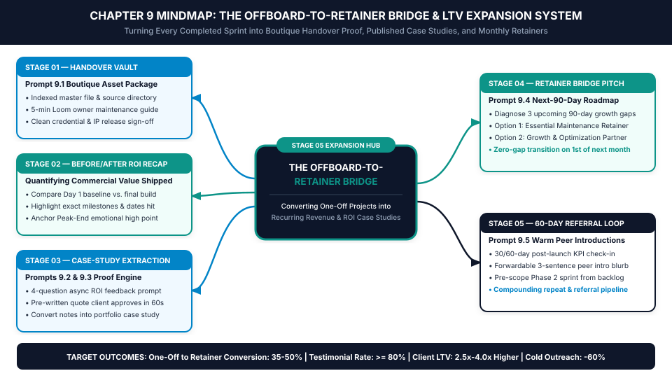
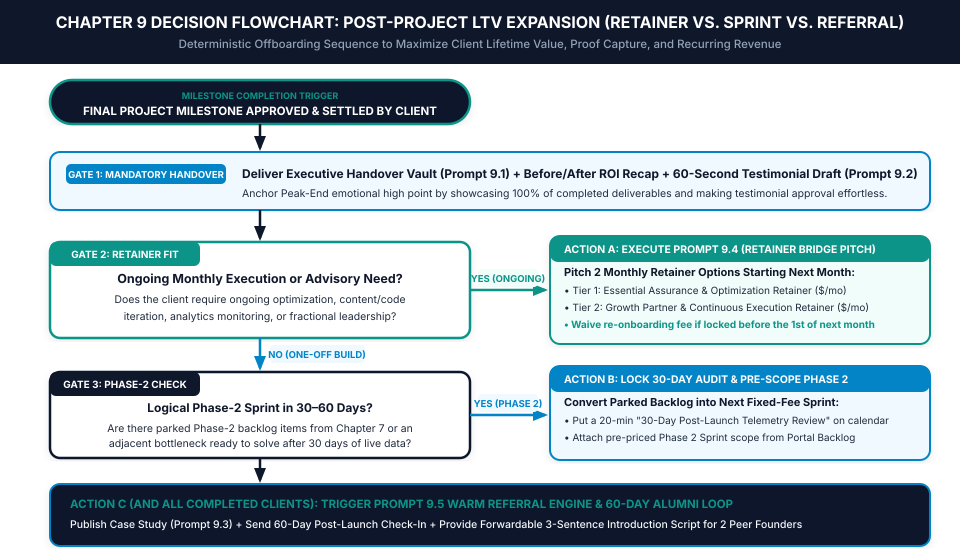

# Chapter 9: Smooth Offboarding, Case Studies & The Retainer Bridge

*How to Package Final Deliverables Like a Boutique Agency, Capture High-Converting Case Studies, and Turn One-Off Projects into Monthly Retainers*

---

## 1. Learning Objectives

By the end of this chapter, you will be able to:

- **Eliminate the "Final ZIP File Dump":** Package every completed client engagement inside an **Executive Handover Vault** (**Prompt 9.1**) complete with indexed master files, a 5-minute owner maintenance video, and a formal Before/After ROI Recap.
- **Capture Client Testimonials on 80%+ of Projects:** Deploy the **60-Second Pre-Drafted Testimonial Protocol** (**Prompt 9.2**) at the exact moment of peak client excitement so busy executives approve high-proof quotes in one click.
- **Transform Raw Project Notes into Sales-Closing Case Studies:** Use **Prompt 9.3** to convert internal sprint telemetry into structured portfolio narratives that pre-sell future buyers.
- **Convert 35% to 50% of One-Off Projects into Monthly Retainers:** Execute the **Offboard-to-Retainer Bridge Pitch** (**Prompt 9.4**) by diagnosing the client's next-90-day maintenance and growth gaps before your project ends.
- **Automate Warm Peer Referrals at Day 60:** Install the **60-Day Post-Launch Alumni Loop** (**Prompt 9.5**) with forwardable 3-sentence introduction blurbs that generate high-trust inbound leads without cold outreach.

---

## 2. The Real-World Friction Point

You just spent three weeks executing a flawless client sprint. You hit every milestone on schedule, navigated stakeholder feedback cleanly, and delivered a finished website, software module, copy deck, or analytics system that the client loves.

Now look at how 90% of independent freelancers end the engagement.

On Friday afternoon at 4:45 PM, relieved to finally cross the project off their list, the freelancer sends a hasty four-line email or Slack message:

> *"Hey Sarah! Attached is the final ZIP folder with all the files (or here's the link to the final Google Drive folder). I also just sent over the final 50% invoice via Stripe. It was awesome working with you—let me know if you ever need anything else in the future!"*

Look closely at the commercial wreckage hidden inside that casual handoff:

1. **Zero Perceived Boutique Finality:** Behavioral economist Daniel Kahneman's **Peak-End Rule** demonstrates that human beings judge an entire experience almost exclusively by how it felt at its **peak** and how it felt at the **end**. When a client pays $4,500 for a high-stakes project and the ending consists of an unorganized Google Drive link and an invoice notification, the emotional finale feels transactional and flat. Worse, two months later, the client's junior marketer accidentally breaks a template or forgets how to update a setting because you never provided a 5-minute owner maintenance SOP—and they blame *your* build.
2. **The Forgotten Testimonial & Case Study:** You tell yourself you will email the client in a few weeks to ask for a testimonial once they have live performance numbers. Six weeks later, when you hit a slow pipeline week and finally email them (*"Hey, would you mind writing a quick testimonial for my website?"*), the client is buried in a new quarterly crunch. Even if they like you, staring at a blank page and trying to write a compelling paragraph about your work feels like homework. They procrastinate, forget to reply, or send a useless seven-word platitude: *"Great working with Alex, super fast and reliable!"*
3. **The "Day 1 of Next Month = $0 Revenue" Treadmill:** By ending the relationship with a passive *"Let me know if you ever need anything else!"*, you place 100% of the strategic burden on the client to invent a reason to re-hire you. Meanwhile, on the 1st of next month, your recurring revenue baseline resets to zero, forcing you right back onto the cold-outreach and proposal hamster wheel to replace the income you just finished earning.

According to Bain & Company and Harvard Business School research on professional service economics, acquiring a brand-new client costs **5x to 7x more in non-billable sales and marketing hours** than expanding or retaining an existing client relationship. When a freelancer treats project offboarding as an administrative exit door rather than a commercial **Stage 05 Expansion Gate**, they throw away their highest-margin revenue source: **Client Lifetime Value (LTV)**.

---

## 3. Why Standard Approaches Fail

When solo practitioners try to ask for retainers, testimonials, or referrals using standard freelance advice, they fail for three structural reasons:

### Failure Mode 1: Asking "Would You Like a Monthly Retainer?" Without Diagnosing the Next-90-Day Gap
Tacking a casual sentence onto the end of a final delivery email—*"By the way, I also offer monthly retainers for $1,500/month if you ever want ongoing help!"*—almost never converts. Why? Because the client just paid you thousands of dollars to *solve* their problem. If you pitch a vague "hours-for-dollars" retainer right after handing over the finished asset, the buyer thinks: *"Wait—didn't we just finish building this? Why would I pay you every month if it's already done?"*

Clients never buy "ongoing availability." They buy **protection against post-launch decay** and **execution of the next 90-day commercial opportunity** exposed by Phase 1.

### Failure Mode 2: Giving Clients "Blank-Page Homework" for Testimonials
When you ask a busy VP of Marketing or SaaS founder to *"write a short testimonial about our project"* or fill out a 12-question survey form, you are assigning them unpaid copywriting labor. High-level buyers are happy to endorse great partners, but they hate writing marketing copy from scratch. If capturing social proof requires more than **60 seconds of cognitive effort** from your client, your capture rate will stay below 20%.

### Failure Mode 3: Passive Referral Begging ("Know Anyone Who Needs Help?")
Ending an email with *"If you know anyone else who needs a freelance developer/designer/writer, please send them my way!"* forces the client to scan their entire mental rolodex without a specific trigger. Because the prompt is too broad (*"anyone"*), their brain retrieves **no one**. Furthermore, even if they think of a peer founder, they still have to figure out how to describe what you do in an introductory email—so they put it off indefinitely.

---

## 4. Core Framework: The Offboard-to-Retainer Bridge

To transform **Stage 05 (The Expansion Gate)** of the *5-Stage Client Lifecycle Engine* into a predictable recurring-revenue and social-proof generator, the AI Freelancer Operating System installs a five-stage sequence: **The Offboard-to-Retainer Bridge**.

```
+=============================================================================+
|             THE 5-STAGE OFFBOARD-TO-RETAINER BRIDGE ARCHITECTURE            |
+=============================================================================+
|                                                                             |
|  STAGE 01: THE EXECUTIVE HANDOVER VAULT (Prompt 9.1)                        |
|  • Indexed master asset & source directory + clean credential release       |
|  • 5-minute Loom Owner Maintenance Guide & Written Team SOP                 |
|                                     |                                       |
|                                     v                                       |
|  STAGE 02: THE BEFORE / AFTER ROI RECAP (Peak-End Value Anchor)             |
|  • Side-by-side comparison of Day 1 bottleneck vs. shipped system           |
|  • Quantifies exact deliverables, timeline hit, and commercial readiness    |
|                                     |                                       |
|                                     v                                       |
|  STAGE 03: FRICTIONLESS 60-SECOND CASE-STUDY EXTRACTION (Prompts 9.2 & 9.3) |
|  • 4 micro-questions + a pre-drafted ROI testimonial based on real project  |
|  • Client edits or replies "Approved to publish" in under 60 seconds        |
|                                     |                                       |
|                                     v                                       |
|  STAGE 04: THE "MAINTENANCE & GROWTH GAP" RETAINER PITCH (Prompt 9.4)       |
|  • Diagnose 3 upcoming 90-day post-launch risks or optimization gaps        |
|  • Present 2 monthly retainer tiers (Assurance vs. Growth Partner)          |
|                                     |                                       |
|                                     v                                       |
|  STAGE 05: THE 60-DAY REFERRAL & RE-ENGAGEMENT LOOP (Prompt 9.5)            |
|  • Scheduled post-launch KPI check-in + forwardable 3-sentence peer blurb   |
|                                                                             |
+=============================================================================+
```

### The Strategic Logic of the 5-Stage Bridge

1. **Stage 01 — The Executive Handover Vault:**
   Instead of a messy ZIP file, you deliver a permanent, clean **Executive Handover Page** inside the client's Notion Portal (generated via **Prompt 9.1**). It includes an indexed table of every master asset, source file link, license key, and documentation file, paired with a **5-Minute Owner Maintenance Video** and a step-by-step written SOP so their internal team knows how to operate the asset without breaking it.
2. **Stage 02 — The Before/After ROI Recap:**
   At the top of the Handover Vault, you present a 4-row **Before vs. After Executive Impact Table** contrasting where their business was on Day 1 (the exact bottleneck diagnosed in your Chapter 3 B.R.I.E.F. proposal) with the live system now in their hands. This locks in a powerful **Peak-End psychological high point** right before you ask for a testimonial or pitch a retainer.
3. **Stage 03 — Frictionless 60-Second Case-Study Extraction:**
   While the client is reviewing the Handover Vault and feeling thrilled about the finished build, you trigger **Prompt 9.2**. Instead of asking them to write a testimonial from scratch, you include a **pre-drafted 4-sentence ROI testimonial** assembled from their own words during the project, and say: *"To save you time staring at a blank page, I drafted a quick summary of our sprint below based on our kickoff goals—feel free to tweak any word, or simply reply 'Approved' if you're happy for me to feature this!"* Over 80% of clients reply *"Approved!"* within 24 hours. You then feed your project notes into **Prompt 9.3** to publish a full portfolio case study.
4. **Stage 04 — The "Maintenance & Growth Gap" Retainer Pitch:**
   Solving Problem A always creates Problem B:
   - Launching a new high-converting website creates the need for **monthly A/B conversion testing, landing page expansion, and technical performance monitoring**.
   - Shipping a v1 SaaS feature or AI automation workflow creates the need for **API maintenance, prompt calibration against edge cases, and Phase 2 feature iteration**.
   - Delivering a B2B content or SEO strategy creates the need for **monthly authority asset production and ranking telemetry**.
   Using **Prompt 9.4**, you identify the **3 Post-Launch Risks or Next-90-Day Growth Opportunities** and present two productized monthly retainer tiers starting on the 1st of next month—offering to waive any re-onboarding fee if they lock in their slot before final sign-off.
5. **Stage 05 — The 60-Day Referral & Re-Engagement Loop:**
   Whether the client converts into a monthly retainer or completes a one-off build, you schedule an automatic calendar reminder for **30 days and 60 days post-launch**. On Day 60, you send **Prompt 9.5**: a value-first check-in referencing a specific observation about their live asset, paired with a **forwardable 3-sentence peer introduction blurb** targeted at one specific persona in their network.

### Visual Architecture: System Mindmap



---

## 5. Step-by-Step Implementation Protocol

### Step 1: Assemble and Release the Executive Handover Vault Upon Final Payment
Remember the golden rule locked in Chapter 7: **Staging previews and Loom walkthroughs are used for final sign-off; editable master source files and administrative ownership transfer upon settlement of the final milestone invoice.**

Once the final milestone invoice clears, run **Prompt 9.1** to generate the client's **Executive Handover Vault & Maintenance SOP**. Every Handover Vault contains four standardized modules:
1. **The Before/After Executive ROI Summary:** A 3-bullet recap of the business problem solved, the exact deliverables shipped on schedule, and the target KPI achieved.
2. **The Master Asset & Source Index Table:** A clean table listing every deliverable, its file format, its permanent cloud location (instructing the client to duplicate master files to their own corporate drive within 30 days), and ownership status.
3. **The 5-Minute "Keys to the Castle" Maintenance SOP:** Written step-by-step instructions (plus a 5-minute Loom video) showing the client's team how to perform routine updates safely—plus an explicit **"Do Not Touch Without Backup" Warning List** covering fragile configurations.
4. **Credential Hygiene & Access Down-Scoping Log:** Confirmation that any temporary staging keys have been rotated and your studio access has been transitioned to read-only or maintenance-collaborator status.

### Step 2: Execute the 60-Second Pre-Drafted Testimonial Capture
Included directly inside the Executive Handover message (or sent 24 hours after handover), run **Prompt 9.2**.

To make your pre-drafted testimonial convert future buyers, structure the draft around the **B.A.R. (Before — Action — Result) Proof Formula**:
- **Sentence 1 (The "Before" Bottleneck & Hesitation):** *"Before working with [Your Name], our team was struggling with [Specific Pain Point / Metric Leak]..."*
- **Sentence 2 (The "Action" & System Experience):** *"[Your Name] stepped in with a structured [Named Process], delivered [Deliverable] on schedule without endless meetings..."*
- **Sentence 3 (The Tangible "Result" & Recommendation):** *"We now have [Specific Outcome / Early Metric Lift], and I'd recommend [Your Name] to any [Peer Role] looking for [Core Outcome]."*

Always give the client two frictionless choices: (A) Reply *"Approved"* (with optional edits) to approve the pre-written draft in 60 seconds, or (B) Answer 4 rapid-fire bullet questions via voice note or text if they prefer their own spontaneous phrasing.

### Step 3: Route the Account Through the Post-Project LTV Expansion Decision Tree
Forty-eight hours after delivering the Executive Handover Vault—while your professionalism and ROI recap are top of mind—route the client through the **Chapter 9 Operational Decision Tree**:

- **Path A — Ongoing Execution or Optimization Need Exists (The Retainer Bridge):**
  Run **Prompt 9.4** to send the **Next-90-Day Roadmap & Retainer Bridge Proposal**. Never pitch "10 hours a month for $1,500." Instead, present two outcome-defined tiers:
  - **Option 1: Essential Assurance & Optimization Retainer** (e.g., `$1,200/month` — monthly performance audit, technical/editorial maintenance, priority 24-hour SLA, and 1 core optimization sprint per month).
  - **Option 2: Growth Partner Retainer** (e.g., `$2,600/month` — everything in Option 1 plus continuous weekly production of [Core Growth Asset], A/B experimentation, and monthly executive strategy review).
  - **The Priority Slot Incentive:** Note that you cap active retainer partners at **4 accounts per quarter** to protect morning deep-work blocks, and offer to waive the standard $500 onboarding/setup fee if they activate before the 1st of next month.
- **Path B — One-Time Build with a Logical Phase-2 Expansion in 30–60 Days:**
  If the client does not need a monthly retainer but has items parked in the **Phase 2 Expansion Backlog** (from Chapter 7), book a **20-Minute 30-Day Post-Launch Telemetry Review** on their calendar right now before offboarding closes. Attach a 1-page pre-scoped Phase 2 Sprint quote so the next project is already on their calendar.
- **Path C — Fully Completed Scope (The 60-Day Referral Engine):**
  Log the client in your Notion CRM as an `Active Alumni Account` with an automatic follow-up date set for `Launch Date + 60 Days`.

### Step 4: Compile the Portfolio Case Study and Trigger the Day-60 Referral Loop
Within 72 hours of project completion—while every technical detail and metric is fresh in your memory—run **Prompt 9.3** to turn your Kickoff Brief, Before/After metrics, and approved client testimonial into a published **Portfolio Case Study** (formatted for your website, LinkedIn, and Chapter 3 proposal proof inserts).

Then, on Day 60 post-launch, run **Prompt 9.5** to send the **60-Day Post-Launch Check-In & Warm Referral Script**. Instead of asking *"Do you know anyone?"*, you:
1. Share one specific, thoughtful observation about how their live asset is performing in the wild.
2. Mention that one production slot just opened on your calendar for next month.
3. Provide a **copy-pasteable 3-sentence introduction blurb** tailored to a specific peer profile (*"If you happen to know another Series A SaaS VP of Marketing who is dealing with [Exact Problem We Solved for You], feel free to forward the 3-line blurb below..."*).

### Operational Decision Tree



---

## 6. Tested AI Workflow Prompts

Use these five prompts to automate your Executive Handover Vault, capture 60-second testimonials, write high-converting case studies, pitch monthly retainers, and activate warm peer referrals.

### Prompt 9.1: Executive Handover Vault & Client Maintenance SOP Generator

- **Operational Objective:** Transform your raw list of final project links, files, and technical notes into a boutique **Executive Handover Vault & Owner Maintenance Guide** that leaves a lasting Peak-End impression and prevents post-handoff client support emergencies.
- **When to Run:** Immediately after the client approves the final milestone and settles the final invoice.
- **Verification Rule:** Confirm that every master file link includes a "30-Day Corporate Backup Reminder" and that the Maintenance SOP explicitly lists what the client's team should *never* modify without backing up first.

```text
ROLE:
Act as a Principal Operations Director and Technical Handover Architect for a premier consultancy.

OBJECTIVE:
Generate a comprehensive, boutique-grade "Executive Handover Vault & Owner Maintenance SOP" document that packages our completed project deliverables, highlights our Before/After commercial impact, and trains the client's internal team to maintain the asset safely.

PROJECT COMPLETION INPUTS:
- Client Name & Project Title: [INSERT CLIENT & PROJECT]
- Original Day-1 Problem / Bottleneck (from B.R.I.E.F.): [INSERT BASELINE PROBLEM]
- Final Shipped Solution & Target KPI Impact: [INSERT WHAT WE BUILT & EXPECTED/EARLY ROI]
- List of Final Deliverables, Formats & Links:
  [LIST ALL MASTER FILES, REPOS, FIGMA LINKS, DOCS, AND CREDENTIALS]
- Routine Tasks the Client's Team Will Do Monthly/Weekly:
  [e.g., "Publishing new blog posts in Webflow CMS, updating pricing table numbers, exporting weekly CSV leads"]
- Fragile Elements They Must NOT Touch Without Backup:
  [e.g., "Custom checkout webhook script, global CSS variables, DNS TXT records"]

OUTPUT STRUCTURE:
Produce a polished Markdown Executive Handover Vault divided into 5 sections:
1. EXECUTIVE BEFORE / AFTER ROI RECAP TABLE:
   - A 4-row Markdown table comparing `[Dimension | Day 1 Baseline (Before) | Shipped System State (After) | Commercial Impact]`.
2. MASTER DELIVERABLE & SOURCE ASSET DIRECTORY:
   - An indexed table of all [Final Deliverables, Formats & Links] with a clear note instructing the client to duplicate master files into their internal corporate archive within 30 days.
3. THE 5-MINUTE OWNER MAINTENANCE SOP:
   - Step-by-step, jargon-free checklists for each of the [Routine Tasks], plus a placeholder for a 5-Minute Loom Maintenance Walkthrough video.
4. THE "DO NOT MODIFY WITHOUT BACKUP" RED-ZONE WARNING:
   - Clear guardrails protecting [Fragile Elements] so junior team members don't accidentally break production.
5. CREDENTIAL HYGIENE & FORMAL PHASE SIGN-OFF:
   - Confirmation of credential handover/rotation and formal completion timestamp.
```

---

### Prompt 9.2: Frictionless 4-Question Testimonial & Pre-Written Approval Draft Builder

- **Operational Objective:** Eliminate "blank-page testimonial procrastination" by generating both (A) four rapid-fire ROI questions and (B) two pre-written, high-proof testimonial drafts based on real project facts that the client can approve in 60 seconds.
- **When to Run:** Bundled with your Executive Handover Vault or sent 24 hours after final project delivery while client goodwill is at its peak.
- **Verification Rule:** Ensure the pre-written testimonial drafts use specific operational details and metrics from the project rather than generic praise (*"great communicator"*).

```text
ROLE:
Act as a B2B Conversion Copywriter and Social Proof Strategist.

OBJECTIVE:
Write a frictionless testimonial capture email that gives my client a "60-Second Pre-Drafted Approval Option" alongside a 4-question async prompt, maximizing the odds of getting a specific, ROI-rich endorsement today.

PROJECT FACTS FOR PROOF EXTRACTION:
- Client Name, Title & Company: [INSERT NAME, TITLE, COMPANY]
- Specific Bottleneck They Had Before Hiring Me: [INSERT BEFORE STATE]
- What We Built & How Fast / Smooth the Process Was: [INSERT DELIVERABLE, TIMELINE HIT, OR ASYNC WORKFLOW PRAISE THEY MENTIONED]
- Specific Quantitative or Operational Result Achieved: [INSERT METRIC, TIME SAVED, OR CAPABILITY GAINED]
- Verbatim Praise TheyAlready Said on Slack/Calls (if any): "[PASTE ANY NICE QUOTE THEY ALREADY SAID DURING THE SPRINT]"

OUTPUT REQUIREMENTS:
Generate a warm, low-pressure email (under 220 words) containing:
1. GRATITUDE HOOK: 2 sentences celebrating the launch of [Project] and thanking them for a smooth partnership.
2. THE 60-SECOND PRE-DRAFTED OPTION (Primary Path):
   - Explain warmly: "I know how busy your week is, so to save you from staring at a blank page, I pulled together two short draft options below based on our sprint goals and your notes. Feel free to edit any word, or simply reply 'Option 1 Approved' or 'Option 2 Approved' if you're happy for me to feature it on my site:"
   - **Draft Option 1 (Executive ROI & Revenue Focus — 3 sentences following Before -> Action -> Result):** [WRITE SPECIFIC, NATURAL-SOUNDING QUOTE]
   - **Draft Option 2 (Speed, Systems & Zero-Friction Process Focus — 3 sentences):** [WRITE SPECIFIC, NATURAL-SOUNDING QUOTE]
3. THE 4-BULLET DIY OPTION (Alternative Path):
   - "Or if you prefer to share a quick 60-second voice note or bullet reply in your own words, here are 4 quick prompts: (1) What was the main bottleneck before we started? (2) What stood out about our process? (3) What tangible result do you have now? (4) Who would you recommend this sprint to?"
```

---

### Prompt 9.3: Project Notes to High-Converting Portfolio Case Study Storyteller

- **Operational Objective:** Convert your raw project notes, Before/After metrics, and approved client quote into a persuasive **1-Page Portfolio Case Study** plus a **3-Sentence Proposal Proof Snippet** you can paste directly into future Chapter 3 proposals.
- **When to Run:** Within 72 hours of offboarding every completed project.
- **Verification Rule:** Check that the generated case study leads with the quantified commercial outcome in the headline and includes a reusable 3-sentence summary for future sales proposals.

```text
ROLE:
Act as a Principal B2B Case Study Editor and Commercial Positioning Strategist.

OBJECTIVE:
Transform my raw project completion notes and client testimonial into a high-converting portfolio case study that proves my system's ROI to future prospective buyers.

RAW CASE STUDY INPUTS:
- Client Industry, Company Size & Buyer Persona: [INSERT DETAILS, or "Anonymized Series B FinTech" if under NDA]
- The "Before" Friction & Financial Cost of Inaction: [INSERT PROBLEM & METRICS]
- The Strategic Architecture & Solution Built: [INSERT KEY STEPS & TRADE-OFFS]
- Before vs. After Quantitative Metrics: [INSERT TIMELINE, CONVERSION, SPEED, OR REVENUE METRICS]
- Approved Client Testimonial Quote: "[PASTE APPROVED QUOTE FROM PROMPT 9.2]"

OUTPUT REQUIREMENTS:
Produce three ready-to-publish assets:

ASSET 1 — FULL 1-PAGE WEBSITE / PORTFOLIO CASE STUDY (600–800 Words):
1. Outcome-Driven Headline & Subtitle (Lead with the #1 metric or operational transformation)
2. Executive Summary At-a-Glance Box (`Client Profile | Timeline | Core Deliverables | Headline ROI`)
3. The Challenge: Why Conventional Approaches Failed
4. The System Intervention: How We Engineered the Solution
5. The Results: Before vs. After Telemetry Table + Featured Client Quote
6. Call-to-Action Banner for Prospective Buyers Facing the Same Problem

ASSET 2 — THE 3-SENTENCE PROPOSAL PROOF SNIPPET:
Write a compressed, high-impact 3-sentence paragraph I can paste directly into future Chapter 3 B.R.I.E.F. proposals to prove I have solved this exact bottleneck before.

ASSET 3 — LINKEDIN / NEWSLETTER CASE-STUDY BREAKDOWN POST (200 Words):
A tactical "Behind-the-Scenes System Breakdown" post sharing the 3 lessons from this build without sounding boastful.
```

---

### Prompt 9.4: The Offboard-to-Retainer Bridge Proposal Architect (Next-90-Day Roadmap)

- **Operational Objective:** Diagnose the client's natural post-launch maintenance risks and next-90-day growth gaps, and generate a high-converting **2-Tier Monthly Retainer Bridge Proposal** that transitions them seamlessly into recurring revenue on the 1st of next month.
- **When to Run:** 48 hours after delivering the Executive Handover Vault (or during your final handover review).
- **Verification Rule:** Never pitch "X hours per month." Every retainer tier must be framed around **specific monthly deliverables, ongoing risk protection, and target business outcomes**.

```text
ROLE:
Act as a Fractional Chief Growth Officer and Productized Retainer Architect.

OBJECTIVE:
Write a persuasive "Next-90-Day Roadmap & Retainer Bridge Proposal" that transitions my thrilled one-off project client into a predictable monthly retainer starting on the 1st of next month.

PROJECT & NEXT-90-DAY CONTEXT:
- Client Name & Completed Phase-1 Project: [INSERT CLIENT & COMPLETED SPRINT]
- 3 Post-Launch Risks or Next-90-Day Growth Gaps Exposed Now That Phase 1 Is Live:
  1. [GAP 1, e.g., Without monthly A/B testing on the new checkout flow, conversion gains plateau]
  2. [GAP 2, e.g., 4 parked Phase-2 backlog features still needed before Q4 enterprise push]
  3. [GAP 3, e.g., Ongoing API/CMS maintenance and monthly performance reporting]
- Retainer Option 1 (Essential Assurance & Optimization Tier — Monthly Fee): $[INSERT FEE, e.g., 1,250]/month
  - Core Monthly Deliverables Included: [LIST 3-4 FIXED MONTHLY DELIVERABLES, ZERO HOURLY BILLING]
- Retainer Option 2 (Growth Partner & Continuous Execution Tier — Monthly Fee): $[INSERT FEE, e.g., 2,500]/month
  - Core Monthly Deliverables Included: [LIST 4-5 EXPANDED MONTHLY DELIVERABLES + PRIORITY SLA]
- Priority Continuation Incentive: [e.g., "Waive standard $500 setup/re-onboarding fee and lock current rate if activated before the 1st of the month"]

OUTPUT FORMAT:
Generate a crisp, executive-ready Retainer Bridge Proposal (under 350 words) structured into 4 sections:
1. PHASE 1 CELEBRATION & THE "DAY-30 DECAY" REALITY:
   - Celebrate the completed Phase 1 asset, then calmly explain why high-performing systems require deliberate 90-day post-launch iteration to compound their ROI.
2. YOUR NEXT-90-DAY OPPORTUNITY & RISK DIAGNOSTIC (3 Bullets):
   - Frame the 3 Post-Launch Gaps clearly in terms of revenue upside and operational protection.
3. TWO PRODUCTIZED MONTHLY PARTNERSHIP OPTIONS (Comparison Table + Bullets):
   - Present Option 1 (Essential Assurance) and Option 2 (Growth Partner) with clear deliverable boundaries, async Friday status cadence, and simple 30-day cancellation flexibility.
4. FRICTIONLESS ACTIVATION STEP:
   - State that you cap active retainer slots at 4 per quarter to protect deep-work quality, highlight the [Priority Continuation Incentive], and ask them to reply "Option 1" or "Option 2" to activate on the 1st.
```

---

### Prompt 9.5: 60-Day Post-Launch Check-In & Warm Referral Activation Script

- **Operational Objective:** Re-engage past clients at 30 or 60 days post-launch with a personalized, value-first observation that naturally surfaces Phase 2 projects AND provides a **forwardable 3-sentence peer introduction blurb** to generate warm referrals.
- **When to Run:** On Day 30 and Day 60 after project completion (and every 60–90 days for all alumni clients in your Notion CRM).
- **Verification Rule:** Confirm the script includes a specific observation about their live business and a **specific target persona** for the referral rather than asking *"Know anyone who needs help?"*

```text
ROLE:
Act as a High-Trust Independent Advisor and Strategic Relationship Manager.

OBJECTIVE:
Write a warm, value-first 60-Day Post-Launch Check-In email to an alumni client that checks on their live results, opens the door for a Phase 2 sprint, and equips them with a frictionless 3-sentence forwardable blurb to introduce me to one peer in their network.

ALUMNI CLIENT CONTEXT:
- Client First Name & Company: [INSERT NAME & COMPANY]
- Project We Completed 60 Days Ago & Result Achieved: [INSERT PROJECT & RESULT]
- Specific Live Observation I Noticed Today on Their Site/Product/LinkedIn:
  [INSERT 1 GENUINE OBSERVATION, e.g., "Saw your recent announcement about launching the UK enterprise tier / noticed the new case study page is ranking #3 for X"]
- Ideal Peer Referral Persona I Want to Meet:
  [e.g., "Another Seed or Series A B2B SaaS Founder or VP of Marketing who is preparing for a product launch or conversion redesign"]
- Next Available Sprint Slot on My Calendar: [e.g., "1 production sprint slot opening up on the 15th of next month"]

OUTPUT REQUIREMENTS:
Generate a concise, natural email (under 180 words) with two parts:
1. THE PERSONALIZED 60-DAY CHECK-IN & PHASE 2 PULSE:
   - Open with [Specific Live Observation] and ask how the metrics on [Completed Project] are trending at the 60-day mark.
   - Mention casually that you have [Next Available Sprint Slot] opening up next month. Ask first if they want to reserve it for any of their parked Phase 2 backlog items, OR if they happen to know ONE [Ideal Peer Referral Persona] who is currently battling [Core Problem].
2. THE COPY-PASTE 3-SENTENCE FORWARDABLE BLURB:
   - Include a clearly boxed 3-sentence blurb written in the client's voice that they can literally copy-paste into an email or Slack message to a founder friend in 10 seconds ("Hey [Name], wanted to introduce you to [My Name], who built our [Asset] and helped us [Result]...").
```

---

## 7. Real-World Implementation Case Study

### Practitioner Profile
- **Name & Location:** Sofia L., Independent B2B SaaS Conversion Copywriter & Funnel Strategist based in Dublin, Ireland (3 years independent, serving US and UK B2B software companies, billing in USD).
- **Core Service Offering:** Fixed-fee website messaging overhauls, core landing page copy sprints, and 6-email trial-to-paid onboarding sequences ($3,200 per 2-week sprint).
- **Target Buyer:** B2B SaaS Founders and Heads of Growth.

### The "Before" Bottleneck (The One-Off Project Hamster Wheel)
Sofia was a gifted conversion copywriter whose clients loved her work, yet her income swung wildly between $9,600 in a good month and $3,200 the next:
1. **Transactional Google Doc Handoffs:** When a client approved final copy, Sofia simply resolved the Google Doc comments, sent her final 50% invoice, and said *"Thanks so much, let me know when you need more copy!"*
2. **Zero Recent Case Studies:** Over the previous 12 months, Sofia had completed 19 client sprints—yet her portfolio website only showed **2 outdated testimonials** from two years ago because she felt awkward asking busy founders to write reviews after projects ended.
3. **0% Retainer Baseline:** Every single month started at **$0 in recurring revenue**. Sofia was spending **12 hours per week** hunting for new one-off clients on LinkedIn and cold email just to replace the three clients she had finished serving the month before.

### The 90-Day System Intervention
Across her next **9 completed one-off client sprints** (over a 90-day period), Sofia installed the Chapter 9 **Offboard-to-Retainer Bridge**:
1. **Stage 1 & 2 (Executive Handover Vault + ROI Recap):** Instead of sending raw Google Docs, Sofia delivered a Notion **Executive Handover Vault** (**Prompt 9.1**) containing an indexed copy repository, a Figma wireframe implementation guide for the client's developer, a 5-minute Loom walkthrough on how their team should A/B test headlines safely, and a Before/After Messaging Transformation table.
2. **Stage 3 (60-Second Pre-Drafted Testimonial + Case Study):** Inside every Handover Vault, Sofia included two pre-drafted testimonial options generated via **Prompt 9.2**. Out of 9 clients, **8 approved a specific, metric-backed testimonial within 24 hours** (an **88.9% capture rate**), which Sofia immediately turned into 8 published portfolio case studies using **Prompt 9.3**.
3. **Stage 4 (The Next-90-Day Retainer Bridge Pitch):** Forty-eight hours after handover, Sofia sent **Prompt 9.4**, pointing out a concrete post-launch reality: *"Even the best conversion copy needs post-launch heatmap diagnostics, headline A/B testing, and monthly feature-release emails over the next 90 days."* She offered two productized retainer options starting on the 1st of the following month:
   - *Option 1 ($1,400/month — Conversion Optimization & Launch Email Retainer):* Monthly Clarity/Hotjar heatmap audit, 2 headline/hero A/B test variants, and 2 product-release or nurture emails per month.
   - *Option 2 ($2,400/month — Full Funnel Growth Copy Partner):* Everything in Option 1 plus 1 new high-intent competitor comparison or vertical landing page every month.
4. **Stage 5 (The Day-60 Referral Loop):** For the 5 clients who only needed a one-off build, Sofia sent **Prompt 9.5** on Day 60 with a forwardable 3-sentence founder introduction blurb—generating **3 warm referrals** (2 of whom closed as $3,200 sprints with zero sales friction).

### Before vs. After Operational Metrics (90-Day Post-Implementation Audit)

| Operational Metric | Before (Casual Google Doc Handoffs) | After (5-Stage Offboard-to-Retainer Bridge) | Net Commercial Impact |
| :--- | :--- | :--- | :--- |
| **One-Off Clients Converted to Monthly Retainers** | 0% (0 of 19 past clients) | **44.4% (4 of 9 clients converted at $1,400/mo)** | **+$5,600 / month recurring baseline** |
| **Monthly Recurring Revenue (MRR) Starting on Day 1** | $0 / month | **$5,600 / month** (before booking any new sprints) | **Eliminated feast-or-famine anxiety** |
| **Client Testimonial & Case-Study Capture Rate** | 10.5% (2 in 12 months) | **88.9% (8 published case studies in 90 days)** | **+8.4x proof capture rate** |
| **Warm Inbound Referrals from Past Clients** | 1 referral in 6 months | **3 warm referrals in 90 days** ($6,400 closed) | **+$6,400 zero-CAC sprint revenue** |
| **Weekly Hours Spent on Cold Outreach / Prospecting** | 12.0 hours / week | **3.5 hours / week** | **-70.8% unpaid sales grind** |
| **Average Client Lifetime Value (LTV)** | $3,200 (single sprint) | **$9,420 average LTV** (sprint + retainers/Phase 2) | **2.94x Client Lifetime Value expansion** |

---

## 8. Common Operational Pitfalls & Fixes

| # | Common Offboarding & Retainer Pitfall | Why It Happens (Root Cause) | Immediate System Fix |
| :--- | :--- | :--- | :--- |
| **1** | **Pitching "Hours per Month" Instead of Fixed Outcomes:** Offering *"10 hours a month of general support for $1,200,"* which leads to rollover disputes or rapid cancellation when the client forgets to assign tasks. | Thinking like an hourly contractor rather than a productized partner. | Use **Prompt 9.4** to package every retainer around **2 to 3 fixed monthly deliverables + a proactive monthly audit** that you execute automatically without waiting for the client to manage you. |
| **2** | **Waiting 60 Days to Ask for a Testimonial:** Waiting weeks after launch to request a quote, when the client's emotional excitement has faded and they are busy with new priorities. | Confusing a *process & delivery* testimonial with a *12-month longitudinal study*. | Capture the **Stage 3 Pre-Drafted Testimonial (Prompt 9.2)** within **24 hours of final handover** (Peak-End high point), then add a 1-sentence metric update on Day 60 during your **Prompt 9.5** check-in. |
| **3** | **Pitching the Retainer Before Delivering the Handover Vault:** Asking the client to sign a monthly contract while the final milestone still feels unfinished. | Premature upselling before closing the psychological loop on the current investment. | Enforce strict sequence discipline: **Stage 1 (Handover Vault) + Stage 2 (ROI Recap) first**, followed 24–48 hours later by **Stage 4 (The Next-90-Day Retainer Bridge Proposal)**. |
| **4** | **Becoming an Unpaid Forever Cloud Host for Client Files:** Leaving master videos, raw design files, or code backups in your personal cloud drive indefinitely and fielding *"Can you resend that logo from 2024?"* emails. | Failing to set an explicit archival boundary at offboarding. | Include the **30-Day Corporate Backup Rule** inside **Prompt 9.1's Master Asset Directory**, instructing the client to duplicate all master files to their own corporate drive within 30 days. |
| **5** | **Sending Vague "Just Checking In!" Alumni Emails:** Emailing a past client with *"Hey, just checking in to see how things are going!"* which provides zero value and feels like a thinly veiled sales pitch. | Reaching out without doing 3 minutes of homework on their live asset. | Before running **Prompt 9.5**, spend 3 minutes viewing their live site, product, or LinkedIn and anchor your opening sentence on one specific, genuine observation—paired with the 3-sentence forwardable peer blurb. |

---

## 9. Chapter Action Worksheet

Complete this worksheet inside your studio binder or in standalone file `05-WORKBOOKS/worksheet-09.md` for every project entering its final milestone week.

### Part A: The 5-Stage Offboard-to-Retainer Bridge Execution Checklist

| Stage | Offboarding & Expansion Action | AI Prompt | Target Timing | Status (`[ ]`) |
| :---: | :--- | :---: | :--- | :---: |
| **Stage 01** | Assemble **Executive Handover Vault** & 5-Min Maintenance SOP | `Prompt 9.1` | Upon Final Invoice Settlement | `[ ] Complete` |
| **Stage 02** | Embed **Before/After Executive ROI Recap Table** at top of Vault | `Prompt 9.1` | Bundled with Stage 01 | `[ ] Complete` |
| **Stage 03** | Send **60-Second Pre-Drafted Testimonial** & Build Portfolio Case Study | `Prompts 9.2 & 9.3` | Hour +24 Post-Handover | `[ ] Complete` |
| **Stage 04** | Deliver **Next-90-Day Retainer Bridge Proposal** (2 Monthly Tiers) | `Prompt 9.4` | Hour +48 Post-Handover | `[ ] Complete` |
| **Stage 05** | Log **30/60-Day Alumni Check-In & Forwardable Referral Blurb** in CRM | `Prompt 9.5` | Day +30 & Day +60 Post-Launch | `[ ] Scheduled` |

### Part B: Next-90-Day Retainer Bridge Design Canvas

Design your two productized monthly retainer tiers for your current client before their sprint ends:

| Retainer Design Parameter | Option 1: Essential Assurance & Optimization Tier | Option 2: Growth Partner & Continuous Execution Tier |
| :--- | :--- | :--- |
| **1. Monthly Fixed Fee (`$ / Month`)** | `$____________ / month` | `$____________ / month` |
| **2. Post-Launch Risk or Gap Solved** | | |
| **3. Fixed Monthly Deliverables Included** *(Zero hourly tracking)* | • Deliverable 1: <br>• Deliverable 2: <br>• Monthly Audit/Report: | • Everything in Option 1 + <br>• Growth Asset 1: <br>• Growth Asset 2: |
| **4. Communication & SLA Boundary** | Async Portal + Friday 3-Bullet Pulse (48h SLA) | Async Portal + Friday Pulse + 1 Monthly 30-Min Strategy Call (24h SLA) |
| **5. Fast-Action Continuation Incentive** | Waive `$500` re-onboarding fee if locked before the 1st of `________________`. | Waive `$500` re-onboarding fee + lock priority sprint slot before the 1st of `________________`. |

---

## 10. Executive Summary & Implementation Checklist

### Key Chapter Takeaways
1. **The Peak-End Rule Governs Client Lifetime Value:** How you package the final 48 hours of a project determines whether a client remembers you as a replaceable freelancer or an indispensable strategic partner.
2. **Never Send a Raw ZIP File—Deliver an Executive Handover Vault:** Pairing an indexed asset directory with a Before/After ROI Recap and a 5-minute Owner Maintenance SOP eliminates post-launch support headaches and anchors massive perceived value.
3. **Pre-Drafted Quotes Multiply Social Proof Capture:** Giving busy executives two specific, metric-backed testimonial drafts they can approve in 60 seconds lifts testimonial capture rates above 80%.
4. **Retainers Are Sold by Diagnosing the "Next-90-Day Gap":** Clients convert to monthly retainers when you show them the three specific maintenance risks or growth opportunities that open up the day Phase 1 launches—and offer two fixed-deliverable monthly tiers starting on the 1st of next month.

### Chapter 9 Implementation Checklist
- [ ] Build your reusable **Executive Handover Vault** template in Notion using **Prompt 9.1** before your next active project finishes.
- [ ] Send **Prompt 9.2's 60-Second Pre-Drafted Testimonial Email** to your most recent completed client today (and to every future client within 24 hours of handover).
- [ ] Run **Prompt 9.3** on your last two completed projects to publish two metric-driven **Portfolio Case Studies** and extract **3-Sentence Proposal Proof Snippets**.
- [ ] Define your two productized monthly retainer tiers (**Essential Assurance** vs. **Growth Partner**) and pitch them using **Prompt 9.4** 48 hours after your next project handover.
- [ ] Schedule 60-day calendar reminders for all past clients and send **Prompt 9.5** with a copy-pasteable 3-sentence peer introduction blurb.

---

## 11. Sources & Operational References

1. **Kahneman, Daniel, Fredrickson, B. L., Schreiber, C. A., & Redelmeier, D. A. (1993 / 2011).** *When More Pain Is Preferred to Less: Adding a Better End / Thinking, Fast and Slow.* Psychological Science / Farrar, Straus and Giroux. — Empirical foundation of the **Peak-End Rule** governing how clients evaluate service engagements and decide on repeat retention.
2. **Reichheld, Frederick F. & Bain & Company (2001 / 2023).** *The Loyalty Effect & Prescription for Cutting Costs: Retention Economics in Professional Services.* Harvard Business School Press. — Commercial telemetry showing that a 5% increase in client retention and expansion lifts service business profitability by 25% to 95%.
3. **Warrillow, John (2015).** *The Automatic Customer: Creating a Subscription Business in Any Industry.* Portfolio / Penguin. — Practitioner models for converting one-off project builds into recurring assurance and optimization retainers.
4. **Cialdini, Robert B. (2021).** *Influence, New and Expanded: The Psychology of Persuasion.* Harper Business. — Behavioral mechanics of social proof specificity and low-friction commitment triggers used in the 60-Second Testimonial Protocol.
