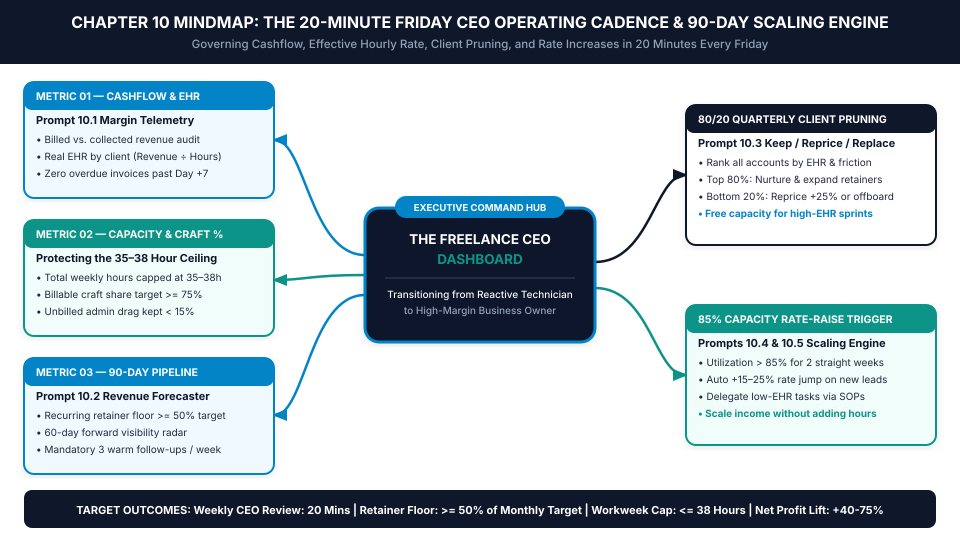
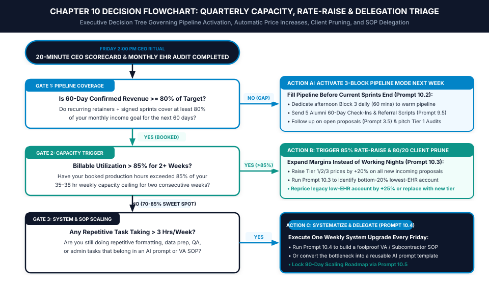

# Chapter 10: The Weekly CEO Review & 90-Day Scaling Roadmap

*How to Run Your Entire Freelance Business in 20 Minutes Every Friday, Prune Low-Margin Clients, and Scale Your Income Without Working More Hours*

---

## 1. Learning Objectives

By the end of this chapter, you will be able to:

- **Execute the 20-Minute Friday CEO Operating Cadence:** Govern your cashflow, capacity, 90-day pipeline, and system upgrades in four 5-minute blocks every Friday afternoon so you never fly blind again.
- **Audit Client-by-Client Effective Hourly Rate (EHR):** Use **Prompt 10.1** to expose hidden "whale traps"—high-revenue accounts that quietly consume so many unbilled hours that they pay less per hour than your smallest clients.
- **Eliminate the Feast-or-Famine Revenue Rollercoaster:** Deploy **Prompt 10.2** to maintain a rolling 60-to-90-day pipeline radar and trigger **3-Block Pipeline Mode** three weeks *before* a revenue dip hits your bank account.
- **Run the Quarterly 80/20 Client Pruning & Repricing Matrix:** Use **Prompt 10.3** and the **85% Capacity Rate-Raise Trigger** to systematically replace or reprice your bottom 20% lowest-EHR accounts while raising new-client rates by 15% to 25%.
- **Scale Beyond Your Personal Keyboard Hours:** Package repetitive lower-value sub-tasks into foolproof Virtual Assistant or subcontractor SOPs (**Prompt 10.4**) and lock your next **90-Day CEO Scaling Roadmap** (**Prompt 10.5**).

---

## 2. The Real-World Friction Point

Suppose you have installed Chapters 1 through 9 of this operating manual. You productized your core offer into three tiers, built a 10-minute proposal engine, locked your pricing with the B.C.R. formula, automated your 48-hour onboarding gate, cut production hours in half with the 20/60/20 Sandwich Method, defended your scope with the P.V.P. Protocol, eliminated status calls with Friday 3-Bullet Pulses, and started bridging one-off clients into retainers.

Compared to 95% of freelancers in the market, your craft and delivery engines are now operating at an elite level.

Yet one final structural trap still awaits almost every skilled independent practitioner: **The Reactive Technician Blind Spot**.

When business is busy—say, during a month where you are juggling three active client sprints and two retainers—you spend 100% of your cognitive energy *inside* client delivery. Because your calendar is full and money is hitting your Stripe account this month, you stop looking at your forward pipeline, you stop tracking how many hours each client is actually consuming, and you skip all business development for four straight weeks.

Then, in the first week of the next month, two sprints finish simultaneously. You open your laptop on Monday morning, look at your calendar, and realize with a cold jolt in your chest that your confirmed revenue for the next 30 days just dropped by 60%.

Panicked by the sudden pipeline cliff, you swing from 100% delivery mode into frantic prospecting mode. Even worse, because you feel financial urgency, you accept the first inbound lead that comes along—overlooking their P.A.C.E. red flags and discounting your rate just to get cash flowing again.

At the same time, a second invisible leak is silently draining your bank account: **The High-Revenue, Low-EHR "Whale Trap."**

Most freelancers judge their clients by **Gross Monthly Revenue** rather than **Realized Effective Hourly Rate (EHR)**. If Client A pays you $2,500 a month on a retainer, and Client B pays you $1,200 a month, you naturally assume Client A is your best client and treat them like royalty. Because they are your "biggest account," you tolerate their extra Slack messages, their unscheduled calls, their slow approvals, and their creeping task requests.

When you finally run the math at the end of the quarter, you discover a shocking truth:
- **Client A ($2,500/month)** consumed **42 hours** of production, communication, and revision time last month—yielding a realized Effective Hourly Rate of just **$59.52/hour**.
- **Client B ($1,200/month)** followed your async portal rules, approved work on Pass 1, and consumed just **6.5 hours** last month—yielding a realized Effective Hourly Rate of **$184.61/hour**.

Your "biggest client" is actually paying you **one-third as much per hour** as your smaller client, while monopolizing the exact 42 hours of capacity you needed to sign two more high-EHR accounts!

Without a weekly executive ritual that forces you to step out of the technician chair and inspect your numbers for twenty minutes every Friday, you will remain trapped on the feast-or-famine rollercoaster—working harder every year without ever increasing your net hourly take-home pay.

---

## 3. Why Standard Approaches Fail

Why do 90% of freelancers fail to run consistent weekly business reviews or scale their income predictably? Because conventional business advice is built for 50-person companies with dedicated finance departments, not solo operators.

### Failure Mode 1: Over-Engineered 3-Hour Accounting & Notion Dashboards
Many freelancers buy complex Notion templates or accounting spreadsheets that require logging 45 variables every day, categorizing every $4 coffee receipt on Friday afternoon, and maintaining 14 linked databases. The first Friday, the freelancer spends two hours filling it out. By Week 3, when a client deadline runs late on Friday afternoon, the two-hour review feels unbearable, so they skip it. Once you skip a complex system twice, it is dead forever. **If a weekly CEO review takes more than 20 minutes, a solo practitioner will not sustain it.**

### Failure Mode 2: Confusing Top-Line Revenue with Profitable Capacity
Standard freelance advice celebrates hitting arbitrary top-line revenue milestones (*"How I hit a $10K month!"*) while ignoring how many hours it took to earn that revenue. Earning $10,000 by working 72 hours a week across seven chaotic, underpriced accounts (`EHR = $34.72/hr`) is not a scalable business; it is a high-stress burnout trap. True scaling for an independent operator means **increasing your realized Effective Hourly Rate and recurring retainer baseline while holding your weekly hours strictly at or below 35 to 38 hours**.

### Failure Mode 3: Emotional Pricing & Fear of Firing Legacy Clients
Most freelancers only raise their rates when they feel angry, burned out, or desperate—and they keep legacy clients on outdated rates from two years ago out of guilt or fear of losing the revenue. Because they lack an objective, rule-based **Capacity Rate-Raise Trigger** and a structured **80/20 Client Pruning Protocol**, their roster stays clogged with low-margin legacy work, leaving zero calendar room for premium buyers who would gladly pay double.

---

## 4. Core Framework: The 20-Minute Friday CEO Operating Cadence

To transition permanently from a reactive technician into a calm, high-margin business owner, the AI Freelancer Operating System locks your entire executive governance into a single, non-negotiable weekly ritual: **The 20-Minute Friday CEO Operating Cadence**, paired with **The Quarterly 80/20 Client Pruning & 85% Capacity Rate-Raise Engine**.

```
+=============================================================================+
|             THE 20-MINUTE FRIDAY CEO OPERATING CADENCE (2:00 PM)            |
+=============================================================================+
|                                                                             |
|  MINUTE 00–05: BLOCK 1 — CASHFLOW, COLLECTIONS & EHR TELEMETRY              |
|  • Log cash collected this week vs. monthly target & recurring floor        |
|  • Check overdue invoices (> Day +1/+7) & trigger Prompt 7.5 if needed      |
|  • Update per-client hours & Realized Effective Hourly Rate (Prompt 10.1)   |
|                                     |                                       |
|                                     v                                       |
|  MINUTE 05–10: BLOCK 2 — CAPACITY & DEEP-WORK UTILIZATION AUDIT             |
|  • Verify total hours worked (Target <= 38h) & Billable Craft % (>= 75%)    |
|  • Check 85% Capacity Trigger: Were booked hours > 85% for 2 straight wks?  |
|  • If YES -> Activate automatic +15–25% Rate Raise on all new proposals     |
|                                     |                                       |
|                                     v                                       |
|  MINUTE 10–15: BLOCK 3 — 60-DAY PIPELINE & THE "3 WARM TOUCHES" RULE        |
|  • Audit confirmed revenue for next 60 days (Retainers + Signed Sprints)    |
|  • If < 80% of target -> Switch next week to 3-Block Pipeline Mode          |
|  • Execute 3 Warm Pipeline Actions (1 Proposal Follow-Up + 2 Alumni Pings)  |
|                                     |                                       |
|                                     v                                       |
|  MINUTE 15–20: BLOCK 4 — ONE WEEKLY SYSTEM UPGRADE & MONDAY LOCK            |
|  • Identify the #1 friction point from this week & fix the SOP/Prompt       |
|  • Lock Monday–Friday Morning Maker Blocks before closing laptop at 2:30 PM |
|                                                                             |
+=============================================================================+
```

### The Three Governing Laws of the Freelance CEO Engine

1. **Law 1 — The 20-Minute Friday Rule (Four 5-Minute Blocks):**
   Every Friday at 2:00 PM—immediately after dispatching your 25-minute batch of **Chapter 8 Friday 3-Bullet Status Pulses**—you set a 20-minute timer and open your **Weekly CEO Scorecard** (inside the Interactive Web Companion App `freelancer-os-app.html` or Notion Database 5). You spend exactly five minutes on Cashflow/EHR, five minutes on Capacity/Hours, five minutes on Pipeline/3 Warm Touches, and five minutes locking Monday's Maker Blocks. By 2:20 PM, your entire business is audited, your pipeline is fed, and your weekend begins with zero lingering cognitive open loops.
2. **Law 2 — The 85% Capacity Rate-Raise Trigger:**
   You never guess when to raise your prices. Whenever your **Billable Capacity Utilization** (booked client hours divided by your weekly target capacity of 35–38 hours) exceeds **85% for two consecutive weeks**, the system automatically triggers a **+15% to +25% price increase on all Tier 1, Tier 2, and Tier 3 proposals quoted to new inbound leads**. Because your calendar is already 85%+ full, you have zero emotional fear of a new prospect saying no—giving you effortless pricing authority.
3. **Law 3 — The Quarterly 80/20 Client Pruning & Repricing Audit:**
   On the final Friday of every quarter (every 90 days), you run **Prompt 10.1** and **Prompt 10.3** to rank every active client from highest to lowest **Realized Effective Hourly Rate (EHR)** and **Operational Friction Score (1–5)**. You then enforce a surgical rule on the **bottom 20% account** (your lowest-EHR, highest-friction client):
   - Either **Reprice & Restructure** them onto your current productized tier with a `+20% to +30%` rate adjustment (using Emergency Script 12 / Prompt 4.5),
   - Or **Gracefully Offboard & Replace** them as soon as your next higher-tier sprint or retainer closes—instantly freeing 25% to 35% of your weekly time while raising net profit.

### Visual Architecture: System Mindmap



---

## 5. Step-by-Step Implementation Protocol

### Step 1: Run the 20-Minute Friday CEO Scorecard Every Friday at 2:00 PM
Never close your laptop for the weekend without completing the four 5-minute blocks of your Weekly CEO Scorecard:

| 5-Minute Block | Exact Metrics Logged | Deterministic Action Triggered |
| :--- | :--- | :--- |
| **Block 1 (Mins 00–05): Cashflow & EHR** | 1. Revenue Billed & Collected ($)<br>2. Overdue Invoices (> Day +1)<br>3. Realized Weekly EHR (`$ Collected ÷ Total Hrs`) | If any invoice is `> 24h` overdue, send **Prompt 7.5 Stage 1/2** immediately before moving to Block 2. |
| **Block 2 (Mins 05–10): Capacity & Craft %** | 1. Total Working Hours (`Cap <= 38h`)<br>2. Billable Craft Hours % (`Target >= 75%`)<br>3. Booked Capacity Next 2 Weeks (`%`) | If Booked Capacity is `> 85%` for 2 straight weeks, raise new-lead proposal prices by `+20%`. |
| **Block 3 (Mins 10–15): Pipeline & 3 Touches** | 1. Recurring Retainer Baseline (`$ / % of Goal`)<br>2. 60-Day Confirmed Pipeline (`$ / % of Goal`)<br>3. Open Proposals Pending | Send **3 Warm Outbound Touches** before 2:15 PM (1 stalled proposal follow-up + 2 alumni 60-day check-ins). |
| **Block 4 (Mins 15–20): System Upgrade & Lock** | 1. #1 Time/Margin Leak This Week<br>2. One Prompt or SOP Updated<br>3. Next Week's 10 Morning Maker Blocks | Calendar-lock Monday–Friday `8:30 AM–11:30 AM` Maker Blocks and assign the exact deliverable for Monday Block 1. |

### Step 2: Execute the Monthly Client-by-Client EHR & Friction Audit
On the final Friday of each month, spend an extra 10 minutes running **Prompt 10.1 (Monthly Client-by-Client EHR & Profit Diagnostician)**.

For every client you served that month, input three numbers:
1. **Gross Fee Collected (`$`):** What they paid you this month.
2. **Direct Production Hours (`Bucket A`):** Deep craft hours spent building their deliverables.
3. **Hidden Communication & Revision Hours (`Bucket B`):** Time spent on calls, Slack threads, onboarding, and revision rounds for that specific account.

Calculate each client's **True Account EHR**:
$$\text{True Account EHR} = \frac{\text{Gross Fee Collected}}{\text{Direct Production Hours (Bucket A)} + \text{Admin/Revision Hours (Bucket B)}}$$

Pair this number with a simple **1-to-5 Friction Score** (`1 = Joyful, async, approves on Pass 1` to `5 = Draining, scope-pushing, constant interrupts`). Any client whose True Account EHR falls **more than 30% below your studio target EHR**—or who scores a `4 or 5` on Friction—is flagged yellow for your quarterly pruning review.

### Step 3: Route Your Business Through the Quarterly Capacity, Rate-Raise & Delegation Flowchart
Follow the **Chapter 10 Operational Decision Tree** every Friday afternoon to determine your exact strategic mode for the coming week:

- **Gate 1 — The 60-Day Pipeline Coverage Check:** *Is your confirmed revenue for the next 60 days (active monthly retainers + signed fixed-fee sprints) at least 80% of your monthly income target?*
  - **If NO (`Pipeline Gap Detected < 80%`):** Do not wait until your current projects finish to start selling. Activate **Action A (3-Block Pipeline Mode)** for next week: protect your two morning Maker Blocks for current client delivery, and dedicate your daily 60-minute afternoon block exclusively to sending **Prompt 9.5 Alumni Check-Ins**, **Prompt 3.5 Proposal Follow-Ups**, and pitching fast **Tier 1 Paid Diagnostic Audits** (from Chapter 2) using **Prompt 10.2**.
  - **If YES (`Pipeline Healthy >= 80%`):** Advance to **Gate 2**.
- **Gate 2 — The 85% Capacity & Pricing Trigger:** *Has your billable utilization exceeded 85% of your target weekly hours for 2+ consecutive weeks?*
  - **If YES (`At Capacity Ceiling`):** Trigger **Action B (The 85% Rate-Raise & 80/20 Pruning Protocol)**. Immediately increase your Tier 1, Tier 2, and Tier 3 package rates by `+15% to +25%` for all new prospects, and run **Prompt 10.3** to either reprice or offboard your lowest-EHR legacy client.
  - **If NO (`Balanced 70%–85% Sweet Spot`):** Advance to **Gate 3**.
- **Gate 3 — System & SOP Scaling Check:** *Are any repetitive production, formatting, QA, or administrative tasks still consuming more than 3 hours per week?*
  - **If YES:** Trigger **Action C (Systematize & Delegate)**. Run **Prompt 10.4** during your Friday afternoon System Upgrade slot to convert that repetitive 3-hour task into either a new automated AI prompt chain or a foolproof **Virtual Assistant / Subcontractor SOP Package** so you can buy back those hours at 20% of your EHR.

### Step 4: Map Your 90-Day Freelance CEO Scaling Roadmap
At the end of every quarter, run **Prompt 10.5** to lock your **90-Day Freelance CEO Scaling Roadmap**. Instead of setting vague annual resolutions (*"Make $150,000 this year"*), you lock four concrete 90-day operational targets:
1. **Target Recurring Retainer Floor (`MRR`):** Raising your predictable Day-1 monthly retainer baseline from `30% -> 50% -> 70%` of your target monthly income.
2. **Target Studio Floor EHR:** Raising your minimum acceptable Effective Hourly Rate by `+$20 to +$35/hr` each quarter via the 20/60/20 Sandwich Method and 85% Rate-Raise Trigger.
3. **One Quarterly Client Upgrade:** Replacing your single lowest-EHR account with a higher-tier productized sprint or retainer.
4. **One Reusable Studio Asset Built:** Adding one new high-converting case study, niche lead magnet, or delegated SOP to your studio vault every 90 days.

### Operational Decision Tree



---

## 6. Tested AI Workflow Prompts

The following five executive prompts power your Friday CEO Review, per-client EHR diagnostics, 90-day pipeline forecasting, 80/20 client pruning, and SOP delegation.

### Prompt 10.1: Monthly Client-by-Client Effective Hourly Rate (EHR) & Profit Diagnostician

- **Operational Objective:** Audit every active client on your roster by calculating their true Effective Hourly Rate (including hidden communication and revision hours), exposing "whale traps," and prescribing specific margin fixes.
- **When to Run:** On the final Friday of every month during your 20-Minute CEO Review.
- **Verification Rule:** Ensure you include both direct craft hours (`Bucket A`) and communication/revision/admin hours (`Bucket B`) for each client so the calculated EHR reflects reality.

```text
ROLE:
Act as a Chief Financial Officer and Margin Optimization Partner for a high-performing solo consultancy.

OBJECTIVE:
Audit my monthly client roster to calculate the True Realized Effective Hourly Rate (EHR) for every account, expose hidden "Whale Traps" (high-revenue but low-EHR clients), and prescribe immediate commercial adjustments.

STUDIO BASELINE TARGETS:
- Target Monthly Revenue Goal: $[INSERT GOAL, e.g., 10,000]/month
- Target Studio Weekly Hours Cap: [INSERT CAP, e.g., 36] hours/week
- Target Minimum Acceptable EHR: $[INSERT TARGET EHR, e.g., 150]/hour

RAW MONTHLY CLIENT TELEMETRY:
[LIST EACH CLIENT WITH:
- Client Name & Offer Type (Retainer vs. Sprint)
- Gross Revenue Collected This Month ($)
- Direct Craft Production Hours (Bucket A)
- Communication, Meetings, Revisions & Admin Hours (Bucket B)
- Subjective Friction Score (1 = Effortless to 5 = High Stress)]

OUTPUT REQUIREMENTS:
1. CLIENT PROFITABILITY & EHR RANKING TABLE:
   Generate a Markdown table ranking all clients from Highest True EHR to Lowest True EHR with columns:
   `[Rank | Client Name | Gross Revenue ($) | Total Hours (A+B) | Admin Drag % (B ÷ Total) | True Realized EHR ($/hr) | Friction (1-5) | Margin Status (STAR / HEALTHY / WHALE TRAP / BLEEDING)]`
2. STUDIO-WIDE EXECUTIVE TELEMETRY SUMMARY:
   - Total Revenue, Total Hours, Blended Studio EHR, and Total Unbilled Admin Drag Hours.
   - Calculate the "Opportunity Cost Leak": How much extra revenue I would earn if the hours spent on my lowest-EHR client were reallocated to my average/top EHR rate.
3. SURGICAL MARGIN PRESCRIPTIONS (CLIENT BY CLIENT):
   - For each client scoring `WHALE TRAP` or `BLEEDING`, provide the exact operational fix (e.g., enforce async portal rule to cut Bucket B hours by 50%, convert unbilled extras into a $X Change Order, or schedule a +25% rate adjustment).
```

---

### Prompt 10.2: 90-Day Revenue Pipeline & Feast-or-Famine Gap Forecaster

- **Operational Objective:** Forecast your confirmed vs. projected cashflow across the next 30, 60, and 90 days, detect any upcoming revenue cliffs early, and generate a high-probability **5-Day Warm Pipeline Action Plan** to fill the gap without cold-outreach panic.
- **When to Run:** Every Friday during Block 3 of your CEO Review (and in depth at the start of every month).
- **Verification Rule:** Only count signed contracts and active retainers as `Confirmed Revenue`; weight pending proposals at `40%–50%` so your forecast is conservative.

```text
ROLE:
Act as a Commercial Revenue Operations Director and Pipeline Strategist.

OBJECTIVE:
Analyze my current retainer baseline, active project milestones, and warm leads to forecast my 30/60/90-day cashflow, identify any upcoming "Feast-or-Famine" gap, and build a 5-Day Warm Pipeline Activation Plan.

PIPELINE & REVENUE INPUTS:
- Target Monthly Income Goal: $[INSERT TARGET, e.g., 8,500]/month
- Active Monthly Retainers (Recurring MRR):
  [LIST RETAINERS & MONTHLY AMOUNTS]
- Signed Fixed-Fee Sprints & Remaining Milestone Invoices (Next 60 Days):
  [LIST PROJECTS, AMOUNTS & EXPECTED COLLECTION DATES]
- Open Proposals Sent & Waiting on Decision:
  [LIST PROSPECTS, PACKAGE QUOTED, AMOUNT & DAYS SINCE SENT]
- Warm Alumni Clients (Completed 30–180 Days Ago) & Parked Phase-2 Backlogs:
  [LIST 3-5 PAST CLIENTS & ANY PARKED PHASE-2 IDEAS]

OUTPUT REQUIREMENTS:
1. 30 / 60 / 90-DAY REVENUE COVERAGE TABLE:
   Create a table showing `Month 1 (Next 30d)`, `Month 2 (31-60d)`, and `Month 3 (61-90d)` with columns:
   `[Window | Recurring Retainer Floor ($) | Confirmed Sprint Milestones ($) | Weighted Open Proposals (40%) | Total Projected ($) | Gap to Monthly Target ($)]`
2. PIPELINE MODE VERDICT:
   - State clearly whether I am in `GREEN (Booked >= 80% — Focus on Delivery & Rate Raises)` or `AMBER/RED (Gap Detected < 80% — Activate 3-Block Pipeline Mode)`.
3. THE 5-DAY WARM PIPELINE ACTION PLAN (HIGHEST PROBABILITY FIRST):
   Rank the exact 5 outreach actions I should execute next week during my afternoon 60-minute pipeline blocks (e.g., which open proposal to close with Prompt 3.5, which current sprint to pitch on a Prompt 9.4 Retainer Bridge, and which 3 alumni clients to ping with Prompt 9.5).
```

---

### Prompt 10.3: Quarterly 80/20 Client & Offer Pruning Audit (Who to Keep, Reprice, or Fire)

- **Operational Objective:** Perform a ruthless quarterly Pareto (80/20) audit across your client roster and service offers—generating the exact **Rate Uplift Memo** for legacy underpriced accounts and a graceful **Offboarding & Referral Transition Script** for low-EHR accounts you are replacing.
- **When to Run:** Once every 90 days on the final Friday of the quarter (or whenever your 85% Capacity Trigger fires).
- **Verification Rule:** Never fire a low-EHR client in anger before securing or queuing their replacement; always give a professional 30-day transition window or a repriced continuation option.

```text
ROLE:
Act as a Senior Managing Partner and Portfolio Restructuring Advisor.

OBJECTIVE:
Conduct a Quarterly 80/20 Client & Offer Pruning Audit on my practice, and draft the exact executive scripts to either reprice or gracefully offboard my bottom-20% lowest-EHR account.

QUARTERLY ROSTER & OFFER DATA:
- Summary of Clients, Monthly/Sprint Revenue, True EHR, and Friction Scores:
  [PASTE TABLE FROM PROMPT 10.1 OR LIST ACCOUNTS]
- My Lowest-EHR / Highest-Friction Account to Address:
  - Client Name & Current Rate/Scope: [INSERT CLIENT, RATE & SCOPE]
  - Why Their EHR Is Too Low: [e.g., "Legacy rate from 18 months ago ($1,200/mo) that now consumes 28 hours/month ($42.85/hr) while new clients pay $2,400/mo ($160/hr)"]
- My Preferred Outcome for This Account:
  [OPTION A: Reprice to $[New Rate]/month with tighter scope boundaries, OR OPTION B: Gracefully offboard at the end of next month]

OUTPUT REQUIREMENTS:
1. THE 80/20 PARETO DIAGNOSTIC:
   - Calculate what percentage of my net profit comes from my top 80% accounts vs. what percentage of my time/stress is consumed by the bottom 20% account.
2. SCRIPT A — THE LEGACY ACCOUNT RATE & BOUNDARY CALIBRATION MEMO (Use if Repricing):
   - Write a warm, high-status executive email (under 200 words) thanking them for the partnership, summarizing the ROI delivered over the past year, and announcing that as of `[Date — 30 Days Out]`, the account is transitioning to your updated 2026 productized structure at `$[New Rate]/month` (or offering a lighter Essential tier at `$[Lower Tier Rate]` with reduced scope).
3. SCRIPT B — THE GRACEFUL 30-DAY OFFBOARDING & HANDOVER NOTICE (Use if Pruning):
   - Write a classy, bridge-preserving notice explaining that due to upcoming studio capacity restructuring in Q[X], `[Next Month]` will be your final month managing `[Scope]`, and outlining a seamless 30-day handover + SOP transfer so their team doesn't miss a beat.
```

---

### Prompt 10.4: Subcontractor & Virtual Assistant Delegation SOP Package Builder

- **Operational Objective:** Convert any repetitive, lower-EHR task in your delivery or admin workflow (`$15–$40/hr` market replacement cost) into a complete, foolproof **Delegation SOP, Video Brief & QA Checklist** so a Virtual Assistant or junior subcontractor can execute it to your exact standard.
- **When to Run:** During Friday Block 4 (System Upgrade) whenever Gate 3 of the Chapter 10 Flowchart flags a repetitive task consuming `> 3 hours/week`.
- **Verification Rule:** Every delegated SOP must include an explicit **"Definition of Done" Binary QA Checklist** so the subcontractor checks their own work before submitting it to you.

```text
ROLE:
Act as a Principal Operations Engineer and Delegation Systems Architect.

OBJECTIVE:
Transform my rough description of a repetitive weekly task into a foolproof, step-by-step "Delegation SOP Package" that a Virtual Assistant or specialist subcontractor can execute with zero guesswork.

TASK TO DELEGATE:
- Task Name & Frequency: [e.g., Formatting & Uploading Client Blog Assets in Webflow CMS / Preparing Weekly Lead Enrichment CSVs / Initial QA Testing on Staging Links]
- Hours Currently Consumed per Week by Me: [e.g., 4.0 hours/week]
- My Raw Brain-Dump of How I Do This Task:
  [PASTE ROUGH STEPS, TOOLS USED, AND COMMON MISTAKES TO AVOID]
- Target Role Executing This SOP: [e.g., Technical Virtual Assistant / Junior Designer / QA Contractor]

OUTPUT FORMAT:
Generate a complete, copy-paste-ready Markdown SOP Document containing:
1. SOP HEADER METADATA:
   `[Task Title | Owner Role | Frequency | Target Completion Time | Tools & Access Needed]`
2. THE 3-MINUTE LOOM RECORDING OUTLINE (For Me to Record Once):
   - 5 bullet points showing me exactly what to demonstrate on screen in a 3-minute training video so I never have to explain this live again.
3. STEP-BY-STEP EXECUTION PROTOCOL:
   - Clear, numbered imperative steps broken into `Phase 1: Setup & Inputs`, `Phase 2: Execution Steps`, and `Phase 3: File Naming & Delivery`.
4. AI PROMPT ACCELERATOR FOR THE SUBCONTRACTOR (If Applicable):
   - A ready-to-run sub-prompt the assistant can use to speed up their part of the workflow.
5. MANDATORY "DEFINITION OF DONE" BINARY QA CHECKLIST:
   - 6 checkboxes `[ ]` the assistant must verify and sign off on before marking the task complete in Notion.
```

---

### Prompt 10.5: 90-Day Freelance CEO Scaling Roadmap & Rate-Raise Planner

- **Operational Objective:** Synthesize your current revenue, EHR, retainer baseline, and weekly hours into a concrete **12-Week (90-Day) CEO Scaling Roadmap** that increases net income by 25% to 50% while capping your workweek at or below 38 hours.
- **When to Run:** Once every quarter during your Quarterly CEO Planning Session (and whenever completing this book to lock your first 90-day rollout).
- **Verification Rule:** Verify that the roadmap never increases total working hours above your weekly cap—all revenue growth must come from **EHR expansion, Retainer Bridge conversions, 80/20 client upgrades, and rate increases**.

```text
ROLE:
Act as an Executive Business Coach and Strategic Scaling Advisor for elite independent practitioners.

OBJECTIVE:
Design a deterministic 90-Day (12-Week) Freelance CEO Scaling Roadmap that transitions my business from its current baseline to my 90-day target without exceeding my weekly hour ceiling.

CURRENT BASELINE vs. 90-DAY TARGETS:
- Current Monthly Revenue (3-Month Avg): $[INSERT CURRENT]/month -> 90-Day Target: $[INSERT TARGET]/month
- Current Recurring Retainer Baseline (MRR): $[INSERT CURRENT MRR]/month -> 90-Day Target: $[INSERT TARGET MRR]/month
- Current Average Weekly Working Hours: [INSERT CURRENT] hrs/wk -> Strict Weekly Cap: [INSERT CAP, e.g., 36] hrs/wk
- Current Blended Effective Hourly Rate (EHR): $[INSERT CURRENT EHR]/hr -> 90-Day Target EHR: $[INSERT TARGET EHR]/hr
- Current Tier 1 / Tier 2 / Tier 3 Package Prices: $[T1] / $[T2] / $[T3]
- Biggest Current Bottleneck: [INSERT #1 BOTTLENECK]

OUTPUT REQUIREMENTS:
Produce a comprehensive 1-Page "90-Day Freelance CEO Scaling Blueprint" structured into 4 sections:
1. THE SCALING MATH BRIDGE (How We Hit $[Target]/Month in [Cap] Hours/Week):
   - Show the exact mathematical mix of Recurring Retainers + Productized Tier 2 Sprints + Tier 1 Diagnostics required to hit the 90-day revenue goal at the new target EHR, with 6+ hours/week of slack buffer.
2. NEW 90-DAY PACKAGE PRICING & RATE-RAISE SCHEDULE:
   - Specify the exact updated prices for Tier 1, Tier 2, and Tier 3, plus the date and trigger for repricing/pruning the lowest-EHR legacy client.
3. MONTH-BY-MONTH MILESTONE ROADMAP (MONTH 1, MONTH 2, MONTH 3):
   - **Month 1 (Foundation & Margin Defense):** Top 3 system installations from Chapters 1–4.
   - **Month 2 (Execution Velocity & Async Control):** Top 3 workflow installations from Chapters 5–8.
   - **Month 3 (Retainer Expansion & 80/20 Pruning):** Top 3 LTV and scaling actions from Chapters 9–10.
4. NON-NEGOTIABLE WEEKLY CEO GUARDRAILS:
   - 4 hard circuit-breaker rules I must enforce every Friday at 2:00 PM to prevent backsliding into reactive technician habits.
```

---

## 7. Real-World Implementation Case Study

### Practitioner Profile
- **Name & Location:** Jordan K., Independent Technical SEO & Content Operations Consultant based in Melbourne, Australia (5 years independent, serving Australian and US e-commerce and B2B SaaS brands; figures below reported in USD equivalent).
- **Core Service Offering:** Technical SEO site architecture audits, programmatic content operations, and monthly organic growth retainers.
- **Target Buyer:** Heads of Growth, CMOs, and E-Commerce Founders.

### The "Before" Bottleneck (The $2,200/Month "Whale Trap" & 54-Hour Workweeks)
Jordan was earning **$5,400 USD/month** across five active clients, but he was working **54 hours every week** (`Blended EHR = $25.00/hr`) and constantly stressed:
1. **Zero Weekly Financial or EHR Visibility:** Jordan hadn't raised his rates in two years and never tracked hours per client. He assumed his largest retainer account—an e-commerce brand paying **$2,200/month** (41% of his income)—was his most valuable asset.
2. **The Hidden Whale Trap Discovery:** When Jordan finally ran **Prompt 10.1 (Monthly Client-by-Client EHR Diagnostician)** on his first Friday CEO Review, the math stunned him:
   - That "$2,200/month whale client" was demanding three weekly Zoom calls, sending 40+ Slack messages a week, and requesting endless ad-hoc URL redirects and manual content uploads—consuming **22.5 hours per week (`91.5 hours/month`)**.
   - Jordan's true realized Effective Hourly Rate on his biggest client was a dismal **$24.04/hour**!
   - Meanwhile, his three mid-tier retainer and audit clients ($1,000 to $1,200 each) followed his async portal workflow and yielded a True EHR of **$82.50/hour**.
3. **Feast-or-Famine Pipeline Neglect:** Because the $2,200 whale client ate 55% of his working hours, Jordan had zero time to follow up on warm leads or pitch retainers to his one-off audit clients.

### The 90-Day System Intervention
Jordan executed the Chapter 10 **Weekly CEO Review & 80/20 Scaling Protocol** over 90 days:
1. **Installed the 20-Minute Friday CEO Cadence:** Every Friday at 2:00 PM, Jordan audited his cashflow, logged per-client hours, and executed **3 Warm Pipeline Touches** (**Prompt 10.2**).
2. **Triggered the 85% Capacity Rate-Raise Rule:** Because Jordan was at 100%+ capacity in Month 1, he immediately raised his productized Technical SEO Sprint price for new leads by **+25%** (from `$1,600` to `$2,000`) and his new monthly Growth Retainer from `$1,200/mo` to `$1,650/mo`. Within 21 days, two warm alumni leads signed at the new pricing without hesitation.
3. **Executed the Prompt 10.3 80/20 Client Pruning & Repricing Audit:** With two new high-EHR accounts secured, Jordan sent **Prompt 10.3 Script A** to his legacy accounts:
   - One mid-tier legacy client happily accepted a rate calibration from `$1,000/mo` to `$1,450/mo`.
   - For the `$2,200/mo` ($24/hr) high-friction whale client, Jordan presented a firm boundary reset: either transition to an async, fixed-deliverable structure at `$3,200/mo` (zero ad-hoc Slack/calls) or complete a graceful 30-day offboarding. The whale client chose to offboard—instantly freeing **91.5 hours per month** of Jordan's life!
4. **Delegated Repetitive Data Prep via Prompt 10.4:** Jordan used **Prompt 10.4** to build a foolproof SOP for keyword clustering and schema markup QA, delegating **5 hours/week** of repetitive spreadsheet prep to a part-time technical VA at `$18/hour`.

### Before vs. After Operational Metrics (90-Day Post-Implementation Audit)

| Operational Metric | Before (Reactive Technician / Unaudited Roster) | After (Friday CEO Cadence + 80/20 Pruning) | Net Commercial Impact |
| :--- | :--- | :--- | :--- |
| **Monthly Net Revenue (USD Equivalent)** | $5,400 / month | **$8,600 / month** (net after VA cost) | **+$3,200 / month (+59.3% net income)** |
| **Total Weekly Working Hours** | 54.0 hours / week | **34.5 hours / week** | **-19.5 hours / week saved (-36.1%)** |
| **Blended Studio Effective Hourly Rate (EHR)** | $25.00 / hour | **$62.32 / hour** (and `$94/hr` on new sprints) | **+149.3% Effective Hourly Rate lift** |
| **Lowest-EHR Client on Roster** | $24.04 / hour (91.5 hrs/mo whale trap) | **$58.00 / hour** (floor enforced across all accounts) | **Whale trap permanently eliminated** |
| **Recurring Monthly Retainer Baseline (MRR)** | $3,200 / month (highly volatile) | **$6,600 / month** (across 4 async retainers) | **76.7% of monthly income locked on Day 1** |
| **Weekly Time Spent on Executive Governance** | 0 mins (flying blind) | **20 minutes every Friday at 2:00 PM** | **100% 90-day pipeline predictability** |

---

## 8. Common Operational Pitfalls & Fixes

| # | Common CEO & Scaling Pitfall | Why It Happens (Root Cause) | Immediate System Fix |
| :--- | :--- | :--- | :--- |
| **1** | **Skipping the Friday CEO Review When Client Work Runs Late:** Letting a Friday afternoon production task overwrite your 2:00 PM 20-Minute CEO Cadence. | Prioritizing urgent technician work over strategic business governance. | Treat your **Friday 2:00 PM–2:20 PM CEO Review** as an immovable board meeting with your most important client: your own company. Never allow client work past 1:30 PM on Fridays. |
| **2** | **Firing a Low-EHR Client in Frustration Before Priming the Pipeline:** Abruptly dropping a frustrating account on a bad Tuesday without having a replacement sprint or retainer lined up. | Emotional reactivity instead of sequenced portfolio management. | Follow the **Chapter 10 Sequence**: first activate **3 Warm Pipeline Touches/Week** (**Prompt 10.2**) and lock 1 new high-EHR sprint; *then* send **Prompt 10.3 (Reprice or 30-Day Offboard)** from a position of total financial calm. |
| **3** | **Hiring a Subcontractor or VA Without a Binary QA SOP:** Handing a vague task to a freelancer (*"Help me format these pages"*), getting sloppy work back, and concluding *"Nobody can do it as well as me."* | Delegating outcomes without documenting step-by-step mechanics and a binary Definition of Done. | Never delegate a task without first running **Prompt 10.4** to create a written step-by-step SOP, a 3-minute screen-recording demonstration, and a 6-item `[ ]` QA verification checklist. |
| **4** | **Waiting Until You Feel "Ready" to Raise Your Rates:** Keeping your package prices frozen for 12+ months because you worry the market won't pay more. | Making pricing an emotional confidence test instead of an automatic capacity rule. | Enforce the **85% Capacity Rate-Raise Trigger**: the moment your booked hours exceed 85% for two straight weeks, raise new-prospect proposal prices by `+15% to +20%` automatically. |
| **5** | **Scaling into an Accidental Low-Margin Agency:** Taking on 10 clients and hiring 4 full-time contractors, which explodes your management overhead and shrinks your personal take-home profit. | Confusing headcount growth with personal wealth and freedom. | Protect the **High-Margin Solo/Micro-Studio Model**: cap your active roster at **3 to 5 high-EHR accounts**, prune the bottom 20% every quarter, and use AI workflows (`Prompts 1.1–10.5`) plus targeted async SOPs instead of bloated payroll. |

---

## 9. Chapter Action Worksheet

Complete this worksheet inside your studio binder, in the Interactive Web Companion App (`freelancer-os-app.html`), or in standalone file `05-WORKBOOKS/worksheet-10.md` every Friday at 2:00 PM.

### Part A: The 20-Minute Friday CEO Weekly Scorecard

| 5-Minute CEO Block | Key Weekly Metric | This Week's Actual | Studio Target Benchmark | Action Triggered (`Green` / `Fix`) |
| :--- | :--- | :---: | :---: | :--- |
| **Block 1: Cashflow & EHR** | **1. Cash Collected This Week / Month-to-Date (`$`)** | `$________ / $________` | On pace for monthly goal | |
| | **2. Overdue Invoices > 24 Hours (`$` / `#`)** | `$________` (`___`) | `$0` (`0 overdue`) | |
| | **3. Realized Weekly EHR (`Revenue ÷ Total Hours`)** | `$________ / hr` | `>= $________ / hr` | |
| **Block 2: Capacity** | **4. Total Working Hours Logged This Week** | `______ hrs` | `<= 38.0 hrs` | |
| | **5. Billable Craft % vs. Unbilled Admin Drag %** | `____% / ____%` | `>= 75% Craft / < 15% Admin` | |
| | **6. Booked Utilization Next 2 Weeks (`%`)** | `______ %` | If `> 85%` 2 wks -> `+20% Rate` | |
| **Block 3: Pipeline** | **7. 60-Day Confirmed Revenue Coverage (`%`)** | `______ %` | `>= 80%` of monthly target | |
| | **8. Three Warm Pipeline Touches Sent Today** | `___ / 3 sent` | `3 / 3` every Friday | |
| **Block 4: System Lock** | **9. One SOP / Prompt Upgraded + Monday Locked** | `[ ] Done` | 10 Morning Maker Blocks set | |

### Part B: Quarterly 80/20 Client EHR & Pruning Matrix (Prompt 10.1 & 10.3)

Rank all active clients at the end of each quarter from highest to lowest True Realized EHR:

| Rank | Client Name | Monthly / Sprint Fee (`$`) | Total Hours (`Craft A + Admin B`) | True Realized EHR (`$/hr`) | Friction (`1–5`) | Quarterly 80/20 Decision (`KEEP & EXPAND` / `REPRICE +25%` / `OFFBOARD`) |
| :---: | :--- | :---: | :---: | :---: | :---: | :--- |
| **1 (Top)** | | `$` | `____ hrs` | `$____/hr` | `___ / 5` | |
| **2** | | `$` | `____ hrs` | `$____/hr` | `___ / 5` | |
| **3** | | `$` | `____ hrs` | `$____/hr` | `___ / 5` | |
| **4** | | `$` | `____ hrs` | `$____/hr` | `___ / 5` | |
| **5 (Bottom 20%)** | | `$` | `____ hrs` | `$____/hr` | `___ / 5` | |

---

## 10. Executive Summary & Implementation Checklist

### Key Chapter Takeaways
1. **What Gets Measured in 20 Minutes on Friday Gets Improved:** You do not need a 3-hour accounting ritual. Auditing Cashflow/EHR, Capacity, 60-Day Pipeline, and One System Upgrade in 20 minutes every Friday at 2:00 PM eliminates feast-or-famine surprises permanently.
2. **Rank Clients by True EHR, Never by Gross Revenue Alone:** A "$2,500/month whale client" that consumes 50 hours of high-stress chaos (`$50/hr`) is far less profitable than a "$1,250/month async client" that consumes 7 hours (`$178/hr`).
3. **Make Price Increases an Automatic Math Rule:** Whenever your booked capacity exceeds **85% for two consecutive weeks**, raise your new-client proposal prices by `+15% to +25%` automatically.
4. **Prune or Reprice the Bottom 20% Every Quarter:** Repricing or gracefully offboarding your single lowest-EHR account every 90 days frees up capacity for high-margin productized sprints and retainers—allowing you to double your net income while working 35 hours a week.

### Chapter 10 & Full-System Mastery Checklist
- [ ] Lock your recurring **Friday 2:00 PM–2:20 PM CEO Review** on your calendar and complete your first **Weekly CEO Scorecard** this Friday.
- [ ] Run **Prompt 10.1** on your last 30 days of client work to calculate the **True Realized EHR** for every active client on your roster.
- [ ] Run **Prompt 10.2** to forecast your next 60 days of confirmed revenue and execute your **3 Warm Pipeline Touches** every Friday afternoon.
- [ ] Run **Prompt 10.3** on your lowest-EHR account to prepare either a **30-Day Rate Calibration Memo** or a graceful **30-Day Offboarding Plan**.
- [ ] Use **Prompt 10.4** to delegate one repetitive 3-hour weekly task and run **Prompt 10.5** to lock your **90-Day Freelance CEO Scaling Roadmap**.

---

## 11. Sources & Operational References

1. **Koch, Richard (1998 / 2022).** *The 80/20 Principle: The Secret to Achieving More with Less.* Currency / Penguin Random House. — Empirical foundation for the **Quarterly 80/20 Client & Offer Pruning Audit**, demonstrating that 20% of client accounts typically generate 70%–80% of net studio profit while the bottom 20% generate 80% of administrative drag.
2. **Gerber, Michael E. (1995 / 2024).** *The E-Myth Revisited: Why Most Small Businesses Don't Work and What to Do About It.* HarperCollins. — Structural distinction between the **Reactive Technician** (working *in* the craft) and the **Systems-Driven CEO** (working *on* the operating architecture).
3. **Druker, Peter F. (1967 / 2006).** *The Effective Executive: The Definitive Guide to Getting the Right Things Done.* HarperBusiness. — Time-diagnostic principles governing executive time consolidation and systematic pruning of low-yield activities.
4. **Digital Knowledge Product Studio Market Audit (2026).** *Solo Practitioner Capacity, Retainer Baseline & Effective Hourly Rate Scaling Benchmarks (`01-MARKET-RESEARCH/sources.md`).* Longitudinal analysis of the 85% Capacity Rate-Raise Trigger across US, UK, Canadian, and Australian independent consultancies.
